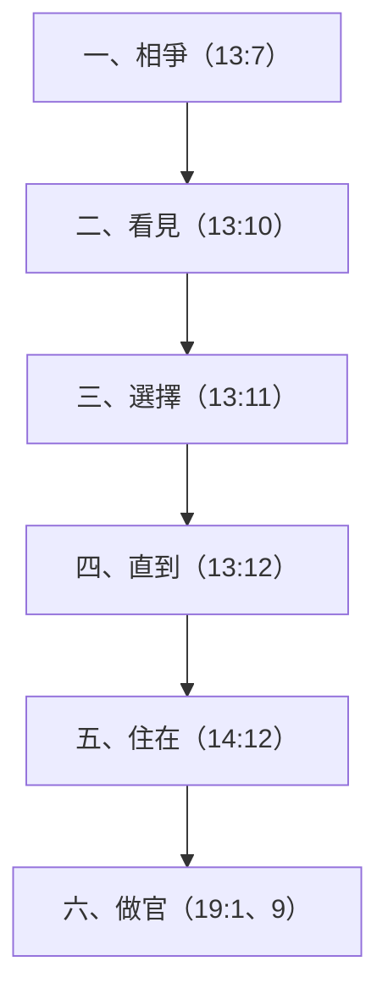

# 創世記 第13章

<!-- chapter-navigation:start -->
| [前一章](../01%20創世記/第12章.md) | [回目錄](../01%20創世記/全書目錄及綱要.md) | [下一章](../01%20創世記/第14章.md) |
| :--- | :---: | ---: |
<!-- chapter-navigation:end -->

1. [[亞伯蘭]]帶著他的妻子與[[羅得]]，並一切所有的，都從[[埃及]]上[[南地]]去。
2. [[亞伯蘭]]的金、銀、牲畜極多。
3. 他從[[南地]]漸漸往[[伯特利]]去，到了[[艾|伯特利和艾的中間]]，就是從前支搭帳棚的地方，
4. 也是他起先[[帳棚與祭壇|築壇]]的地方；他又在那裡[[求告耶和華的名]]。
5. 與[[亞伯蘭]]同行的[[羅得]]也有牛群、羊群、帳棚。
6. [[牧人水草與土地承載|那地容不下他們]]；因為他們的財物甚多，使他們不能同居。
7. 當時，[[迦南人]]與[[比利洗人]]在那地居住。[[亞伯蘭]]的牧人和[[羅得]]的牧人相爭。
8. [[謙讓|亞伯蘭就對羅得說]]：你我不可相爭，你的牧人和我的牧人也不可相爭，因為我們是[[骨肉原文作弟兄|骨肉【原文作弟兄】]]。
9. 遍地不都在你眼前嗎？請你離開我：你向左，我就向右；你向右，我就向左。
10. [[羅得]]舉目看見[[約但河]]的全平原，直到[[瑣珥]]，都是滋潤的，那地在耶和華未滅[[所多瑪]]、[[蛾摩拉]]以先如同[[耶和華的園子]]，也像[[埃及]]地。
11. 於是[[羅得的世俗選擇與後果|羅得選擇約但河的全平原]]，[[往東遷移]]；他們就彼此分離了。
12. [[亞伯蘭]]住在[[迦南地]]，[[羅得]]住在平原的城邑，漸漸挪移帳棚，直到[[所多瑪]]。
13. [[所多瑪]]人在耶和華面前罪大惡極。
14. [[羅得]]離別[[亞伯蘭]]以後，耶和華對亞伯蘭說：從你所在的地方，你舉目向東西南北觀看；
15. 凡你所看見的一切地，我都要賜給你和你的後裔，直到永遠。
16. 我也要使你的後裔如同[[後裔如地上的塵沙|地上的塵沙]]那樣多，人若能數算地上的塵沙才能數算你的後裔。
17. 你起來，[[走遍全地與土地所有權|縱橫走遍這地]]，因為我必把這地賜給你。
18. [[亞伯蘭]]就搬了帳棚，來到[[希伯崙]][[幔利]]的橡樹那裡居住，在那裡為耶和華[[帳棚與祭壇|築了一座壇]]。

---

## 本章知識節點

### 人物
- [[亞伯蘭]]
- [[迦南人]]
- [[比利洗人]]
- [[迦南人與比利洗人]]
- [[撒萊]]
- [[羅得]]

### 地點
- [[埃及]]
- [[南地]]
- [[伯特利]]
- [[艾]]
- [[迦南地]]
- [[約但河]]
- [[瑣珥]]
- [[所多瑪]]
- [[蛾摩拉]]
- [[希伯崙]]
- [[幔利]]

### 主題／神學
- [[亞伯拉罕之約]]
- [[帳棚與祭壇]]
- [[求告耶和華的名]]
- [[謙讓]]
- [[信心與世俗的對比]]
- [[羅得的世俗選擇與後果]]
- [[往東遷移]]

### 背景／原文
- [[牧人水草與土地承載]]
- [[面東定向的左右方位]]
- [[耶和華的園子]]
- [[骨肉原文作弟兄]]
- [[後裔如地上的塵沙]]
- [[走遍全地與土地所有權]]

---

## 本章整理

上一章結尾，亞伯蘭因稱撒萊為妹子，被法老召來責問，最後連同妻子和一切所有的被送出埃及（創12:18-20）。本章從他離開埃及寫起：他回到伯特利和艾之間先前築壇的地方，再次求告耶和華的名（第1-4節）；財物太多，兩家牧人相爭，亞伯蘭讓羅得先選，羅得選了約但河平原，帳棚漸漸挪向所多瑪（第5-13節）；羅得離開之後，耶和華重申土地與後裔的應許，亞伯蘭搬到希伯崙，在那裡築壇（第14-18節）。

### 回到伯特利與祭壇（1-4節）

亞伯蘭帶著妻子、羅得和一切所有的，從埃及『上』南地去（第1節），再從南地漸漸往[[伯特利]]去，到了伯特利和[[艾]]之間「從前支搭帳棚的地方」，也是他「起先築壇的地方」，他又在那裡[[求告耶和華的名]]（第3-4節）。說『上』南地，是因為迦南的地勢比埃及高（CT、丁良才）。

亞伯蘭下埃及的時候，聖書沒有提到羅得，丁良才說這是因為在那裡所遇的事與羅得無關；亞伯蘭回到迦南以後，聖書才多論到他。《聖經精讀本──創世記註解》指出，羅得的作用和命運，只有在與亞伯蘭的立約關係中才出現；他的後裔亞捫族和摩押支系，也只有在與選民以色列的關係中才出現在神政史中。

這家人是遊牧民族，途中必須定期停站，尋找水草放牧牛羊；主前第二千年紀初期，尼革地區（和合本作南地）的人口比現今稠密，或許能為這段行程提供沿途的驛站。從埃及邊界到伯特利和艾，大約是二百哩的行程。回到伯特利一帶，也顯示經文回到盟約的敘述，並為與羅得分離作好準備（《舊約背景註釋》）。

亞伯蘭是為了保全生命離開迦南，在埃及經歷屈辱的失敗和信仰上極大的損失，回到伯特利是為了恢復起初的信心（《精讀本》）。

> [!note] KC
> 我們若偏離了主，而主又使我們看清這一點，就必須回到最後與主同在的那個地方。跌倒之後蒙恢復的每一步，都會加深我們對神恩典的稱奇。

第4節的『求告』，CT 解為亞伯蘭恢復與神相交，重新過依靠神的生活；《精讀本》則說，這表明他痛心悔改自己在埃及的行為，帶著讚美和感恩決意重新開始（詩18:49；50:15）。BH 注意到兩個地名的意思：伯特利是『神的家』，艾是『廢墟』，兩地並列，顯出跟隨神與面臨毀滅之間的選擇。

第2節說亞伯蘭的金、銀、牲畜「極多」。這個詞在原文是 כָּבֵד מְאֹד（H3515 搭配 H3966），字典的意思是『沉重』加『很』，本節譯作『富有』；前章形容饑荒「甚大」（創12:10）用的是同一個字根，所以饑荒和財物都在試驗信心，本節潛伏著比饑荒更深的危機（CT）。CT 並說：「人即使能勝過饑餓，但不一定能勝過富足」。

### 水草、土地與牧人相爭（5-7節）

羅得也有牛群、羊群、帳棚，兩家的財物太多，那地容不下他們，不能同居（第5-6節）。兩家的牲畜太多，需要的草地也多（丁良才）；伯特利與艾一帶的水源和青草，已經不夠供給兩家的牛羊（《啟導本聖經創世記註釋》、《串珠聖經註釋》）。

在巴勒斯坦的山地放牧，要跟著季節尋找水草。四月至九月炎熱乾旱，牛羊必須趕到較高的地區，才找得到牧草和溪澗水泉；十月至三月較冷較濕，牲口才回到平原放牧。牧人若不想長期離開本村，就得接受無根的半遊牧生涯，全家隨牛羊移居；水草使用權的爭執，是牧人不和最常見的原因（《舊約背景註釋》）。

「容不下」的原文動詞是 נָשָׂא（H5375K），本節語境譯作『承載』，字典義是『舉起』『承擔』；說的是土地養不起兩個大牧群（參[[牧人水草與土地承載]]）。第7節牧人的『相爭』是 רִיב（H7379，語境譯義『爭吵』），第8節亞伯蘭要避免的是 מְרִיבָה（H4808，語境譯義『紛爭』）。

第7節又交代，當時[[迦南人]]與[[比利洗人]]在那地居住。比利洗人是住在迦南地的一個部族（《串珠聖經註釋》、《創世記雷氏研讀本》）。

牧人相爭，責任在誰？CT 說，羅得是被亞伯蘭帶領的人，理應認識自己的本分，卻縱容手下的牧人與亞伯蘭的牧人相爭，錯就顯在這裡；CT 又推測，羅得可能已經介入，或正在向亞伯蘭抗議。KC 則說，羅得並不是靠自己信心活著的人，他跟隨叔父的信心，自己也很富有，兩家的財富成了牧人相爭的起因。

迦南人和比利洗人就在旁邊看著。KC 說，這等於讓世人看著這些自稱是地上寄居者的人起爭執，魔鬼和世人都幸災樂禍，何況爭的又是地上的東西；保羅也勸哥林多的信徒，不要在這類事上堅持自己的權利（林前6:7）。信徒在外邦人眼前爭吵，最羞辱主名（CT）；丁良才也說，同族相爭，主的名就必受辱。

### 亞伯蘭提出分地（8-9節）

亞伯蘭在伯特利恢復信心之後，馬上面臨試煉。選擇關係到全部財產的草地，對他是個大試煉，就像他在埃及為保存己命而不顧妻子貞潔時所面對的一樣；但他紀念那位不顧他嚴重錯誤而拯救他的神，放棄自己的利益（第9節）、放棄世上的安逸，固守有神應許和築壇的迦南地。《精讀本》說，亞伯蘭藉著捨棄，成為信心的典範（太10:39）。

爭端出現後，亞伯蘭先開口：「你我不可相爭，你的牧人和我的牧人也不可相爭，因為我們是骨肉」（第8節）。和合本在『[[骨肉原文作弟兄|骨肉]]』旁的小字註明原文作弟兄。亞伯拉罕與羅得是叔姪（創12:5），原文的『弟兄』含義較廣，可指一切男性親屬和朋友，所以意譯作骨肉；創29:15 拉班對雅各說的『骨肉』也有同樣的小字。詞書把骨肉解作至親：雖然住在不同的地方也彼此相通，有病痛就互相救助，有憂愁就互相感受，活著一起歡樂，死了一起哀傷（李啟榮《聖經小字解》）。

亞伯蘭是長輩，按禮可以先選（CT、KC、丁良才），他卻把先選的機會讓給羅得。《雷氏研讀本》請讀者留意第8-9節的『請你』，這是亞伯拉罕對晚輩顯出的風度和寬宏大量。CT 說，亞伯蘭經歷了第12章的失敗以後，靈命長進不少，不再為自己的生存有所選擇。

他的讓法是把土地切成兩半：「你向左，我就向右；你向右，我就向左」（第9節）。以色列人面向日出的方向辨別方位，稱東為前邊、西為後邊、南為右邊、北為左邊，所以『向左』是向北，『向右』是向南（丁良才；參[[面東定向的左右方位]]）。

這樣的退讓是[[謙讓]]、和睦與信心的表現。亞伯蘭追求和睦，主動尋求解決紛爭的方法，又慷慨禮讓（《串珠聖經註釋》）；他不在乎眼前見得到的一切，因為信心的眼睛已看見比這更美更永久的家鄉（《啟導本》，來11章）。有信心的人總是讓別人先作選擇，因為知道神為他選擇的，總比人所選擇的要好得多（CT）。

《精讀本》把這個舉動聯想到耶穌的登山寶訓（太5:9、24），並說亞伯蘭的自我犧牲帶來三重效果：

1. 阻止了趁兩者不合之際，試圖掠奪他們財物的原住民；
2. 與羅得保持和平相處，沒有在外邦人社會中玷污神的聖名；
3. 藉著更加信靠屬天的基業，亞伯蘭的信心日益增長。

### 羅得選擇約但河平原（10-13節）

羅得舉目，看見[[約但河]]的全平原，直到[[瑣珥]]，都是滋潤的；經文說，那地在耶和華未滅[[所多瑪]]、[[蛾摩拉]]以先，如同[[耶和華的園子]]，也像[[埃及]]地（第10節）。從伯特利附近的山地，應該可以俯瞰約但河谷和死海北部地區。今日死海周圍不是宜人的地帶，但本節明言在審判之前情況截然不同；約但河沿岸的高原還有大片足以放牧的土地，可能也包括在本節的記載之內（《舊約背景註釋》）。

這一帶水源充足，是最肥沃的土地，作者用伊甸園和埃及地來描寫它的富饒（《串珠聖經註釋》）。灌溉系統在羅得時代以前已經使用很久；瑣珥是位於死海南端的一個小城（《雷氏研讀本》），名字就是比拉（創14:2；丁良才）。

於是[[羅得的世俗選擇與後果|羅得選擇約但河的全平原]]，[[往東遷移]]，兩人就彼此分離了（第11節）。KC 說，羅得雙手接下亞伯蘭的讓步，凡事看自己得多少好處，只顧眼前的享受，他的心跟著眼睛走，像夏娃一樣。

羅得本該讓亞伯蘭先選，理由有四：亞伯蘭年長（彼前5:5），羅得是跟隨亞伯蘭的（創12:4），羅得的產業多是因亞伯蘭得來的，那地又是神應許給亞伯蘭的（創12:7）（CT、丁良才）。《啟導本》說，羅得為平原和城邑所吸引，一點也不顧念亞伯蘭提到的骨肉之情。《精讀本》說，羅得從離開哈蘭以來一直活在亞伯蘭的影響之下，本當對亞伯蘭盡兒子般的義務，卻隨從世俗的誘惑，他的腦海裡仍留著以物質為中心的埃及人思想。

丁良才和 CT 都把羅得的錯分成三樣：眼錯（舉目看見全平原）、心錯（選擇全平原）、腳錯（往東遷移）。丁良才還打了個比方：有人從口袋裡拿出金幣、銀幣和銅幣讓外甥挑，小孩不知道金幣和銀幣的價值，只挑了那又大又亮的銅幣，等明白過來才後悔；信徒憑自己挑選也是這樣，亞伯蘭卻是神替他挑選（第14節）。CT 說，人所看為美的，不一定真正美麗，也不一定有益。

KC 還指出一個牽連：亞伯蘭偏離去埃及，使羅得也嘗到了埃及的味道。

> [!note] KC
> 倚靠別人信心的人，也會跌進那人的錯誤裡。亞伯蘭從偏離埃及一事學到了功課，羅得卻沒有顯出他學到什麼。……父母若偏離、有一段時間愛了世界，即使後來蒙神的恩典恢復、再次放下世界，他們的兒女卻可能已經嘗到世界的味道，並且留在其中。

第12節說，亞伯蘭住在迦南地，羅得住在平原的城邑，漸漸挪移帳棚，直到所多瑪。聖經每處地方都視約但河為迦南的東界（民34:1-12），羅得遷到平原的城邑，就清楚是離開了迦南地，把它完全讓給亞伯蘭（《舊約背景註釋》）。

『漸漸』二字，丁良才提醒：羅得起先並不預備進所多瑪城。CT 說，羅得先是選擇肥沃的平原，現在又選擇放棄遊牧生活，改為定居的城市生活，信心生活的方式已有重大變化；他明知所多瑪罪大惡極，仍漸漸移近，終於虧損（創14:12；19:15-38）。第13節說所多瑪人在耶和華面前罪大惡極，丁良才說這一節是插入的注解，顯明羅得所揀選之地的人如何（參創19章）。

丁良才從經文用字找出羅得退步的次序，一路連到創世記第19章：

CT 的《靈訓要義》也列出羅得失敗的六個步驟：縱容自己的牧人與亞伯蘭的牧人相爭（第7節）、以屬世的眼光舉目觀看（第10節）、自私地為自己選擇（第11節）、離開神所命定的地方（第11節）、漸漸地移近罪惡之源（第12節）、最後住在罪惡之地（第12-13節）。

這條路的終點，KC 說：羅得後來住在城裡的房子裡，帳棚不見了，甚至成了城裡議會的一員，坐在城門口。他在神的審判將要臨到的城裡定居，幫助建造它，因為他看見它的前景；結果失去一切，保住了身體，卻在洞穴的黑暗中結束一生，又與自己的女兒行了令人厭惡的事，生下以色列長久的仇敵。《精讀本》列出這個選擇的後果：被擄、城市和家產被毀、喪失妻子和女婿、與女兒亂倫，並把羅得看作信仰墮落者的預表：他被世俗的富裕和享樂吸引，在罪惡之城附近暫住，最終進入城市的深處。

### 神重申土地與後裔的應許（14-17節）

羅得離別亞伯蘭以後，耶和華對亞伯蘭說：從你所在的地方，你舉目向東西南北觀看；凡你所看見的一切地，我都要賜給你和你的後裔，直到永遠；我也要使你的後裔如同地上的塵沙那樣多；你起來，縱橫走遍這地（第14-17節）。亞伯蘭主動讓地之後，現在是神為他選地（《串珠聖經註釋》）。《精讀本》說，這是亞伯蘭自我犧牲的信仰得到神認可的場面；《雷氏研讀本》提醒，神再次確認把迦南地『永遠』賜給他和他的『後裔』，但他仍然沒有兒子。

《精讀本》說，『舉目……觀看』是要亞伯蘭克服與羅得訣別帶來的屬肉體的孤獨和傷心，用信心和期待的目光觀看立約之地。丁良才說，羅得離別後，神就賜福與亞伯蘭（箴3:5-6）。

亞伯蘭的『舉目』與第10節羅得的『舉目』前後呼應，原文兩處都用同一個動詞（H5375M，『舉起』）和同一個名詞（H5869A，『眼睛』）。CT 說，兩者不同：亞伯蘭是遵照神的指示去看，羅得是隨私慾的動機去看；亞伯蘭從東西南北看到神自己，羅得從全平原看到所多瑪。丁良才說，羅得舉目是隨自己的意思，求暫時的福氣，遇到非常的禍患；亞伯蘭舉目是因神的吩咐，得到永遠的應許，並與神交通。丁良才還整理出亞伯蘭一生四次的『舉目』：

| 次序 | 他舉目看見了什麼 |
|---|---|
| 第一次 | 看見地面的土地（創13:14） |
| 第二次 | 看見天上的眾星（創15:5） |
| 第三次 | 看見神派來的使者（創18:2） |
| 第四次 | 看見代替以撒的公羊（創22:13） |

對照第12章的應許，神在這裡把話說得更具體：

| 第12章的應許 | 第13章神所說的 |
|---|---|
| 「往我所要指示你的地去」（12:1） | 「從你所在的地方，你舉目向東西南北觀看」（13:14） |
| 「我要把這地賜給你的後裔」（12:7） | 「我都要賜給你和你的後裔，直到永遠」（13:15） |
| 「我必叫你成為大國」（12:2） | 「我也要使你的後裔如同地上的塵沙那樣多」（13:16） |

這塊地有多大？神起初給亞伯蘭的應許之地沒有劃定界限，人的信心有多大，便能取用多大；神要他向四周觀看，答應凡他見到的都可以走遍、取得（第17節），他相信，神便與他立約，把『從埃及河直到伯拉大河』之地賜給他（創15:18）（《啟導本》）。CT 也說，信心有多大，便能取用神的應許有多大。

這個應許要等到後來才兌現：神也將這地賜給以撒（創26:3）和雅各（創28:13；35:12）；亞伯蘭到底沒有得這地，他的後裔雖然得了迦南為業，所享受的不過是神所應許亞伯蘭之地的一部分（來11:9、13、39）；將來是必要得著的（太22:31-32）（丁良才）。

「[[後裔如地上的塵沙|塵沙]]」是修辭上的誇大語法，強調子孫眾多（《串珠聖經註釋》）。對年老無子的亞伯蘭來說，地上的塵沙、天上的眾星（創15:5）、海邊的沙（創22:17），都像夢一般的盼望；但這個應許在歷史上真的成就了（王上4:20），在屬靈方面也完全成就了（太8:11；羅4:16；加3:7、29）（《精讀本》）。丁良才和 CT 的屬靈讀法是：塵沙比屬地的後裔，創15:5 的『眾星』比屬天的後裔。

第17節的『縱橫走遍』，原文是 ק֚וּם הִתְהַלֵּךְ בָּאָרֶץ（『起來，在這地走一走』），後面接 לְאָרְכָּהּ וּלְרָחְבָּהּ（『按它的長、按它的寬』）。神的意思是要亞伯蘭憑著信心取得那地的所有權（書1:3；丁良才、CT）。BH 說，在古代近東，走遍一塊土地是宣示取得所有權的象徵性動作；第14節的向四方觀看，也反映了當時勘查土地的作法，是擁有權和祝福的記號。KC 說，亞伯蘭先看見全部，然後才能享受；他在這片土地上繼續走，就像取得了它。

CT 還有一個屬靈的讀法：『東西』加上『南北』構成十字架，『縱橫』的一豎一橫也是十字架，凡經過十字架處理的，遍地都成屬靈的產業（參[[走遍全地與土地所有權|縱橫走遍這地]]）。

### 希伯崙幔利的祭壇（18節）

亞伯蘭搬了帳棚，來到[[希伯崙]][[幔利]]的橡樹那裡居住，在那裡為耶和華築了一座壇（第18節）。『搬了帳棚』直譯是『他住帳棚』，或『一直遷移他的帳棚』，展示他對神應許之地的所有權；橡樹或作平原（《雷氏研讀本》）。

幔利是人名，也是地名。幔利是以實各和亞乃的哥哥，他們兄弟二人都與亞伯蘭有盟約（創14:13），這裡的橡樹是因幔利而起名（丁良才）。希伯崙後來名為基列亞巴（創23:2；士1:10），到約書亞的時候又稱原名希伯崙（書14:15）（丁良才）；《啟導本》說，希伯崙又名幔利、基列亞巴，聖經常用『幔利的橡樹』指這個地方。

這座城的位置，各家給的數字如下：

| 參考來源 | 對希伯崙位置的描述 |
|---|---|
| 《舊約背景註釋》 | 位於猶大山地，海拔約3,300呎；在耶路撒冷西南方約十九哩（約三十公里），別是巴東北方二十三哩 |
| 《串珠聖經註釋》 | 希伯崙與幔利指的是同一個地區，位在耶路撒冷以南三十二公里（二十哩） |
| 《雷氏研讀本》 | 位於耶路撒冷以南二十二哩（三十五公里） |
| 李道生《舊約聖經問題總解》 | 距離耶路撒冷南方大約六十五里 |

希伯崙是通往東面拉吉和北面耶路撒冷兩條古道會集之處，自古一直有人居住；當地的泉水和井水，足以種植橄欖、葡萄，並應付創世記23章所形容的那種半農牧經濟。聖經說希伯崙比埃及的鎖安城早七年被建造，據考證是主前十七世紀（民13:22）。和在伯特利一樣，在此築壇之舉將本城變為後世的宗教中心；族長後來在此埋葬，更加強了它在政治上的重要性（撒下2:1-7；15:7-12）（《舊約背景註釋》）。

亞伯蘭後來在這裡買地葬妻（創23:1-3），成了家族的祖墳地（創49:29-32）；以撒、雅各大部分時間也住在希伯崙（創37-45章）（《啟導本》）。李道生說，希伯崙是世界最古的一座城，後來被選作逃城；大衛三十歲的時候，以色列的長老們到這裡膏立他為王（撒下5:5），押沙龍也在這裡自立為王（撒下15:7-10），羅波安曾修築這城為保障（代下11:10）。

『帳棚』與『祭壇』是亞伯蘭生活的重要標記（《啟導本》）。丁良才說，亞伯蘭築壇，是神的應許（第14-17節）激動了他的心。KC 說，亞伯蘭沒有在所多瑪安頓，而是住在希伯崙；『希伯崙』的意思是『交通』，他活在與神的交通中，再次築壇敬拜。CT 的靈意註解把希伯崙解為交通與得勝，亞伯蘭在那裡築壇，表明他的信心經過試驗後沒有後退，反而更上一層樓。

### 兩條路：亞伯蘭與羅得（全章）

本章從亞伯蘭回到舊日的祭壇開始，到他在希伯崙築新壇為止；中間是兩個人面對同一片土地的兩種選擇。第14章羅得住在所多瑪，被擄去（創14:12）。

| | 亞伯蘭 | 羅得 |
|---|---|---|
| 選地 | 把先選的機會讓給羅得（13:8-9） | 舉目看見平原，就為自己選擇（13:10-11） |
| 住處 | 住在迦南地（13:12） | 住在平原的城邑，漸漸挪移帳棚，直到所多瑪（13:12） |
| 神的話 | 羅得離別以後，耶和華對他說話（13:14-17） | 本章沒有記載耶和華對羅得說話 |
| 祭壇 | 在幔利的橡樹那裡為耶和華築壇（13:18） | 本章沒有記載羅得築壇 |

原文用同一個動詞 וַיֶּאֱהַל（字根 אָהַל，H167，『支搭帳棚』）寫兩個人：第12節是羅得『漸漸挪移帳棚』，直到所多瑪；第18節是亞伯蘭『搬了帳棚』，來到希伯崙幔利的橡樹那裡，為耶和華築壇。

《啟導本》說，羅得眼前的富裕後來變成罪惡之源，他日趨孤立，陷在異族的仇視中（創14:12；19章），亞伯蘭因著信反得到極大的福分。KC 的歸納是：

> [!note] KC
> 羅得想要得著一切，結果失去一切；亞伯蘭撇下一切，結果得著一切。把選擇權交給神的人，永不失望（詩22:5）。

兩人的對照，另見[[信心與世俗的對比]]。

**參考資料**
代號：CT＝ccbiblestudy《逐節註解》；GT＝ccbiblestudy《拾穗》，彙集多本中文註釋；正文直接寫書名或作者的（如《丁道爾》、丁良才），都出自這裡；KC＝KingComments；BH＝BibleHub Study；STEP＝STEP Bible 原文資料（CC BY 4.0）
https://www.ccbiblestudy.org/Old%20Testament/01Gen/01CT13.htm
https://www.ccbiblestudy.org/Old%20Testament/01Gen/01GT13.htm
https://www.kingcomments.com/en/bible-studies/Gen/13
https://biblehub.com/study/genesis/13.htm
https://github.com/STEPBible/STEPBible-Data

<!-- appendix-links:start -->
## 附錄

### 相關地圖
- [[appendix/fhl_maps/maps/008|〈創圖三〉族長們於迦南地以外的活動]]
- [[appendix/fhl_maps/maps/009|〈創圖四〉亞伯拉罕的生平]]
- [[appendix/fhl_maps/maps/010|〈創圖五〉羅得和他的後代－摩押與亞捫]]
- [[appendix/fhl_maps/maps/017|〈創圖十二〉古埃及全圖]]
<!-- appendix-links:end -->

<!-- chapter-navigation:start -->
| [前一章](../01%20創世記/第12章.md) | [回目錄](../01%20創世記/全書目錄及綱要.md) | [下一章](../01%20創世記/第14章.md) |
| :--- | :---: | ---: |
<!-- chapter-navigation:end -->
