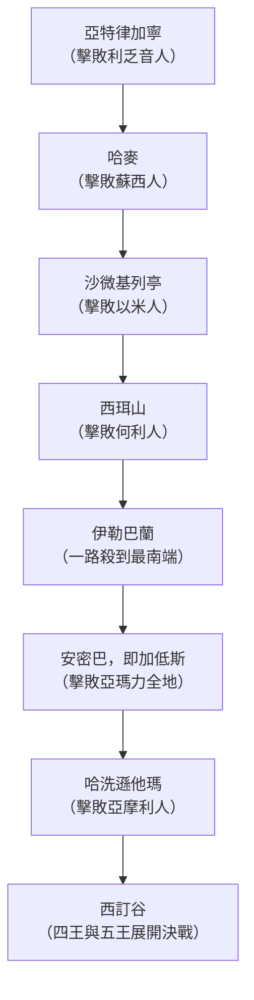

# 創世記 第14章

<!-- chapter-navigation:start -->
| [前一章](../01%20創世記/第13章.md) | [回目錄](../01%20創世記/全書目錄及綱要.md) | [下一章](../01%20創世記/第15章.md) |
| :--- | :---: | ---: |
<!-- chapter-navigation:end -->

1. 當[[暗拉非]]作[[示拿地|示拿]]王，[[亞略]]作[[以拉撒]]王，[[基大老瑪]]作[[以攔]]王，[[提達]]作[[戈印]]王的時候，
2. 他們都攻打[[所多瑪]]王[[比拉（所多瑪王）|比拉]]、[[蛾摩拉]]王[[比沙（蛾摩拉王）|比沙]]、[[押瑪]]王[[示納（押瑪王）|示納]]、[[洗扁]]王[[善以別（洗扁王）|善以別]]，和比拉王；比拉就是[[瑣珥]]。
3. 這五王都在[[西訂谷]]會合；西訂谷就是[[鹽海]]。
4. 他們已經事奉[[基大老瑪]]十二年，到十三年就背叛了。
5. 十四年，[[基大老瑪]]和同盟的王都來在[[亞特律加寧]]，殺敗了[[利乏音人]]，在[[哈麥]]殺敗了[[蘇西人]]，在[[沙微基列亭]]殺敗了[[以米人]]，
6. 在[[何利人]]的[[西珥山]]殺敗了何利人，一直殺到靠近曠野的[[伊勒巴蘭]]。
7. 他們回到[[安密巴]]，就是[[加低斯]]，殺敗了[[亞瑪力人|亞瑪力全地的人]]，以及住在[[哈洗遜他瑪]]的[[亞摩利人]]。
8. 於是[[所多瑪]]王、[[蛾摩拉]]王、[[押瑪]]王、[[洗扁]]王，和比拉王（比拉就是[[瑣珥]]）都出來，在[[西訂谷]]擺陣，與他們交戰，
9. 就是與[[以攔]]王[[基大老瑪]]、[[戈印]]王[[提達]]、[[示拿地|示拿]]王[[暗拉非]]、[[以拉撒]]王[[亞略]]交戰；乃是四王與五王交戰。
10. [[西訂谷]]有許多石漆坑。[[所多瑪]]王和[[蛾摩拉]]王逃跑，有掉在坑裡的，其餘的人都往山上逃跑。
11. 四王就把[[所多瑪]]和[[蛾摩拉]]所有的財物，並一切的糧食都擄掠去了；
12. 又把[[亞伯蘭]]的姪兒[[羅得]]和羅得的財物擄掠去了。當時羅得正住在[[所多瑪]]。
13. 有一個逃出來的人告訴[[希伯來人]][[亞伯蘭]]；亞伯蘭正住在[[亞摩利人]][[幔利]]的橡樹那裡。幔利和[[以實各]]並[[亞乃]]都是弟兄，曾與亞伯蘭聯盟。
14. [[亞伯蘭的愛心與勇氣|亞伯蘭聽見他姪兒【原文作弟兄】被擄去]]，就率領他家裡生養的精練壯丁三百一十八人，直追到[[但]]，
15. 便在夜間，自己同僕人分隊殺敗敵人，又追到[[大馬士革|大馬色]][[面東定向的左右方位|左邊]]的[[何把]]，
16. 將被擄掠的一切財物奪回來，連他姪兒[[羅得]]和他的財物，以及婦女、人民也都奪回來。
17. [[亞伯蘭]]殺敗[[基大老瑪]]和與他同盟的王回來的時候，[[所多瑪]]王出來，在[[王谷|沙微谷]]迎接他；沙微谷就是[[王谷]]。
18. 又有[[撒冷]]王[[麥基洗德]]帶著[[麥基洗德的餅和酒是否預表聖餐|餅和酒]]出來迎接；他是[[至高的神|至高神]]的祭司。
19. 他為[[亞伯蘭]]祝福，說：願[[天地的主]]、[[至高的神]]賜福與亞伯蘭！
20. [[至高的神]]把敵人交在你手裡，是應當稱頌的！[[亞伯蘭]]就把所得的拿出[[十分之一]]來，給[[麥基洗德]]。
21. [[所多瑪]]王對[[亞伯蘭]]說：你把人口給我，財物你自己拿去吧！
22. [[亞伯蘭]]對[[所多瑪]]王說：我已經向[[天地的主|天地的主─至高的神]][[至高的神|耶和華]]起誓：
23. [[亞伯蘭拒絕所多瑪財物|凡是你的東西，就是一根線、一根鞋帶，我都不拿]]，免得你說：我使[[亞伯蘭]]富足！
24. 只有僕人所吃的，並與我同行的[[亞乃]]、[[以實各]]、[[幔利]]所應得的分，可以任憑他們拿去。

---

## 本章知識節點

### 人物
- [[亞伯蘭]]
- [[羅得]]
- [[暗拉非]]
- [[亞略]]
- [[基大老瑪]]
- [[提達]]
- [[麥基洗德]]
- [[以實各]]
- [[亞乃]]
- [[寧錄]]

### 地點與群體
- [[示拿地]]
- [[以拉撒]]
- [[以攔]]
- [[戈印]]
- [[所多瑪]]
- [[蛾摩拉]]
- [[押瑪]]
- [[洗扁]]
- [[瑣珥]]
- [[西訂谷]]
- [[鹽海]]
- [[亞特律加寧]]
- [[哈麥]]
- [[沙微基列亭]]
- [[西珥山]]
- [[伊勒巴蘭]]
- [[安密巴]]
- [[加低斯]]
- [[哈洗遜他瑪]]
- [[幔利]]
- [[但]]
- [[大馬士革]]
- [[何把]]
- [[王谷]]
- [[撒冷]]
- [[利乏音人]]
- [[蘇西人]]
- [[以米人]]
- [[何利人]]
- [[亞瑪力人]]
- [[亞摩利人]]
- [[希伯來人]]
- [[亞摩利人幔利的橡樹]]
- [[以東]]
- [[示拿]]
- [[耶路撒冷]]

### 神學／主題／原文
- [[天地的主]]
- [[至高的神]]
- [[麥基洗德與基督豫表]]
- [[十分之一]]
- [[亞伯蘭拒絕所多瑪財物]]
- [[羅得的世俗選擇與後果]]
- [[亞伯蘭的愛心與勇氣]]
- [[得勝後的試探]]
- [[「希伯來人」的意義]]
- [[「麥基洗德」名字含義]]
- [[「撒冷」名字含義]]
- [[聖經第一場戰爭]]
- [[三百一十八人]]
- [[石漆]]
- [[面東定向的左右方位]]
- [[什一奉獻的起源]]
- [[四王與五王戰爭的屬靈意義]]
- [[耶和華的得勝]]
- [[至高神的祭司]]
- [[麥基洗德的豫表]]

### 解經爭議
- [[創世記14章四王的歷史辨識]]
- [[麥基洗德的身分]]
- [[麥基洗德的餅和酒是否預表聖餐]]

---

## 本章整理

前一章羅得選擇定居約但河平原，帳棚漸漸挪向所多瑪。本章東方四王前來討伐背叛的五王，攻破所多瑪，並把羅得和他的財物擄走。亞伯蘭聽見姪兒被擄，率領家裡的壯丁追擊，奪回所有人口與財物。凱旋歸來時，他先接受撒冷王麥基洗德的祝福並獻上十分之一，接著拒絕所多瑪王的財物，一根線、一根鞋帶都不拿。

### 四王與五王的戰爭（1-10節）

這是聖經記載的第一場戰爭。KC 說，這場戰爭被記下來，是因為亞伯蘭和羅得都牽涉在內，只是兩人的緣由截然不同。《聖經精讀本──創世記註解》說這場戰爭發生在亞伯蘭離開哈蘭約九年、八十四歲的時候，並列出記錄它的三個原因：關係到神政史的兩個重要人物亞伯蘭和羅得；表明了挪亞很早以前所說，閃族支配迦南族的預言（創9:25）；借羅得追求世俗繁榮的下場，警告今天的信徒。

東方四王攻打約但河平原的五王（第1-2節）。五王事奉基大老瑪十二年，到十三年就背叛了（第4節）；《串珠聖經註釋》說基大老瑪經過一年籌備，聯同三個盟國的君主來平亂。巴勒斯坦許多弱小的國家很早就被美索不達米亞的強國支配，每年要上繳一定數量的貢品；五王拒絕進貢，出於貪欲和驕傲，並不是因為強大（《精讀本》）。

| 東方聯盟（四王） | 約但河平原聯盟（五王） |
|---|---|
| 以攔王基大老瑪（聯盟首領） | 所多瑪王比拉 |
| 示拿王暗拉非 | 蛾摩拉王比沙 |
| 以拉撒王亞略 | 押瑪王示納 |
| 戈印王提達 | 洗扁王善以別 |
| | 比拉（也就是瑣珥）王 |

四王的來歷，《串珠聖經註釋》說示拿即巴比倫，以拉撒在巴比倫之北，以攔位於巴比倫的東面，戈印指巴比倫東北的地區。《舊約背景註釋》說以攔是當時美索不達米亞東面、從裏海到波斯灣整個地區（今日的伊朗）通用的名字，以拉撒與亞述的一個古名對應，戈印最不容易鑑定。學者多次考證這四王，想把他們與已知的歷史人物連結，一直沒有成功；四王的名字都很道地，卻沒有一個能與當時執政的君王連上關係（《舊約背景註釋》）。

暗拉非是不是漢摩拉比，各家說法不同。丁良才提到1901年在書珊城出土的黑色大石碑，上面所刻的就是這王所定的二百八十五條律法，大半是很文明的規則。李道生《舊約聖經問題總解》也提到這塊石碑，並指出巴比倫列王中沒有稱為暗拉非的王，許多歷史學家認為暗拉非就是哈慕拉比，這個說法仍然沒有足夠的證據。暗拉非不可能是罕摩拉比，因為罕摩拉比是較後期的人（《創世記雷氏研讀本》；參[[創世記14章四王的歷史辨識]]）。

第5-7節記四王沿途打勝仗，是本章唯一詳細的行軍路線：

經文只給了地名的順序，各家還原的路線不同：

- 四王順著王道，也就是約但河谷東緣的南北大道，自北至南行進，到達亞喀巴灣之後轉往西北攻打加低斯巴尼亞（當時名叫安密巴），再進入死海以東和以南的平原；行軍路程依時序排列，是古代文獻的一貫格式（《舊約背景註釋》）。
- 聯軍首先北上進軍大馬色，然後轉向約但河東岸，又南下至加低斯，再北上和五王交戰（《串珠聖經註釋》）。
- 入侵的路線向西北穿過南地，再折返西訂谷（《雷氏研讀本》）。

丁良才說，伊勒巴蘭是四王所到最南的地方，他們從死海東邊下去，從死海西邊回來。《精讀本》說這樣的戰略，是先攻克死海聯軍的友好合作勢力，阻止鄰族勢力集合，斷絕五王的供給和退路，並充分利用有利的戰略環境。

五王在[[西訂谷]]擺陣交戰（第8-9節）。西訂谷就是[[鹽海]]，意思是那谷後來成了鹽海的一部分（丁良才、CT）；李道生說，現在死海靠南端的三分之一，那時是一個平原。《雷氏研讀本》說西訂谷可能位於死海東岸伸出來的舌狀半島以南，在馬撒他附近，地質證據顯示該地區在亞伯拉罕時代曾因地震隆起。

第10節說西訂谷有許多石漆坑，所多瑪王和蛾摩拉王逃跑，有掉在坑裡的，其餘的人都往山上逃跑。死海地區的天然瀝青，古時用作防水材料和建築材料（BH）；這個地區瀝青盛產到從地底下冒上來，甚至浮在死海海面，石漆坑十分普遍（《舊約背景註釋》）。五王選在這裡擺陣，是以為那谷的地形能幫助他們得勝（丁良才），可是他們原想利用地形的險惡防守，結果卻自己掉在坑裡；CT 說，人所依仗的，往往反成了人的陷阱。

『掉在坑裡』有兩種讀法。《串珠聖經註釋》說石漆是黏性物質，有如修補馬路的柏油，任何人掉在坑裡就會被黏住，不能再逃跑；CT 與 BH 也讀成跌進坑裡遇難。《舊約背景註釋》則指出，原文譯作『坑』的字眼與舊約其他形容水井的字相同，一般是指掘出來的地點，換言之西訂谷有很多開採瀝青的礦坑，作為五王避難之處，他們是『自己吊下去』，不是『掉進坑裡去』。原文是 בֶּאֱרֹת בֶּאֱרֹת חֵמָר（H875 連用兩次，搭配 H2564『瀝青』），『掉』是 וַיִּפְּלוּ（H5307，『落下』）。

### 羅得被擄與亞伯蘭追救（11-16節）

四王把所多瑪和蛾摩拉所有的財物和糧食都擄掠去了（第11節），CT 說所擄的還包括人口（參第21節）。他們又把亞伯蘭的姪兒羅得和羅得的財物擄掠去了；經文特別交代，當時羅得正住在所多瑪（第12節）。上一章羅得只是漸漸挪移帳棚直到所多瑪，這時他已經住在城裡（參[[羅得的世俗選擇與後果]]）。《雷氏研讀本》說，他整天為所多瑪的邪惡憂傷痛苦（彼後2:8）。

KC 說，羅得在所多瑪經歷了內心的掙扎之後，又成了外面爭戰的戰利品；他選了自己在地上的份，那份被奪走了，連自由也失去。CT 說，羅得原為財物離開亞伯蘭，如今財物都被擄掠去了，他並沒有因此學到功課，結果相當淒涼（創19:23-38）。與惡人為鄰，必要因惡人受連累（丁良才）。

> [!note] KC
> 我們若因世界的享樂吸引而選擇住在世界裏、照它的樣式生活，就不要指望能逃過它的苦楚。

有一個逃出來的人告訴『[[希伯來人]]』亞伯蘭，他正住在亞摩利人幔利的橡樹那裡；幔利和以實各、亞乃都是弟兄，曾與亞伯蘭聯盟（第13節）。這是聖經第一次稱亞伯蘭為希伯來人（CT、《啟導本聖經創世記註釋》）。『希伯來』是『過來之人』的意思，指亞伯蘭從幼發拉底河東邊渡河而來（丁良才、李道生、CT）；也有說法認為這名稱來自祖先希伯（《雷氏研讀本》、《精讀本》；丁良才、李道生、《啟導本》也提到這一說）。

這稱呼起初是非以色列人為他們取的，含有輕蔑的意思，就像新約的『基督徒』一名（《啟導本》），初時只指外來的人，部分學者把它與古代文獻中流離失所的社會階層『哈比魯』連在一起（《舊約背景註釋》；參[[「希伯來人」的意義]]）。

KC 說，亞伯蘭是寄居的外人，與周圍的政治局勢無關，他住在幔利的橡樹那裡，幔利的意思是活力、肥沃，是得力量去爭戰的地方；CT 的靈意註解也把幔利讀成剛強、豐富。

亞伯蘭聽見姪兒被擄去，就率領他家裡生養的精練壯丁三百一十八人，直追到但（第14節）。『姪兒』原文作弟兄。亞伯蘭救羅得，既是公義的事，也是以善報惡（丁良才）；這是他生涯中唯一的軍事行動，出於幫助困境中親族的純正愛心，以及對勝利的確信、信心和勇氣（《精讀本》）。CT 說，亞伯蘭以數百名家丁去追擊四王的聯軍，證明他對人有愛心，對神有信心，知道神必為他爭戰（出14:14）；羅得雖然曾經虧負亞伯蘭，亞伯蘭還是關心他的安危。KC 說，羅得是信徒（彼後2:7-8 三次稱他為義人），生活卻很悲慘；羅得從被擄與獲救之後並沒有學到功課，仍然回到所多瑪，這並不減少亞伯蘭行動的意義。

三百一十八人在上古是一支強大的軍隊：亞瑪拿信集（主前1400年）記載，當時兩國交戰，打仗的軍兵數目只是二十至五十，三百一十八人加上盟友，足可和四王一戰高下（《串珠聖經註釋》）。形容這些人的字眼在舊約其他地方沒有再用過，卻出現在主前十五世紀一封亞喀得函件之內，亞伯蘭的家軍足以和當地任何一個武裝部隊匹敵（《舊約背景註釋》）。亞伯蘭的軍隊由自己部族中受過訓練的三百一十八人和少許同盟支援兵組成（第24節；《精讀本》）。丁良才從這個人數推算，亞伯蘭家中必有一千多人，已是富戶，有小王的樣式。

『壯丁』的原文是 חֲנִיכָיו（H2593），字義是受過訓練的人（CT）；『家裡生養的』使亞伯拉罕能放心把這個艱險漫長的任務交託他們（《雷氏研讀本》）。KC 說，這些人不但受過武器的訓練，也受過宗教原則的教導，因為亞伯蘭曾吩咐全家遵守耶和華的道（創18:19）。

亞伯蘭在夜間同僕人分隊殺敗敵人，又追到大馬色左邊的何把，把被擄掠的一切財物、羅得和他的財物，以及婦女人民都奪回來（第15-16節）。KC 說，他把人分開，從不同方向同時攻擊，使小隊伍看起來像一支大軍，又選在夜間突襲，基甸後來也是這樣做（士7:16）。CT 從經文的用語讀出亞伯蘭的聰明（在夜間）、勇氣（自己）、組織與謀略（同僕人分隊）和毅力（又追到）。夜間突襲的戰術，早至士師時代的埃及文獻和赫人典籍已有例證（《舊約背景註釋》）；《精讀本》說他趁敵人沉浸在勝利的喜樂當中夜襲，之所以能戰勝強國的正規軍，是因為對神的信心和正義的勇敢，正如打敗米甸人的三百基甸勇士（士7:7-23）。

第15節和合本作「大馬色[[面東定向的左右方位|左邊]]的何把」，左邊就是北邊，呼應創13:9 的方位習慣（丁良才）。何把離大馬色多遠，各家的數字不同：《串珠聖經註釋》說以北「約二百三十公里（一百五十英里）」，丁良才說相離約有二三十里路，準確位置難以確定（《雷氏研讀本》）。

原文動詞也把被擄與獲救對應起來：第12節四王『拿走』（לָקַח，H3947）羅得和他的財物，第16節亞伯蘭先『帶回』（שׁוּב，H7725）全部財物，接著再『帶回』羅得和他的財物，以及婦女和人民。

### 麥基洗德：撒冷王與至高神祭司（17-20節）

亞伯蘭殺敗基大老瑪回來的時候，所多瑪王出來，在沙微谷迎接他；沙微谷就是王谷（第17節）。沙微谷意為『王者之谷』，近耶路撒冷東面，有人認為就是汲淪谷（《啟導本》、《串珠聖經註釋》）；《舊約背景註釋》說最有可能是汲淪溪谷和欣嫩子谷接連之處，後來押沙龍在這谷立了一個紀念碑（撒下18:18）。

又有撒冷王[[麥基洗德]]帶著餅和酒出來迎接，他是至高神的祭司（第18節）。他的名字意思是『公義的王』（來7:2；《啟導本》、《精讀本》、《雷氏研讀本》），撒冷是耶路撒冷的簡稱，意思是『和平』（《啟導本》、《精讀本》；參[[「麥基洗德」名字含義]]、[[「撒冷」名字含義]]）。《舊約背景註釋》說，一般認為撒冷就是耶路撒冷，但早期基督教證據和馬底巴地圖都以它位於示劍；麥基洗德究竟是迦南人、亞摩利人，還是耶布斯人，不容易確定。

這是聖經第一次提到耶路撒冷，十九世紀末在埃及發現的亞馬拿泥版證實，耶路撒冷在亞伯蘭時代早已存在（《啟導本》）；特勒瑪迪克泥版（約主前2300年）也記載了耶路撒冷和數百個其他的地方名和人名（《雷氏研讀本》）。《雷氏研讀本》說，當時顯然有一群真正認識創造主的人住在耶路撒冷，受到身兼君王與祭司的麥基洗德統治。

麥基洗德是誰，各家整理出不同的看法：

- 他是外邦人中持有純真信仰的迦南王，這是三種看法中最恰當的一種；另兩種是虔誠的信徒把他看成閃、以諾或約伯，以及有人把他看成天使、聖靈或基督的顯現（《精讀本》）。
- 他是挪亞之子閃，這是希伯來人的傳說；另有人以為他是天使、道成肉身的神或彌賽亞（李道生）。
- 把他看成天使或基督的顯現不太可能，因為希伯來書的作者是以麥基洗德為基督的預表；在創世記裡他以平凡的歷史人物出現，用一般的舉止態度與亞伯拉罕對話（賈斯樂郝威《聖經難解經文詮釋手冊》）。
- 他是在該地區受人尊敬的王，亞伯蘭只是向他表達當受的敬意；『麥基洗德』可能是所有作撒冷王者的稱號；他也是基督的預表（《靈修版聖經註釋》）。

作為預表，詩篇110篇4節與希伯來書第7章以他來說明基督兼有君王與祭司的職分（《串珠聖經註釋》；參[[麥基洗德與基督豫表]]、[[麥基洗德的身分]]）。丁良才把這個預表分成四層：不屬利未族；大於亞伯蘭（受亞伯蘭的供給、為亞伯蘭祝福）；沒有記族譜的始終；是祭司又是王，即仁義王與平安王（來7:2）。《精讀本》說，麥基洗德在歷史上神秘地出現又突然消失，是聖靈遮掩了他的始和末。

至於麥基洗德帶出來的餅和酒，多數註釋讀成對得勝軍隊的慰勞與敬意：慰勞凱歸之師（CT），表示感激之心，給跟從亞伯拉罕的疲乏者加添心力（李道生；參申23:3-4、撒上17:17、尼13:2上）。《雷氏研讀本》說，這也是供應軍隊的口糧，表示欣賞和敬佩亞伯拉罕的勝利。這些都是友善而信賴的表示，象徵多於實際（《啟導本》）。

《舊約背景註釋》從政治面看：兩人同享筵宴，通常表示雙方立了和平協議，赫人條約就提到打仗時供應盟友食物；麥基洗德急著要和這個有戰績可誇的軍事勢力建立和好關係，亞伯蘭則藉送上十分之一表示降服，間接承認了麥基洗德的地位。

餅和酒與聖餐的關係，看法也不同。丁良才說，餅和酒不過是爽心飲食，後來聖所裡常陳設餅和酒（出25:29-30），以色列人吃逾越節羔羊時也吃餅和酒，所以主耶穌借用這兩種成分作聖餐的表像。KC 說這與主餐無關，主餐是紀念主耶穌之死的記念餐；這裡（在圖畫中）是主耶穌帶著加力的餅和使人喜樂的酒來，分發祝福。CT 的靈意註解也把餅和酒讀成屬靈生命的供應，餅滋養、飽足、加力，酒舒暢、復甦、激勵（參[[麥基洗德的餅和酒是否預表聖餐]]）。

麥基洗德為亞伯蘭祝福，說：「願天地的主、至高的神賜福與亞伯蘭！」又說至高的神把敵人交在亞伯蘭手裡，是應當稱頌的（第19-20節）。原文『祝福』的字根（H1288）連用三次：『為他祝福』、說亞伯蘭『蒙福』、說至高的神『當稱頌』。《精讀本》說，這是承認所有的祝福和勝利都源於神，並藉含有大有能力者之意的至高神性稱呼，告白神對被造物的主權和統治權。

『天地的主』在原文是 אֵל עֶלְיוֹן קֹנֵה שָׁמַיִם וָאָרֶץ（H410、H5945、H7069），קֹנֵה 本節的語境譯義是『創造者』，字典義是『買、取得』；CT 說『天地的主』是天地的擁有者。『至高神』是古代迦南一帶對主神的稱呼（《啟導本》），希伯來文是 El Elyon，強調神的力量和主權（《雷氏研讀本》）。亞伯蘭在第22節向所多瑪王起誓時用的是同一個稱號，並冠上耶和華的名，在二人面前見證唯一真神（《啟導本》、《舊約背景註釋》）。

亞伯蘭把所得的拿出[[十分之一]]給麥基洗德（第20節）。所得的是戰利品（CT、《雷氏研讀本》；來7:4），這是聖經中有關什一奉獻的最早例子，表明他對『天地的主』的感謝（《啟導本》）。丁良才說，這顯明在摩西的律法以先已經有人將十分之一獻給神，是承認神為至高至尊者；《雷氏研讀本》說，這份禮物是為了感謝神賜下戰爭的勝利，同時也感謝神的祭司在撒冷提供了避難所。

十分之一原本是人們為了供養在神殿服事的人，自發拿出家產或出產的十分之一上交的一種稅金，是非條文的制度，閃族文化圈以外也廣泛使用，日後才在摩西律法中成為有條文規定的法律（民18:21-32）（《精讀本》）。KC 說，當時十分之一的權利還沒有神的誡命規定；麥基洗德不屬利未支派，是憑自己的位格與職分收十分之一，所以比亞伯拉罕大（來7:6-7）。

### 拒絕所多瑪王的財物（21-24節）

所多瑪王對亞伯蘭說：「你把人口給我，財物你自己拿去吧！」（第21節）這是照當時的風俗，勝利者占有掠物，只請求歸還人丁（丁良才、《舊約背景註釋》）；CT 註明『人口』的原文直譯是『靈魂』。

亞伯蘭說，他已經向[[天地的主]]、[[至高的神]]耶和華起誓，凡是所多瑪王的東西，一根線、一根鞋帶都不拿，免得所多瑪王說『我使亞伯蘭富足』（第22-23節）。『起誓』在原文作『舉手』（CT、《雷氏研讀本》）。『天地的主、至高的神』正是麥基洗德祝福時所說的話，CT 說這表示麥基洗德的話對亞伯蘭產生了功效。丁良才說，亞伯蘭要把一切榮耀歸於神；他對撒冷王和所多瑪王並不一樣看待，是因所多瑪的惡極大（創13:13）（參[[亞伯蘭拒絕所多瑪財物]]）。

亞伯蘭為什麼拒絕？他知道賜他財富的乃是耶和華（《串珠聖經註釋》）。他怕因此負上任何義務，免得所多瑪王將來想重奪霸主之權時，要他作藩屬（《雷氏研讀本》）。

所多瑪王給的看似十分慷慨，從眼前看條件不錯，從長遠看後患堪虞（《精讀本》）。他對地上財富的取捨是有原則的（CT）。KC 則說，所多瑪王的提議暗藏大騙局，亞伯蘭看透了，不要世界所提供、世界可藉以向他提出要求的任何東西，何況他剛剛蒙了神的祝福，拒絕就容易得多。

這場協議可能還包括使條款正式化的書面合同，那份文獻的編排很可能和本章相仿，甚至可能是本章的素材（《舊約背景註釋》）。

兩位王先後出來迎接，KC 說，得勝的時刻總是危險的時刻：所多瑪王是撒但的圖畫，像『光明的天使』（林後11:14），但在這次會面之前，麥基洗德先遇見了亞伯蘭。CT 的靈意註解說，信徒真正的屬靈危機，並非在與魔鬼正面衝突的時候，而是在魔鬼企圖以笑臉迷惑的時候（參[[得勝後的試探]]）。

| | 麥基洗德（撒冷王） | 所多瑪王 |
|---|---|---|
| 身分 | 至高神的祭司 | 所多瑪王 |
| 他帶來了什麼 | 餅和酒，以及對亞伯蘭的祝福 | 「你把人口給我，財物你自己拿去吧」的提議 |
| 亞伯蘭的回應 | 把所得的拿出十分之一給他 | 連一根線、一根鞋帶都不拿 |

亞伯蘭只讓僕人所吃的，並與他同行的亞乃、以實各、幔利所應得的分，任憑他們拿去（第24節）。這表明他作人處事有分際，不替別人出主意，不慷他人之慨（CT），也讓同盟者有自由去接受應得的戰利品（《雷氏研讀本》）。

信徒最容易犯的錯誤，就是以自己的信仰為標準來判斷或定別人的罪；真正的信徒當像亞伯蘭一樣，保證別人正當的自由和權利，不從自己的尺度任意判斷信心軟弱的弟兄（《精讀本》；羅14:1-3、林前8:9、9:22-23）。自己在使用某些自由上所加的限制，不應強加在別人身上（KC）。

丁良才從本章看出亞伯蘭的八樣善心：

| 品格 | 出現在哪一節 |
|---|---|
| 忠心 | 第13、24節 |
| 愛心 | 第14節 |
| 膽量 | 第14節 |
| 聰明 | 第15節 |
| 寬宏 | 第16節 |
| 虔誠 | 第18-20節 |
| 樂施 | 第20節最後一句 |
| 節制 | 第21-23節 |

CT 的《靈訓要義》把亞伯蘭的榜樣分成五點：憑愛心為弟兄爭戰，憑信心戰勝這世界的王，憑感恩的心奉獻十分之一給神，憑敬畏神的心不肯沾染世俗的敗壞，憑通情達理的心尊重別人的權益（參[[亞伯蘭的愛心與勇氣]]）。

### 從救援到拒絕（全章）

本章從外邦帝國的征戰開始：東方四王擊潰五王聯盟，掠奪所多瑪，也擄走前一章定居在當地的羅得（第1-12節）。亞伯蘭隨後率領家丁奔襲救援，奪回全部人口與財物（第13-16節）。得勝歸來，他接受麥基洗德的祝福並獻上十分之一，又拒絕所多瑪王的財物（第17-24節）。

《啟導本》說，聖經歷史的主流發展與外邦的歷史開始交錯，亞伯蘭雖在這世界卻不屬這世界，他戰鬥殺敵，外交結盟，但時刻以神的交托為念（第20-22節）。KC 說，他沒有與世界連合，所以能勝過世界（約壹5:4）。KC 在本章開頭概括前一章兩人的選擇：羅得有爭戰，亞伯蘭有安息。

**參考資料**
代號：CT＝ccbiblestudy《逐節註解》；GT＝ccbiblestudy《拾穗》，彙集多本中文註釋；正文直接寫書名或作者的（如《丁道爾》、丁良才），都出自這裡；KC＝KingComments；BH＝BibleHub Study；STEP＝STEP Bible 原文資料（CC BY 4.0）
https://www.ccbiblestudy.org/Old%20Testament/01Gen/01CT14.htm
https://www.ccbiblestudy.org/Old%20Testament/01Gen/01GT14.htm
https://www.kingcomments.com/en/bible-studies/Gen/14
https://biblehub.com/study/genesis/14.htm
https://github.com/STEPBible/STEPBible-Data

<!-- appendix-links:start -->
## 附錄

### 相關地圖
- [[appendix/fhl_maps/maps/008|〈創圖三〉族長們於迦南地以外的活動]]
- [[appendix/fhl_maps/maps/009|〈創圖四〉亞伯拉罕的生平]]
- [[appendix/fhl_maps/maps/010|〈創圖五〉羅得和他的後代－摩押與亞捫]]
- [[appendix/fhl_maps/maps/011|〈創圖六〉北方四王攻打南方五王]]
<!-- appendix-links:end -->

<!-- chapter-navigation:start -->
| [前一章](../01%20創世記/第13章.md) | [回目錄](../01%20創世記/全書目錄及綱要.md) | [下一章](../01%20創世記/第15章.md) |
| :--- | :---: | ---: |
<!-- chapter-navigation:end -->
