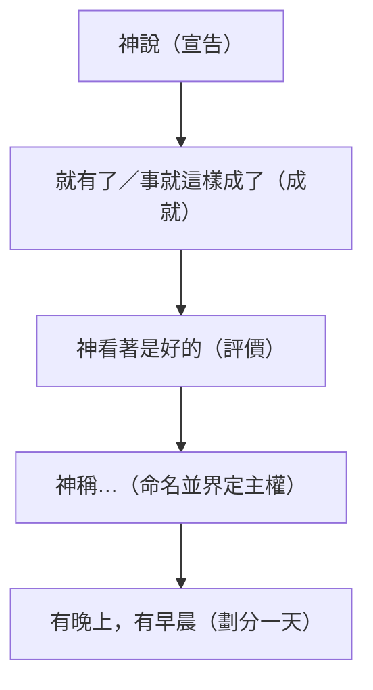

# 創世記 第1章

<!-- chapter-navigation:start -->
|  | [回目錄](../01%20創世記/全書目錄及綱要.md) | [下一章](../01%20創世記/第2章.md) |
| :--- | :---: | ---: |
<!-- chapter-navigation:end -->

1. 起初，神[[創造（從無到有）|創造]]天地。
2. 地是[[空虛混沌的原意|空虛混沌]]，淵面黑暗；[[神的靈的角色|神的靈]]運行在水面上。
3. [[神的話（創造媒介）|神說]]：要有光，就有了光。
4. 神看光是好的，就把[[光與黑暗的分別|光暗分開]]了。
5. [[神命名與主權|神稱光為晝，稱暗為夜]]。有晚上，有早晨，這是頭一日。
6. [[神的話（創造媒介）|神說]]：諸水之間要有空氣，將水分為上下。
7. 神就造出空氣，將空氣以下的水、空氣以上的水分開了。事就這樣成了。
8. [[神命名與主權|神稱空氣為天]]。有晚上，有早晨，是第二日。
9. [[神的話（創造媒介）|神說]]：天下的水要聚在一處，使旱地露出來。事就這樣成了。
10. [[神命名與主權|神稱旱地為地，稱水的聚處為海]]。神看著是好的。
11. [[神的話（創造媒介）|神說]]：地要發生青草和結種子的菜蔬，並結果子的樹木，[[各從其類]]，果子都包著核。事就這樣成了。
12. 於是地發生了青草和結種子的菜蔬，各從其類；並結果子的樹木，各從其類；果子都包著核。神看著是好的。
13. 有晚上，有早晨，是第三日。
14. [[神的話（創造媒介）|神說]]：天上要有[[光體作記號定節令|光體]]，可以分晝夜，作記號，定節令、日子、年歲，
15. 並要發光在天空，普照在地上。事就這樣成了。
16. 於是神造了兩個大光，大的管晝，小的管夜，又造眾星，
17. 就把這些光擺列在天空，普照在地上，
18. 管理晝夜，分別明暗。神看著是好的。
19. 有晚上，有早晨，是第四日。
20. [[神的話（創造媒介）|神說]]：水要多多滋生有生命的物；要有雀鳥飛在地面以上，天空之中。
21. 神就造出大魚和水中所滋生各樣有生命的動物，各從其類；又造出各樣飛鳥，各從其類。神看著是好的。
22. 神就賜福給這一切，說：滋生繁多，充滿海中的水；雀鳥也要多生在地上。
23. 有晚上，有早晨，是第五日。
24. [[神的話（創造媒介）|神說]]：地要生出活物來，各從其類；牲畜、昆蟲、野獸，各從其類。事就這樣成了。
25. 於是神造出野獸，各從其類；牲畜，各從其類；地上一切昆蟲，各從其類。神看著是好的。
26. [[神的話（創造媒介）|神說]]：我們要照著我們的[[形像與樣式|形像]]、按著我們的[[形像與樣式|樣式]]造[[人]]，使他們[[治理與管理|管理]]海裡的魚、空中的鳥、地上的牲畜，和全地，並地上所爬的一切昆蟲。
27. 神就照著自己的形像造人，乃是照著他的形像[[人的尊嚴與神的形像|造男造女]]。
28. 神就賜福給他們，又對他們說：要[[生養眾多與治理|生養眾多]]，遍滿地面，[[生養眾多與治理|治理]]這地，也要[[治理與管理|管理]]海裡的魚、空中的鳥，和地上各樣行動的活物。
29. [[神的話（創造媒介）|神說]]：看哪，我將遍地上一切結種子的菜蔬和一切樹上所結有核的果子全賜給你們作[[原初素食與受造界和平|食物]]。
30. 至於地上的走獸和空中的飛鳥，並各樣爬在地上有生命的物，我將青草賜給他們作[[原初素食與受造界和平|食物]]。事就這樣成了。
31. 神看著一切所造的都[[神看為好（甚好）|甚好]]。有晚上，有早晨，是第六日。

---

## 本章知識節點

### 神學
- [[創造（從無到有）]]
- [[神的靈的角色]]
- [[神的話（創造媒介）]]
- [[三位一體在創造中的隱現]]
- [[光與黑暗的分別]]
- [[形像與樣式]]
- [[人的尊嚴與神的形像]]

### 背景／結構
- [[空虛混沌的原意]]
- [[六日復造的結構]]
- [[光體作記號定節令]]
- [[與古代近東創世神話的對比]]

### 原文／文化
- [[各從其類]]
- [[治理與管理]]
- [[神命名與主權]]
- [[穹蒼（raqia）]]

### 主題
- [[生養眾多與治理]]
- [[神看為好（甚好）]]
- [[原初素食與受造界和平]]
- [[六日創造與信徒重生經歷]]

### 互文
- [[詩篇33篇神話語創造]]
- [[約翰福音1章道與創造]]
- [[詩篇8篇人的治理權柄]]
- [[創世記9章洪水後准吃肉]]

### 解經爭議
- [[創世記1章第1-2節間隔問題]]
- [[創造日長度問題]]

---

## 本章整理

〈創世記〉第1章是聖經的開頭：神在六日之內用話語創造天地，前三天分別光暗、上下的水和海陸，後三天用光體、水中和空中的生物、地上的動物與人把這些空間充滿（第3-31節）。第六天神照著自己的形像造男造女，託付他們管理全地，最後看一切所造的都甚好（第26-31節）。第2章接著講第七日的安息與伊甸園（創2:1-3）。

### 起初的創造與未成形的地（v1-2）

整章以「起初，神創造天地」（1節）開始。KingComments 說，人做東西需要材料，神不需要，祂憑自己的全能創造。

創世記的記述與[[與古代近東創世神話的對比|古代近東創世神話]]大不相同。《舊約背景註釋》說：「創世記的記述，則描繪神的創造與敵對勢力的爭戰無關，反而是個安詳而有條不紊的過程。」又說：「在聖經裡面，整個宇宙都是為人類而造，也是為人類而組織運作。人在神的計畫中是受造世界的焦點。」

BibleHub 說：「the biblical narrative uniquely presents God as sovereign over chaos, not battling it」（聖經的記述獨特地呈現神是混沌的主宰，而不是與混沌爭戰）。

> [!background]- 美索不達米亞的創世記述
> 《舊約背景註釋》說，美索不達米亞的創世記述是諸神爭戰的結果，組織宇宙的神需要勝過混沌的勢力；創世記則描繪神的創造與敵對勢力的爭戰無關，是個安詳而有條不紊的過程。

#### 「起初」是什麼時候？

這裡的「起初」跟約翰福音的「太初」不太一樣。本節的「起初」是指**時間的起點**（時間本身也是被造出來的），約翰福音 1:1 的「太初」則是指基督超越時空、本來就一直存在的本質（《聖經精讀本》、黃迦勒；見[[約翰福音1章道與創造|約1:1-3]]）。

#### 「創造」是什麼意思？

第1節的「[[創造（從無到有）|創造]]」宣告神完成的創造之工。黃迦勒說，「創造」的意思是「使無變為有(羅四17；來十一3)的嶄新創造」；丁良才、BibleHub 也這樣解釋（BibleHub 用的詞是 creation ex nihilo，從無創造）。

《串珠聖經註釋》說：「此詞在舊約出現了四十四次，每一次都描寫神造出了『簇新』的東西，是前所未有的」。

所以這裡的「創造」，講的是神從無中造出前所未有的東西。

「神」這個字在原文文法上是複數，動詞「創造」卻是單數。註釋家對這種搭配有不同的讀法。

丁良才說，「神」這個字「原文並非單數字式，乃是含有數位的意思。這樣，在聖書第一節中就暗示神是三位一體」。

BibleHub 說：「This plurality hints at the Trinity」（這個複數暗示[[三位一體在創造中的隱現|三位一體]]），也說三位一體的完整啟示在聖經後面才發展出來。

《啟導本》說：「也許隱含聖經後來清楚啟示的三位一體的奧秘（太三16；二十八19），但此處為加強意義的用法，表示神的偉大與華麗」，稱為『華麗的多數』。

BibleHub 也說這個複數形式「suggests the majesty and fullness of God」（表示神的威榮與完滿）。

所以這個複數有兩種讀法：三位一體的暗示（丁良才），或表示神偉大的『華麗的多數』（《啟導本》）；BibleHub 和《啟導本》兩種都提到。

> [!original]- 「創造」與「神」
> 第1節的「創造」使用動詞 בָּרָא（H1254A），意思就是「創造」。
>
> 「神」（אֱלֹהִים，H430）在文法上為複數名詞，動詞「創造」（בָּרָא）卻使用單數形式，呈現『神（複數）創造（單數）』的獨特結構。

#### 神的靈在水面上做什麼？

「[[神的靈的角色|神的靈]]運行在水面上」（2節），這裡的『運行』描寫靈的臨在。《聖經精讀本》與 BibleHub 把『運行』比作母鳥在雛鳥上空盤旋、輕輕護育，充滿生命力與親切的照料；KingComments 說這個『運行』有孵育的意思，讓人想到將要出現的新生命。

> [!original]- 「運行」
> 「運行」的原文是 מְרַחֶפֶת，字根 רָחַף（H7363），意思是盤旋／盤繞。

#### 「空虛混沌」是怎麼來的？

第2節的「[[空虛混沌的原意|空虛混沌]]」該怎麼解釋，是本章的第一個[[創世記1章第1-2節間隔問題|解經分歧]]。黃迦勒的原文字義說，「地是空虛混沌」（2節）的「是」有『發生了、變成了』的意思，倪柝聲說創1:2 的「是」與創19:26 的「變」原文相同（《聖經問答》）。《創世記雷氏研讀本》則指出，這個字在希伯來文雖可解作『變成』（如創19:26），子句的結構卻不支持把它讀成接續第1節之後發生的事。

> [!original]- 「空虛混沌」與「地是」
> 原文用了 to.hu（H8414，字典的意思是『不成形』）與 bo.hu（H922，字典的意思是『空虛』）這兩個詞，「地是」的動詞是 ha.yah（H1961，字典的意思是『是』）。

各家學者的看法並不相同：

| 立場 | 對「空虛混沌」的解讀 | 主要代表 |
| --- | --- | --- |
| 間隔／復造說 | 神一開始造的地球很美好，後來因為遭遇審判才變荒涼；第3節之後是神的『重新恢復與創造』 | 黃迦勒；拾穗收錄的丁良才、李道生 |
| 初始未成形說 | 地球一開始就是還沒成形、不適合居住的狀態，神接著才把它分別出來並充滿生命，這並不是審判的結果 | 拾穗（含《精讀本》、《雷氏研讀本》，這兩本明文反對『缺口說』）；BibleHub |
| 立場轉變 | 早期曾因為「未成形」這個詞而認為有審判間隔，後來改認為神可以先造出未成形的物質，再繼續塑造它 | KingComments |

認為兩節之間有間隔的，丁良才說：「在這兩節當中大概間隔好些年代。」

李道生說：「最初神創造大地，並非使地荒涼，後來因為魔鬼和罪的敗壞」，「才變成空虛混沌，淵面黑暗」。

認為一開始就是未成形的，拾穗說：「這強調的是一種荒蕪而空曠的狀態，沒有暗示地球曾經是完美的，而後來變得荒涼的意思。」

《雷氏研讀本》說：「子句的結構不支持一個連續的陳述句，形容一些發生在第1節之後的事情」。

《精讀本》說：「雖然神從無到有的創造,使宇宙形成了一定的狀態(chaotic),但地球還沒有完全形成適合人類居住的狀態(cosmos)」。

BibleHub 說：「This phrase describes the initial state of the earth as chaotic and uninhabitable.」（這句話描寫地起初的狀態是混亂、不適合居住。）

KingComments 說：「God can create something that is ‘formless and void’ and continue to work with it.」（神可以造出『未成形、空虛』的東西，再繼續在上面作工。）

### 前三天：神用話語帶來秩序與界線（v3-13）

前三天神做了三次分開的動作：分開光與暗（第3-5節）、分開上下方的水（第6-8節）、分開海與陸地（第9-10節）。《精讀本》與《雷氏研讀本》都列出這三次分開。《精讀本》說：「保羅用光和暗區別信和不信、義和不義、聖潔和不潔(林後6:14)。」

神所造用以分開上下之水的[[穹蒼（raqia）|穹蒼]]（第6-8節），也是日月星辰陳列的天空（第14-17節）。《舊約背景註釋》說：「古代近東文化將宇宙視為三層的結構，包括諸天、地、陰間。」又說，古代世人「所注重的卻不是物質上的成分，而是功用」。

> [!original]- 『穹蒼』
> 「穹蒼」的原文是 רָקִיעַ（H7549），基本意思為廣闊的空間。

#### 神怎麼創造？

推動這一切創造的是[[神的話（創造媒介）|神說]]。從第3節開始，『神說』這兩個字不斷出現，就像詩篇裡寫的：「他說有，就有，命立，就立」（[[詩篇33篇神話語創造|詩33:9]]；另見詩33:6），希伯來書11:3 也說宇宙是藉著神的話造成的。《丁道爾聖經註釋》指出，這八道命令使一切受造之物成形，不容人以為宇宙是自我存在的、是鬥爭的對象、毫無目的或是神性的衍生物；因沒有任何仲介者，『說』一字便具豐富的內容。

神也為造出來的東西命名：稱光為晝、暗為夜、空氣為天、旱地為地與海（第5、8、10節）。在當時的閃族文化裡，[[神命名與主權|命名暗示命名者對被命名者或物具有主權或所有權]]（《聖經精讀本》；見王下23:34）。

《聖經精讀本──創世記註解》將神的創造事工分為五個部分：

#### 第二天為什麼沒有說『好』？

第二天（第6-8節）沒有單獨說『神看著是好的』。黃迦勒說：「大概是因為天空中有屬靈氣的惡魔居住的緣故(弗六12)」。

KingComments 說：「However, at the end of all creation days, so including this second day, it says: “God saw all that He had made, and behold, it was very good”」（不過在所有創造日的最後，也包括這第二天，經上說：神看著一切所造的都甚好；31節）。

到了第三天，神命令地上發生青草和結種子的菜蔬，並結果子的樹木，果子都包著核，並且要「[[各從其類]]」（11-12節）。『各從其類』在本章一共出現十次。《創世記雷氏研讀本》說，生物的繁殖變種有不能超越的界限，但我們不可能知道這裡的『類』是相等於生物分類裡的科、屬，還是其他的類項。

> [!original]- 「各從其類」
> 「各從其類」的「類」，原文是 מִין（H4327）。

### 後三天：神讓萬物充滿世界（v14-25）

第四天神造了「[[光體作記號定節令|光體]]」（14節）來分開日夜、作記號、定節令與年歲（第14-19節）。經文沒有直接寫出日、月的名字，只說神造了「兩個大光」（16節）。

> [!background]- 為什麼不直接寫『日』和『月』？
> 這一段刻意避開了『日』和『月』這兩個字（因為那正是當時周遭國家太陽神和月神的名字），只稱呼它們為『兩個大光』（《舊約背景註釋》）。古代近東常把日月星辰神化，但這裡把它們寫成神所造、為神的旨意服務的受造物，不是神（BibleHub）。

日月星辰受神管理，神也按名字認識它們（賽40:26），它們絕不該被敬拜（KingComments）。KingComments 引用的申命記4:19 警告以色列人，抬頭看見日月星辰時，不要被勾引去敬拜事奉它們；17:3 則說，去拜日頭、月亮或天象，是主不曾吩咐的。

第五天，神用話語讓水中和空中充滿生物，並且第一次向受造物「賜福」（22節），要牠們繁衍充滿（第20-23節）。

第21節的「大魚」，《丁道爾》說：「對迦南人而言，這是個不吉祥的字，代表在世界的起頭與巴力對抗的深淵強權」，但「不過是龐大的受造物」。

BibleHub 說：「they are part of God's orderly creation」（牠們是神有秩序的創造的一部分）。

> [!background]- 古代近東神話裡的「大魚」
> 『大魚』這個字對迦南人是個不吉祥的字，代表世界起頭時與巴力對抗的深淵強權；但在這裡，牠們不過是龐大的受造物，和其他生物一同領受神的祝福（22節；《丁道爾》）。
>
> BibleHub 也指出，古代近東文化裡的海中生物常象徵混沌並與神明連在一起，但在這段經文裡，牠們卻是神有秩序的創造的一部分，顯出神掌管一切。

> [!original]- 「大魚」
> 「大魚」的原文是 הַתַּנִּינִם，字根 תַּנִּין（H8577）。

第六天神造了地上的動物，分為牲畜、昆蟲（爬行動物）和野獸三類（第24-25節）。《丁道爾》認為，第24節的三類動物可能廣泛而言，是指家畜、小動物和野獸。

後三天與前三天互相呼應：前三天是『分別』，後三天是『充滿』。丁良才把它排成了對照表，並說：「前三日的工是預備後三日的工，後三日的工是成全前三日的工」；KingComments 也逐天對應了起來（第四天對應第一天、第五天對應第二天、第六天對應第三天）：

| 前三天：劃分界線 | 後三天：充滿生命 |
| --- | --- |
| 第一天　光（v3-5） | 第四天　光體：日、月、星（v14-19） |
| 第二天　天空、上下方的水（v6-8） | 第五天　水族、鳥類（v20-23） |
| 第三天　陸地、植物（v9-13） | 第六天　動物、人類（v24-31） |

條目〈[[六日復造的結構|六日創造前後呼應的結構]]〉整理了這組對照。

### 第六天的高峰：照著神的形像造人（v26-31）

神在造人時的說法和其他受造物不同：「我們要照著我們的形像……造人」（26節）。黃迦勒說：「本節暗示三一神對於創造人，態度相當慎重，為此特地開了一個神格會議。」

#### 「我們」是誰？

《精讀本》列出四種解釋：神自我督促時使用的複數、舊約中三位一體的表達、神與天使之間的商議、希伯來人表達莊嚴時常用的複數，並說：「結合以後神的啟示,較恰當的解釋應該是②,創造事工是神的三個位格——聖父,聖子,聖靈完美的傑作。」

賈斯樂郝威也列出幾種說法。有人說這是神向天使說話，他說：「這種解釋並不太對」。有人說「我們」表示三位一體，他舉出約1:1的聖子有份於創造，創1:2「聖靈也同等的在創造過程中有份」。希伯來文法學者則認為這句話「不能用以證明是三位一體」。他自己的結論是：「在新約聖經確實很清楚的教導神的三位一體」。

《啟導本》和《雷氏研讀本》把『我們』讀成威嚴、華麗的複數：《雷氏研讀本》說：「這裏使用複數來表達一種威嚴」。

#### 什麼是神的形像？

原文中，「[[形像與樣式|形像]]」出現了三次，「樣式」出現了一次，是兩個不同的名詞。黃迦勒的原文字義說「形像」包含可見與不可見，「樣式」只指可見的，並說「形像」指裏面的性情，包括心思、情感和意志。《串珠聖經註釋》指出，人像神卻不是神，與神有特別關係，能與神相交，也在地上作神的代表。

丁良才說，照著神的形像造的人，有永不死的靈，也有自知、想像、理想和自主的能力。人原來是正直、聖潔的，這兩樣因犯罪而失去了，但凡信靠耶穌的人仍能得回（西3:10；弗4:23-24）。

神「照著他的形像[[人的尊嚴與神的形像|造男造女]]」（27節）。《丁道爾》指出，耶穌把這句話當作婚姻的兩大基礎之一（見可10:6-7），這也預示了新約中男女在靈性上的平等（見加3:28）。

拾穗說，人無分男女，都是照神的『形像和樣式』造的，有人格、理性和道德意識，會思想、有感情、有意志，「人因此應該受到尊重，也應自尊」。KingComments、BibleHub 也這樣說；《精讀本》並說：「男人和女人是平等的存在」。

#### 人可以任意使用地球嗎？

接著神交託給人類[[生養眾多與治理|生養眾多、遍滿、治理地球]]的任務，以及[[治理與管理|管理]]海、空、地上的動物（第28節；這呼應了[[詩篇8篇人的治理權柄|詩篇第8篇]]）。第28節神將託付賜給全人類，用兩個動詞宣告治理的使命。

> [!original]- 「治理」與「管理」
> 第28節以兩個動詞宣告治理使命：『制伏』（כָּבַשׁ，H3533）這地，並『管理』（רָדָה，H7287）海空地上的各樣活物。

《啟導本》說：「是神和人所立管理地球的大憲章」，也說：「不可濫用、浪費、破壞神所造的大地」。

BibleHub 說：「The concept of ruling is not one of exploitation but of responsible governance」（治理的概念不是剝削，而是負責任的管理），並以那位服事並為百姓犧牲的耶穌基督為例（可10:42-45）。

#### 起初人和動物吃什麼？

最後神安排了食物：結種子的菜蔬和樹上的果子給人，青草給地上的走獸和空中的飛鳥（29-30節），也就是[[原初素食與受造界和平|人類墮落前大家都是吃素的]]。丁良才說：「當時神只叫人吃蔬菜，世上沒有流血的事。到洪水以後神才准人吃肉」（見[[創世記9章洪水後准吃肉|創9:3]]）。黃迦勒、《精讀本》也這樣解釋。

KingComments 說，起初「nor do the animals eat each other」（動物也不互相吞食）。

這種和平，黃迦勒說：「將來到了千年國度，野獸將會馴良如初(賽十一6~9)」。

KingComments 說：「the killing in the realm of the animals will stop」（動物界的殺戮將會停止）。

《精讀本》說：「因此,必然需要藉著彌賽亞流血,再次創造樂園(賽11:6-9)」。

《丁道爾聖經註釋》說：「不可太過強解，說一切生物原來都是素食的」；「這只是概說，指出所有生命都直接、間接仰仗植物菜蔬；本節的要點是說明，所有生物都從神的聖手中得到餵養」。

至此「神看著一切所造的都[[神看為好（甚好）|甚好]]」（31節）。KingComments 說，神看了這一天的成果，「He can have it recorded as a conclusion of the entire work of creation」（祂可以把這句話記下來，作為整個創造工作的總結），又說：「This means that everything is perfect, so that every creature serves the purpose for which God created it.」（這表示一切都是完美的，每一個受造物都達成神創造牠的目的。）

> [!original]- 「好」與「甚好」
> 前面六次宣告的『好』，原文是 טוֹב（H2896A）；第31節的『都甚好』是 טוֹב מְאֹד（H2896A 搭配 H3966）。

丁良才在第31節下說，聖經論神的作為有四層。這四層分別是：浩大的（詩111:2；啟15:3）、奇妙的（啟15:3；詩139:14）、完全的（申32:4），最後是『甚好』的。

### 「創造」動詞的三處飛躍（v1, 21, 27）

原文裡的「創造」（*bara*）在本章出現在三個地方、總共五次：第1節和第21節各一次，第27節連續用了三次。丁良才與黃迦勒把這三個地方分別整理為物質、生命、人類：

| 「創造」出現的位置 | 造了什麼 | 意義上的飛躍 |
| --- | --- | --- |
| 1 節 | 天地（物質宇宙） | 從無 → 物質 |
| 21 節 | 大魚與水中動物（動物生命） | 物質 → 生命 |
| 27 節 | 人類 | 生命 → 人類 |

本章還有另一個表示『造／做』的字 *asah*。《雷氏研讀本》說 bara 的意思在本質上跟 asah 相同；黃迦勒則說「創造」是從無造出有來，「造」是從已有的東西造出另一種東西，或給予新的擺設。

> [!original]- 「創造」和「造」
> STEP 顯示本章表示『造／做』的另一個字 asah（H6213H）出現七次。

### 六天的一天有多長？（v5、8、13、19、23、31）

至於[[創造日長度問題|六天裡的「一天」到底有多長]]，BibleHub 提出了『普通的二十四小時』與『一段漫長的時期』兩種看法：有人把它看成字面的二十四小時，理由是經文說『有晚上，有早晨』，許多保守派學者持這種看法；也有人把它看成象徵較長的時期。拾穗也說，六日創造主要有兩種解釋：把『日』解為一天，因為經文說『有晚上，有早晨，這是頭一日』；或把『日』解為一個時期或一個階段。

KingComments 則主張六天是普通的二十四小時，理由有兩個：經文說『有晚上，有早晨』；而『日』這個字單獨使用時，在創世記裡都是一般意義的一天（創8:22；29:7）。KingComments 並引出埃及記20:11，說神是在六日之內創造天地。

### 六日創造與信徒生命重生的靈意讀法

在歷史與文字層面的解讀之外，黃迦勒與 KingComments 把這六天的順序，看作是[[六日創造與信徒重生經歷|信徒生命重生的縮影]]。

> [!application]- 從六日的復造看信徒重生的經歷
> 下面照黃迦勒〈從六日的復造看信徒重生的經歷〉的分法：
>
> - 第一天：聖靈運行與蒙光照
> - 第二天：分別屬天與屬地
> - 第三天：脫離死亡、心田結出果實
> - 第四天：站穩屬天的地位發光
> - 第五天：勝過環境的考驗
> - 第六天：生命成熟、彰顯神的形像並掌權
>
> KingComments 也把整章看成是神終極計畫的縮影：神把大自然交給亞當夫婦，未來也要把萬有交給「末後的亞當」基督與教會，基督最終必成為宇宙的中心。

### 從起初創造到受造界秩序（全章）

全章從神起初創造天地開始，地原是空虛混沌、淵面黑暗，神的靈運行在水面上（第1-2節）。神藉著話語在六日內循序建立受造秩序：前三天分別光暗、上下方的水與陸地海洋，劃定界限；後三天造光體、水族飛鳥、陸地動物與人類，使萬物各從其類並充滿全地（第3-25節）。第六天神照著自己的形像造男造女、交託治理使命，最後看一切所造都甚好（第26-31節）。

本章的四個重點各有條目說明：[[創造（從無到有）]]說神從無到有創造天地；[[人的尊嚴與神的形像]]說男女都照神的形像造成（第27節）；[[神看為好（甚好）]]說神多次看著是好的，最後看一切都甚好（第31節）；[[六日復造的結構]]整理六日創造的次序。第2章接著講第七日的安息與伊甸園（創2:1-3）。

**參考資料**
資料來源：黃迦勒《基督徒文摘解經系列》逐節註解（ccbiblestudy）；ccbiblestudy《拾穗》，彙集多本中文註釋；正文寫『拾穗』或寫出書名、作者的（如《丁道爾》、丁良才），都摘自這裡；KingComments 研經註解（英文）；BibleHub 研讀註釋（英文）；STEP Bible 原文資料（CC BY 4.0）
https://www.ccbiblestudy.org/Old%20Testament/01Gen/01CT01.htm
https://www.ccbiblestudy.org/Old%20Testament/01Gen/01GT01.htm
https://www.kingcomments.com/en/bible-studies/Gen/1
https://biblehub.com/study/genesis/1.htm
https://github.com/STEPBible/STEPBible-Data

<!-- appendix-links:start -->
## 附錄

### 相關地圖
- [[appendix/fhl_maps/maps/006|〈創圖一〉洪水前的各地示意圖]]
- [[appendix/fhl_maps/maps/009|〈創圖四〉亞伯拉罕的生平]]
<!-- appendix-links:end -->

<!-- chapter-navigation:start -->
|  | [回目錄](../01%20創世記/全書目錄及綱要.md) | [下一章](../01%20創世記/第2章.md) |
| :--- | :---: | ---: |
<!-- chapter-navigation:end -->
