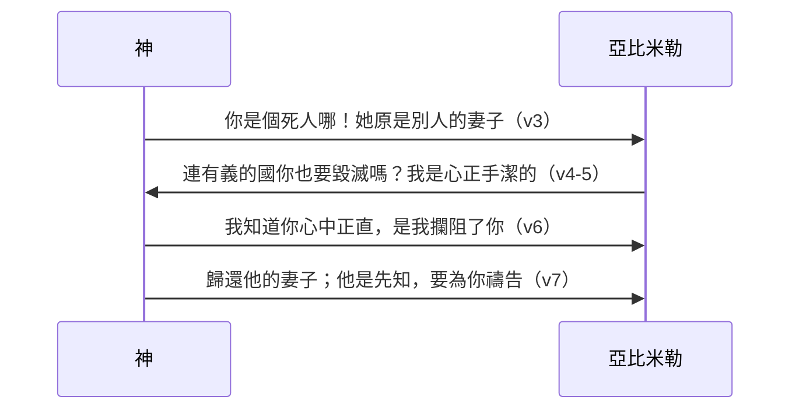

# 創世記 第20章

<!-- chapter-navigation:start -->
| [前一章](../01%20創世記/第19章.md) | [回目錄](../01%20創世記/全書目錄及綱要.md) | [下一章](../01%20創世記/第21章.md) |
| :--- | :---: | ---: |
<!-- chapter-navigation:end -->

1. [[亞伯拉罕]]從那裡向[[南地]]遷去，寄居在[[加低斯]]和[[書珥]]中間的[[基拉耳]]。
2. [[亞伯拉罕]]稱他的妻[[撒拉]]為妹子，[[基拉耳]]王[[亞比米勒]]差人把撒拉取了去。
3. 但夜間，神來，在夢中對[[亞比米勒]]說：你是個死人哪！因為你取了那女人來；他原是別人的妻子。
4. [[亞比米勒]]卻還沒有親近[[撒拉]]；他說：主啊，連有義的國，你也要毀滅嗎？
5. 那人豈不是自己對我說他是我的妹子嗎？就是女人也自己說：他是我的哥哥。我做這事是[[心正手潔]]的。
6. 神在夢中對他說：我知道你做這事是心中正直；[[神攔阻人犯罪|我也攔阻了你，免得你得罪我]]，所以我不容你沾著他。
7. 現在你把這人的妻子歸還他；因為他是[[先知]]，他要為你禱告，使你存活。你若不歸還他，你當知道，你和你所有的人都必要死。
8. [[亞比米勒]]清早起來，召了眾臣僕來，將這些事都說給他們聽，他們都甚懼怕。
9. [[亞比米勒]]召了[[亞伯拉罕]]來，對他說：你怎麼向我這樣行呢？我在什麼事上得罪了你，你竟使我和我國裡的人陷在大罪裡？你向我行不當行的事了！
10. [[亞比米勒]]又對[[亞伯拉罕]]說：你見了什麼才作這事呢？
11. [[亞伯拉罕]]說：[[我以為這地方的人總不懼怕神]]，必為我妻子的緣故殺我。
12. 況且他也實在是我的妹子；他與我是同父異母，後來作了我的妻子。
13. 當神叫我離開父家、飄流在外的時候，我對他說：我們無論走到什麼地方，你可以對人說：他是我的哥哥；這就是你待我的恩典了。
14. [[亞比米勒]]把牛、羊、僕婢賜給[[亞伯拉罕]]，又把他的妻子[[撒拉]]歸還他。
15. [[亞比米勒]]又說：看哪，我的地都在你面前，你可以隨意居住；
16. 又對[[撒拉]]說：我給你哥哥[[一千銀子與遮羞的含義|一千銀子，作為你在閤家人面前遮羞]]【原文作眼】的，你就在眾人面前沒有不是了。
17. [[亞伯拉罕]]禱告神，神就醫好了[[亞比米勒]]和他的妻子，並他的眾女僕，他們便能生育。
18. 因耶和華為[[亞伯拉罕]]的妻子[[撒拉]]的緣故，已經使[[亞比米勒]]家中的婦人不能生育。

---

## 本章知識節點

### 人物與地點
- [[亞伯拉罕]]
- [[撒拉]]
- [[亞比米勒]]
- [[基拉耳]]
- [[南地]]
- [[加低斯]]
- [[書珥]]
- [[亞伯蘭]]

### 神學／主題
- [[先知]]
- [[心正手潔]]
- [[遮羞]]
- [[我以為這地方的人總不懼怕神]]
- [[神在夢中顯現與引導]]
- [[神是生育的源頭]]
- [[神攔阻人犯罪]]

### 背景／原文
- [[古代近東同父異母婚姻]]
- [[亞比米勒名字與王號]]

### 解經爭議
- [[亞伯蘭稱撒萊為妹子的性質]]
- [[亞比米勒為何取撒拉]]
- [[一千銀子與遮羞的含義]]

---

## 本章整理

上一章所多瑪和蛾摩拉傾覆之後，亞伯拉罕離開幔利向南遷移，寄居在基拉耳（第1節）。他再次稱撒拉為妹子，基拉耳王亞比米勒把撒拉取了去（第2節）。神在夢中攔阻亞比米勒（第3-7節），亞比米勒責問亞伯拉罕（第8-13節），歸還撒拉並贈與賠償（第14-16節），亞伯拉罕為他禱告，神醫好他全家的不育（第17-18節）。這件事讓人想起二十四年前在埃及的事（創12:10-20），但並不是同一件事的重複（《聖經精讀本──創世記註解》）。

### 遷往基拉耳，再稱妻為妹（1-2節）

亞伯拉罕從那裡向南地遷去（הַנֶּגֶב，H5045G），寄居在加低斯（קָדֵשׁ，H6946G）和書珥（שׁוּר，H7793）中間的基拉耳（בִּגְרָר，H1642）（第1節）。『那裡』指幔利（丁良才）。他在幔利住了約二十年，所多瑪和蛾摩拉滅亡之後離開（《精讀本》）。這一句和合譯本初版作『住在加低斯和書珥中間，寄居在基拉耳』，意思是先住在兩地中間，後來才寄居在基拉耳（丁良才《創世紀註釋》）。

KC 說，經文沒有交代他離開幔利的原因，這使人想起創12章同樣向南、走到埃及的事；他這次只走到邊界的基拉耳，但那不是信心的路。

基拉耳是非利士人集居的地方，在迦薩以南（丁良才、《啟導本聖經創世記註釋》）。距離迦薩約十英里（16公里）（《啟導本》、《創世記雷氏研讀本》），或只有四公里（《串珠聖經註釋》）。

《舊約背景註釋》說它的確實地點無法肯定，只知在尼革西部（創10:19），甚至可能是地區而非城邑的名字；大部分考古學家指出別是巴西北十五哩的哈羅珥遺址可能就是基拉耳。加低斯是西乃半島東北部的一個綠洲，在別是巴以南46哩；書珥的原義是『城牆』，可能指尼羅河三角洲東部埃及要塞的城牆。

『亞比米勒』（אֲבִימֶלֶךְ，H40G）是非利士王的稱號，有如法老和凱撒（丁良才、《啟導本》、《串珠》），意思是『王（神）是我的父』（《啟導本》）或『我的父是王』（《串珠》）；李道生列出聖經中四個亞比米勒，這一位是亞伯拉罕寄居基拉耳時的非利士王（[[亞比米勒名字與王號]]）。

亞伯拉罕稱他的妻子撒拉為「妹子」（אֲחֹתִי，H269），亞比米勒就差人把撒拉取了去（第2節）。這與創12章在埃及的做法相似（參[[亞伯蘭稱撒萊為妹子的性質]]）：

| 比較項目 | 創12章（埃及法老） | 創20章（基拉耳王亞比米勒） |
|---|---|---|
| 事件對象 | 埃及法老 | 基拉耳王亞比米勒 |
| 神的介入 | 降大災於法老與全家 | 夜間夢中警告、使全家婦女暫時不育 |
| 國王處置 | 質問後送走 | 質問後賠償千銀，並准許隨意居住 |
| 亞伯拉罕回應 | 經文未記其答辯 | 說明動機，之後按吩咐代求 |

有的學者認為這是創12章埃及王故事的重複，理由是人不會重蹈覆轍；但一個人面臨被殺的危險，不會因為有動聽的理由就不重施故技，從第13節看，兄妹相稱是夫妻間早已協議妥了的事（《啟導本》）。《精讀本》同樣不接受這是同一件事的重複，並指出這件事的教訓：無論什麼理由，亞伯拉罕只要離開應許之地，就會有誘惑跟隨；人也很容易再犯已往的罪。《串珠》說，這可能是因為上次的謊話帶給他許多財物，他不怕再來一次。

撒拉的說法在字面上有真實的一面，也有欺騙的一面。第12節說她確是亞伯拉罕同父異母的妹子，但他說的話只對一半，故意叫對方以為撒拉不是他的妻子（《串珠》）；依中東當時的風俗和法律，這句話並無問題，卻有謊騙的意圖，所以是謊言，也導致別人犯罪（《精讀本》）；半真半假的謊言，很難從信徒口中根除（CT）。丁良才列出亞伯拉罕的四個錯處：不依靠神、太過怕人、卑賤自己、玷辱主名。

亞比米勒為什麼取撒拉，經文沒有記載。撒拉這時已九十歲，他可能看中亞伯拉罕的財富，想和他結親或結盟（《啟導本》、《精讀本》；參[[亞比米勒為何取撒拉]]）；他像法老一樣，取了許多未嫁的婦人作妻妾（《雷氏研讀本》）。

CT 的靈意註解把基拉耳讀成良知的世界，亞比米勒則是人的良知；KC 的靈意讀法是，非利士人預表徒有基督徒名義卻不把神放在眼中的人，亞伯拉罕此時在靈裡正落在他們中間。

### 神在夢中攔阻亞比米勒（3-7節）

夜間，神來，在夢中對亞比米勒說：「你是個死人哪！因為你取了那女人來；他原是別人的妻子」（第3節；בְּעֻלַת בָּעַל，H1166、H1167；[[神在夢中顯現與引導]]）。丁良才列出聖經一共記了二十一個夢，舊約十五個，本節居首。對外邦人，神常常用夢來顯明自己，法老（創41:1）和尼布甲尼撒（但4:5）都是例子（《精讀本》）。《舊約背景註釋》說，古代人認為夢是神向未受訓練之人啟示的最普通方式之一，馬里文獻中得到夢中信息的，通常是廟宇專業人員以外的人。

亞比米勒卻還沒有親近撒拉（第4節）。丁良才說，大概神使他生病，免得玷辱撒拉；《精讀本》說，這是為保證立約之子以撒的誕生所作的緊急措施，不然按時間推算，有可能謠傳撒拉所生的以撒是非利士王的兒子。

亞比米勒說：「連有義的國，你也要毀滅嗎？」，丁良才說這顯明他怕神刑罰全國；CT 說『有義的國』是照世人的標準而評定，並非照神的標準。他又申明自己「心正手潔」（第5節；בְּתָם、לְבָבִי，H8537、H3824；בְּנִקְיֹן כַּפַּי，H5356、H3709；[[心正手潔]]），指裡面動機純正，外面行為清潔（CT）。

神回答他：「我知道你做這事是心中正直；我也攔阻了你，免得你得罪我，所以我不容你沾著他」（第6節；וָאֶחְשֹׂךְ，H2820；[[神攔阻人犯罪]]）。神承認亞比米勒說的清白在這件事上是真的，但這並沒有使他承認自己生命中其他的罪（KC）。

根據當時的倫理標準，亞比米勒的行為並不算特別惡劣，但帶來不好的影響，所以他的過犯須通過亞伯拉罕的中保才得赦免（《精讀本》）。神如今還是常常攔阻人犯罪（何2:6；丁良才），許多時候我們沒有跌倒犯罪，是因為神攔阻了我們（CT）。

> [!note] KC
> 有些罪在人心裡已經計劃、已經定意，卻始終沒有犯成——因為神攔阻了人去犯那罪。

神又說：「現在你把這人的妻子歸還他；因為他是先知，他要為你禱告，使你存活」（第7節；先知 נָבִיא，H5030；禱告 וְיִתְפַּלֵּל，H6419；[[先知]]）。這是聖經第一次出現『先知』一詞（《啟導本》、《雷氏研讀本》、BH）。『先知』是神的代言人（《啟導本》、CT）：《雷氏研讀本》說 nabi 的意思是『宣佈，以中間人的身分發言』，這裡用來強調亞伯拉罕替人求情的公認角色；KC 說，不要只想到預言未來，先知更是把別人的話傳出去（出7:1）。

古代近東的人很明白先知的角色，馬里遺址挖掘到五十多個記載不同先知所傳信息的文獻。先知多半傳達神明的信息，這裡卻特別突出先知為人代求的一面，視之為與神明關係有力、能咒詛也能把咒詛除去的人（《舊約背景註釋》）。丁良才說，亞伯拉罕的尊榮有三：君王（創14:14-16）、祭司（創18:23-33）、先知（創20:7）。CT 說，神在亞伯拉罕剛失敗的光景中，還為他說好話，把功勞歸給他，可見神何等看重屬祂的人。

### 亞比米勒的責問（8-13節）

亞比米勒清早起來，召了眾臣僕，將這些事都說給他們聽，他們都甚懼怕（第8節）。他召亞伯拉罕來，說：「你向我行不當行的事了！」（第9節）。亞伯拉罕如此受外邦人的責備，十分虧缺神的榮耀（丁良才）；這是無故陷人於罪，侵犯別人的權利（CT）；他所犯的不該犯的罪有兩項：不信神，讓鄰舍失足（《精讀本》）。

亞比米勒又問：「你見了什麼才作這事呢？」（第10節），意思是你見我們殺了什麼人、劫奪他們的妻子嗎？（丁良才）

亞比米勒又問：「你見了什麼才作這事呢？」（第10節），丁良才說，意思是你見我們殺了什麼人、劫奪他們的妻子嗎？

亞伯拉罕提出三個藉口（《雷氏研讀本》）。第一，他說：「我以為這地方的人總不懼怕神，必為我妻子的緣故殺我」（第11節；יִרְאַת אֱלֹהִים，H3374、H430；[[我以為這地方的人總不懼怕神]]），CT 說這表明他說話不誠實，是因為他預見了危險。第二，撒拉實在是他同父異母的妹子，後來作了他的妻子（第12節；[[古代近東同父異母婚姻]]）。第三，這是離開父家飄流在外的時候，他們早就約定的安排（第13節）。

KC 說，亞比米勒的責備是對的，亞伯拉罕的辯護很軟弱：他心裡想過，卻沒有想到與神商量；為了自保，他否認了與撒拉的關係。他說『神叫我離開父家、飄流在外』，也顯得不誠實，因為不是神叫他飄流，而是他自己開始飄流。CT 說，這話顯出亞伯拉罕的失敗不是偶然，他早在幾十年前就種下失敗的根源，雖在埃及被對付過一次，卻沒有徹底根除。

撒拉是同父異母的妹子，這種婚姻在族長時代不被視為亂倫，也是保證再婚所生的女兒能受本家照顧的方法（《舊約背景註釋》）。古時允許娶同父異母的姊妹為妻，後來被禁止（CT，利20:17）。賈斯樂郝威（《聖經難解經文詮釋手冊》）指出，亞伯拉罕沒有違背律法有兩個理由：亂倫的律法是約五百年後摩西才頒佈的；聖經稱呼『妹子』常用在較寬廣的意義上，可以表示近親。他說沒有任何根據說亞伯拉罕娶撒拉是犯了亂倫罪。《精讀本》說，稱妻為妹的情形在埃及、本章和以撒的基拉耳事件（創26:6-11）中重複出現，這是族長成長的哈蘭地的風俗，也是法律，問題在於他們沒能脫離世俗，使用了人為的處世方法。

### 歸還、賠償與公開昭雪（14-16節）

亞比米勒把牛、羊、僕婢賜給亞伯拉罕，又把他的妻子撒拉歸還他（第14節），並說：「看哪，我的地都在你面前，你可以隨意居住」（第15節）。《精讀本》說，家畜、奴僕、土地、錢財這四樣禮物，表示贖罪和解的意思。

他又對撒拉說：「我給你哥哥一千銀子，作為你在閤家人面前遮羞的」（第16節；אֶלֶף כֶּסֶף，H505、H3701）。「遮羞」原文作『眼』（כְּסוּת עֵינַיִם，H3682、H5869I）。丁良才說，亞比米勒稱『你哥哥』，是故意要責備撒拉。

一千銀子的分量，一個奴僕的身價只值三十塊銀子（出21:32；利27:3-5），所以是很可觀的數目（《啟導本》）；一個奴隸的身價是二十舍客勒（創37:28）（《雷氏研讀本》）。這筆錢約是二十五磅銀子，在烏加列文學中是神明之間女子聘禮的數目；亞比米勒出手這麼大，可能是要保證撒拉毫髮無損，並安撫使他全家不育的神祇（《舊約背景註釋》）。

『遮羞』是難譯的句子，李道生歸納出三種理解：

1. 面帕說：近東婦女在男子面前常蒙臉（如創24:64-65），這筆錢是買面帕的費用；
2. 聘奩說：作為正式的妝奩賠償，恢復夫妻名分；
3. 解恨說：此詞在創32:20 譯作『解恨』，亞比米勒的禮物是要平息亞伯拉罕和親友的怨恨；理化中文譯本作「用來證明你是清白的」，表明撒拉自始至終都是貞潔的（參[[一千銀子與遮羞的含義]]）。

《精讀本》說，直譯是『蒙住你的眼』，可以從撒拉的立場解釋為不讓她看見亞比米勒企圖冒犯自己的過犯，也可以從別人的立場解釋為不讓他們用情欲的眼目看著撒拉。《串珠》和《雷氏研讀本》都把這筆錢讀成證明無辜的憑據：證明責任不在撒拉身上，她沒有做出羞恥的事。

### 先知代求與生育恢復（17-18節）

亞伯拉罕禱告神，神就醫好了亞比米勒和他的妻子，並他的眾女僕，她們便能生育（第17節；וַיִּתְפַּלֵּל אַבְרָהָם，H6419、H85；אֱלֹהִים，H430；וַיֵּלֵדוּ，H3205）。《啟導本》說，他曾為所多瑪代求，現在帶著慚愧也為亞比米勒禱告。CT 說，這個禱告超越了他自己的軟弱與失敗；亞伯拉罕自己的妻子不能生育，卻為別人妻子的生育禱告。KC 把這件事和米利暗（民12:13）、約伯為朋友禱告（伯42:8-9）並列：亞伯拉罕與神的關係回復之後，又能成為別人的祝福。

第18節說，耶和華為亞伯拉罕的妻子撒拉的緣故，已經使亞比米勒家中的婦人不能生育（עָצֹר עָצַר יְהוָה，H6113、H3068；[[神是生育的源頭]]）。這是神保護撒拉的方法，因為撒拉要作神所應許的後裔的母親（《雷氏研讀本》、《精讀本》）。《舊約背景註釋》指出其中的對稱：亞比米勒令亞伯拉罕多久沒有妻子，他自己就多久沒有兒子。CT 說，亞伯拉罕居留基拉耳不會多於一年，神藉此讓他學習把自己生育的難處放在一邊，先為別人的生育禱告。

CT 在〈認識屬世的良知〉列出亞比米勒身上的六個特點：以公義自許、作事心正手潔、對神心存懼怕、對人不敢隨便得罪、肯為別人著想、卻缺乏生命。

### 失敗之後的恢復（全章）

本章從亞伯拉罕離開幔利南遷，走到他為亞比米勒禱告、亞比米勒全家得醫治。亞伯拉罕在這件事上有錯（丁良才列出四個錯處；KC 稱他的辯護很軟弱）；神仍稱他為先知（第7節），並藉他的禱告使亞比米勒全家恢復生育（第17節）。撒拉始終沒有被親近（第4、6節）。《精讀本》說，通過基拉耳事件應該明白，無論信徒走到哪裡，神都會與之同行，守護聖徒。CT 說，先有本章的經歷，然後才有第21章以撒的出生。

**參考資料**
代號：CT＝ccbiblestudy《逐節註解》；GT＝ccbiblestudy《拾穗》，彙集多本中文註釋；正文直接寫書名或作者的（如《丁道爾》、丁良才），都出自這裡；KC＝KingComments；BH＝BibleHub Study；STEP＝STEP Bible 原文資料（CC BY 4.0）
https://www.ccbiblestudy.org/Old%20Testament/01Gen/01CT20.htm
https://www.ccbiblestudy.org/Old%20Testament/01Gen/01GT20.htm
https://www.kingcomments.com/en/bible-studies/Gen/20
https://biblehub.com/study/genesis/20.htm
https://github.com/STEPBible/STEPBible-Data

<!-- appendix-links:start -->
## 附錄

### 相關地圖
- [[appendix/fhl_maps/maps/009|〈創圖四〉亞伯拉罕的生平]]
<!-- appendix-links:end -->

<!-- chapter-navigation:start -->
| [前一章](../01%20創世記/第19章.md) | [回目錄](../01%20創世記/全書目錄及綱要.md) | [下一章](../01%20創世記/第21章.md) |
| :--- | :---: | ---: |
<!-- chapter-navigation:end -->
