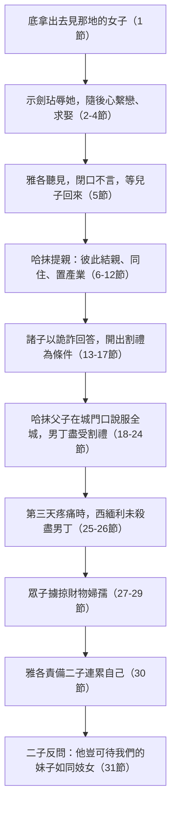

# 創世記 第34章

<!-- chapter-navigation:start -->
| [前一章](../01%20創世記/第33章.md) | [回目錄](../01%20創世記/全書目錄及綱要.md) | [下一章](../01%20創世記/第35章.md) |
| :--- | :---: | ---: |
<!-- chapter-navigation:end -->

1. [[利亞]]給[[雅各]]所生的女兒[[底拿]]出去，要見那地的女子們。
2. 那地的主─[[希未人]]、[[哈抹]]的兒子[[示劍（哈抹之子）|示劍]]看見他，就拉住他，與他行淫，玷辱他。
3. [[示劍（哈抹之子）|示劍]]的心繫戀[[雅各]]的女兒[[底拿]]，喜愛這女子，甜言蜜語地安慰他。
4. [[示劍（哈抹之子）|示劍]]對他父親[[哈抹]]說：求你為我聘這女子為妻。
5. [[雅各]]聽見[[示劍（哈抹之子）|示劍]]玷污了他的女兒[[底拿]]。那時他的兒子們正和群畜在田野，雅各就[[雅各閉口不言的屬靈狀態|閉口不言]]，等他們回來。
6. [[示劍（哈抹之子）|示劍]]的父親[[哈抹]]出來見[[雅各]]，要和他商議。
7. [[雅各]]的兒子們聽見這事，就從田野回來，人人忿恨，十分惱怒；因[[示劍（哈抹之子）|示劍]]在以色列家做了醜事，與雅各的女兒行淫，這本是不該做的事。
8. [[哈抹]]和他們商議說：我兒子[[示劍（哈抹之子）|示劍]]的心戀慕這女子，求你們將他給我的兒子為妻。
9. 你們與我們[[古代近東婚姻習俗|彼此結親]]；你們可以把女兒給我們，也可以娶我們的女兒。
10. 你們與我們同住吧！[[迦南地|這地]]都在你們面前，只管在此居住，做買賣，置產業。
11. [[示劍（哈抹之子）|示劍]]對女兒的父親和弟兄們說：但願我在你們眼前蒙恩，你們向我要什麼，我必給你們。
12. 任憑向我要多重的[[聘金與禮物|聘金和禮物]]，我必照你們所說的給你們；只要把女子給我為妻。
13. [[雅各]]的兒子們因為[[示劍（哈抹之子）|示劍]]玷污了他們的妹子[[底拿]]，就用詭詐的話回答示劍和他父親[[哈抹]]，
14. 對他們說：我們不能把我們的妹子給沒有受[[割禮之約|割禮]]的人為妻，因為那是我們的羞辱。
15. 惟有一件才可以應允：若你們所有的男丁都受[[割禮之約|割禮]]，和我們一樣，
16. 我們就把女兒給你們，也娶你們的女兒；我們便與你們同住，兩下成為[[聖約子民與世界的界限|一樣的人民]]。
17. 倘若你們不聽從我們受[[割禮之約|割禮]]，我們就帶著妹子走了。
18. [[哈抹]]和他的兒子[[示劍（哈抹之子）|示劍]]喜歡這話。
19. 那少年人做這事並不遲延，因為他喜愛[[雅各]]的女兒；他在他父親家中也是人最尊重的。
20. [[哈抹]]和他兒子[[示劍（哈抹之子）|示劍]]到[[城門口公共場合|本城的門口]]，對本城的人說：
21. 這些人與我們和睦，不如許他們在[[迦南地|這地]]居住，做買賣；這地也寬闊，足可容下他們。我們可以娶他們的女兒為妻，也可以把我們的女兒嫁給他們。
22. 惟有一件事我們必須做，他們才肯應允和我們同住，成為[[聖約子民與世界的界限|一樣的人民]]：就是我們中間所有的男丁都要受[[割禮之約|割禮]]，和他們一樣。
23. 他們的群畜、貨財，和一切的牲口豈不都歸我們嗎？只要依從他們，他們就與我們同住。
24. 凡從[[城門口公共場合|城門出入]]的人就都聽從[[哈抹]]和他兒子[[示劍（哈抹之子）|示劍]]的話；於是凡從城門出入的男丁都受了[[割禮之約|割禮]]。
25. 到第三天，眾人正在疼痛的時候，[[雅各]]的兩個兒子，就是[[底拿]]的哥哥[[西緬]]和[[利未]]，各拿刀劍，趁著眾人想不到的時候來到城中，把一切男丁都殺了，
26. 又用刀殺了[[哈抹]]和他兒子[[示劍（哈抹之子）|示劍]]，把[[底拿]]從示劍家裡帶出來就走了。
27. [[雅各]]的兒子們因為他們的妹子受了玷污，就來到被殺的人那裡，[[以惡報惡的罪|擄掠那城]]，
28. 奪了他們的羊群、牛群，和驢，並城裡田間所有的；
29. 又把他們一切貨財、孩子、婦女，並各房中所有的，都擄掠去了。
30. [[雅各]]對[[西緬]]和[[利未]]說：你們連累我，使我在[[迦南地|這地]]的居民中，就是在[[迦南人]]和[[比利洗人]]中，有了臭名。我的人丁既然稀少，他們必聚集來擊殺我，我和全家的人都必滅絕。
31. 他們說：他豈可待我們的妹子如同妓女嗎？

---

## 本章知識節點

### 人物
- [[底拿]]
- [[雅各]]
- [[示劍（哈抹之子）]]
- [[哈抹]]
- [[西緬]]
- [[利未]]
- [[希未人]]
- [[他瑪 (撒下13)]]
- [[大衛]]
- [[拔示巴]]
- [[暗嫩]]

### 地點
- [[示劍（城）]]
- [[迦南地]]

### 神學
- [[割禮之約]]
- [[聖約子民與世界的界限]]
- [[以惡報惡的罪]]
- [[神聖記號被濫用]]
- [[神的管教與鞭打]]

### 歷史
- [[古代近東婚姻習俗]]
- [[城門口公共場合]]
- [[迦南人與比利洗人]]
- [[雅各買示劍地]]

### 原文
- [[底拿名字含義]]
- [[示劍名字含義]]
- [[哈抹名字含義]]
- [[希未人稱呼]]
- [[聘金與禮物]]
- [[以色列]]

### 互文
- [[西緬利未受咒詛 (創49_5-7)|西緬利未受咒詛 (創49_5-7) 雅各臨終咒詛二人分居散住]]
- [[撒母耳記下13_10-19 暗嫩他瑪|撒母耳記下13_10-19 暗嫩他瑪 暗嫩強暴他瑪的平行敘事與相反結局]]
- [[申命記22_28-29 強姦者娶被害女子律法]]
- [[羅馬書2_28-29 真割禮是內心的]]
- [[希伯來書12_5-11 神管教兒女]]
- [[申命記7_3-4 禁止與迦南人通婚]]
- [[雅各書1_20 人的怒氣不成就神的義]]

### 解經爭議
- [[雅各閉口不言的屬靈狀態]]
- [[西緬利未報復是否合乎公義]]
- [[示劍悔改是否真誠]]
- [[利用割禮作欺騙工具的性質]]

### 背景
- [[古代近東割禮背景]]
- [[古代近東聘禮制度]]
- [[西乃之前的普世道德規範]]

---

## 本章整理

上一章雅各在示劍城東支搭帳棚，買地築壇。這一章他的女兒底拿出去，被那地的主哈抹的兒子示劍玷辱；示劍想娶她，雅各的兒子們假意提出割禮為條件，等全城男丁受了割禮，西緬和利未趁他們疼痛的時候殺盡男丁，雅各的兒子們又擄掠了那城（第1-29節）。雅各責備二子連累自己，兒子們反問：他豈可待我們的妹子如同妓女嗎（第30-31節）。

### 底拿出去，示劍玷辱她（1-4節）

利亞給雅各所生的女兒底拿出去，要見那地的女子們（第1節；[[底拿]]）。底拿此時大約十四、五歲（CT、《啟導本聖經創世記註釋》），和約瑟出生的日期差不多，按創37:2 推算，大概十五、六歲（《聖經精讀本──創世記註解》）。CT 說『出去』一詞帶有消極的含義，暗示她離開父母的保護和管教，『見那地的女子們』顯示這不是第一次；丁良才引猶太歷史家的說法，底拿出去時正逢示劍的一個拜偶像的節期。《精讀本》說，她是為了擺脫繁重的日常生活、結識示劍的女孩子，參加了村莊裡的一個宴會。

那地的主、希未人哈抹的兒子示劍看見她，就拉住她，與她行淫，玷辱她（第2節；[[示劍（哈抹之子）|示劍]]）。『拉住』是用武力抓住，『行淫』原文指強迫她同寢，這是古代地方上權貴之子欺侮寄居者的一幅寫照（CT）；BH 也把這節讀成明確的性暴力。示劍可能是強行擄走她，或用甜言蜜語誘拐了她，當時未婚女孩在外很危險（《精讀本》）。

華爾頓提供了法律背景：強姦在古代近東顯然是獲取婚約的手段之一，相關的法律（出22:16-17；申22:28-29，以及中亞述和赫人的法律）通常勒令強姦者加重付出聘禮，有時還禁絕離婚；蘇美法律第七條與本章一樣針對年輕未許配、不得父母同意外出而被強姦的女子，結局是父母有權不經她同意，把她嫁給強姦者。

這件事為什麼發生，各家的重點不同。《精讀本》認為根本原因是雅各沒有履行在伯特利許下的願，也因青春期的底拿天真浪漫，美貌吸引了示劍；CT 說雅各逗留在示劍是靈程上的一個停頓，讓子女遭受不良的影響，比對他自己的害處更大。KC 把這件事讀成雅各選擇居住的地方對家庭造成的災難，說底拿想結識的是世上的女子，並認為她多半已經適應了世界，也沒有強力抵抗；KC 同時說，示劍有一定程度的強迫。這是 KC 的推論，經文本身只寫示劍看見她，就拉住她，與她行淫。

示劍的心繫戀雅各的女兒底拿，喜愛這女子，甜言蜜語地安慰她（第3節）。『戀慕』指不願分開，事實上示劍沒有放回底拿，把她扣留在他家裡（參第26節；CT）。示劍玷辱底拿是沒有克制欲火的結果，與暗嫩（撒下13:10-19）不同，並非一時的情欲或仗著主人的勢力，但這一瞬間的欲火給這座城市帶來滅頂之災（《精讀本》）。KC 看到示劍的另一面：對他來說，強暴不只是一個行動，他愛底拿並且想娶她，性關係帶來責任（參撒下13:14-16）。

示劍對他父親哈抹說：「求你為我聘這女子為妻」（第4節）。原文稱她『這女子』，缺少尊重和禮貌的成分（CT）。當時近東的婚姻習俗，是雙方父母的決定比當事人的意見更重要（士14:2），而且男方要給女方送上相當多的彩禮（《精讀本》）。

### 雅各閉口不言，哈抹前來提親（5-12節）

雅各聽見示劍玷污了他的女兒底拿；那時他的兒子們正和群畜在田野，雅各就閉口不言，等他們回來（第5節）。牧民以中央帳棚為中心，分散在周圍流動放牧（《精讀本》）。雅各為什麼沒有反應，CT 提出兩種可能：他畏懼對方的權勢，或是有重男輕女的觀念，因底拿是利亞所生，他對她的關愛不及拉結所生的兒女。KC 稱雅各在這裡又是缺席的父親，聽見這事卻沒有任何反應（[[雅各閉口不言的屬靈狀態]]）。CT 的話中之光說，敬虔的信徒固然應當遇事閉口不言，但必須是為了回到裡面來與神交通，仰望神的引導，而不是為了怕惹火燒身。

示劍的父親哈抹出來見雅各，要和他商議（第6節）。CT 說哈抹的『出來』，與第1節底拿的『出去』相對，是因底拿的『出去』而引起的反應。《精讀本》說，示劍家族鄭重向雅各家求婚，是因雅各家雖是外來客，但與以撒和以掃有關，具有非常大的影響力。

雅各的兒子們聽見這事，就從田野回來，人人忿恨，十分惱怒；因示劍在以色列家做了醜事，與雅各的女兒行淫，這本是不該做的事（第7節）。『以色列家』這個用語顯示這家族清楚知道他們與整城的人不同；摩西寫創世記時，雅各的後裔已被稱為以色列人（CT、丁良才）。《精讀本》說，問題的嚴重在於底拿不是普通人，她是立約支系的女兒，這種肉體上的犯罪對聖約及選民以色列的名譽和自豪感帶來決定性的打擊（申22:21；撒下13:12）。華爾頓指出，古代近東同時代和更早期的法典清楚證明，對不正當和暴力性行為的禁戒「並非起源於西乃」，兩者之間共有一個普世性的道德感和正義感；法律要保護的，往往是家庭的榮譽和健全、個人的尊嚴，以及在社會中的保障（[[西乃之前的普世道德規範]]）。

哈抹說，他兒子的心戀慕這女子，求你們把她給我的兒子為妻；你們與我們彼此結親，女兒可以彼此給、彼此娶；你們與我們同住，這地都在你們面前，只管在此居住，做買賣，置產業（第8-10節；[[古代近東婚姻習俗]]）。示劍也說，但願我在你們眼前蒙恩，你們向我要什麼，我必給你們，任憑向我要多重的聘金和禮物，我必照你們所說的給你們（第11-12節）。哈抹的條件可歸成三項：通過結親結盟友好；答應雅各家族居住自己的土地並提供經商致富的機會；答應要求的聘金和禮物。雅各兒子們的憤恨不僅由於家人受玷污，更由於宗教信仰的不同，所以這些條件對他們根本沒有用（《精讀本》）。

華爾頓說，男家所付聘金和禮物的價值往往按婚姻的有利程度而定，女家社會地位若比男家高，聘禮相應增加，新娘其他因素（如美貌）也會提升她的價值；努斯文獻中典型的聘金大約是三十至四十舍客勒銀子（[[古代近東聘禮制度]]）。『聘金』是付給女方家的財，『禮物』是單給新娘的禮物，有時兩種並用（《精讀本》）。

KC 說，這樣一來，迦南地成了仇敵送給雅各及其後裔的禮物，而不是他們憑神的應許所得的地；仇敵至今仍用同一招，向信徒提出種種好處，勸他與世界結不合法的聯合（[[聖約子民與世界的界限]]）。KC 又說，這些提議沒有實現，不是因為雅各兒子們的屬靈態度，而是神用他們的惡意，破壞了哈抹愚昧的提議。

### 割禮成了詭計（13-24節）

雅各的兒子們因為示劍玷污了他們的妹子，就用詭詐的話回答示劍和他父親哈抹（第13節）。這是兒子效法父親（創27章；丁良才），也用假話欺騙示劍，又利用神聖的割禮達到罪惡的目的（《啟導本》）。這是雅各兒子們的詭詐，不是雅各的詭詐，因為雅各在雅博渡口與神摔跤後已經改變，兒子們早年從他學的就自然地流露出來（CT）。

這種詭詐呼應雅各自己欺騙以掃和以撒，也預示日後兄弟欺騙約瑟，聖經沒有認可，而是作為警戒（BH）；雅各當年的欺騙，後來藉著被岳父拉班欺騙（創29:25）、被自己的子女欺騙（創37:31-33）付上了代價（《精讀本》）。

他們說：「我們不能把我們的妹子給沒有受割禮的人為妻，因為那是我們的羞辱。惟有一件才可以應允：若你們所有的男丁都受割禮，和我們一樣，我們就把女兒給你們，也娶你們的女兒；我們便與你們同住，兩下成為一樣的人民。倘若你們不聽從我們受割禮，我們就帶著妹子走了」（第14-17節）。割禮始於亞伯拉罕（創17:9-14），是神與他們立約的記號（CT 背景註解）；神規定的神聖割禮儀式在這裡被用作邪惡的手段，沒有受割禮的人在舊約時代指那些與神的約無關的外邦人（《精讀本》）。《精讀本》又說，『成為一樣的人民』不過是雅各的兒子們為報復而說的冠冕堂皇之言，不是出於信仰，形式上的割禮毫無意義，與真以色列無關。

CT 說：「以神聖的記號(「割禮」)作為欺騙的工具，乃是欺騙神的行為，甚至可以說是在嫁禍給神。」KC 也說，他們濫用了對自己本應別具意義、由神賜作與亞伯拉罕及其後裔立約記號的事物；KC 並以學習基督徒的行為來融入基督徒社群為比方，說父母若只要求對方上教會或受洗，沒有談到心裡的改變，就是只看外面的行為（[[割禮之約]]）。外面肉身的割禮也不是真割禮（羅2:28；CT）。

| 割禮在這條鏈子上的三重身分 | 出處 |
|---|---|
| 神與亞伯拉罕立約的記號 | 創17:9-14（CT 背景註解） |
| 外族可取得通婚資格的門檻 | 華爾頓：近東割禮普及，故此條件在當時聽來合理 |
| 成人受術後失能數日的時間表 | 華爾頓：「足以使男丁失去活動能力幾天之久」 |

華爾頓說，割禮最初引進時（創17章），成年男子和嬰孩都要動手術，作為社群一分子的表記；割禮在古代近東作為青春期、豐饒崇拜或結婚禮儀雖然普及，「卻也未曾達到所有人都奉行的地步」，所以示劍人接受割禮，使自己有資格成為雅各眾女的丈夫（[[古代近東割禮背景]]）。這種手術對成人頗為痛楚，足以使男丁失去活動能力幾天之久。

哈抹和他的兒子示劍喜歡這話（第18節）。那少年人做這事並不遲延，因為他喜愛雅各的女兒；他在他父親家中也是人最尊重的（第19節）；示劍人都尊敬哈抹的兒子，這是眾人願意受割禮的一個緣故（丁良才）。哈抹和他兒子示劍到本城的門口，對本城的人說話（第20節）。城門是聚集進行訴訟或交易的地點，也是討論與全體市民有關事務的公開聚會場所；在小鎮房屋擁擠、街道窄小，市集和城門口是唯一空曠的地方（華爾頓；參創19:1、23:10）。

他們對城裡的人說：這些人與我們和睦，不如許他們在這地居住，做買賣；這地也寬闊，足可容下他們；我們可以彼此通婚，惟有一件事必須做，就是我們中間所有的男丁都要受割禮；他們的群畜、貨財和一切的牲口，豈不都歸我們嗎（第21-23節）。示劍原來只是動機單純的求婚，現在竟變成了併吞雅各家產的企圖（CT）；城裡的人是出於貪婪，不是出於想與以色列的神同住（KC）；這也與哈抹聯合雅各的經濟和社會影響力、擴充自己部落的想法吻合（《精讀本》）。

凡從城門出入的人都聽從哈抹和他兒子示劍的話，於是凡從城門出入的男丁都受了割禮（第24節）；這是因為哈抹的地位，他是那地的主（CT）。

### 西緬和利未屠城（25-29節）

到第三天，眾人正在疼痛的時候，雅各的兩個兒子，就是底拿的哥哥西緬和利未，各拿刀劍，趁著眾人想不到的時候來到城中，把一切男丁都殺了；又用刀殺了哈抹和他兒子示劍，把底拿從示劍家裡帶出來就走了（第25-26節；[[西緬]]；[[利未]]）。行割禮後第三天是傷口最痛楚、全身最無力氣的時候（CT、《精讀本》）。丁良才與 CT 都從『把底拿從示劍家裡帶出來』一句，看出示劍強留了底拿；《精讀本》說，西緬和利未是與底拿同母的哥哥，也是示劍復仇的主謀，這時年紀二十歲左右。

雅各的兒子們來到被殺的人那裡，擄掠那城，奪了他們的羊群、牛群和驢，並城裡田間所有的，又把一切貨財、孩子、婦女，並各房中所有的都擄掠去了（第27-29節）。二人既把城中一切男丁都殺了，必須還有別人幫助（丁良才）；底拿其他的哥哥也積極參與了，約瑟則可以相信沒有參加（創37:2），示劍城規模非常小，單靠雅各兒子們的力量就摧毀了這座城（《精讀本》）。他們不但犯了謀殺罪，又成了強盜，殘忍加上貪婪，罪加一等（CT）。

這件事怎麼評價，《精讀本》列出三點：他們降低神聖割禮的意義，使之淪為可怕的報復手段；報復的程度過於示劍的過失程度；對信義和誓言報以最殘酷的背叛；並說聖經指出以惡報惡是大罪（太5:39、44）（[[以惡報惡的罪]]）。

| 罪 | 說明 |
|---|---|
| 褻瀆聖物 | 降低神聖割禮的意義，使之淪為報復手段 |
| 刑度失衡 | 報復程度遠過於示劍的過失 |
| 背信毀約 | 對信義和誓言報以最殘酷的背叛 |

華爾頓從交涉的邏輯看這件事：雙方談判的主題，是在底拿遭受強暴的情況下何為合適的補償（聘禮），「結果是，底拿兄弟認為全城的性命財貨才可算為合適」；他舉出《伊里亞德》中希臘人為奪回海倫而圍攻特洛伊城，目的也相仿。CT 的話中之光說：神從不以暴行表白善義，人沒有權利為著公義的理由行作不義，好的目的不能把手段正當化。雅各臨終時咒詛二子，說他們的怒氣暴烈、行為殘忍，要分居散住（創49:5-7；《啟導本》、《雷氏研讀本》、《串珠聖經註釋》）。

### 雅各責備二子，兒子反問（30-31節）

雅各對西緬和利未說：「你們連累我，使我在這地的居民中，就是在迦南人和比利洗人中，有了臭名。我的人丁既然稀少，他們必聚集來擊殺我，我和全家的人都必滅絕」（第30節）。雅各不責備兒子行惡，只埋怨他們連累全家，後來他才把這事看得清楚（創49:5-7；丁良才）。『有了臭名』可理解為使他變得可憎可厭，雅各突然關心這場屠殺傳開後，對家人的安全會造成怎樣的危害（《雷氏研讀本》）。KC 的看法是，雅各介意的是自己被人厭惡，多過神所受的羞辱。

雅各深切痛苦的原因有二：家庭的光景與他離開哈蘭時立志在迦南地建立堂堂正正家業的決心相反，底拿被玷污和兒子們的殘忍報復，使這與神立約的家族的威嚴在外邦人心目中一落千丈；又帶給這個家族生存的危機（《精讀本》）。此事果然在四周城邑引起公憤，企圖追殺雅各家的人，幸蒙神保守（參創35:5；CT）。BH 也指出，雅各擔心的是各族聯合攻擊，神的約應許常被人的行動威脅。

他們說：「他豈可待我們的妹子如同妓女嗎？」（第31節）先強姦後禁錮在家裡，形同對待妓女（CT）；阿拉伯人和希伯來人把兄弟或姐妹受的恥辱，看得比妻子所受的恥辱更重，所以他們認為對底拿的玷污，就是對以色列全家族的挑戰和污辱（《精讀本》）。BH 把這句話讀成兄弟為保護妹妹的尊嚴而說。KC 說，雅各對兒子們的反駁無話可答，父母被兒女責問，次序本是顛倒的。丁良才說，聖經常記實情，並不一味隱惡揚善，這是聖書真實的一個憑據。

### 從示劍的帳棚到伯特利的呼喚（全章）

本章從底拿出去開始，到兒子們反問父親結束，中間每一步都由不同的人推進。CT 的靈訓要義把雅各的缺失列為四項：容讓女兒單獨出去與世俗為友（第1節）、聽見女兒被污辱卻閉口不言（第5節）、容讓兒子們擅出主意（第13-17節）、顧自己在世上的名聲和性命安危（第30節）。CT 並說，本章的事故，正是神為著繼續磨煉雅各而有的剝奪。

《精讀本》說，雅各平安進入迦南地，卻忘記在伯特利向神許下的願（創28:20-22），神用鞭打的方式（來12:5-11）提醒他要回到伯特利，女兒底拿被玷污及兩個兒子屠殺示劍人，成為提醒。下一章神對雅各說：「起來！上伯特利去，住在那裡」（創35:1），神也使那周圍城邑的人甚驚懼，就不追趕雅各的眾子（創35:5）。

**參考資料**
代號：CT＝ccbiblestudy《逐節註解》；GT＝ccbiblestudy《拾穗》，彙集多本中文註釋；正文直接寫書名或作者的（如《丁道爾》、丁良才），都出自這裡；KC＝KingComments；BH＝BibleHub Study；STEP＝STEP Bible 原文資料（CC BY 4.0）
https://www.ccbiblestudy.org/Old%20Testament/01Gen/01CT34.htm
https://www.ccbiblestudy.org/Old%20Testament/01Gen/01GT34.htm
https://www.kingcomments.com/en/bible-studies/Gen/34
https://biblehub.com/study/genesis/34.htm
https://github.com/STEPBible/STEPBible-Data

<!-- appendix-links:start -->
## 附錄

### 相關地圖
- [[appendix/fhl_maps/maps/015|〈創圖十〉雅各的生平]]
<!-- appendix-links:end -->

<!-- chapter-navigation:start -->
| [前一章](../01%20創世記/第33章.md) | [回目錄](../01%20創世記/全書目錄及綱要.md) | [下一章](../01%20創世記/第35章.md) |
| :--- | :---: | ---: |
<!-- chapter-navigation:end -->
