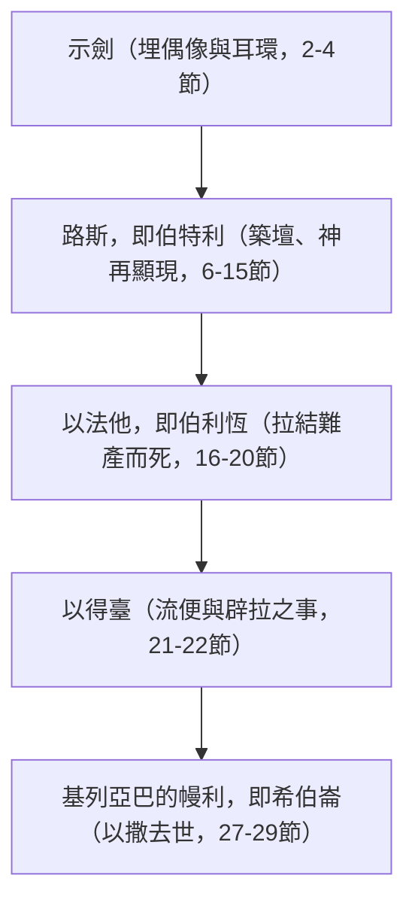
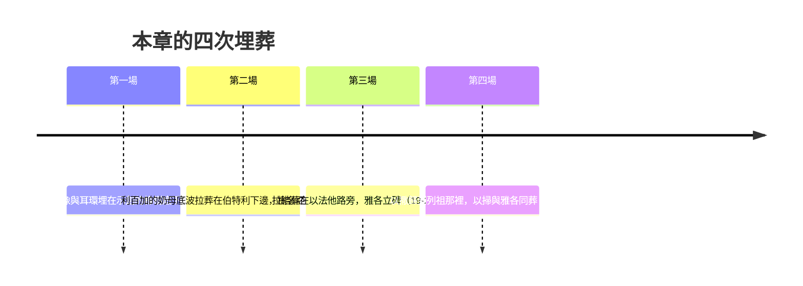

# 創世記 第35章

<!-- chapter-navigation:start -->
| [前一章](../01%20創世記/第34章.md) | [回目錄](../01%20創世記/全書目錄及綱要.md) | [下一章](../01%20創世記/第36章.md) |
| :--- | :---: | ---: |
<!-- chapter-navigation:end -->

1. 神對[[雅各]]說：起來！上[[伯特利]]去，住在那裡；要在那裡[[祭壇敬拜|築一座壇]]給神，就是你逃避你哥哥[[以掃]]的時候向你顯現的那位。
2. [[雅各]]就對他家中的人並一切與他同在的人說：你們要[[除掉外邦神|除掉你們中間的外邦神]]，也要[[自潔與更換衣裳|自潔，更換衣裳]]。
3. 我們要起來，上[[伯特利]]去，在那裡我要[[祭壇敬拜|築一座壇]]給神，就是在我遭難的日子應允我的禱告、在我行的路上[[神的同在與保護|保佑我的那位]]。
4. 他們就把[[除掉外邦神|外邦人的神像]]和他們[[耳環作異教護身符|耳朵上的環子]]交給[[雅各]]；雅各都藏在[[示劍（城）|示劍]]那裡的橡樹底下。
5. 他們便起行前往。[[神的同在與保護|神使那周圍城邑的人都甚驚懼]]，就不追趕[[雅各]]的眾子了。
6. 於是[[雅各]]和一切與他同在的人到了[[迦南地]]的[[路斯]]，就是[[伯特利]]。
7. 他在那裡築了一座壇，就給那地方起名叫[[伊勒伯特利]]【就是[[伯特利的神|伯特利之神]]的意思】；因為他逃避他哥哥的時候，神在那裡向他顯現。
8. [[利百加]]的奶母[[乳母底波拉|底波拉]]死了，就葬在[[伯特利]]下邊橡樹底下；那棵樹名叫[[亞倫巴古]]。
9. [[雅各]]從[[巴旦亞蘭]]回來，神又向他顯現，賜福與他，
10. 且對他說：你的名原是[[雅各]]，從今以後不要再叫雅各，要叫以色列。這樣，他就[[雅各改名以色列|改名叫以色列]]。
11. 神又對他說：我是[[全能的神（El Shaddai）|全能的神]]；你要生養眾多，將來有一族和多國的民從你而生，又有君王從你而出。
12. 我所賜給[[亞伯拉罕]]和[[以撒]]的地，我要賜給你與你的後裔。
13. 神就從那與[[雅各]]說話的地方升上去了。
14. [[雅各]]便在那裡[[立石柱與澆油|立了一根石柱]]，在柱子上[[奠酒]]，[[立石柱與澆油|澆油]]。
15. [[雅各]]就給那地方起名叫[[伯特利]]。
16. 他們從[[伯特利]]起行，離[[以法他]]還有一段路程，[[拉結]]臨產甚是艱難。
17. 正在艱難的時候，[[古代收生婆|收生婆]]對他說：不要怕，你又要得一個兒子了。
18. 他將近於死，靈魂要走的時候，就給他兒子起名叫[[便俄尼名字含義|便俄尼]]；他父親卻給他起名叫[[便雅憫]]。
19. [[拉結]]死了，葬在[[以法他]]的路旁；以法他就是[[伯利恆（猶大）|伯利恆]]。
20. [[雅各]]在他的墳上立了一統碑，就是[[拉結之墓|拉結的墓碑]]，到今日還在。
21. 以色列起行前往，在[[以得臺]]那邊支搭帳棚。
22. 以色列住在那地的時候，[[流便]]去與他父親的妾[[辟拉]]同寢，以色列也聽見了。[[雅各]]共有十二個兒子。
23. [[利亞]]所生的是[[雅各]]的長子[[流便]]，還有[[西緬]]、[[利未]]、[[猶大（雅各之子）|猶大]]、[[以薩迦（價值）|以薩迦]]、[[西布倫（同住）|西布倫]]。
24. [[拉結]]所生的是[[約瑟]]、[[便雅憫]]。
25. [[拉結]]的使女[[辟拉]]所生的是[[但（審判）|但]]、[[拿弗他利]]。
26. [[利亞]]的使女[[悉帕]]所生的是[[迦得（萬幸）|迦得]]、[[亞設（有福）|亞設]]。這是[[雅各]]在[[巴旦亞蘭]]所生的兒子。
27. [[雅各]]來到他父親[[以撒]]那裡，到了[[基列亞巴]]的[[幔利]]，乃是[[亞伯拉罕]]和以撒寄居的地方；基列亞巴就是[[希伯崙]]。
28. [[以撒]]共活了一百八十歲。
29. [[以撒]]年紀老邁，日子滿足，氣絕而死，歸到他列祖【原文作本民】那裡。他兩個兒子[[以掃]]、[[雅各]]把他埋葬了。

---

## 本章知識節點

### 人物
- [[雅各]]
- [[以掃]]
- [[以撒]]
- [[亞伯拉罕]]
- [[利百加]]
- [[乳母底波拉]]
- [[拉結]]
- [[便雅憫]]
- [[流便]]
- [[辟拉]]
- [[利亞]]
- [[西緬]]
- [[利未]]
- [[猶大（雅各之子）]]
- [[以薩迦（價值）]]
- [[西布倫（同住）]]
- [[約瑟]]
- [[但（審判）]]
- [[拿弗他利]]
- [[悉帕]]
- [[迦得（萬幸）]]
- [[亞設（有福）]]

### 地點
- [[伯特利]]
- [[路斯]]
- [[示劍（城）]]
- [[迦南地]]
- [[巴旦亞蘭]]
- [[以法他]]
- [[伯利恆（猶大）]]
- [[以得臺]]
- [[基列亞巴]]
- [[幔利]]
- [[希伯崙]]

### 神學
- [[伯特利的神]]
- [[回到伯特利的屬靈復興]]
- [[除掉外邦神]]
- [[自潔與更換衣裳]]
- [[祭壇敬拜]]
- [[神的同在與保護]]
- [[神的應許應驗]]
- [[全能的神（El Shaddai）]]
- [[雅各改名以色列]]
- [[十二支派起源]]
- [[流便失去長子名分]]

### 歷史
- [[家神像_特拉芬]]
- [[耳環作異教護身符]]
- [[古代收生婆]]
- [[古代近東妾與繼承權]]
- [[拉結之墓]]
- [[立石柱與澆油]]
- [[奠酒]]

### 原文
- [[伊勒伯特利]]
- [[亞倫巴古]]
- [[便俄尼名字含義]]
- [[便雅憫名字含義]]

### 互文
- [[伯特利之約 (創28)|伯特利之約 (創28) 天梯異象與雅各所許的願]]
- [[雅博渡口經歷 (創32)|雅博渡口經歷 (創32) 摔跤得名以色列]]
- [[何西阿書12章雅各摔跤]]
- [[創世記49章流便受責]]
- [[歷代志上5章流便失去長子名分]]
- [[馬太福音2章拉結哭泣]]
- [[彌迦書5章伯利恆與彌賽亞]]

### 解經爭議
- [[拉結之死與雅各咒詛是否相關]]
- [[流便與辟拉同寢的性質]]

### 背景
- [[摩利橡樹]]
- [[古代生產的危險]]

---

## 本章整理

上一章雅各的家在示劍遭遇底拿被玷辱與屠城。這一章神對雅各說：起來，上伯特利去（第1節）；他先吩咐全家除掉外邦神、自潔、更換衣裳，把神像和耳環埋在示劍的橡樹底下（第2-4節）。他在伯特利築壇，神再向他顯現，重申以色列的名與應許（第6-15節）；接著拉結在以法他難產而死，便雅憫出生（第16-20節），流便與辟拉同寢（第21-22節），雅各回到幔利見以撒，以撒去世（第27-29節）。

### 起來，上伯特利去（1-5節）

神對雅各說：「起來！上伯特利去，住在那裡；要在那裡築一座壇給神，就是你逃避你哥哥以掃的時候向你顯現的那位」（第1節；[[雅各]]；[[伯特利]]）。神的名字出現在第33章最後一節和第35章第一節，第34章污穢事件的記載中完全沒有提及（CT）。神先興起第34章的環境，迫使雅各服下來，然後才對他說話（CT）。

雅各只顧肉體的事（創33:17、19），忘了自己在伯特利許過的願（創28:19-22），神藉第34章的事提醒他（丁良才）。CT 把神的意思寫成：當初你向我要的，我都給你了，你也應當還你當初所許的願；《聖經精讀本──創世記註解》也說，從哈蘭回來已經十年，雅各尚未履行許願，或許這就是雅各家庭發生所有問題的根本原因。KC 則說神的目的是要賜福，要在伯特利，就是『神的家』與雅各同住。

《精讀本》說，第34章的事是神的懲戒，目的是把雅各召到伯特利，也是神愛的邀請；對雅各來說，伯特利是他在最痛苦的時候強烈體驗到神看顧之手的地方，也是最純真地告白信仰、許願的地方（創28:10-22）。《啟導本聖經創世記註釋》說，雅各家有了一次復興運動，也是聖經中第一次有關靈性復興的記錄，並把它歸納成九個特色：復興前人有罪惡、不義和懼怕（創34:30-31）；復興靠神的一句話開始；丟棄神不喜悅的事物；回到順服神旨意的路上；紀念神過去的賜福；真誠尋求神的，必得到保護（第5節）；帶來關於神性情的新啟示（第11節）；神重新賜下應許（第10-11節）；復興的經歷是為了預備迎接試煉或苦難（第16-20節）。

雅各對他家中的人並一切與他同在的人說：「你們要除掉你們中間的外邦神，也要自潔，更換衣裳」（第2節；[[除掉外邦神]]；[[自潔與更換衣裳]]）。這些神像的來源，包括拉結從拉班家帶來的神像（創31:19、30、34-35；丁良才、《雷氏研讀本》），以及雅各眾子可能擄掠自示劍人的神像（創34:27-29；丁良才、CT）；雅各的妻妾自米所波大米帶來異教信仰，加上迦南地染上的風俗，家裡可能有許多神像（《啟導本》）。

『[[耳環作異教護身符|耳朵上的環子]]』不是平常的妝飾品，而是異教徒佩戴的迷信護身符，兼作飾物（CT）；上面大概有雕刻的神像（丁良才），可能刻有某種神像或咒語（《精讀本》）。華爾頓則說，耳環與崇拜其他神有什麼關係並不清楚，說它是護身符的人提不出證據。他又說，自潔是禮儀所規定的手續之一，通常包括洗澡和更衣，也可能是對第34章流血事件的回應。丁良才說，雅各家中的人可能因第34章的事染了污穢（參出19:10）；《精讀本》則把這三件事看成悔改：丟掉神像、自潔、更換衣裳，表示外表上體現屬靈和道德的聖潔。

| 三個吩咐 | 屬靈含義（CT） |
|---|---|
| 除掉外邦神 | 除去一切在心中取代神地位的人、事、物 |
| 自潔 | 對付罪污與天然的舊人 |
| 更換衣裳 | 行為與生活方式的改變（西3:9-10） |

華爾頓說，除掉外邦神的呼籲，同時是呼籲他們惟獨委身於耶和華，但「這話並不顯示他們在理論上明白或接受一神信仰」，只是表示他們接受了耶和華為他們一家的守護神；接受一位有位格的神保護供給自己一家，是主前第二千年紀初期美索不達米亞常見的信念。

他們把外邦人的神像和耳朵上的環子交給雅各，雅各都藏在示劍那裡的橡樹底下（第4節）。這是亞伯拉罕進入迦南地後第一次築壇之地（創12:5-7）；雅各埋在這裡，是宣告要回到亞伯拉罕持有的純潔信仰，也是說在神的約面前所有偶像如同死屍（賽2:20；《精讀本》）。華爾頓說，這棵樹可能就是創12:6、書24:23-27、士9:6、37 所提及的那一棵，在當時通俗宗教中聖木很重要，但足以澄清聖木在迦南作用的考古和文學遺跡，卻少之又少（[[示劍（城）]]；[[摩利橡樹|創十二6]]）。KC 把橡樹看成十字架的畫像，偶像應該埋在那裡；KC 並說這是本章第一次埋葬，後面還有三次（第8、19、29節）。

他們起行前往，神使那周圍城邑的人都甚驚懼，就不追趕雅各的眾子了（第5節；[[神的同在與保護]]）。原文是『神的驚懼』，一指神是他們驚懼的來源，另指他們的驚懼達於極度；『不追趕雅各的眾子』暗示此後聖經記事的重心，將從雅各轉移到他的眾子身上（CT）。雅各的眾子雖然行事殘忍，雅各還蒙特別的保佑，但他們保守家風清潔的辦法不可學，因為神說「伸冤在我，我必報應」（羅12:19；丁良才）；《雷氏》說這是神阻止迦南人向示劍人報仇。CT 並說：「人走在神的道路上，神就負人一切的責任」。

### 伯特利：築壇與神再顯現（6-15節）

於是雅各和一切與他同在的人到了迦南地的路斯，就是伯特利，在那裡築了一座壇，給那地方起名叫伊勒伯特利，就是伯特利之神的意思（第6-7節；[[伯特利的神]]；[[伊勒伯特利|伯特利之神]]；[[祭壇敬拜]]）。雅各從前給這地起名伯特利（創28:19），這次稱神為『伯特利的神』；他不像異教把神當作一地的神，而是用神曾幫助人的地方來紀念無所不在的神（《啟導本》）。雅各回憶神當時賜下的恩惠，以此檢驗自己現在的信仰，並將未來交託給神（《精讀本》）。

雅各在示劍稱神是『以色列的神』（創33:20），在伯特利稱神是『伯特利的神』，表示他的觀念從個人進入團體（CT）。雅各第一次在伯特利稱它為可畏的地方（創28:17），這次沒有懼怕，他築壇是敬拜神本身；他在示劍築的壇沒有神的吩咐，神也沒有在那裡向他顯現（KC）。亞伯蘭周遊時到處築壇，是為求告耶和華的名，不是獻祭，雅各似乎也一樣，經文沒有提過在壇上獻祭；有人認為壇是神明領土的標記，另一個可能是耶和華之名的紀念碑（華爾頓）。

利百加的奶母底波拉死了，就葬在伯特利下邊橡樹底下，那棵樹名叫亞倫巴古（第8節）。『亞倫巴古』是『哭泣的橡樹』，表明雅各的傷痛和對底波拉的尊敬（《串珠聖經註釋》、丁良才）。底波拉跟隨利百加來到迦南地（創24:59），她忠心侍奉主母全家許多年（《啟導本》）；《精讀本》提出她在雅各身邊的兩個原因：利百加派她照顧自己的兒孫，或是母親死後，雅各因思念母親特意接她回來。KC 的讀法是：神要再向雅各顯現之前，底波拉必先死去，似乎是舊的傳統要先消失，只有個人與主有每天的關係，主才向我們顯明祂自己。

雅各從巴旦亞蘭回來，神又向他顯現，賜福與他（第9節）。這是三十年前雅各逃往哈蘭途中，神第一次向他顯現（創28:10-16）之後的再次顯現，是對雅各履行伯特利之約的回應（《精讀本》）；CT 說這是對雅各順從神話的獎勵。神對他說：「你的名原是雅各，從今以後不要再叫雅各，要叫以色列」（第10節；[[雅各改名以色列]]）。神是在毘努伊勒要雅各改名（創32:28），現在重申這話，意思是要他把這事付諸實施（CT）；《精讀本》說，這個名字含有彌賽亞的應許。

神又說：「我是全能的神；你要生養眾多，將來有一族和多國的民從你而生，又有君王從你而出」，並把賜給亞伯拉罕和以撒的地賜給雅各和他的後裔（第11-12節；[[全能的神（El Shaddai）|全能的神]]）。神早曾用這名稱向亞伯拉罕顯現（創17:1），所以這樣與雅各顯現十分合宜，也大大安慰了雅各（丁良才）；CT 說，原文字義是『有母親胸奶的神』，意思是神對我們正如有胸奶的母親對嬰孩，乃是全豐、全足、全有的；神的意思是你不只要認識自己的無能，也要認識我的全能。『有君王從你而出』的應許有雙重成就：歷史上有大衛、所羅門那樣的君王，在屬靈方面誕生了萬王之王彌賽亞（《精讀本》）。

神就從那與雅各說話的地方升上去了（第13節）。這句顯明神（就是聖子，約1:18）親自降臨（丁良才），也反映神確實藉著可見的形像對雅各講話（《串珠》）；『升上去』意為不見了（CT）。

雅各便在那裡立了一根石柱，在柱子上奠酒，澆油，給那地方起名叫伯特利（第14-15節；[[立石柱與澆油]]；[[奠酒]]）。這是雅各第二次立石柱（創28:18），也是聖經中第一次提到奠酒；奠酒有敬拜神及獻自己與神的意思（腓2:17；丁良才）。華爾頓說，同一地區立有幾根石柱並無異常之處。

前次雅各遇見神後覺得害怕（創28:16-18），現在他不再懼怕，而是喜樂，奠酒表明獻身給神（提後4:6）和從其中所得的喜樂（腓2:17；CT）。KC 說，雅各先奠酒、再澆油，是把喜樂（酒）與聖靈的能力（油）連在這個記號上；何12:4 回顧神在伯特利『與我們說話』，KC 說這表示雅各代表全族，神向雅各說的，也向以色列全族說（[[何西阿書12章雅各摔跤]]）。

### 拉結難產，便雅憫出生（16-20節）

他們從伯特利起行，離以法他還有一段路程，拉結臨產甚是艱難（第16節）。猶太人以為一段路程是三里路（丁良才、CT）。《精讀本》說，艱難的原因可能是距生約瑟已隔近十六、七年、年齡接近五十歲、在旅程中生產。華爾頓說，難產而死在古時並不罕見，巴比倫的咒語文學中有好幾個在生產時用作保佑母嬰平安的咒語，尤其針對他們相信專門攻擊女子和兒童的邪靈拉馬什圖（[[古代生產的危險|難產]]）；收生婆通常是年紀比較大的婦女，在分娩時施以援手，也有分參與命名儀式。

正在艱難的時候，收生婆對她說：「不要怕，你又要得一個兒子了」（第17節）。拉結將近於死，靈魂要走的時候，給兒子起名叫便俄尼；他父親卻給他起名叫便雅憫（第18節；[[拉結]]；[[便雅憫]]；[[便俄尼名字含義|便俄尼]]）。『便俄尼』是『艱難之子』或『我悲傷之子』，『便雅憫』是『右手之子』，猶太人以右手為尊貴，面向東方時右手邊即南方，所以也有『生於南方』之意（CT、丁良才、《啟導本》）。華爾頓說，按嬰兒出生時的情景起名是很常見的作法，雅各另起新名，也是為父者的權利。

雅各為什麼改名，各家的重點不同：便俄尼說出拉結的悲哀傷痛，便雅憫則表明雅各對兒子的期望和愛護（《啟導本》）；是為了忘記失去愛妻的悲傷，也因為終於有了十二個兒子，痛苦因著喜悅得到補償（《精讀本》）；是『有神作他的依靠』（CT）。CT 並說，這兩個名字說出：天然的人憑現實判斷事物，屬靈的人憑信心判斷事物；經過苦難（便俄尼）而進入榮耀（便雅憫），十字架乃是得勝的原則。KC 把兩個名字讀成基督的預表：兩個名字屬於同一位，提醒主耶穌的受苦與榮耀不可分割（彼前1:11）。

拉結死了，葬在以法他的路旁；以法他就是伯利恆（第19節；[[以法他]]；[[伯利恆（猶大）|伯利恆]]）。這是聖經中第一次提到伯利恆，意思是『糧屋』，也是救主基督降生的地方，新約作者用拉結生子的哀痛，來說明基督降生時嬰兒被屠殺的慘痛（太2:16-18；《啟導本》）；BH 也提到這地日後是大衛的出生地，並藉彌5:2 指向基督。CT 提出神取走拉結的兩種可能：一是雅各愛她甚深，她成了他心目中的偶像；二是她曾偷拉班家的神像（創31:19），她死了就不會再回去挖取藏在橡樹底下的神像。CT 又說，拉結果如其先前所言，因生產兒子而死（參創30:1），信徒在神面前不要隨便說話。

雅各在她的墳上立了一統碑，就是拉結的墓碑，到今日還在（第20節；[[拉結之墓]]）。雅各臨死時還提到拉結去世的事，可見他何等愛拉結（創48:7；丁良才）。華爾頓說，這地點後來是便雅憫和猶大支派屬地的交界（撒上10:2），耶利米書31章提到拉結的墳墓，顯示直到王國時代末期此地仍是有名的朝聖地點；近期傳統中，一個拉結墓在伯利恆，另一個在耶路撒冷以北，二者發生了混淆。

### 流便的罪與十二子名單（21-26節）

以色列起行前往，在以得臺那邊支搭帳棚（第21節）。『以得臺』是牧羊人的守望台，位於伯利恆和希伯崙中間（《啟導本》、《串珠》、《雷氏》）；華爾頓說，按雅各的行程，以得臺應該很接近耶路撒冷，彌4:8『羊群的高臺』一語也支持這個考證，但後世傳統認為它比較接近伯利恆。

以色列住在那地的時候，流便去與他父親的妾辟拉同寢，以色列也聽見了（第22節；[[流便]]；[[辟拉]]）。流便的行為是亂倫（創49:4；林前5:1），他因此永遠被剝奪長子權（代上5:1），他的後裔也不出眾（《精讀本》）。華爾頓說，妾的職務包括為家庭生兒育女，占用父親的妾不單要負亂倫之名，更被視為試圖僭奪族長的權威；古時中東父親死後，承受產業的長子也可擁有父親的妻妾（撒下16:22；王上2:22），但律法禁止（利18:8；申22:30；《啟導本》）。雅各晚年對這事仍耿耿於懷（創49:3-4）；雅各不喜歡流便所行的事，將他長子的名分歸於約瑟（丁良才，參代上5:1）。

KC 觀察到：底拿受辱時經文說『雅各』聽見了（創34:5），他沒有反應；流便犯罪時經文說『以色列』也聽見了，同樣沒有寫反應，但因用的是新名，KC 認為他似乎是以正確的方式面對這個罪，不再是被動的父親。CT 的話中之光說，流便的事說出，外表的沐浴自潔（第2節）無濟於事，要緊的是內心的潔淨更新。

雅各共有十二個兒子（第22-26節）：利亞所生的是流便、西緬、利未、猶大、以薩迦、西布倫；拉結所生的是約瑟、便雅憫；拉結的使女辟拉所生的是但、拿弗他利；利亞的使女悉帕所生的是迦得、亞設。這是聖經記載的第一個完整名單（《啟導本》）。便雅憫的出生，使兒子完成十二的全數，將成為以色列的十二個支派，預示新約的十二個使徒（《精讀本》）。經文說這是雅各在巴旦亞蘭所生的兒子，但便雅憫其實是在迦南地出生的（創35:16-19；丁良才、CT）。KC 說，雅各離開時是孤身一人，現在帶著大家庭回來。

### 以撒之死（27-29節）

雅各來到他父親以撒那裡，到了基列亞巴的幔利，就是希伯崙，是亞伯拉罕和以撒寄居的地方（第27節）。雅各回到希伯崙和父親居住，侍候父親終老，預備承受他的產業（《啟導本》）。聖經沒有提到利百加，很可能她此時已經不在了（CT）。

以撒共活了一百八十歲（第28節）。以撒六十歲生雅各，所以以撒死時雅各一百二十歲；雅各一百三十歲到埃及，當時約瑟三十九歲；約瑟十七歲時被賣，所以約瑟被賣後以撒仍活了十二年（丁良才、CT）。

以撒年紀老邁，日子滿足，氣絕而死，歸到他列祖那裡；他兩個兒子以掃、雅各把他埋葬了（第29節；[[以掃]]）。以掃和雅各友善地一起埋葬父親，顯出神改變人心的奇妙（CT）。此後聖經沒有再提到兩兄弟相遇（《啟導本》）；以撒葬在麥比拉洞（創49:30-31；《精讀本》）。KC 說，如同亞伯拉罕的葬禮，墓前站著兩個人生道路與目標截然不同的兒子；信心使一切不同，沒有信心的只能往墳裡看，有信心的卻能越過墳墓觀看。

### 一路向南，一路埋葬（全章）

本章的路線是從示劍往南，經伯特利、以法他、以得臺，最後回到父家幔利；沿途有四次埋葬（KC）。

CT 把雅各此時的傷心事列為：底波拉死了（第8節）、最愛的妻子在半路上死了（第16-20節）、到了希伯崙，聖經沒有提到他的母親，可能愛他的母親已經不在了（第27節）；神如此對付他，是要在他身上造出一個他從前所沒有的性格來。《精讀本》說，本章記述出生和死亡、信仰和犯罪，雅各滿有人類的各種弱點，但他也是有信仰的人，最終相信神不變的應許。

**參考資料**
代號：CT＝ccbiblestudy《逐節註解》；GT＝ccbiblestudy《拾穗》，彙集多本中文註釋；正文直接寫書名或作者的（如《丁道爾》、丁良才），都出自這裡；KC＝KingComments；BH＝BibleHub Study；STEP＝STEP Bible 原文資料（CC BY 4.0）
https://www.ccbiblestudy.org/Old%20Testament/01Gen/01CT35.htm
https://www.ccbiblestudy.org/Old%20Testament/01Gen/01GT35.htm
https://www.kingcomments.com/en/bible-studies/Gen/35
https://biblehub.com/study/genesis/35.htm
https://github.com/STEPBible/STEPBible-Data

<!-- appendix-links:start -->
## 附錄

### 相關地圖
- [[appendix/fhl_maps/maps/013|〈創圖八〉以撒的生平]]
- [[appendix/fhl_maps/maps/014|〈創圖九〉以掃的生平，以東、西珥、亞瑪力人和米甸人]]
- [[appendix/fhl_maps/maps/015|〈創圖十〉雅各的生平]]
- [[appendix/fhl_maps/maps/032|〈書圖五〉約但河東兩個半支派的領土]]
<!-- appendix-links:end -->

<!-- chapter-navigation:start -->
| [前一章](../01%20創世記/第34章.md) | [回目錄](../01%20創世記/全書目錄及綱要.md) | [下一章](../01%20創世記/第36章.md) |
| :--- | :---: | ---: |
<!-- chapter-navigation:end -->
