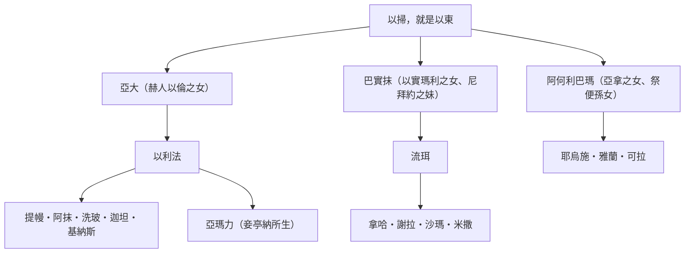
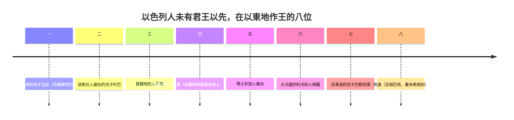

# 創世記 第36章

<!-- chapter-navigation:start -->
| [前一章](../01%20創世記/第35章.md) | [回目錄](../01%20創世記/全書目錄及綱要.md) | [下一章](../01%20創世記/第37章.md) |
| :--- | :---: | ---: |
<!-- chapter-navigation:end -->

1. [[以掃]]就是[[以東]]，他的後代記在下面。
2. [[以掃]]娶[[迦南地|迦南]]的女子為妻，就是赫人以倫的女兒[[亞大]]和希未人[[祭便]]的孫女、[[亞拿（何利人）|亞拿]]的女兒[[阿何利巴瑪]]，
3. 又娶了[[以實瑪利]]的女兒、[[尼拜約]]的妹子[[巴實抹]]。
4. [[亞大]]給[[以掃]]生了[[以利法]]；[[巴實抹]]生了[[流珥（以掃之子）|流珥]]；
5. [[阿何利巴瑪]]生了耶烏施、雅蘭、可拉。這都是[[以掃]]的兒子，是在[[迦南地]]生的。
6. [[以掃]]帶著他的妻子、兒女，與家中一切的人口，並他的牛羊、牲畜，和一切貨財，就是他在[[迦南地]]所得的，往別處去，離了他兄弟[[雅各]]。
7. 因為二人的財物群畜甚多，寄居的地方容不下他們，所以不能同居。
8. 於是[[以掃]]住在[[西珥山]]裡；以掃就是[[以東]]。
9. [[以掃]]是[[西珥山]]裡[[以東]]人的始祖，他的後代記在下面。
10. [[以掃]]眾子的名字如下。以掃的妻子[[亞大]]生[[以利法]]；以掃的妻子[[巴實抹]]生[[流珥（以掃之子）|流珥]]。
11. [[以利法]]的兒子是[[提幔]]、阿抹、洗玻、迦坦、基納斯。
12. [[亭納]]是[[以掃]]兒子[[以利法]]的妾；他給以利法生了[[亞瑪力人|亞瑪力]]。這是以掃的妻子[[亞大]]的子孫。
13. [[流珥（以掃之子）|流珥]]的兒子是拿哈、謝拉、沙瑪、米撒。這是[[以掃]]妻子[[巴實抹]]的子孫。
14. [[以掃]]的妻子[[阿何利巴瑪]]是[[祭便]]的孫女，[[亞拿（何利人）|亞拿]]的女兒；他給以掃生了耶烏施、雅蘭、可拉。
15. [[以掃]]子孫中作族長的記在下面。以掃的長子[[以利法]]的子孫中，有[[提幔]]族長、阿抹族長、洗玻族長，基納斯族長、
16. 可拉族長、迦坦族長、[[亞瑪力人|亞瑪力]]族長。這是在[[以東|以東地]]從[[以利法]]所出的族長，都是[[亞大]]的子孫。
17. [[以掃]]的兒子[[流珥（以掃之子）|流珥]]的子孫中，有拿哈族長、謝拉族長、沙瑪族長、米撒族長。這是在[[以東|以東地]]從流珥所出的族長，都是以掃妻子[[巴實抹]]的子孫。
18. [[以掃]]的妻子[[阿何利巴瑪]]的子孫中，有耶烏施族長、雅蘭族長、可拉族長。這是從以掃妻子，[[亞拿（何利人）|亞拿]]的女兒，阿何利巴瑪子孫中所出的族長。
19. 以上的族長都是[[以掃]]的子孫；以掃就是[[以東]]。
20. 那地原有的居民─[[何利人]][[西珥（何利人）|西珥]]的子孫記在下面：就是羅坍、朔巴、[[祭便]]、[[亞拿（何利人）|亞拿]]、
21. 底順、以察、底珊。這是從[[以東|以東地]]的[[何利人]][[西珥（何利人）|西珥]]子孫中所出的族長。
22. 羅坍的兒子是何利、希幔；羅坍的妹子是[[亭納]]。
23. 朔巴的兒子是亞勒文、瑪拿轄、以巴錄、示玻、阿南。
24. [[祭便]]的兒子是亞雅、[[亞拿（何利人）|亞拿]]（當時在曠野放他父親祭便的驢，遇著[[溫泉或騾子（創36：24）|溫泉]]的，就是這亞拿）。
25. [[亞拿（何利人）|亞拿]]的兒子是底順；亞拿的女兒是[[阿何利巴瑪]]。
26. 底順的兒子是欣但、伊是班、益蘭、基蘭。
27. 以察的兒子是辟罕、撒番、亞干。
28. 底珊的兒子是烏斯、亞蘭。
29. 從[[何利人]]所出的族長記在下面：就是羅坍族長、朔巴族長、[[祭便]]族長、[[亞拿（何利人）|亞拿]]族長、
30. 底順族長、以察族長、底珊族長。這是從[[何利人]]所出的族長，都在[[西珥山|西珥地]]，按著宗族作族長。
31. 以色列人未有君王治理以先，在[[以東|以東地]]作王的記在下面。
32. 比珥的兒子比拉在[[以東]]作王，他的京城名叫亭哈巴。
33. 比拉死了，[[波斯拉]]人謝拉的兒子約巴接續他作王。
34. 約巴死了，[[提幔]]地的人戶珊接續他作王。
35. 戶珊死了，比達的兒子哈達接續他作王；這哈達就是在[[摩押地]]殺敗米甸人的，他的京城名叫亞未得。
36. 哈達死了，瑪士利加人桑拉接續他作王。
37. 桑拉死了，大河邊的[[利河伯（大河邊）|利河伯]]人掃羅接續他作王。
38. 掃羅死了，亞革波的兒子巴勒哈南接續他作王。
39. 亞革波的兒子巴勒哈南死了，哈達接續他作王，他的京城名叫巴烏；他的妻子名叫米希他別，是米薩合的孫女，瑪特列的女兒。
40. 從[[以掃]]所出的族長，按著他們的宗族、住處、名字記在下面：就是[[亭納]]族長、亞勒瓦族長、耶帖族長、
41. [[阿何利巴瑪]]族長、以拉族長、比嫩族長、
42. 基納斯族長、[[提幔]]族長、米比薩族長、
43. 瑪基疊族長、以蘭族長。這是[[以東]]人在所得為業的地上，按著他們的住處。（所有的族長都是以東人的始祖[[以掃]]的後代。）

---

## 本章知識節點

### 人物
- [[以掃]]
- [[雅各]]
- [[亞大]]
- [[巴實抹]]
- [[阿何利巴瑪]]
- [[以實瑪利]]
- [[尼拜約]]
- [[以利法]]
- [[流珥（以掃之子）]]
- [[亭納]]
- [[亞瑪力人]]
- [[何利人]]
- [[西珥（何利人）]]
- [[亞拿（何利人）]]
- [[祭便]]
- [[亞瑪力]]
- [[迦勒]]

### 地點
- [[迦南地]]
- [[西珥山]]
- [[以東]]
- [[提幔]]
- [[波斯拉]]
- [[摩押地]]
- [[利河伯（大河邊）]]

### 歷史
- [[以掃後裔譜系]]
- [[以掃遷居西珥山]]
- [[以東族長制度]]
- [[以東諸王早於以色列王政]]
- [[以東非世襲王制]]
- [[何利人與以東人同化]]
- [[以掃妻子名差異]]

### 神學
- [[應許之地與西珥山的分離]]
- [[屬世成功早於應許成就]]
- [[以東與以色列的敵對]]
- [[神對以掃的地業安排]]

### 原文
- [[以掃名字含義]]
- [[以東名字含義]]
- [[何利名字含義]]
- [[流珥名字含義]]
- [[溫泉或騾子（創36：24）]]

### 互文
- [[創世記25章以掃賣長子名分]]
- [[創世記27章以掃所得祝福]]
- [[創世記13章亞伯拉罕與羅得分離]]
- [[出埃及記17章亞瑪力攻擊以色列]]
- [[申命記2章西珥賜給以掃]]
- [[歷代志上1章以掃後裔]]
- [[俄巴底亞書以東審判]]
- [[羅馬書9章雅各以掃揀選]]

### 解經爭議
- [[以掃三位妻子名單差異]]
- [[創世記36章以東諸王年代問題]]
- [[約伯記與以東地的關聯]]

---

## 本章整理

上一章以撒去世，以掃和雅各把他埋葬了（創35:29）。這一章記以掃的後代：以掃的妻子和兒子（第1-5節），他離開雅各遷往西珥山（第6-8節），他的子孫和族長（第9-19節），原住西珥地的何利人的子孫（第20-30節），以及以色列人未有君王以先在以東地作王的八位（第31-39節）。全章五次重申以掃就是以東（第1、8、9、19、43節）。

### 以掃的妻子與兒子（1-5節）

以掃就是以東，他的後代記在下面（第1節；[[以掃]]；[[以東]]）。『以掃』是『有毛的』，『以東』是『紅』；以掃為了一碗紅豆湯把長子名分賣給雅各，因此又名以東（創25:30；CT）。CT 說，以掃犯了一件錯誤的事，那件事竟成為他永久的記念。以東地位於古代猶大國南部，從死海延伸到紅海阿卡巴灣（《啟導本聖經創世記註釋》）。

雅各的故事本該接在以撒的死亡之後，聖經卻在這裡插入以掃的後裔，《聖經精讀本──創世記註解》說有三個目的：這些記載與立約百姓以色列有密切的關係，如同羅得之於亞伯拉罕、以實瑪利之於以撒；神預言的成就，就是『兩國在利百加腹中』（創25:23）；以立約之地迦南為中心，對照留下的人和離去者的生涯。KC 說，以掃的心沒有改變，父親的死沒有在他心裡留下長久的印象，他離開自己的弟兄，表示要與神心意的路線沒有關係。

以掃娶迦南的女子為妻，就是赫人以倫的女兒亞大和希未人祭便的孫女、亞拿的女兒阿何利巴瑪，又娶了以實瑪利的女兒、尼拜約的妹子巴實抹（第2-3節）。這三位妻子的名字，與創26:34、創28:9 所記不同。可能的原因：女人結婚時有時會改名（《串珠聖經註釋》、《精讀本》）；『以掃』又稱『以東』，在特殊事件中可以有另外的名字，聖經中的『父親』有時指先祖，一個族系也常有兩個並用的名稱（《精讀本》）。丁良才與 CT 對對應關係的說法是：亞大又名巴實抹（創26:34），巴實抹又名瑪哈拉（創28:9），阿何利巴瑪又名猶滴；丁良才並說，『赫』是總稱，『希未』及『何利』是特別的稱呼，就像英國與蘇格蘭。以掃的婚姻被視為失敗的婚姻，因為他與外邦人結婚，並有多個妻子（創26:34；28:6-9；《精讀本》）。

亞大給以掃生了以利法；巴實抹生了流珥；阿何利巴瑪生了耶烏施、雅蘭、可拉；這都是以掃的兒子，是在迦南地生的（第4-5節）。『流珥』在聖經中共有四個：以掃的兒子、摩西的岳父米甸祭司、迦得支派的首領、從巴比倫回來的一個便雅憫人（丁良才、李道生《舊約聖經問題總解》）。KC 說，以掃的兒子都生在迦南地，雅各的兒子除了便雅憫，都生在迦南地之外。

### 以掃離開雅各，遷往西珥山（6-8節）

以掃帶著他的妻子、兒女，與家中一切的人口，並牛羊、牲畜和他在迦南地所得的一切貨財，往別處去，離了他兄弟雅各（第6節）。因為二人的財物群畜甚多，寄居的地方容不下他們，所以不能同居（第7節），於是以掃住在西珥山裡（第8節；[[西珥山]]）。這使人想起亞伯拉罕與羅得的事（創13:5-6；《創世記雷氏研讀本》）。

以掃早已在西珥游牧（創32:3），仍保留迦南地南方的住家，到這時才正式以西珥山作為永久的住所（CT）；他是因父親以撒去世回來安葬，就與雅各分家（丁良才）。雅各與以掃分開的表面原因是財產豐富和牧場不足，根本原因是神的護理（創27:39-40；《精讀本》）。神後來說，「我已將西珥山賜給以掃為業」（申2:5），CT 因此說，以掃遷往西珥山乃是出於神手的安排。

| | 雅各 | 以掃 |
|---|---|---|
| 去向 | 進入應許之地 | 離開應許之地 |
| 地業 | 迦南（創35:12） | [[西珥山]]（申2:5） |
| 兒子出生地 | 除便雅憫外皆生於境外 | 皆生於[[迦南地]] |

### 以掃的子孫與族長（9-19節）

以掃是西珥山裡以東人的始祖，他的後代記在下面（第9節）。聖經僅記載以掃兒孫的名字，沒有記載他們的事蹟，是為將來他們與以色列人的關係留下可追尋的記錄（CT）；介紹以掃的三位妻子、五個兒子、十一個孫子，其中成為族長的有三個兒子和十一個孫子，共十四人（代上1:35-37；《精讀本》）。

華爾頓說，這份族譜先列以掃最初的三個妻子，接著是十二個支族的名稱（第9-14節，亞瑪力除外，他是妾所生的子），數目與拿鶴（創22:20-24）、以實瑪利（創25:13-16）、以色列的相同；第三層的後裔（第15-19節）似乎是宗族的名稱，與上一層有些許重複。

提幔是以東北部的一座城，約伯的友人以利法就是來自此地（伯2:11；《串珠聖經註釋》）；這城多出有名望有智慧的人（耶49:7、20；摩1:12；哈3:3；丁良才）。烏斯（創36:28）是約伯的出身地名（伯1:1），所以約伯記很可能發生在以東地（CT；[[約伯記與以東地的關聯]]）。李道生說有人認為以東王約巴（創36:33）可能是約伯記中的約伯，但未確知。

亞瑪力是以掃的內孫，出自[[以利法]]與妾[[亭納]]（第12節），是亞瑪力人的始祖，後來成為以色列人最憎惡的敵人（出17:8；申25:17；撒上15:2；丁良才、《串珠》）。華爾頓說，亞瑪力人所流浪的地區包括尼革、外約但、西乃半島，聖經以外沒有提及他們的歷史記錄，也找不到肯定與他們有關的文物，但考古學在本區的調查，顯示這個時期與遊牧和半遊牧民族有關的證據數量頗為可觀。KC 把亞瑪力看成信徒肉體的畫像，CT 也以他豫表肉體，因為肉體和靈相爭、相敵（加5:17；[[亞瑪力人]]）。

『族長』（`אַלּוּף`，*al.luph*，H441，STEP 簡要詞義是 chief）含有『聯合』『指教』之意，起初指純正血統家族的最高領袖，後來是某個部落或集體的領袖（《精讀本》）；《雷氏》說意思是首領。華爾頓說，本段列出不同地區的多位族長，由於這些貝督因民族採用酋長統治的體制，「本段除了是族譜以外，也可算是君王的名單」，蘇美的君王名單也十分相像。KC 注意到，基納斯（第15節）的後裔[[迦勒]]被稱為『基尼洗人』（書14:6），所以生為以東人並非絕望（士3:9）。

### 原住西珥地的何利人（20-30節）

那地原有的居民，就是何利人西珥的子孫（第20-30節；[[何利人]]；[[西珥（何利人）|西珥]]）。何利人原住西珥山，以掃的子孫把他們消滅，住在他們的土地上（申2:12、22；《啟導本》）；何利人早在亞伯拉罕時代就第一次被以攔王基大老瑪征服（創14:5-6），日後被以掃的子孫完全征服並同化（《精讀本》）。

『何利』原意是『住在山洞』（《串珠》），『希未』與『何利』是不是同一個族，有兩種解釋：原文只有微小的分別，創36:2 的『希未』或許本來就是『何利』；或希未人原來出於何利山，所以有時也稱為何利人（丁良才）。CT 的看法是，『何利人』是赫人的一個支系『希未人』的別稱。

何利人和以掃的後裔彼此通婚，混合成為以東人（《串珠》、CT）。《精讀本》說，記錄這份名單有三個目的：兩族通婚使何利人和以掃的後裔同化；表明以掃的後裔已經完全從約中隔離出來，淪為外邦人；以掃因不明白婚姻的純潔性與立約的關係，釀成悲劇（創28:6-9）。CT 並說，信的和不信的原不相配（林後6:14），信徒若與世界聯合，就要被世界同化，而失去見證。阿何利巴瑪是亞拿的女兒、祭便的孫女，這條家族線把以掃家與何利人連在一起（[[阿何利巴瑪]]；[[祭便]]）。

名單中夾著一則小事：亞拿當時在曠野放他父親祭便的驢，遇著溫泉（第24節；[[亞拿（何利人）|亞拿]]；[[溫泉或騾子（創36：24）|溫泉]]）。本章有三個同名的亞拿：祭便的孫女、何利人的族長，和祭便的兒子（本節；CT）。這個字，STEP 作 `יֵמִם`（*yem*，H3222），簡要詞義是 hot spring。

華爾頓說，族譜裡有同名的人時，分辨的方法之一是簡述其人的生涯，這位亞拿與他叔父的分別，在於他發現了一個對全族都有益處的自然現象；但『溫泉』的翻譯完全是根據武加大譯本，猶太傳統把這字譯作『騾子』，換言之是把學會馬驢雜交的功勞歸給亞拿。《精讀本》說，這是聖經所記載何利人的唯一基業，暗示聖經在記錄事件時把重點放在屬靈價值上。

KC 讀出一層反諷：在炎熱的曠野發現泉源本應是生命的指望，但湧出的若是熱水，反而加重乾渴；發明家和政治上有影響力的人物，不憑神塑造人類，常常承諾改善生活，人民信他們、選他們做領袖，卻一次又一次大失所望。

### 以東地的諸王（31-39節）

以色列人未有君王治理以先，在以東地作王的記在下面（第31節）。神曾應許亞伯拉罕（創17:6）與雅各（創35:11）有君王從他們而出，這預言在雅各後裔中未曾應驗以先，在以掃的後裔中已經應驗了；屬世俗的先得榮耀，但那榮耀必歸無有，信主的人後得榮耀，而這榮耀卻是長久（丁良才）。KC 也說，以掃似乎比弟弟更成功，他的後裔中尊貴的人出現得比雅各的後裔早；但神用一章交代他們的全部歷史，雅各的歷史則從創37章起與約瑟連在一起，看見受苦在先，榮耀在後。『以色列人未有君王以先』不是指掃羅時代，而是指曠野領袖摩西的時代（申33:5；《精讀本》）。

這八位王沒有一位提到兒子，其中三位另記了京城，可見王位不是世襲的（CT）。

王權繼承通過選擇族長，不是血統繼承的世襲制，以東是由王和族長同時統治的地方性君主體制（《精讀本》）。以東沒有固定的京城，誰最有權力，誰就是王（《串珠》）。丁良才說，『大河邊的利河伯』想必是幼發拉底河，這個利河伯和創10:11 的利河伯不同；波斯拉位於死海東南三十二公里，是以東最重要的一座大城（《串珠》，參摩1:12）。

第二位哈達的京城和皇后被詳細寫出，卻沒有提到他死了，所以他在以色列人出埃及的時候，大概正作以東王，對以色列人甚不友善（民20:14-21；丁良才、CT）。《串珠》說，提到哈達的妻子米希他別和她的母親與婆婆，可能是由於她們曾參與執政。

### 按住處列出的族長，以及全章（40-43節）

從以掃所出的族長，按著他們的宗族、住處、名字記在下面（第40-43節）。第15-19節的族長、第20-39節的王，與第40-43節的族長未必是相繼的；一王掌權的時候，同時還有幾個族長（民20:14；出15:15；丁良才）。這些族長中有兩人的名字已在第15-19節中提到，這裡卻按他們的住處來臚列（《串珠》）；KC 說，那裡只列人名，這裡列的是地名。

本章以『以東人的始祖以掃的後代』作結，是聖經對以掃和其後裔的告別，從此只能看到以東一直抵擋以色列，最終滅亡。當以東人擁有自己的領地時，以色列人則在他國的壓迫下，只擁有對迦南地應許的盼望；但歷史顯明持有應許的人最終征服了那些擁有物質的人（代上18:13；摩9:12；《精讀本》）。CT 的靈訓要義把以掃的家譜列為『肉體的特徵』十項：因一點食物賣了長子的名分、與世界聯合、離開弟兄、財物霸佔人心、作頭管理別人、厭棄神不要神作王等。

**參考資料**
代號：CT＝ccbiblestudy《逐節註解》；GT＝ccbiblestudy《拾穗》，彙集多本中文註釋；正文直接寫書名或作者的（如《丁道爾》、丁良才），都出自這裡；KC＝KingComments；BH＝BibleHub Study；STEP＝STEP Bible 原文資料（CC BY 4.0）
https://www.ccbiblestudy.org/Old%20Testament/01Gen/01CT36.htm
https://www.ccbiblestudy.org/Old%20Testament/01Gen/01GT36.htm
https://www.kingcomments.com/en/bible-studies/Gen/36
https://biblehub.com/study/genesis/36.htm
https://github.com/STEPBible/STEPBible-Data

<!-- appendix-links:start -->
## 附錄

### 相關地圖
- [[appendix/fhl_maps/maps/014|〈創圖九〉以掃的生平，以東、西珥、亞瑪力人和米甸人]]
<!-- appendix-links:end -->

<!-- chapter-navigation:start -->
| [前一章](../01%20創世記/第35章.md) | [回目錄](../01%20創世記/全書目錄及綱要.md) | [下一章](../01%20創世記/第37章.md) |
| :--- | :---: | ---: |
<!-- chapter-navigation:end -->
