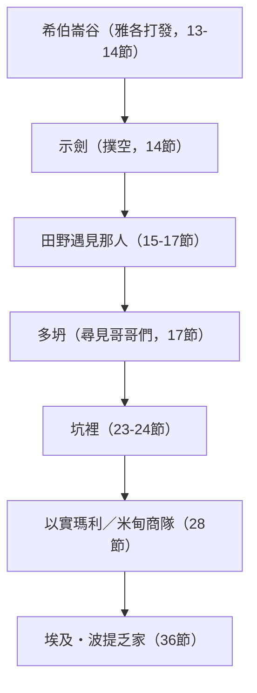
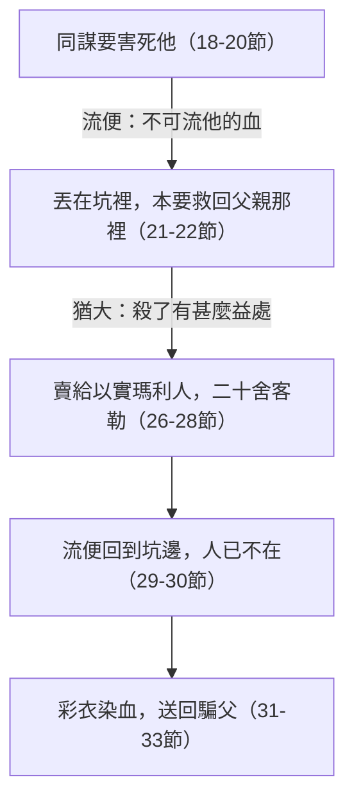

# 創世記 第37章

<!-- chapter-navigation:start -->
| [前一章](../01%20創世記/第36章.md) | [回目錄](../01%20創世記/全書目錄及綱要.md) | [下一章](../01%20創世記/第38章.md) |
| :--- | :---: | ---: |
<!-- chapter-navigation:end -->

1. [[雅各]]住在[[迦南地]]，就是他父親寄居的地。
2. [[雅各]]的記略如下。[[約瑟]]十七歲與他哥哥們一同牧羊。他是個童子，與他父親的妾[[辟拉]]、[[悉帕]]的兒子們常在一處。約瑟將他哥哥們的惡行報給他們的父親。
3. [[以色列]]原來愛[[約瑟]]過於愛他的眾子，因為約瑟是他年老生的；他給約瑟做了一件[[彩衣]]。
4. [[約瑟]]的哥哥們見父親愛約瑟過於愛他們，就恨約瑟，不與他說和睦的話。
5. [[約瑟]]做了一夢，告訴他哥哥們，他們就越發恨他。
6. [[約瑟]]對他們說：請聽我所做的夢：
7. 我們在田裡捆禾稼，我的捆起來站著，你們的捆來圍著我的捆下拜。
8. 他的哥哥們回答說：難道你真要作我們的王嗎？難道你真要管轄我們嗎？他們就因為他的夢和他的話越發恨他。
9. 後來他又做了一夢，也告訴他的哥哥們說：看哪，我又做了一夢，夢見太陽、月亮，與十一個星向我下拜。
10. [[約瑟]]將這夢告訴他父親和他哥哥們，他父親就責備他說：你做的這是什麼夢！難道我和你母親、你弟兄果然要來俯伏在地，向你下拜嗎？
11. 他哥哥們都[[嫉妒與爭競|嫉妒]]他，他父親卻把這話存在心裡。
12. [[約瑟]]的哥哥們往[[示劍（城）|示劍]]去放他們父親的羊。
13. [[以色列]]對[[約瑟]]說：你哥哥們不是在[[示劍（城）|示劍]]放羊嗎？你來，我要打發你往他們那裡去。約瑟說：我在這裡。
14. [[以色列]]說：你去看看你哥哥們平安不平安，群羊平安不平安，就回來報信給我；於是打發他出[[希伯崙]]谷，他就往[[示劍（城）|示劍]]去了。
15. 有人遇見他在田野走迷了路，就問他說：你找什麼？
16. 他說：我找我的哥哥們，求你告訴我，他們在何處放羊。
17. 那人說：他們已經走了，我聽見他們說要往[[多坍]]去。[[約瑟]]就去追趕他哥哥們，遇見他們在多坍。
18. 他們遠遠地看見他，趁他還沒有走到跟前，大家就同謀要害死他，
19. 彼此說：你看！那做夢的來了。
20. 來吧！我們將他殺了，丟在一個[[坑中無水|坑]]裡，就說有惡獸把他吃了。我們且看他的[[約瑟的夢|夢]]將來怎麼樣。
21. [[流便]]聽見了，要救他脫離他們的手，說：我們不可害他的性命；
22. 又說：不可流他的血，可以把他丟在這野地的[[坑中無水|坑]]裡，不可下手害他。[[流便]]的意思是要救他脫離他們的手，把他歸還他的父親。
23. [[約瑟]]到了他哥哥們那裡，他們就剝了他的外衣，就是他穿的那件[[彩衣]]，
24. 把他丟在[[坑中無水|坑]]裡；那坑是空的，裡頭沒有水。
25. 他們坐下吃飯，舉目觀看，見有一夥[[米甸]]的[[以實瑪利|以實瑪利人]]從[[基列]]來，用駱駝馱著[[香料乳香沒藥貿易|香料、乳香、沒藥]]，要帶下[[埃及]]去。
26. [[猶大（雅各之子）|猶大]]對眾弟兄說：我們殺我們的兄弟，藏了他的血有什麼益處呢？
27. 我們不如將他賣給[[以實瑪利|以實瑪利人]]，不可下手害他；因為他是我們的兄弟，我們的骨肉。眾弟兄就聽從了他。
28. 有些[[米甸]]的商人從那裡經過，哥哥們就把[[約瑟]]從[[坑中無水|坑]]裡拉上來，講定[[二十舍客勒銀子]]，把約瑟賣給[[以實瑪利|以實瑪利人]]。他們就把約瑟帶到[[埃及]]去了。
29. [[流便]]回到[[坑中無水|坑]]邊，見[[約瑟]]不在坑裡，就撕裂衣服，
30. 回到兄弟們那裡，說：童子沒有了。我往哪裡去才好呢？
31. 他們宰了一隻公山羊，把[[約瑟]]的那件[[彩衣]]染了血，
32. 打發人送到他們的父親那裡，說：我們撿了這個；請認一認是你兒子的外衣不是？
33. 他認得，就說：這是我兒子的外衣。有惡獸把他吃了，[[約瑟]]被撕碎了！撕碎了！
34. [[雅各]]便撕裂衣服，腰間圍上麻布，為他兒子悲哀了多日。
35. 他的兒女都起來安慰他，他卻不肯受安慰，說：我必悲哀著下陰間，到我兒子那裡。[[約瑟]]的父親就為他哀哭。
36. [[米甸]]人帶[[約瑟]]到[[埃及]]，把他賣給[[法老]]的內臣─護衛長[[波提乏]]。

---

## 本章知識節點

### 人物
- [[雅各]]
- [[以色列]]
- [[約瑟]]
- [[辟拉]]
- [[悉帕]]
- [[流便]]
- [[猶大（雅各之子）]]
- [[以實瑪利]]
- [[米甸]]
- [[法老]]
- [[波提乏]]
- [[以實瑪利人]]

### 地點
- [[迦南地]]
- [[示劍（城）]]
- [[希伯崙]]
- [[多坍]]
- [[基列]]
- [[埃及]]

### 歷史
- [[約瑟被賣]]
- [[雅各受兒子欺騙]]
- [[約瑟下埃及]]

### 神學
- [[約瑟預表基督]]
- [[受苦到榮耀]]
- [[嫉妒與爭競]]
- [[父親偏愛與家庭破裂]]
- [[神的主權]]

### 文化
- [[彩衣]]
- [[古代近東夢文化]]
- [[二十舍客勒銀子]]
- [[坑中無水]]
- [[香料乳香沒藥貿易]]

### 互文
- [[約瑟的夢|約瑟的夢 禾捆與日月星兩夢預告全家下拜]]
- [[約瑟在埃及|約瑟在埃及 被賣為奴到官居宰相的全程]]
- [[創世記27章雅各欺騙以撒|創世記27章雅各欺騙以撒 山羊皮騙父對照山羊血騙父]]
- [[創世記42章約瑟哥哥們認罪|創世記42章約瑟哥哥們認罪 二十年後憶起坑中哀求]]
- [[阿摩司書6章不為約瑟的苦難擔憂|阿摩司書6章不為約瑟的苦難擔憂 坐下吃飯的冷漠成為先知控訴]]
- [[約瑟失衣袍（三次）|約瑟失衣袍（三次） 彩衣、外衣、囚服三次被剝]]
- [[被賣為奴|被賣為奴 創15:13 寄居受苦四百年的應驗起點]]

### 解經爭議
- [[約瑟告哥哥惡行是否告狀]]
- [[約瑟說夢是否不智]]
- [[約瑟母親在第二夢中的指涉]]
- [[以實瑪利人與米甸人稱呼差異]]

### 原文
- [[衣裳（外袍）]]

### 背景
- [[古代近東奴隸制度]]
- [[古代哀悼習俗]]

---

## 本章整理

上一章記以掃的後代；這一章回到[[雅各]]，經文卻說『雅各的記略如下』之後立刻轉入[[約瑟]]。約瑟十七歲，因為報哥哥們的惡行、父親偏愛、兩個夢，被哥哥們恨惡（第1-11節）；他奉父命去看哥哥們，哥哥們同謀要害他，把他丟在坑裡，又賣給商隊帶到埃及（第12-28節）；兒子們用染血的彩衣欺騙雅各，雅各悲哀不肯受安慰（第29-35節），約瑟在埃及被賣給法老的內臣波提乏（第36節）。

### 雅各的記略：約瑟被恨（1-11節）

雅各住在迦南地，就是他父親寄居的地（第1節；[[迦南地]]）。迦南是神應許給以撒之地，經文卻說是他『寄居的地』，信徒在地上乃是作客（來11:9-10；CT）。雅各住在迦南，與以掃住在西珥山（創36:8）形成對比，應許的繼承人和應許之外的人，以迦南為中心已被完全區分（《聖經精讀本──創世記註解》）。KC 說，雅各沒有像以掃那樣的君王、土地與大族，屬世的權勢比屬靈的偉大來得快，所應許的屬靈祝福需要耐心與信心。

『雅各的記略如下』（第2節）原文是『家譜』，STEP 的簡要詞義是 generation（`תּוֹלֵדוֹת`，*to.le.dah*，H8435）。這裡雖稱雅各的記略，卻以約瑟的故事為中心，因為雅各的記略只有在和約瑟的關係上才顯出意義，包括約瑟在內的十二個兒子的故事，正是以色列的記略（《精讀本》）。KC 說，雅各和後裔的存續繫於約瑟；CT 也說，神要藉約瑟的遭遇，說明雅各的靈命如何經過對付而達到成熟，如何經過苦難而達到榮耀。

約瑟十七歲與哥哥們一同牧羊；他是個童子，與他父親的妾辟拉、悉帕的兒子們常在一處（第2節）。約瑟在離開哈蘭前六年出生，至今已在迦南地過了十一個年頭（CT）。

雅各雖然看重約瑟，仍叫他和哥哥們做一樣的苦工（創31:40；丁良才）。辟拉、悉帕的兒子們是但、拿弗他利、迦得、亞設，他們可能得不到像其他兄弟那樣的地位（《串珠聖經註釋》）；『他哥哥們的惡行』就是指這四個兒子（《創世記雷氏研讀本》）。

約瑟把哥哥們的惡行報給他們的父親，各家的評價不同（[[約瑟告哥哥惡行是否告狀]]）。他這樣做是顧及父家的名譽和神的榮耀，如果先勸勉哥哥們，就是一個完全的辦法（弗5:11；利19:17；丁良才）；他似乎沒有被哥哥們的惡行誘惑，而是一一告訴父親（《精讀本》）。KC 說，他不是告密的人，他恨惡惡事，不參與其中，哥哥們所做的使他痛心，沒有比對父親說更合適的人了。CT 的話中之光則說，在教會中見到弟兄姊妹的惡行時，應當為他們代禱，把他們的事帶到父神面前，而不要輕易告訴別人。STEP 標示這裡的『報告』是 `דִּבָּה`（*dib.bah*，H1681），簡要詞義是 slander，本節譯作 report；這個詞本身不足以決定約瑟的動機。

以色列原來愛約瑟過於愛他的眾子，因為約瑟是他年老生的，他給約瑟做了一件彩衣（第3節；[[彩衣]]）。拉結在雅各九十一歲時生約瑟，現在約瑟的生母已經去世，約瑟似乎在眾弟兄中最虔誠、孝順（《精讀本》）。彩衣是長袖的長袍，上面可能有繡花或飾物，一般為貴族所穿（撒下13:18；CT）；雅各給約瑟做彩衣，暗示要把長子的名分給他（丁良才）。李道生說，彩衣可能暗示長子的名分，但不可能是長子名分的全部權利，因為這些權利已經賜給猶大了（創49:8-12）。STEP 作 `כְּתֹנֶת פַּסִּים`（H3801 與 H6446），簡要詞義是 tunic（`כֻּתֹּנֶת`）與 long-sleeved（`פַּס`）。

《舊約背景註釋》說，約瑟父親為他做的特種衣裳代表權柄和寵愛，雖或色彩豐富，使這種衣裳與眾不同的，是其材料、織工、（下擺或衣袖的）長度；由於形容這衣裳的希伯來字眼只在本段出現，「這衣服的特色究竟是什麼，十分難以確定」。雅各偏愛約瑟，KC 為他說了公道話：與主同行的孩子比任性的孩子更叫我們喜樂，這不是偏愛；CT 的話中之光則說，父母對待兒女不可有差別待遇，否則會演變成家庭糾紛的原因。

約瑟的哥哥們見父親愛約瑟過於愛他們，就恨約瑟，不與他說和睦的話（第4節）。『和睦』是 `שָׁלוֹם`（*sha.lom*，H7965），連希伯來人最常用的『平安』也不說（《精讀本》）；第14節雅各差約瑟去看哥哥們『平安不平安』，用的是同一個字。

| 層次 | 起因 | 經文 |
|---|---|---|
| 恨 | 約瑟將惡行報給父親 | 第2節 |
| 恨（不與他說和睦的話） | 父親以彩衣顯出偏愛 | 第3-4節 |
| 越發恨、嫉妒（[[嫉妒與爭競]]） | 兩個夢暗示全家要向他下拜 | 第5-11節 |

約瑟做了一夢，告訴哥哥們，他們就越發恨他（第5節）。夢說：我們在田裡捆禾稼，我的捆起來站著，你們的捆來圍著我的捆下拜（第6-7節）。哥哥們說：「難道你真要作我們的王嗎？難道你真要管轄我們嗎？」（第8節；[[約瑟的夢]]）。後來他又做了一夢，夢見太陽、月亮與十一個星向他下拜（第9節）；太陽指父親，月亮指母親，十一個星指兄長們，對住帳篷的遊牧民是非常熟悉的象徵（《精讀本》）。

這兩個夢出於神的啟示（CT）；一連做兩次類似的夢，表示這事出於神的命定，必要應驗（創41:32；CT、丁良才）。神讓約瑟連續做兩個被高舉的夢，是為他日後的遭遇預先做好心理準備，使他在苦難中仍因這兩個夢而不喪志（CT）。

約瑟為什麼要把夢說出來？這似乎不聰明，但他只是十七歲的孩子，這些夢預表將來的事，在未應驗以先必須使哥哥們知道（丁良才）；如果他有心計，就不會把第二個夢說出來，他的言行顯出單純和誠實（《精讀本》）。

第一個夢在哥哥們到埃及購糧、跪拜在他面前時應驗（創42:6；43:26；44:14），第二個夢在雅各收約瑟兩個兒子為養子時如實成就（創48:5；《精讀本》）。

約瑟將這夢告訴他父親和哥哥們，他父親就責備他：「你做的這是什麼夢！難道我和你母親、你弟兄果然要來俯伏在地，向你下拜嗎？」（第10節）。『你母親』指誰，各家不同。拉結已經過世，所以《雷氏》說顯然是指利亞，丁良才說大概是指利亞或辟拉；《精讀本》卻說是指約瑟的生母拉結，雅各提到她，是為了指出這夢的荒唐。CT 提到有解經家認為是利亞，但說這夢只是強調約瑟將來的地位在全家之上，不必照字面解作父母都要向他下拜。

CT 並說，這個夢只是強調約瑟將來的地位在全家之上，不是按字面解釋為連父母都會下拜。他哥哥們都嫉妒他；他父親卻把這話存在心裡（第11節）。『嫉妒』（`קָנָא`，*qa.na*，H7065）簡要詞義是 be jealous，與該隱對亞伯、以掃對雅各、掃羅對大衛、法利賽人對基督（太27:18）的表現相似（《精讀本》）；雅各或者看出這夢出於神的旨意，但因約瑟年幼，不敢明明地承認（丁良才）。

《舊約背景註釋》說，初民很重視夢，相信夢能讓人知曉神界的事物，「連一般人的尋常夢也不例外」，夢經常充滿象徵成分，但「這些象徵的明顯程度，有時也很合理」；擢升高位的夢，古代近東還有其他例子，最有名的是約瑟以前五百年亞喀得的撒珥根。

### 奉父差遣，尋找哥哥們（12-17節）

約瑟的哥哥們往示劍去放他們父親的羊（第12節）。示劍是雅各的兒子們曾殺戮全城的地方（創34章；CT）。以色列對約瑟說：「你哥哥們不是在示劍放羊嗎？你來，我要打發你往他們那裡去。」約瑟說：「我在這裡」（第13節）。雅各因著兒子們從前的犯行，時常擔心他們的安危（創34:30；CT）；丁良才說，他或者恐怕有示劍附近的人來報仇。他打發約瑟出希伯崙谷，往示劍去看看哥哥們和羊群平安不平安（第14節）。

有人遇見他在田野走迷了路，問他：「你找什麼？」他說：「我找我的哥哥們，求你告訴我，他們在何處放羊。」那人說他們已經走了，要往多坍去，約瑟就去追趕他哥哥們，遇見他們在多坍（第15-17節；[[多坍]]）。多坍在示劍以北約二十英里，那裡水草茂盛（CT）。《舊約背景註釋》說，多坍位於示劍以北十四哩，是商旅和牧人北上耶斯列谷的主要大道之上，城的周圍是上等的牧場。冬雨使牧草茂盛，牧人可以用本村或營帳附近的牧場，雨季結束後羊群要帶到夏季有草的山地（《舊約背景註釋》）。

約瑟的日常生活體現他的品性：非常順從父母，忠於擔負的使命，真心愛自己的兄弟（《精讀本》）。KC 說，約瑟的順服超過父親所吩咐的，他本可以回去報告沒有在示劍找到哥哥們；他說『我找我的哥哥們』，哥哥們不把他當弟兄，他卻仍以他們為弟兄。

### 坑與商隊（18-30節）

他們遠遠地看見他，趁他還沒有走到跟前，大家就同謀要害死他（第18節）。這一幕重現了哥哥們在底拿事件中顯露過的狡詐（創34:13）和殘忍（創34:25-29）；重婚和偏愛引起異母兄弟間的嫉妒，終於導致謀殺親兄弟的罪惡（箴29:10；《精讀本》）。他們彼此說：「你看，那作夢的來了」（第19節）。這句話原文直譯是『做夢大師』『做夢專家』，語帶諷刺（《雷氏》）；STEP 作 `בַּעַל`（*ba.al*，H1167，master）與 `חֲלוֹם`（*cha.lom*，H2472，dream）。

他們說：「來吧！我們將他殺了，丟在一個坑裡，就說有惡獸把他吃了。我們且看他的夢將來怎麼樣」（第20節）。哥哥們的目的是要廢掉約瑟的夢，他們這樣行，反倒使夢應驗了；聖經中往往有惡人不由自己就成全了神的旨意（丁良才）。《精讀本》說，這正如人為防止分散而建築巴別塔，卻反而加速了人類的分散（創11:4-9）。

流便聽見了，要救他脫離他們的手，說：「我們不可害他的性命。」又說：「不可流他的血，可以把他丟在這野地的坑裡，不可下手害他」（第21-22節）。經文說明：「流便的意思是要救他脫離他們的手，把他歸還他的父親」，所以不該再懷疑他的動機（CT）。流便有此一念之慈，雖因犯淫亂失去長子名分，日後在流便的『溪水旁仍有定大志、設大謀的』（士5:15-16；CT）。

流便雖願意救約瑟，卻不敢說堅定有力的話，因為他自己的良心有虧（創35:22；丁良才）。他的提議得到其他兄弟的回應，因為他是長子，又在眾兄弟中有理由最恨約瑟，而「不可流他血」是最低程度的同情（《精讀本》）；長子在希伯來人家庭中負有管理弟妹的責任，後來大權旁落猶大手中（《啟導本聖經創世記註釋》）。KC 把流便比作約7:50-51 的尼哥底母，在審判基督的過程中提出異議。

約瑟到了他哥哥們那裡，他們就剝了他的外衣，就是他穿的那件彩衣，把他丟在坑裡；那坑是空的，裡頭沒有水（第23-24節；[[坑中無水]]）。和合本的『坑』是儲水池，用以儲藏雨水，旱季時人畜的食水都靠它供應；「水池沒有水時，可以用作臨時牢房」（耶38:6；《舊約背景註釋》）。約瑟發出哀求的哭聲，情詞迫切，甚至過了二十年還清晰地留在哥哥們的腦海中（創42:21-22；《精讀本》）。

他們坐下吃飯，舉目觀看，見有一夥米甸的以實瑪利人從基列來，用駱駝馱著香料、乳香、沒藥，要帶下埃及去（第25節）。他們毫不顧惜骨肉之親，實在殘忍（創42:21；摩6:6；丁良才）；他們卑鄙的行為一點也沒有影響食欲（《雷氏》）。阿摩司用這一幕控訴以色列：不為約瑟的苦難擔憂（摩6:6）；KC 應用說，當神的百姓在罪的後果下呻吟，人們卻沉溺於安逸、情慾與怠惰，最大的需要是他們看不見自己的需要。

以實瑪利人和米甸人交替稱呼，有三種解法：或者是住在米甸地的以實瑪利人，或者這一夥商人中有米甸人也有以實瑪利人，或者兩族同住東方曠野，彼此通婚而混雜（士8:22、24；丁良才）。兩族都是亞伯拉罕的後裔，關係密切，很難清楚區分（《啟導本》、《串珠》、《雷氏》），作者不關注他們的國籍，重點在於買賣約瑟的行為（《精讀本》；[[米甸]]；[[以實瑪利|以實瑪利人]]）。

《舊約背景註釋》說，士8:24 混用兩個名字，似乎顯示聖經的作者若非假定兩者的關聯，就是反映兩者間已知的血緣。『基列』出產乳香等香料，多坍是從大馬色經基列往南方埃及的通商孔道必經之地（CT）；行商沿西乃半島的各個商道，把香從阿拉伯南部運到巴勒斯坦海傍的迦薩和埃及，本段所述的米甸人大概就是在這樣一條商道上買下約瑟（《舊約背景註釋》）。

猶大對眾弟兄說：「我們殺我們的兄弟，藏了他的血有什麼益處呢？」又說：「我們不如將他賣給以實瑪利人，不可下手害他；因為他是我們的兄弟，我們的骨肉。」眾弟兄就聽從了他（第26-27節；[[猶大（雅各之子）|猶大]]）。聽從的是猶大而不是長子流便，因為流便犯了淫亂，他的話不再受弟弟們的尊重（CT）。舊約的猶大賣了約瑟，新約的猶大出賣耶穌（丁良才、CT）；按猶太人的傳說，西緬也在這事上出頭（創42:24；丁良才）。KC 說，他們把約瑟賣給親族的商人，賣的價錢比一個奴隸該值的還少（出21:32），這裡已有出賣主耶穌的猶大的精神。

有些米甸的商人從那裡經過，哥哥們就把約瑟從坑裡拉上來，講定二十舍客勒銀子，把約瑟賣給以實瑪利人，他們就把約瑟帶到埃及去了（第28節；[[二十舍客勒銀子]]）。二十舍客勒是五至二十歲男子的價值（利27:5；丁良才、CT、《串珠》），約瑟被當作奴僕出賣；這低於當時一個奴隸的身價（《啟導本》），後來成人奴隸的價錢被定為三十塊銀子（出21:32；《雷氏》）。

同時代的文學（例如《漢摩拉比法典》）證明這是奴隸在這個時期的常價，「它大約等於兩年的工錢」；古代近東從遠古已有奴隸買賣，「這種奴隸重獲自由的機會極微」（《舊約背景註釋》；[[古代近東奴隸制度]]）。

流便回到坑邊，見約瑟不在坑裡，就撕裂衣服，回到兄弟們那裡說：「童子沒有了。我往哪裡去才好呢？」（第29-30節）。這表示出賣約瑟時流便不在場，或許正值他輪班照顧羊群（CT）；撕裂衣服是中東人極度悲憤的感情表達（《啟導本》）。丁良才說，流便雖然傷心，後來仍與弟兄們同謀瞞哄父親，可見他真是『滾滾如水，飄飄無定』的（創49:4）。KC 說，流便以為他救了約瑟的性命，要把他帶回父親那裡；出主意作惡的人各有自己的打算，不顧彼此。

### 染血的彩衣（31-36節）

他們宰了一隻公山羊，把約瑟的那件彩衣染了血，打發人送到他們的父親那裡，說：「我們撿了這個；請認一認是你兒子的外衣不是？」（第31-32節）。雅各曾用山羊羔皮欺騙他的父親（創27:16），如今被兒子們用山羊的血欺騙；父子同出一轍，前後相照（丁良才、CT、KC）。罪不悔改，就如癌細胞般蔓延、傳染（《精讀本》）。雅各『打發』約瑟去看望兒子們（第13節），兒子們卻『打發』人送血衣給他看，這是一個極發人深省的對比，也表明做壞事的人往往良心有虧，不敢面對其後果（CT）。KC 說，他們安慰父親，而父親的悲傷正是他們造成的，這是偽善的頂點。

雅各認得，就說：「這是我兒子的外衣。有惡獸把他吃了，約瑟被撕碎了！撕碎了！」（第33節）。STEP 標示 `טָרַף`（*ta.raph*，H2963），簡要詞義是 to tear。在雅各看來，是約瑟被撕碎了，其實神是藉著約瑟的事件，在雅各身上繼續作拆毀、破碎的工作（CT）。

雅各便撕裂衣服，腰間圍上麻布，為他兒子悲哀了多日；他的兒女都起來安慰他，他卻不肯受安慰，說：「我必悲哀著下陰間，到我兒子那裡」（第34-35節）。《舊約背景註釋》說，哀悼的習俗通常包括撕裂自己的衣服、哭泣、在頭髮上加灰塵和穿麻衣，麻衣用山羊或駱駝毛織造，粗糙不適；正式的服喪期是三十天，「但可以隨服喪者的意思無限期延長」（[[古代哀悼習俗|習俗]]）。

《精讀本》說，雅各悲痛的原因有三：拉結死後不久又失去最疼愛的兒子，哀歎徒然度過的曠野艱難旅程，想像約瑟被野獸撕碎、連屍體都看不到。『陰間』（sheol）通常指墳墓，也可指義人和惡人的魂脫離身體後的所在（《雷氏》）；雅各說這話，顯明他深信死後還能與兒子見面（丁良才）。CT 說，過度的愛往往會產生過度的悲傷。

米甸人帶約瑟到埃及，把他賣給法老的內臣、護衛長波提乏（第36節；[[埃及]]）。『內臣』是掌管宮廷事務的官員，『波提乏』原意是『太陽神的禮物』（《串珠》）；護衛長負責監管王的囚犯（創39:20；40:1-4；CT）。

### 從迦南到埃及（全章）

本章始於迦南地（第1節），終於被人帶到埃及（第36節），正應驗了神對亞伯拉罕所說的預言（創15:13-16；CT）；《精讀本》也說，借著約瑟的歷史，神在歷史中已作好一切準備，實現他對族長所有的應許，而約瑟被賣到埃及的根本原因，是神的介入。

CT 把約瑟與基督對照，列出九項：他是牧羊人（第2節；約10:11）、揭發弟兄的惡行（第2節；約7:7）、是父親所鍾愛的（第3節；太3:17）、被弟兄所憎惡（第4節；約15:24-25）、順從父親的差遣（第13-14節；腓2:8）、被同胞設計謀害（第18節；太27:1）、衣服被剝（第23節；太27:28）、被出賣（第28節；太27:4）、被交在外邦人的手裡（第36節；太27:2）。《啟導本》也列出相近的對照，並說約瑟後來和弟兄和好，並且提攜他們。KC 說，約瑟是主耶穌的美好圖畫，沒有記載他的罪；KC 並說，在實際的層面，受苦是神塑造祂僕人的方式，在預言的層面，受苦是神通往榮耀的道路（路24:26；羅8:17）。CT 的靈訓要義另列出雅各性格的改變：安靜下來，滿了愛心（第13-14、33-35節）。

**參考資料**
代號：CT＝ccbiblestudy《逐節註解》；GT＝ccbiblestudy《拾穗》，彙集多本中文註釋；正文直接寫書名或作者的（如《丁道爾》、丁良才），都出自這裡；KC＝KingComments；BH＝BibleHub Study；STEP＝STEP Bible 原文資料（CC BY 4.0）
https://www.ccbiblestudy.org/Old%20Testament/01Gen/01CT37.htm
https://www.ccbiblestudy.org/Old%20Testament/01Gen/01GT37.htm
https://www.kingcomments.com/en/bible-studies/Gen/37
https://biblehub.com/study/genesis/37.htm
https://github.com/STEPBible/STEPBible-Data

<!-- appendix-links:start -->
## 附錄

### 相關地圖
- [[appendix/fhl_maps/maps/008|〈創圖三〉族長們於迦南地以外的活動]]
- [[appendix/fhl_maps/maps/015|〈創圖十〉雅各的生平]]
- [[appendix/fhl_maps/maps/016|〈創圖十一〉猶大和約瑟的生平]]
- [[appendix/fhl_maps/maps/017|〈創圖十二〉古埃及全圖]]
<!-- appendix-links:end -->

<!-- chapter-navigation:start -->
| [前一章](../01%20創世記/第36章.md) | [回目錄](../01%20創世記/全書目錄及綱要.md) | [下一章](../01%20創世記/第38章.md) |
| :--- | :---: | ---: |
<!-- chapter-navigation:end -->
