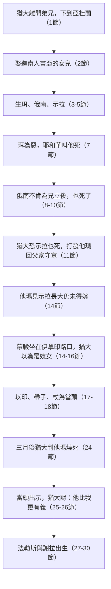

# 創世記 第38章

<!-- chapter-navigation:start -->
| [前一章](../01%20創世記/第37章.md) | [回目錄](../01%20創世記/全書目錄及綱要.md) | [下一章](../01%20創世記/第39章.md) |
| :--- | :---: | ---: |
<!-- chapter-navigation:end -->

1. 那時，[[猶大（雅各之子）|猶大]]離開他弟兄下去，到一個[[亞杜蘭]]人名叫[[希拉]]的家裡去。
2. [[猶大（雅各之子）|猶大]]在那裡看見一個[[迦南人]]名叫[[書亞（迦南人）|書亞]]的[[書亞的女兒|女兒]]，就娶他為妻，與他同房，
3. 他就懷孕生了兒子，[[猶大（雅各之子）|猶大]]給他起名叫[[珥]]。
4. 他又懷孕生了兒子，母親給他起名叫[[俄南]]。
5. 他復又生了兒子，給他起名叫[[示拉]]。他生示拉的時候，[[猶大（雅各之子）|猶大]]正在[[基悉]]。
6. [[猶大（雅各之子）|猶大]]為長子[[珥]]娶妻，名叫[[他瑪（創38）|他瑪]]。
7. [[猶大（雅各之子）|猶大]]的長子[[珥]]在耶和華眼中看為惡，耶和華就叫他死了。
8. [[猶大（雅各之子）|猶大]]對[[俄南]]說：你當與你哥哥的妻子同房，向他盡你為弟的本分，為你哥哥[[弟續兄孀制度|生子立後]]。
9. [[俄南]]知道生子不歸自己，所以同房的時候便遺在地，免得給他哥哥留後。
10. [[俄南]]所做的在耶和華眼中看為惡，耶和華也就叫他死了。
11. [[猶大（雅各之子）|猶大]]心裡說：恐怕[[示拉]]也死，像他兩個哥哥一樣，就對他兒婦[[他瑪（創38）|他瑪]]說：你去，在你父親家裡守寡，等我兒子示拉長大。他瑪就回去，住在他父親家裡。
12. 過了許久，[[猶大（雅各之子）|猶大]]的妻子[[書亞的女兒]]死了。猶大得了安慰，就和他朋友[[亞杜蘭]]人[[希拉]]上[[亭拿（猶大）|亭拿]]去，到他[[婚宴與剪羊毛風俗|剪羊毛]]的人那裡。
13. 有人告訴[[他瑪（創38）|他瑪]]說：你的公公上[[亭拿（猶大）|亭拿]][[婚宴與剪羊毛風俗|剪羊毛]]去了。
14. [[他瑪（創38）|他瑪]]見[[示拉]]已經長大，還沒有娶他為妻，就脫了他作[[寡婦衣裳|寡婦的衣裳]]，用帕子蒙著臉，又遮住身體，坐在[[亭拿（猶大）|亭拿]]路上的[[伊拿印]]城門口。
15. [[猶大（雅各之子）|猶大]]看見他，以為是妓女，因為他蒙著臉。
16. [[猶大（雅各之子）|猶大]]就轉到他那裡去，說：來吧！讓我與你同寢。他原不知道是他的兒婦。[[他瑪（創38）|他瑪]]說：你要與我同寢，把什麼給我呢？
17. [[猶大（雅各之子）|猶大]]說：我從羊群裡取一隻山羊羔，打發人送來給你。[[他瑪（創38）|他瑪]]說：在未送以先，你願意給我一個當頭嗎？
18. 他說：我給你什麼當頭呢？[[他瑪（創38）|他瑪]]說：你的[[印帶杖身份憑據|印、你的帶子，和你手裡的杖]]。[[猶大（雅各之子）|猶大]]就給了他，與他同寢，他就從猶大懷了孕。
19. [[他瑪（創38）|他瑪]]起來走了，除去帕子，仍舊穿上作[[寡婦衣裳|寡婦的衣裳]]。
20. [[猶大（雅各之子）|猶大]]託他朋友[[亞杜蘭]]人送一隻山羊羔去，要從那女人手裡取回[[印帶杖身份憑據|當頭]]來，卻找不著他，
21. 就問那地方的人說：[[伊拿印]]路旁的[[迦南廟妓風俗|妓女]]在哪裡？他們說：這裡並沒有妓女。
22. 他回去見[[猶大（雅各之子）|猶大]]說：我沒有找著他，並且那地方的人說：這裡沒有妓女。
23. [[猶大（雅各之子）|猶大]]說：我把這山羊羔送去了，你竟找不著他。任憑他拿去吧，免得我們被羞辱。
24. 約過了三個月，有人告訴[[猶大（雅各之子）|猶大]]說：你的兒婦[[他瑪（創38）|他瑪]]作了妓女，且因行淫有了身孕。猶大說：拉出他來，把他燒了！
25. [[他瑪（創38）|他瑪]]被拉出來的時候便打發人去見他公公，對他說：這些東西是誰的，我就是從誰懷的孕。請你認一認，這[[印帶杖身份憑據|印和帶子並杖]]都是誰的？
26. [[猶大（雅各之子）|猶大]]承認說：[[他瑪比猶大更有義|他比我更有義]]，因為我沒有將他給我的兒子[[示拉]]。從此猶大不再與他同寢了。
27. [[他瑪（創38）|他瑪]]將要生產，不料他腹裡是一對雙生。
28. 到生產的時候，一個孩子伸出一隻手來；收生婆拿[[紅線與長子標記|紅線]]拴在他手上，說：這是頭生的。
29. 隨後這孩子把手收回去，他哥哥生出來了；收生婆說：你為什麼搶著來呢？因此給他起名叫[[法勒斯]]。
30. 後來，他兄弟那手上有[[紅線與長子標記|紅線]]的也生出來，就給他起名叫[[謝拉]]。

---

## 本章知識節點

### 人物
- [[猶大（雅各之子）]]
- [[希拉]]
- [[書亞（迦南人）]]
- [[書亞的女兒]]
- [[珥]]
- [[俄南]]
- [[示拉]]
- [[他瑪（創38）]]
- [[法勒斯]]
- [[謝拉]]
- [[迦南人]]

### 地點
- [[亞杜蘭]]
- [[基悉]]
- [[亭拿（猶大）]]
- [[伊拿印]]

### 歷史
- [[猶大與他瑪事件]]
- [[雅各家下埃及的必要性]]
- [[猶大支派三族來源]]

### 神學
- [[猶大的認罪與悔改]]
- [[他瑪比猶大更有義]]
- [[彌賽亞家譜中的恩典]]
- [[神的主權]]
- [[聖約子民與世界的界限]]
- [[寬以律己嚴以待人]]

### 文化
- [[弟續兄孀制度]]
- [[寡婦衣裳]]
- [[婚宴與剪羊毛風俗]]
- [[印帶杖身份憑據]]
- [[迦南廟妓風俗]]
- [[紅線與長子標記]]

### 互文
- [[申命記7_3-4 禁止與迦南人通婚]]
- [[申命記25章弟續兄孀律法]]
- [[馬太福音1章他瑪進入基督家譜]]
- [[路得記4章法勒斯家譜]]
- [[創世記37章山羊與衣服欺騙雅各]]
- [[法勒斯出生與雅各以掃出生對照]]

### 解經爭議
- [[創世記38章插入約瑟敘事的原因]]
- [[創世記38章時間順序問題]]
- [[俄南之罪是否等於自瀆]]
- [[他瑪行動是否可稱義]]
- [[亭拿地點辨識]]

---

## 本章整理

猶大離開弟兄，娶了迦南女子，兩個兒子相繼死去，最後和自己的兒媳生下一對雙胞胎。這一章夾在約瑟被賣（第37章）和約瑟在波提乏家拒絕誘惑（第39章）之間，鏡頭忽然從約瑟轉到[[猶大（雅各之子）|猶大]]身上。讀這一章可以帶著兩個問題：這個家怎麼一步步走下坡？這樣一段敗壞的事，為什麼還記在聖經裡？

先看第二個問題。這一章被收進來，有三個緣故：顯明以色列人如何漸漸變壞，以及神使他們下埃及受試煉的緣故；叫人越發注意約瑟的清潔（創39:1-10）；使人知道猶大支派分三族的來歷（民26:19-20），也看出主耶穌降世為人是何等的虛己（太1:3）（丁良才）。聖靈在這一章毫不遮掩地展示人性的深度敗壞，彷彿主耶穌之死的必要性在這裡被說明白了（KC）。

### 猶大怎麼走下坡路（1-11節）

猶大離開弟兄，下到一個亞杜蘭人名叫[[希拉]]的家裡（1節）；他在那裡看見一個[[迦南人]]名叫書亞的女兒，就娶她為妻，生了珥、俄南、示拉（2-5節）。

亞杜蘭在希伯崙西北，各家給的距離不同：十九公里（《串珠聖經註釋》）、約二十四公里（《創世記雷氏研讀本》）、約二十五公里（《啟導本聖經創世記註釋》）。

它的高度比希伯崙低，所以說猶大「下」到亞杜蘭很是恰當（《舊約背景註釋》）。

CT 抓住經文的動詞，排出一條下坡的路：

| 經文 | CT 的讀法 |
|---|---|
| 離開他弟兄「下去」（1節） | 信徒一離開弟兄，定規走屬靈的下坡路 |
| 到亞杜蘭人希拉家裡（1節） | 墮落的第一步是結交壞朋友，先與世俗為友 |
| 「看見」書亞的女兒就娶她（2節） | 眼睛注目於世界的美麗，接下去就與世界聯合；行事應憑著信心，不可憑著眼見（林後5:7） |
| 與迦南人聯姻（2節） | 信的和不信的不相配，不要同負一軛（林後6:14） |

猶大憑眼睛行事，亞伯拉罕當年曾禁止僕人為以撒這樣做（創24:3）（KC）。與本土哈蘭的聯繫早已中斷（創31:52），這樁婚姻可能難以避免，但選民與外邦人通婚影響他們持守純潔的信仰，猶大家族的婚姻以悲劇收場也與此不無關係（《聖經精讀本──創世記註解》）。十二個兒子中只記錄猶大的婚姻，是因為流便與繼母發生亂倫（創35:22）、西緬和利未在底拿事件中殘忍殺人（創34章），更重要的是彌賽亞將會從猶大的血統中誕生（創49:10）（《聖經精讀本》）。

長子[[珥]]在耶和華眼中看為惡，耶和華就叫他死了（7節）。經文沒有說他做了什麼；從本章的脈絡看，他似乎與性倫理的嚴重罪惡有關（《聖經精讀本》），神管治並懲罰一切的惡（KC）。

這一章發生在什麼時候，各家有不同的看法。從約瑟被賣到雅各下埃及約有二十二、三年，猶大未必能在這段時間完成娶妻、生子、等兒子長大、從他瑪生雙生子，再等法勒斯長大生子（創46:12）這些事，所以本章可能發生在更早（丁良才、CT），CT 說甚至遠在以撒死之前。另一種算法是約瑟被賣時以撒168歲、雅各108歲，猶大比約瑟大3、4歲，大概是20或21歲（《聖經精讀本》）。

> [!note] 為什麼必須下埃及
> 以色列人若在迦南人當中繼續生活，沒有方法與異教人分開，很難保住自己的血統與文化；後來到了埃及，當地人視他們為奴，反而發展自成一族（《啟導本》）。雅各的兒子們將組成十二支派，若都和猶大一樣與迦南女人通婚同化，可能和得到滅亡警告的迦南人（創15:16）一樣陷入滅亡的危險，神要在埃及試煉他們，直到所定之日（《聖經精讀本》）。猶大和兩個兒子的惡行，也暗示了雅各子孫在埃及為奴四百年的主因（《串珠聖經註釋》）。

### 弟續兄孀：責任揭出的自私（8-11節）

猶大對[[俄南]]說：「你當與你哥哥的妻子同房，向他盡你為弟的本分，為你哥哥生子立後。」（8節）這是[[弟續兄孀制度]]：兄死無後，弟當娶兄嫂，所生長子歸兄名下，使兄的產業有子可以繼承，後來摩西把它制定成律法（申25:5-6）（CT、《啟導本》）。古時多國的人都有這個規矩（丁良才）。8節「盡你為弟的本分」在原文是專門的動詞 יָבַם（H2992），意思是盡弟兄娶嫂留後的本分。

古代近東用這套制度處理英年早逝無後的難題，死者的弟兄有責任使寡嫂懷孕，兄弟的名字和當得的遺產才傳得下去；赫人法律第193條有類似規例，路得記四章所記的可能是另一個形式，申25:5-10 則容許死者的兄弟拒絕承擔，條件是他要在公開儀式中受寡嫂侮辱。猶大在這段所遭遇的情形，大概就解釋了這律法為何有制定的必要（《舊約背景註釋》）。

俄南明白生的孩子不歸自己，所以同房時便遺在地（9節）。因為所生的第一個兒子須歸在長兄名下，不能算是自己的兒子；『每當』同房就如此，表示是習慣性的行動，用意在避免她懷孕（CT）。

他的動機是貪財，這樣做會分薄他至終要得的產業（《舊約背景註釋》）；他希望長子繼承家業的權利歸於自己（《雷氏》），也無視神命定婚姻的神聖（《聖經精讀本》）。

『俄南之罪』（onanism）常被拿來指自瀆，這是不正確的，俄南的問題在於他拒絕使自己的兄弟有後（KC）。『便遺在地』字意是把種子遺棄在地上，委婉地表達體外射精的行為（《聖經精讀本》）。

猶大心裡說：恐怕示拉也死，像他兩個哥哥一樣，就叫兒婦他瑪回父家守寡，等示拉長大（11節）。他害怕他瑪會『剋夫』，無意讓示拉娶她；沒有兒子的寡婦按當時的規矩歸回父家（利22:13；得1:8）（CT）。「你去……守寡，等我兒子示拉長大」是推辭的話（丁良才）。猶大的兩個兒子之死是由於他們在神面前的惡，他卻認為他瑪是不吉利的女人，不僅沒有安慰她，反而把她送回娘家，如同趕出家門（《聖經精讀本》）。CT 的話中之光說：「兒子死，怪媳婦帶來厄運，叫她返家，這好比推人入阱，遂種下了禍根。」

寡婦在疾病和戰亂不斷的社會中十分常見，以色列的辦法是兄終弟及婚姻，並容許年輕寡婦在服喪期後從速再婚；寡婦有特別的衣著表明身分，因為沒有分受遺產的權利，律法特准她們拾取遺穗（得2），又保護她們不受壓迫（申14:29；詩94:1-7）（《舊約背景註釋》）。猶大把他瑪送回父家，示拉長大以後卻一直沒有娶她（14節）。

### 他瑪的行動：不能稱義，也不能簡化（12-23節）

猶大的妻子死了，他得了安慰，就和朋友希拉上[[亭拿（猶大）|亭拿]]去，到剪羊毛的人那裡（12節）。『得了安慰』是悲哀過後（《串珠聖經註釋》）。

中東畜牧民族剪羊毛，有如農民收割禾田，舉行盛大宴會（《啟導本》），人歡樂的時候也往往是試探來臨的時候（CT）。亭拿的確實地點無法肯定，這地名在分地名單與參孫的事件中多次出現（書15:10、57；士14:1-2；代下28:18），與猶大支派在山地南部的屬地有關（《舊約背景註釋》）。

他瑪見示拉已經長大還沒有娶她，就脫了寡婦的衣裳，用帕子蒙著臉，又遮住身體，坐在亭拿路上的[[伊拿印]]城門口（13-14節）。寡婦和已婚婦女一樣用不著蒙臉，但寡婦的服飾給予她們法定的權益（《舊約背景註釋》）。

蒙臉是當時妓女的打扮（《串珠聖經註釋》），妓女通常會駐足在路口（耶3:2）（《雷氏》）。伊拿印在14、21節兩次出現，支持它是地名，而非『空曠地方』或『岔路口』，位置只能確定在猶大支派屬地（《舊約背景註釋》）。

它或許就是書15:34 的以楠（丁良才、《舊約背景註釋》）。

猶大看見她，以為是妓女，因為她蒙著臉（15節）。古時有些婦女為敬假神而許願獻身做妓女，將所得的錢歸與那神（丁良才）。

21節的『妓女』與15節在原文是不同的字，應譯『廟妓』，社會地位高過一般妓女（CT、《串珠聖經註釋》、《啟導本》）。

15節是普通字 זָנָה（H2181），含有『姦淫』之意（《聖經精讀本》）；21節是 קְדֵשָׁה（H6948），字面是『聖潔的、奉獻的女子』，指在神廟中為祭拜亞斯他錄女神而賣淫的人（CT、《啟導本》、《聖經精讀本》）。迦南文化在豐饒崇拜中使用祭儀娼妓，男子在開始耕作或剪毛、產羊等重要日子來到神廟，以求田地和牲口多產（《舊約背景註釋》）。

他瑪的手段，來源沒有一份為她辯護。她的罪不能被合理化，她要爭取自己的權利，卻找不到別的路；但絆倒她的是猶大，她之所以能設下這個局，正因為她太清楚猶大是什麼樣的人，KC 由此問：我是以什麼樣的人被人認識的？她的計謀不是為了滿足性慾，而是要給丈夫家族留後代，這是對猶大不守承諾的自救方法；當時的風俗認為正當，基督教倫理卻認為相當於姦淫和通姦（《聖經精讀本》）。她的手段絕不值得仿效（《串珠聖經註釋》）。

猶大說會打發山羊羔來，他瑪就要一個當頭：他的印、帶子和手裡的杖（17-18節）。當頭是抵押品（CT、《串珠聖經註釋》），原文是 עֵרָבוֹן（H6162）；三樣東西是印（חֹתָם，H2368）、帶子（פָּתִיל，H6616，掛印章的繩帶）和杖（מַטֶּה，H4294）。印是個人圖章，帶子把印懸繫在頸項上，杖上雕刻有可資辨認的花紋（CT），三者都是辨認一個人的證明（《啟導本》）。

杖也是家族領袖權柄的記號（《串珠聖經註釋》）。古代近東常用圓筒印章，通常用皮繩穿起掛在頸項上，杖是私人物件，很可能經過雕刻打磨而顯示物主身分（《舊約背景註釋》）。猶大交出去的三件東西都能指認到他本人。

KC 讀出這三樣東西的象徵：印是忠信與所有權的記號，他丟棄了；帶子（繩）代表產業（詩16:6），他失去了產業的享用；杖是支撐他行走的，他也交給了一個陌生女子。他瑪知道猶大的話靠不住，才要抵押；婚姻中的不忠與其他關係（如生意）中的不忠，總是結伴而行（KC）。

猶大託朋友送山羊羔去，卻找不到那女人，當地人說這裡沒有妓女，猶大說：「任憑他拿去吧，免得我們被羞辱。」（20-23節）往往有人保守自己的聲譽，卻不保守自己的良心（丁良才）；人把他人的評價和名譽看得比犯罪更重要，真正的信徒應該懼怕神的眼目勝過人的眼目（太10:28）（《聖經精讀本》）。猶大與亞杜蘭人的友誼是罪人之間的友誼，互相遮蓋罪；真朋友會指出朋友的錯處，幫助他認罪（KC）。

### 猶大的認罪（24-26節）

約過了三個月，有人告訴猶大他瑪懷孕，猶大說：「拉出他來，把他燒了！」（24節）古時的家長有權處死家人（參創31:32；42:37）（CT）。

娼妓和淫婦的刑罰通常是用石頭打死（申22:23-24），[[他瑪被判燒死的刑罰問題|他瑪被判燒死]]很是罕見，只有祭司女兒行淫和亂倫（利20:14）才規定判處這刑（《舊約背景註釋》），猶太所定的刑罰比摩西的律法更加嚴厲（丁良才）。這個判決也對猶大有利，因為他瑪一死，他就不必再把示拉給她（KC）。

CT 的話中之光說：「犯罪的人外表總是假冒為善，裝作嫉惡如仇似的。猶大只有『三個月』，就把自己的罪都忘光了。」人對罪惡的看法常具雙重標準，寬以律己，嚴以待人，在什麼事上論斷人，就在什麼事上定自己的罪（羅2:1）（CT）。輕易犯下重罪而毫無悔意的人，往往在論斷別人的罪上格外嚴厲，這樣做正是定了自己的罪（KC）。猶大和大衛同樣地定了自己的罪（撒下12:5-7；羅2:1）（丁良才）。

他瑪被拉出來的時候，打發人去見公公，說：這些東西是誰的，我就是從誰懷的孕，請你認一認，這印、帶子和杖都是誰的？（25節）猶大承認：「他比我更有義，因為我沒有將他給我的兒子示拉。」（26節）原文猶大的話是 צָֽדְקָ֣ה מִמֶּ֔נִּי，字根 צָדַק（H6663）是『義』，加上『比我』。猶大不守諾言，沒有叫小兒子娶他瑪為長子生子立後，他瑪被迫採用策略使前夫得以有後嗣，按傳宗接代的義來說，她比猶大更有義（CT）。《啟導本》說，猶大的錯誤是不守信諾，她乃用自己的辦法來取這長子的權利。猶大有兩個錯誤：不讓他瑪嫁給他的兒子，以及與她行淫（《雷氏》）。『她比我更有義』不是說她的行為無罪，而是比自己好得多（《聖經精讀本》）。

猶大承認自己的過錯之後，從此不再與他瑪同寢（26節）。這是猶大的轉機，所以神後來還要揀選他；他可取之處有三：認罪、倒空隱藏的罪、與罪斷絕不再去犯（CT）。

「凡只認罪而不斷絕惡行的，並不是真正的悔改認罪。」（CT）這是悔恨、努力不再犯罪的真摯決心，也許正因如此，始於罪惡而生下的孩子得到神的祝福，成為彌賽亞家族的先祖（《聖經精讀本》）。猶大的悔改是真的，不再與他瑪有關係，就是證明（KC）。

### 恩典勝過罪：進入彌賽亞的家譜（27-30節）

他瑪腹裡是一對雙生。一個孩子先伸出手來，收生婆拿紅線拴在他手上，說「這是頭生的」；隨後孩子把手收回去，他哥哥生出來了，收生婆說：「你為什麼搶著來呢？」因此給他起名叫法勒斯；後來手上有紅線的才生出來，起名叫謝拉（27-30節）。紅線是用來辨認長子（《啟導本》），表明希伯來社會長子名分的重要（《聖經精讀本》）。『你為甚麼搶著來呢？』又可譯作『你怎麼為你自己衝破一個缺口呢？』（CT）。原文動詞是 פָּרַץ（H6555），意思是衝破，法勒斯（פֶּרֶץ，H6557）與它同一個字根；謝拉（זֶרַח，H2226）字面的意思是光芒、初升。

「謝拉是人所定規以為是頭生的（28節），神卻揀選了法勒斯；可見人所定規的，並非神所揀選的；神所揀選的，是人所棄絕的（參彼前二4）。」（CT）拴紅線的謝拉明明是長子，屬靈的長子卻是法勒斯（創46:12；代上2:4），這個次子優先的原則（太20:16）代表猶太人和外邦人的位置，彌賽亞家譜中包括這兩個兒子（太1:3）（《聖經精讀本》）。

[[法勒斯]]日後成為猶大的嫡傳，大衛出自他這一脈（得4:18-22），基督也在他的譜系裡（太1:3）（《啟導本》）。

法勒斯的子孫中有波阿斯和大衛，耶穌基督也是法勒斯的後代（《串珠聖經註釋》）。欺騙、詭詐、殘忍、道德敗壞集於一身的雅各家族，又增添了公公和兒媳通姦的恥辱，神卻使這個墮落的家族成為以色列國，揀選他們為選民，並通過他們的血統差派自己的獨生子基督到人間；他瑪與妓女喇合、外邦女子路得、烏利亞之妻和大衛之妾拔示巴、馬利亞一同出現在彌賽亞家譜上，是神的大恩和人類腐敗形成鮮明對比的例子（《聖經精讀本》）。神的恩典勝過了猶大的罪，也勝過了出自受咒詛的迦南族、且犯了淫行的他瑪（KC）。正如羅5:20 所說：「罪在哪裡顯多，恩典就更顯多了。」

### 兩章的鏡像：山羊、衣服與「請你認一認」

第37章的兄弟們用山羊的血和一件衣服欺騙父親；本章猶大自己被一件信物和一隻山羊羔的承諾反制：

| 第37章猶大兄弟做的 | 本章猶大遇到的 |
|---|---|
| 宰公山羊，把約瑟的彩衣染血（創37:31） | 承諾送一隻山羊羔作代價（17節） |
| 打發人把血衣送去，說「請認一認」（創37:32） | 他瑪打發人送當頭來，說「請你認一認」（25節） |
| 父親認得，說「這是我兒子的外衣」（創37:33） | 猶大認得，說「他比我更有義」（26節） |

創37:32 哥哥們叫雅各認血衣，與創38:25 他瑪叫猶大認當頭，原文用的是同一個命令詞組（動詞 נָכַר，H5234，加上祈願質詞 נָא，意思是『請你認一認、請察驗』）；創37:33 雅各認得與創38:26 猶大認得，也用同一個動詞。早先雅各宰羊羔以哄以撒，當時眾子宰羊羔以哄雅各，父子同出一轍，前後相照（加6:7）（丁良才在創37:31 的註）。

### 從猶大與他瑪學到的

CT 的靈訓要義從猶大身上列出九點：信徒一離開弟兄和教會就會墮落到世界裡去；捨弟兄而與不信的人親密論交，必然敗壞德行；行事為人應憑著信心，不可憑著眼見；信徒與不信的人不可同負一軛；父親若自己行得不正，子女也難免行惡；神是輕慢不得的，順著情慾撒種的，必從情慾收敗壞（加6:7）；說謊和犯淫亂是人受魔鬼轄制的兩大特徵；人自己犯罪，卻喜歡定罪別人；認罪並從此不再犯罪，仍將蒙神施恩（約8:11）。人有罪不管是什麼身分，神不能替他隱藏，但他若認罪悔改，神還願意赦罪施恩（約壹1:9）（CT 的話中之光）。

從他瑪身上，CT 列出八點：得知長子的名分，對神的應許心存盼望；所嫁非人，並不因此而喪志；被人欺負，仍默默忍受；順從長輩，堅忍地抱持盼望；抓住機會爭取生子立後的權利；運用智慧留下可靠的憑據；不惜犧牲性命，有勇氣去作所該作的事；亂倫的行為雖不值得仿效，但其存心受到認可（創38:26；參太1:3）。

### 一條下坡路，一面照回自己的鏡子（全章）

本章從猶大離開弟兄「下去」開始，到他承認「他比我更有義」、雙生子出生為止。中間的每一步都由前一步推動：離開弟兄、結交亞杜蘭人、娶迦南女子；兒子死去，猶大把責任推給他瑪，扣住示拉不給；他瑪設局，猶大中計，又在聽說她懷孕時急著判她燒死，直到憑據擺在眼前。第37章猶大提議賣約瑟，本章他自己被一件信物反制，用的是同一個『請你認一認』。這樣的敗壞使這個家族需要下埃及保住血統，猶大這一線卻經由法勒斯進入大衛與基督的家譜。接下來第39章，鏡頭回到約瑟在埃及，他拒絕了另一場誘惑（創39:1-10）。

**參考資料**
代號：CT＝ccbiblestudy《逐節註解》；GT＝ccbiblestudy《拾穗》，彙集多本中文註釋；正文直接寫書名或作者的（如《丁道爾》、丁良才），都出自這裡；KC＝KingComments；BH＝BibleHub Study；STEP＝STEP Bible 原文資料（CC BY 4.0）
https://www.ccbiblestudy.org/Old%20Testament/01Gen/01CT38.htm
https://www.ccbiblestudy.org/Old%20Testament/01Gen/01GT38.htm
https://www.kingcomments.com/en/bible-studies/Gen/38
https://biblehub.com/study/genesis/38.htm
https://github.com/STEPBible/STEPBible-Data

<!-- appendix-links:start -->
## 附錄

### 相關地圖
- [[appendix/fhl_maps/maps/016|〈創圖十一〉猶大和約瑟的生平]]
<!-- appendix-links:end -->

<!-- chapter-navigation:start -->
| [前一章](../01%20創世記/第37章.md) | [回目錄](../01%20創世記/全書目錄及綱要.md) | [下一章](../01%20創世記/第39章.md) |
| :--- | :---: | ---: |
<!-- chapter-navigation:end -->
