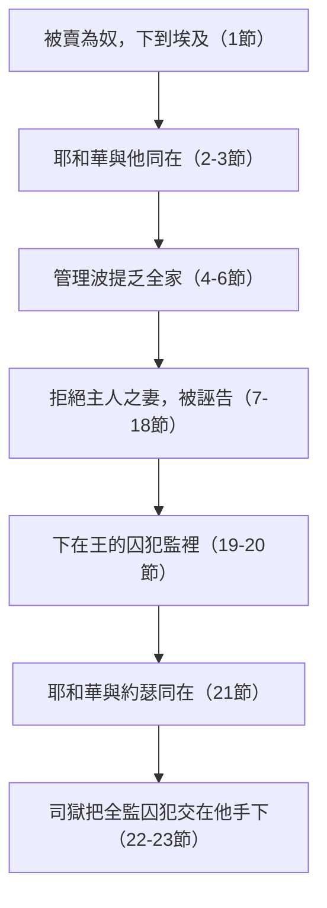

# 創世記 第39章

<!-- chapter-navigation:start -->
| [前一章](../01%20創世記/第38章.md) | [回目錄](../01%20創世記/全書目錄及綱要.md) | [下一章](../01%20創世記/第40章.md) |
| :--- | :---: | ---: |
<!-- chapter-navigation:end -->

1. [[約瑟]]被帶下[[埃及]]去。有一個埃及人，是[[法老]]的內臣─[[護衛長波提乏]]，從那些帶下他來的[[以實瑪利人]]手下買了他去。
2. [[約瑟]]住在他主人[[埃及]]人的家中，[[耶和華]]與他同在，他就百事順利。
3. 他主人見[[耶和華]]與他同在，又見耶和華使他手裡所辦的盡都順利，
4. [[約瑟]]就在主人眼前蒙恩，伺候他主人，並且主人派他管理家務，把一切所有的都交在他手裡。
5. 自從主人派[[約瑟]]管理家務和他一切所有的，[[耶和華]]就因約瑟的緣故賜福與那[[埃及]]人的家；凡家裡和田間一切所有的都蒙耶和華賜福。
6. [[波提乏]]將一切所有的都交在[[約瑟]]的手中，除了自己所吃的飯，別的事一概不知。約瑟原來[[秀雅俊美（約瑟容貌）|秀雅俊美]]。
7. 這事以後，[[約瑟]]主人的妻以目送情給約瑟，說：你與我[[同寢]]吧！
8. [[約瑟]]不從，對他主人的妻說：看哪，一切家務，我主人都不知道；他把所有的都交在我手裡。
9. 在這家裡沒有比我大的；並且他沒有留下一樣不交給我，只留下了你，因為你是他的妻子。我怎能作這大惡，[[得罪神]]呢？
10. 後來他天天和[[約瑟]]說，約瑟卻不聽從他，不與他[[同寢]]，也不和他在一處。
11. 有一天，[[約瑟]]進屋裡去辦事，家中人沒有一個在那屋裡，
12. 婦人就拉住他的[[衣裳（外袍）|衣裳]]，說：你與我[[同寢]]吧！[[約瑟]]把衣裳丟在婦人手裡，跑到外邊去了。
13. 婦人看見[[約瑟]]把[[衣裳（外袍）|衣裳]]丟在他手裡跑出去了，
14. 就叫了家裡的人來，對他們說：你們看！他帶了一個[[希伯來人（族群稱呼）|希伯來人]]進入我們家裡，要戲弄我們。他到我這裡來，要與我[[同寢]]，我就大聲喊叫。
15. 他聽見我放聲喊起來，就把[[衣裳（外袍）|衣裳]]丟在我這裡，跑到外邊去了。
16. 婦人把[[約瑟]]的[[衣裳（外袍）|衣裳]]放在自己那裡，等著他主人回家，
17. 就對他如此如此說：你所帶到我們這裡的那[[希伯來人（族群稱呼）|希伯來]]僕人進來要戲弄我，
18. 我放聲喊起來，他就把[[衣裳（外袍）|衣裳]]丟在我這裡，跑出去了。
19. [[約瑟]]的主人聽見他妻子對他所說的話，說：你的僕人如此如此待我，他就生氣，
20. 把[[約瑟]]下在監裡，就是王的囚犯被囚的地方。於是約瑟在那裡坐監。
21. 但[[耶和華]]與[[約瑟]]同在，向他施恩，使他在[[司獄]]的眼前蒙恩。
22. [[司獄]]就把監裡所有的囚犯都交在[[約瑟]]的手下；他們在那裡所辦的事都是經他的手。
23. 凡在[[約瑟]]手下的事，[[司獄]]一概不察，因為[[耶和華]]與約瑟同在；耶和華使他所做的盡都順利。

---

## 本章知識節點

### 人物
- [[約瑟]]
- [[波提乏]]
- [[護衛長波提乏]]
- [[波提乏的妻子]]
- [[以實瑪利人]]
- [[司獄]]
- [[王的囚犯]]
- [[法老]]
- [[約瑟在埃及]]

### 地點
- [[埃及]]
- [[波提乏的家]]
- [[監獄（王的囚犯被囚之處）]]

### 神學
- [[耶和華與約瑟同在]]
- [[耶和華使凡事順利]]
- [[耶和華因約瑟賜福埃及人的家]]
- [[得罪神]]
- [[逃避情慾]]
- [[耶和華向約瑟施恩]]
- [[耶和華使約瑟在司獄眼前蒙恩]]
- [[神的同在帶來的祝福]]
- [[忠心管家]]

### 文化
- [[護衛長]]
- [[管家（管理家務）]]
- [[希伯來人（族群稱呼）]]

### 原文
- [[秀雅俊美（約瑟容貌）]]
- [[衣裳（外袍）]]
- [[色誘]]
- [[誣告]]
- [[同寢]]

### 歷史
- [[埃及不與希伯來人同席]]
- [[埃及人視希伯來人為不潔淨]]
- [[喜克索王朝（Hyksos）背景]]
- [[埃及監獄制度]]

### 互文
- [[約瑟豫表主耶穌]]
- [[約瑟失衣袍（三次）]]
- [[被賣為奴]]
- [[受冤屈不開口]]

### 解經爭議
- [[波提乏是否全信妻子話]]
- [[「除了自己所吃的飯」含義]]
- [[司獄是否即護衛長]]

---

## 本章整理

第38章的猶大看見女子就走上情慾的路，第39章的約瑟卻在同樣的誘惑面前轉身逃跑。約瑟被賣到埃及，在波提乏家一時得到重用，又因拒絕主母而被誣告下監；經文卻四次說「耶和華與他同在」。這一章可以帶著兩個問題來讀：神的同在在順境和逆境裡各是什麼樣子？一個守住自己的人，為什麼反而下到監裡？

創37章的約瑟在弟兄中間被棄絕，創39章的他在外邦人中間也被棄絕，主耶穌也是這樣被祂的百姓和萬民所棄（徒4:27）（KC）。約瑟被賣埃及的經歷，又是以色列民族際遇的縮影：蒙神看顧、因正直而受害、被神救出，後來在埃及人丁興旺，反淪為新王的奴隸（GT）。

### 神的同在帶來的祝福（1-6節）

約瑟被帶下埃及，米甸人把他賣給法老的內臣、護衛長波提乏，這是一個埃及人（1節）。有考古學家說當時的法老是外國人，他的臣子大概也多是外國人，但這位護衛長是埃及本國人（丁良才）。CT 推算此時的法老可能是喜克索王朝的人（主前1878~1843年），《創世記雷氏研讀本》則說他極可能是塞索提斯三世，在位的年份相同。『內臣』是朝廷命官，後來才專指太監；『護衛長』負責監管王的囚犯（CT）。

約瑟住在主人埃及人的家中，不必像其他奴僕在屋外作苦工（CT、《串珠聖經註釋》）。「耶和華與他同在」這句話在本章出現四次（2、3、21、23節）（CT、《聖經精讀本──創世記註解》）；第21節還特別載明神向他施慈愛（חֶסֶד，H2617A）。原文『順利』的動詞 מַצְלִיחַ（H6743B）字面是『使之亨通』，在2、3、23節反覆出現。『順利』字面是『興盛的人』，無論何事，只要約瑟經手，事情就有明顯好轉，使不信神的人也能清楚看到他身上有神的祝福和保護（《聖經精讀本》）。

波提乏看見耶和華與約瑟同在，約瑟的事都順利（3節）。信徒與神的關係如何，手中所辦的事是否有神的祝福，是能夠被別人看出來的（CT）。波提乏高抬約瑟分兩步：先派為近身侍從，再提升作管家（4節）（CT）。從古埃及墳墓中發掘的資料，可以證明富人家裡確實有管家這種職務（《聖經精讀本》）。

耶和華因約瑟的緣故賜福與那埃及人的家，凡家裡和田間一切所有的都蒙福（5節）。拉班曾因雅各蒙福（創30:27），蒙神恩惠之人的影響力會擴展到他周圍的每個人，這源於神與亞伯拉罕立約時說的「為你祝福的，我必賜福與他」（創12:3）（《聖經精讀本》）；丁良才也在創39:5 註參創30:27。神所揀選的人是神祝福的管道，不但使自己得福，也使他身邊的人得到祝福（CT）；主耶穌在地上行走時，所到之處只散播祝福，我們呢？（KC）

《靈修版聖經註釋》說，古埃及社會貧富懸殊，波提乏是法老王朝中極富有的高官，房子兩三層高，有美麗的花園和陽台，用膳用金製餐具，僕人包括約瑟在一樓工作，他們在樓上奢華宴樂。

「除了自己所吃的飯，別的事一概不知」（6節）有兩種解法。一是埃及人不與希伯來人一起吃飯（創43:32），所以飯食不交約瑟經手（CT、《串珠聖經註釋》、《聖經精讀本》）。

二是只是把一切家務都交給他處理的生動描述（CT）。經文末了補一句，約瑟原來秀雅俊美，容貌像他母親（創29:17）（丁良才）；生得一表人才固然得天獨厚，卻也比一般人面臨更多潛伏的危機（CT）。

《聖經精讀本》說，神為了成就與亞伯拉罕的火把之約（創15:12-17），從三個方面介入約瑟的生命：把約瑟帶到埃及；讓約瑟被賣到王的內臣家中；給約瑟總務職分，讓他管理家務和一切事情，為使他日後能很好地履行埃及總管的職責。

### 勝過試探：約瑟怎麼做（7-12節）

這事以後，主人的妻以目送情給約瑟，說：「你與我同寢罷。」（7節）罪通常由眼睛開始：夏娃先望見果子（創3:6）（《聖經精讀本》），猶大也是看見了才娶迦南女子、看見了才以為她是妓女（創38:2、15）（KC）。埃及人男女混雜，並不像希伯來人那樣隔離，彼此有機會交接來往；她先以眉目傳情，見他毫無反應，索性明白挑逗（CT）。

魔鬼若不能用艱難困苦擊垮我們，就換用安逸和娛樂來試探，而後者更具毀滅性（CT）。

約瑟不從，說出幾層理由。CT 歸納為四層：

| # | 理由 | 經文 |
|---|---|---|
| 1 | 「在這家裡沒有比我大的」，認識自己的身分 | 9節 |
| 2 | 不能辜負主人的信託，「他把所有的都交在我手裡」 | 8節 |
| 3 | 這不是小事，乃是「大惡」 | 9節 |
| 4 | 這會得罪神 | 9節 |

約瑟不受女色誘惑，與流便和猶大的失敗（創35:22；38:16）成了強烈的對比（CT）。約瑟因為常與神接觸，明白主人對他的信任，不願濫用；他知道自己的位置，也知道隨著位置而來的責任，這才是真正的偉大（KC）。

約瑟說的是：「我怎能作這大惡，得罪神呢？」（9節）原文是 וְחָטָאתִי לֵאלֹהִים，核心動詞 חָטָא（H2398）是『犯罪、得罪』。犯任何的罪，都是得罪了神（詩51:4）（CT、丁良才）。那位如此幫助他、賜福他的神，他怎能得罪祂？若神恆常的良善更多存在我們心中，我們也就更有力量抵擋各樣的試探（KC）。

CT 說：『偉大』不是叫我們矜誇，『偉大』乃是叫我們鄙視卑劣的情慾。

約瑟試圖從兩方面提醒她認識自己的罪，喚起她的良知：提醒她丈夫的權威和存在；強調在神面前的純潔（《聖經精讀本》）。

婦人「天天」和約瑟說（10節）。『天天』造成持續不斷的壓力，實在是極大的考驗（CT）；KC 說，別以為她只試了一次，約瑟一再說『不』，需要屬靈的力量。約瑟的對策，CT 對回詩篇第一篇的『三不』（詩1:1）：

- 不聽從她，是不從惡人的計謀
- 不與她同寢，是不站罪人的道路
- 也不和她在一處，是不坐褻慢人的座位

要堅持這三不，須怕神而不怕人、不存僥倖之心、不怕被眾人孤立；凡要保守自己不受試探的人，必須小心地遠離試探的事物（CT）。丁良才說，約瑟有兩個方法：決意不從，以及不和她在一處（箴1:10、15）。《聖經精讀本》說，能克服罪的誘惑固然是偉大的信仰，但從開始就離開誘惑之地，是非常明智的作法。

有一天，約瑟進屋裡去辦事，家中人沒有一個在那屋裡（11節）；他不尋找危險，在屋裡是為了作他的工作（KC）。

婦人拉住他的衣裳，約瑟把衣裳丟在婦人手裡，跑到外邊去了（12節）。她先是動眼色，繼之動口（7節），再後是天天絮聒（10節），最後動手強拉（CT）。『跑』字說出約瑟盡力避開罪惡的態度（CT），這是提後2:22 和林前6:18 的好例子（《雷氏》）。KC 說：寧可失去你的外袍，也不可失去無虧的良心。CT 說：有時候，『逃避』並不是懦夫的行為，反而需要有極大的決心和勇氣，是神所稱許的（提前6:11）。

### 誣告：愛慾變成憎恨（13-19節）

婦人看見約瑟把衣裳丟在她手裡跑出去，就叫家裡的人來，說：「你們看！他帶了一個希伯來人進入我們家裡，要戲弄我們。」（14節）『希伯來人』含有輕蔑的意思（CT、丁良才、《啟導本》），她似乎有意激起種族歧視和仇恨（CT）。當時的埃及人認為遊牧的希伯來人是不潔淨的低賤民族（創43:32；46:34），她利用這種觀點遮掩自己的惡毒（《聖經精讀本》）。

凡出於情慾的愛不是真愛，很容易因愛成恨（撒下13:15）（CT、丁良才）；《聖經精讀本》舉暗嫩對他瑪的行為為例（撒下13:15-19）；有罪的愛總會變成恨（KC）。《聖經精讀本》說，罪惡的情慾若能達到目的就成為一種快樂，被扼制就變成可怕的憎惡。KC 說，因愛成恨的人往往是最無情的人，施洗約翰也是因為希羅底容不下他和他的講道而下監、終至被斬（可6:17-18）。

約瑟的衣裳再次被拿來作假證物（16節）（KC、《雷氏》、《聖經精讀本》）。第一次是哥哥們用染血的彩衣欺騙父親（創37:31-33），這一次是主母用他的外袍欺騙丈夫。約瑟第一次失衣袍，引致老父被欺，他被賣；第二次失衣袍，引致主人被欺，他被下監（CT）。《舊約背景註釋》說，衣裳往往能表示其人的地位、階級、職權，因此可以成為證物。

CT 的話中之光說：「一個厚顏無恥的女人竟扮演有品德的婦人，而堅守節操的約瑟竟成為壞人；但事實真相會有大白的一天，因此我們只能忍耐。」約瑟為著良心，就被人中傷控告，可見良心和美名往往不能兩全。《聖經精讀本》指出，埃及第19王朝時期有類似的事件，兩個兄弟受淫蕩嫂子誘惑、陷害，體現當時埃及人普遍放蕩的社會面貌。

### 下監：神的同在不因環境而改變（20-23節）

波提乏聽見妻子的話，就生氣，把約瑟下在監裡，就是王的囚犯被囚的地方（19-20節）。KC 說，波提乏好像漠不關心的彼拉多：他若相信約瑟的話，就會損及自己的面子，約瑟沒有受審就被關進監裡，如同主耶穌所受的（可14:46；太26:59；路23:4）。

按當時埃及的法律，僕人若企圖強姦主人的妻子，要立刻處死（《聖經精讀本》）；波提乏有權處死約瑟卻沒有這樣做，可見他並不全然相信妻子的控告，也可歸功於神暗中的保護（CT）。《聖經精讀本》列出三個理由：主人特別寵愛和信任他；約瑟平時的誠實和對家中的貢獻；不全信品行不端之妻所說的話。《舊約背景註釋》說，波提乏的選擇可能反映了他對這件事的理解，約瑟被囚在王室禁錮政治犯的地方，就監牢而言可能比較舒服一點，更重要的是，約瑟因此可以接觸到法老的王室成員（創40:1-23）。『王的囚犯』可能是指較重要的犯人（《串珠聖經註釋》）。

《靈修版聖經註釋》說，埃及的監獄暗無天日，環境惡劣，被囚的人在受審以前都被當作有罪，很多人從沒有被審過，約瑟被囚兩年以後才蒙法老召見（創41:1），也不是接受審訊，而是去為法老解夢。約瑟起初在監牢中受了大苦（詩105:17-18）（丁良才）。

經文立刻轉折：「但耶和華與約瑟同在，向他施恩，使他在司獄的眼前蒙恩。」（21節）有神同在，就是約瑟含冤繫獄的明證；他在獄中，神也在獄中（CT）。司獄把監裡所有的囚犯都交在約瑟手下，凡在他手下的事，司獄一概不察（22-23節），與波提乏家的情形一模一樣。約瑟的名義是囚犯，實際工作卻是『司獄』；神的用人不在乎榮耀羞辱，美名惡名（林後6:4、8）（CT）。聖經沒有記載約瑟作任何反駁，他的表現一如主耶穌被欺壓，在受苦的時候卻不開口（賽53:7）（CT）。

看似忠心只招來苦難，但耶和華要教導約瑟，也教導我們：最深的卑微之地，是通往最大榮耀的必經之路；監獄這個被棄絕的地方，成了經歷耶和華祝福的地方（詩105:17-19）（KC）。約瑟因為想到夢中所見的將來，得著忍受新試煉的力量；他在監中的忠心，是他日後執政的預備，大衛作王之前也要受許多苦（KC）。《聖經精讀本》說，約瑟被囚隱藏著神深遂的旨意：使他謙卑，單單仰望神；讓他遇見法老的兩個親信；鍛煉他，使他有朝一日能為那些和他一樣無辜的人伸張正義。

### 約瑟豫表主耶穌，與如何勝過試探

CT 的靈訓要義說，約瑟豫表主耶穌基督的兩處：甘心為奴僕（創39:1-6；太20:28）；因拒絕罪惡而受苦害（創39:7-23；來2:18）。約瑟被下在監裡，豫表主耶穌從高天來到塵世中，承擔我們眾人的罪孽（賽53:6）（CT 的靈意註解）。

CT 列出勝過試探的九點：要感受神的同在；要對別人有責任感，「他把所有的都交在我手裡」；要認識自己的尊嚴，「在這家裡沒有比我大的」；要能分辨該與不該的界限，「只留下了你」；要有不敢得罪神的態度；要有勇氣拒絕不當的要求，也不要給魔鬼留下地步；要逃避情慾；要能忍受不實的控告；要在冤屈中站立起來，盡心作所該作的事。KC 說，勝過罪的真正力量，在於與主耶穌有活的關係並順服神的話：「少年人用什麼潔淨他的行為呢？是要遵行你的話！」（詩119:9）

### 約瑟的兩次落難（全章）

本章從約瑟被賣、在波提乏家蒙福開始，到他下監、又在監中蒙司獄信任為止，形狀是兩次下沉、兩次高升，每一次高升都有「耶和華與他同在」。第一次下沉在創37章，是失去彩衣；第二次在本章，是失去外袍。每次落難之後，經文都記下他被帶到新的位置：先是波提乏的家，再是王的囚犯被囚的地方，下一步是創40章的酒政和膳長。第38章猶大放縱情慾，第39章約瑟拒絕情慾，兩章緊鄰，把猶大和約瑟並排放在讀者面前。

**參考資料**
代號：CT＝ccbiblestudy《逐節註解》；GT＝ccbiblestudy《拾穗》，彙集多本中文註釋；正文直接寫書名或作者的（如《丁道爾》、丁良才），都出自這裡；KC＝KingComments；BH＝BibleHub Study；STEP＝STEP Bible 原文資料（CC BY 4.0）
https://www.ccbiblestudy.org/Old%20Testament/01Gen/01CT39.htm
https://www.ccbiblestudy.org/Old%20Testament/01Gen/01GT39.htm
https://www.kingcomments.com/en/bible-studies/Gen/39
https://biblehub.com/study/genesis/39.htm
https://github.com/STEPBible/STEPBible-Data

<!-- appendix-links:start -->
## 附錄

### 相關地圖
- [[appendix/fhl_maps/maps/008|〈創圖三〉族長們於迦南地以外的活動]]
- [[appendix/fhl_maps/maps/015|〈創圖十〉雅各的生平]]
- [[appendix/fhl_maps/maps/016|〈創圖十一〉猶大和約瑟的生平]]
<!-- appendix-links:end -->

<!-- chapter-navigation:start -->
| [前一章](../01%20創世記/第38章.md) | [回目錄](../01%20創世記/全書目錄及綱要.md) | [下一章](../01%20創世記/第40章.md) |
| :--- | :---: | ---: |
<!-- chapter-navigation:end -->
