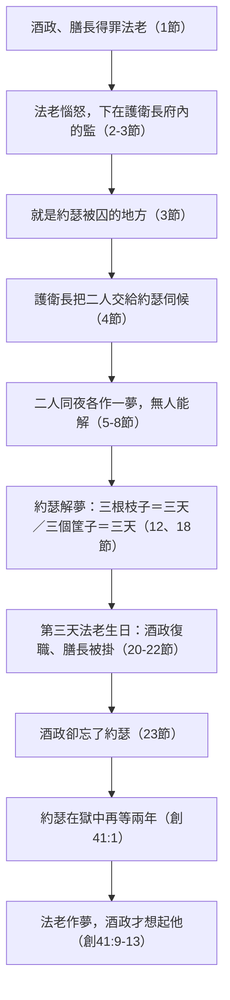

# 創世記 第40章

<!-- chapter-navigation:start -->
| [前一章](../01%20創世記/第39章.md) | [回目錄](../01%20創世記/全書目錄及綱要.md) | [下一章](../01%20創世記/第41章.md) |
| :--- | :---: | ---: |
<!-- chapter-navigation:end -->

1. 這事以後，[[酒政|埃及王的酒政]]和[[膳長]][[酒政和膳長得罪法老的具體原因|得罪]]了他們的主─埃及王，
2. [[法老]]就惱怒[[酒政]]和[[膳長]]這二臣，
3. 把他們下在[[護衛長波提乏|護衛長]]府內的[[監_監牢_坑|監]]裡，就是[[約瑟]]被囚的地方。
4. [[護衛長波提乏|護衛長]]把他們交給[[約瑟]]，約瑟便伺候他們；他們有些日子在監裡。
5. 被囚在監之[[酒政|埃及王的酒政]]和[[膳長]]二人同夜各做一夢，各夢都有講解。
6. 到了早晨，[[約瑟]]進到他們那裡，見他們有愁悶的樣子。
7. 他便問[[法老]]的二臣，就是與他同囚在他主人府裡的，說：你們今日為什麼面帶愁容呢？
8. 他們對他說：我們各人做了一夢，沒有人能解。[[約瑟]]說：[[解夢出於神|解夢不是出於神嗎？]]請你們將夢告訴我。
9. [[酒政]]便將他的夢告訴[[約瑟]]說：我夢見在我面前有一棵[[葡萄樹_葡萄_杯|葡萄樹]]，
10. 樹上有[[三根枝子]]，好像發了芽，開了花，上頭的[[葡萄樹_葡萄_杯|葡萄]]都成熟了。
11. [[法老]]的[[葡萄樹_葡萄_杯|杯]]在我手中，我就拿[[葡萄樹_葡萄_杯|葡萄]]擠在法老的杯裡，將杯遞在他手中。
12. [[約瑟]]對他說：你所做的夢是這樣解：[[三根枝子]]就是[[三天]]；
13. [[三天]]之內，[[法老]]必[[提你出監_抬起頭|提你出監]]，叫你官復原職，你仍要遞杯在法老的手中，和先前作他的[[酒政]]一樣。
14. 但你得好處的時候，求你記念我，施恩與我，在[[法老]]面前提說我，救我出這[[監_監牢_坑|監牢]]。
15. 我實在是從[[希伯來人之地]]被拐來的；我在這裡也沒有做過什麼，叫他們把我下在[[監_監牢_坑|監]]裡。
16. [[膳長]]見夢解得好，就對[[約瑟]]說：我在夢中見我頭上頂著[[三筐白餅]]；
17. 極上的筐子裡有為[[法老]]烤的各樣食物，有[[飛鳥吃食物_吃肉|飛鳥]]來吃我頭上筐子裡的食物。
18. [[約瑟]]說：你的夢是這樣解：[[三筐白餅|三個筐子]]就是[[三天]]；
19. [[三天]]之內，[[法老]]必[[斬斷你的頭_從你將你的頭抬起來|斬斷你的頭]]，把你掛在[[掛在木頭上_懸屍示眾|木頭]]上，必有[[飛鳥吃食物_吃肉|飛鳥]]來吃你身上的肉。
20. 到了第[[三天]]，是[[法老]]的[[生日筵席|生日]]，他為眾臣僕設擺筵席，把[[酒政]]和[[膳長]]提出監來，
21. 使[[酒政]]官復原職，他仍舊遞杯在[[法老]]手中；
22. 但把[[膳長]]掛起來，正如[[約瑟]]向他們所解的話。
23. [[酒政]]卻不記念[[約瑟]]，竟忘了他。

---

## 本章知識節點

### 主題
- [[解夢出於神]]
- [[神的主權與安排]]
- [[神的主權與人的責任]]
- [[試煉中的忠心事奉]]
- [[蒙恩與被遺忘]]
- [[救贖歷史的進程]]

### 歷史
- [[埃及宮廷職制_酒政_膳長]]
- [[埃及人的生日習俗_大赦]]
- [[古代近東解夢文學_夢經]]
- [[掛在木頭上_懸屍示眾]]
- [[生日筵席]]
- [[埃及監獄制度]]

### 原文
- [[酒政_cupbearer]]
- [[膳長_baker]]
- [[提你出監_抬起頭]]
- [[斬斷你的頭_從你將你的頭抬起來]]
- [[希伯來人_過河的人]]
- [[監_坑_地牢_dungeon]]
- [[三天]]
- [[三根枝子]]
- [[三筐白餅]]

### 互文
- [[酒政與主餐的杯]]
- [[葡萄樹與真葡萄樹_約15_1]]
- [[兩個囚犯與十字架上兩個強盜_路23_32_39-43]]
- [[被掛在木頭上與基督被掛在樹上_徒5_30_加3_13]]
- [[約瑟被遺忘與神不忘記_賽49_15-16]]
- [[約瑟受苦後高升與基督受苦後得榮耀_腓2_8-9]]
- [[膳長被掛木架預表基督受咒詛]]

### 解經爭議
- [[酒政和膳長得罪法老的具體原因]]
- [[護衛長是否仍為波提乏]]
- [[酒政忘記約瑟是人性還是神的安排]]
- [[司獄是否即護衛長]]

### 人物
- [[司獄]]
- [[王的囚犯]]

### 地點
- [[監獄（王的囚犯被囚之處）]]
- [[護衛長府_監]]

### 文化
- [[埃及人搬運物件頂在頭上]]

---

## 本章整理

[[約瑟]]因自己的夢被賣到埃及（創37章），現在又因別人的夢走向新的局面。王的酒政和膳長下監，同夜各作一夢，約瑟為他們解夢：一個三天後官復原職，一個三天後被斬首掛起。這一章可以帶著兩個問題來讀：約瑟在監裡怎麼面對這兩個人？酒政出獄後忘了他，這兩年算不算白白浪費？

這一章看似偶然的相遇（二臣入監、同夜作夢、法老生日），後來正好成為約瑟謁見法老的背景（創41:9-13）；神在人類歷史中等待預定的場所和境況（《聖經精讀本──創世記註解》）。這時約瑟大概27歲，被賣到埃及約10年（《聖經精讀本》）。

### 在監中的忠心事奉（1-8節）

[[酒政]]監管王的飲料並為王倒酒（CT），[[膳長]]主理王的膳食；兩職都要防備別人下毒，所以由王的親信出任，是宮廷高官（CT、《串珠聖經註釋》）。酒政是[[埃及]]王室中地位很高的一員，主要責任是親嚐君主的飲食，免得君主受人毒害（《舊約背景註釋》）。

他們怎麼[[酒政和膳長得罪法老的具體原因|得罪]]法老，來源沒有確定的答案。有猶太的注釋家說二人同謀要毒死法老（丁良才），《靈修版聖經註釋》也說他們也許同謀要殺害法老王；也有說膳長圖謀害王、酒政無辜被連累，但古時帝王喜怒無常，所謂『得罪』不一定指他們作了不利於王的事（CT）；謀反還是失職已經無從得知，他們可能只是在控罪未曾調查清楚之前遭受軟禁（《舊約背景註釋》）。《聖經精讀本》說，聖經對大臣的罪狀、被囚的經過都沒有記載，因為聖經只記錄與神的應許及救贖有關的人物和事件。

他們『有些日子』在監裡：大約一個月以上，可能多達一年（CT），猶太人以為是一年（丁良才）。

護衛長把二人交給約瑟伺候（4節），可能考慮到他們不久之後官復原職對自己有利（《聖經精讀本》）；他們是高官，所以在獄中仍有人侍候（CT）。丁良才說，這個護衛長若不是接續波提乏之職的，便是波提乏本人，大概他也懷疑他妻子的話，因此恩待約瑟。

> [!note] 人能囚禁約瑟的身體，卻不能囚禁他的服事
> 約瑟沒有自憐，也沒有悖逆；他藉著照亮別人的命運來照亮自己的命運，不終日想著自己，而是服事那些與他同處困境的人（何況他是冤枉的，那兩人卻是罪有應得）。這是不被苦境吞滅、不變苦毒的最好方法（KC）。魔鬼頂多只能叫我們的身體行動失去自由，卻不能叫我們失去服事神並服事人的心願和能力（CT）。

約瑟進到他們那裡，見他們有愁悶的樣子，就問他們為什麼面帶愁容（6-7節）。這表明他關心所服事的人，並且觀察入微；監獄本是冷酷、猜疑、恐怖的地方，人在那裡呆久了，容易變成無情，約瑟卻仍滿有愛心和溫情（CT）。

服事聖徒的人可以學習三件事：先放下自己的愁苦，才能關心別人的愁苦；注意觀顏察色，設法瞭解別人內心的疾苦；對人表露關懷和同情（CT）。我們是否也有一雙能讀出別人臉上需要的眼睛？別人會願意把憂慮告訴我們嗎？（KC）

他們愁悶的緣由，是因謀殺王的嫌疑被關進牢房，夜裡又作了不尋常的夢，肯定令他們極為不安（《聖經精讀本》）。

二人說「沒有人能解」，是因為他們在獄中，沒有機會向埃及的解夢專家請教（CT）；當時埃及有專門傳達神諭和解夢的術士、博士（創41:8），兩個大臣苦於在牢裡無法見到他們（《聖經精讀本》）。5節『各夢都有講解』應作『各夢都有不同的意思』（《串珠聖經註釋》）。

> [!note] 約瑟不查「夢經」，他直接求問神
> 解夢通常由受過當代解夢文學訓練的專家執行，埃及人和巴比倫人都編纂了『夢經』，記載夢的範例和圓解的關鍵；他們相信神明透過夢與人溝通，卻不相信神明會啟示夢的含義。約瑟持不同的立場，他沒有查考『科學』的文學，反而直接求問神（《舊約背景註釋》）。
>
> 「[[解夢出於神|解夢不是出於神麼？]]」（8節）意思是只有神才能合宜並正確地解夢，暗示埃及的術士並不足信賴，約瑟自薦是與神親近的人，足可作神的代言人（CT）。丁良才留意到，約瑟並沒有說我因作夢吃了許多苦，夢是不可信的，也沒有埋怨他的哥哥們、波提乏和他的妻子。我們對人最大的幫助，乃是帶領人認識神（CT）。『解夢』在原文是 פִּתְרוֹן（H6623），源自動詞 פָּתַר（H6622），約瑟在此把解夢的主權直接歸於神。

### 兩個夢，兩種結局（9-19節）

酒政夢見面前有一棵葡萄樹，樹上有[[三根枝子]]，發了芽、開了花、葡萄成熟，他把葡萄擠在法老的杯裡，將杯遞在法老手中（9-11節）。約瑟說三根枝子就是[[三天]]，三天之內法老必提他出監，官復原職（12-13節）。膳長夢見頭上頂著[[三筐白餅]]，極上的筐子裡有為法老烤的各樣食物，有飛鳥來吃（16-17節）；約瑟說三個筐子就是三天，三天之內法老必斬斷他的頭，把他掛在木頭上，飛鳥要吃他身上的肉（18-19節）。

|  | 酒政的夢 | 膳長的夢 |
|---|---|---|
| 夢境 | 葡萄樹三根枝子發芽、開花、結果，擠汁遞杯 | 頭頂三筐白餅，極上的筐子裡有為法老烤的食物 |
| 夢中情節 | 親手把葡萄汁擠在杯中、遞在法老手中 | 飛鳥來吃極上筐子裡的烤食 |
| 解 | 三天之內「法老必提你出監」 | 三天之內「法老必斬斷你的頭」 |
| 結局 | 官復原職 | 掛在木頭上，飛鳥吃他的肉 |

葡萄樹不是憑空的意象：根據當年紀念碑的圖像和聖經的記載，當時埃及人種植葡萄並釀葡萄酒（民20:5；詩78:47）（《聖經精讀本》）。

第10節發芽、開花、結成葡萄、成熟這四個階段，在原文彼此之間沒有連接詞，表示這個發展沒有停留，瞬息完成轉變（CT）。膳長頭頂餅筐，古埃及人搬運物件多頂在頭上（CT、丁良才），當時埃及男人用頭頂東西，女人會扛在肩上（創21:14）（《聖經精讀本》）。

約瑟對二臣的判語用的是同一個動詞 נָשָׂא（H5375，抬起）和『你的頭』（H7218）；第13節對酒政是『法老必抬起你的頭』（[[提你出監_抬起頭|提你出監]]），第19節對膳長多了一個介系詞片語（字面是『從你身上』），成了從你身上抬起你的頭，雙關地指[[斬斷你的頭_從你將你的頭抬起來|斬首示眾]]。『提你出監』原文作『抬起你的頭』，這句話可有相反的意思，這裡指恢復酒政尊貴的職位，在第19節則指把膳長殺了（《創世記雷氏研讀本》）；『提你』是希伯來人常用的表達方式，表示赦免和恢復職權（王下25:27；耶52:31）（《聖經精讀本》）。第11節酒政複述夢境，說『將杯遞在他手上』（on his hand），是埃及人的習慣說法，13節約瑟說『遞杯在法老的手中』（in his hand），則是希伯來人的說法（CT）。

酒政夢中的[[葡萄樹_葡萄_杯|葡萄樹與法老的杯]]、膳長筐中被[[飛鳥吃食物_吃肉|飛鳥]]吃盡的食物、[[掛在木頭上_懸屍示眾|掛在木頭上的極刑]]，各自預告了結局。膳長的刑罰是極刑：死囚的屍體不能埋葬，而是掛在樹上，增加對他的恥辱（申21:21-22；書10:26）（《聖經精讀本》）。人被處死後使屍體蒙羞的法子之一是懸掛，可能綁著頸項吊起來，也可能刺在杆子上，處死的方法若非石頭打死就是砍頭（《舊約背景註釋》）。BH 說，在古代近東不得安葬本身就是奇恥大辱（撒上17:44；啟19:17-18）。

KC 讀出另一層：酒的夢說到死（葡萄被擠壓），使人想起主餐的杯，說到主耶穌為信祂之人所流的血；餅的夢說到人的努力，一個餅在烤成之前需要許多工序，而這努力被飛鳥（這裡是惡者的象徵，啟18:2；參創15:11）吃盡了。這段歷史教導的是：憑恩典懇求的得救，想靠自己的義站立的滅亡（KC）。CT 的話中之光說，葡萄必須被擠壓才能流汁供法老享受，我們的天然必須被破碎、壓榨，才能流出生命，成為神和人的享受；製餅所需的碾磨、烤焙代表苦難，有可能被飛鳥（撒但）吃去其成果。

約瑟照實解說膳長的凶夢，並不隱瞞：傳道人須誠實講道，神的旨意不可有一樣是避諱不傳的（CT；徒20:27）；丁良才也說，神所指示他的，他就照實說出來，不加添，也不刪減（申4:2）。

CT 在第22節的靈意註解說，兩個囚犯作夢三天之後，一個官復原職，另一個被處死，豫表和基督同釘在十字架上的兩個囚犯，在死牢中三日三夜之後，其中一個得救，另一個滅亡（路23:32、39-43）；KC 也說，十字架上兩個犯人的差別，可以在與約瑟同囚的那兩個人身上看見。

### [[神的主權與人的責任|為什麼一個蒙恩，一個受審]]（20-22節）

酒政和膳長同樣得罪了法老（1節），為什麼一個被接納，一個被審判？KC 沒有給一個簡單的答案：那是神主權的作為，我們無法測透；能看見這奧祕的唯一方法，是記得這裡有真理的兩面，一面是神的揀選，另一面是人的責任，這兩面我們無法連起來，只有神能，兩面只能並排放著，不要試圖把它們接起來，否則就會落入異端；我們不該狂妄到想在每一件事上都明白神。

KC 隨即補上限定：神並沒有預定那些人沉淪，滅亡的人是因為自己不肯照著神的呼召悔改（太23:37；徒17:30）；在祂憐憫中被揀選的人，該有的反應是感謝與希奇，因為就我們自己而言並不比別人好。

### 「求你記念我」（14-15節）

約瑟求酒政：「你得好處的時候，求你記念我，施恩與我，在法老面前提說我，救我出這[[監_監牢_坑|監牢]]。」（14節）『得好處的時候』指當你照解夢的內容，事情順利的時候（《聖經精讀本》）。『記念』用的動詞字根是 זָכַר（H2142），『施恩』是 חֶסֶד（H2617A）；BH 說，約瑟所求的不只是一個順手的人情，而是盟約中忠實不變的愛與守信到底的相待。

他說自己是「從[[希伯來人之地]]被拐來的」（15節），原文 גֻנֹּב גֻּנַּבְתִּי（字根 גָּנַב，H1589）是強調的結構，意思是確確實實被偷來的。『拐』原作『綁架』，針對哥哥們出賣他一事（《串珠聖經註釋》）。『希伯來人』字面意思是『過來的人』，用於描述亞伯拉罕（創14:13）的背景，以色列人向別族介紹自己時用它（創43:32；拿1:9），別族稱呼以色列人時也用它（出2:6），約瑟這樣介紹自己，是因他沒有忘記自己是亞伯拉罕的後裔、立約的百姓（《聖經精讀本》）。丁良才另說，約瑟不說迦南地，大概因為他輕看那些拜偶像的迦南人，不願意被人看作迦南人。

CT 的話中之光有三點觀察：約瑟在14-15節共提到七個『我』字，表明他此時還沒有學好向己死的功課，所以他還不能出監，仍須等候；他只陳述自己的景況，並未明指被弟兄們出賣和被主母誣告之事，當我們為自己表白時，要儘可能避免提到別人的壞處；他所求的只是『救我出這監牢』，只求能過正常的生活，而不求地位和報復伸冤，只有那些存心正確的人，神才會為他們成就一切，超過他們所求所想的（創41:39-45；弗3:20）。

### 酒政忘了他，神沒有忘記（20-23節）

第三天是[[生日筵席|法老的生日]]，他為眾臣僕設擺筵席，把酒政和膳長提出監來（20節）。古代帝王慶祝生日，常會舉行盛大宴會，並施行大赦，釋放囚犯（CT）；這一天囚犯或得到王的赦免、或被斬首（《聖經精讀本》）。BH 說，聖經提到法老的生日只有這一處。一切全如約瑟所解，「酒政卻不記念約瑟，竟忘了他」（23節）。第14節與第23節都用動詞字根 זָכַר（H2142），第23節另接 שָׁכַח（H7911，忘記），形成詞彙對照。

> [!note] 人忘記，神不忘記
> 這正是『吃了果子忘了樹』，把約瑟當作敲門磚；但這也對約瑟有益處，假若酒政為約瑟求情，使他早已出監，當法老作夢的時候或者就尋不著約瑟了（丁良才）。酒政此時倘若沒忘記約瑟而設法為他求情，後來恐就沒有為法老解夢的機會，人的記念或不記念，都是出於神（CT）。「婦人焉能忘記他吃奶的嬰孩，不憐恤他所生的兒子？即或有忘記的，我卻不忘記你。」（賽49:15）

約瑟又在獄中多留了兩年（創41:1）。「兩年以來，酒政一直把約瑟忘記，但神卻沒有忘記他。」（《雷氏》）《聖經精讀本》說，雖然人忘記了約瑟，神卻仍然清楚記著他（詩27:10；賽49:14-16），這兩年是神對心愛的孩子進行最後的試煉（創41:1）。《串珠聖經註釋》的思想問題記下，宗教改革家加爾文認為，神遲遲不讓約瑟回復自由，目的是要考驗他的耐性。

KC 把這根刺轉向讀者：約瑟說「求你記念我」，酒政卻忘了他；我們多少次沒有想起主耶穌？祂說「你們應當如此行，為的是記念我」（林前11:23-26），當我們擘餅、喝杯、傳揚祂的死時，心思是否真的在祂身上？

### 解夢是一門專業，約瑟不用它

《舊約背景註釋》說，約瑟「詮釋的方向依然與某些解夢文學所建議的相同」：和美索不達米亞的文學一樣，他也利用夢中出現的數字來斷定時間的指標，夢中的象徵亦與夢書中的部分例子相似（例如杯滿表示得到名譽和後裔，在頭上攜帶水果表示哀痛）。約瑟用的是當時人共通的象徵語言，他的來源卻是直接求問神。

### 從這一章看約瑟（全章）

這一章從約瑟在監裡服事兩位大臣開始，到酒政忘記他為止。每一步單獨看都是意外，連起來卻通向創41章的法老。丁良才把這條鏈收成一句要訓：萬事都是與愛神的人有益處（羅8:28），約瑟在監內服侍膳長和酒政，正是一個機會，得以略知法老的性情和宮裡的事（丁良才、CT）。CT 的靈訓要義列出約瑟作主工人的榜樣：自己身受苦難，卻仍服事同受苦難的人；對別人關心，設法瞭解別人的疾苦；引導別人更多認識神；要按著正意分解真理的道；不說別人的壞話；神的旨意不可避諱不傳。《聖經精讀本》則說，聖徒決不要因所願遲遲不成而灰心（詩37:7；路21:19；羅12:12；來10:36）。

### 互文豫表

- 酒政擠葡萄汁遞杯，使人想起主餐的杯和基督的血（KC、BH）；葡萄樹與枝子，CT 的話中之光讀作真葡萄樹（約15:1）
- 兩個囚犯一生一死，對應十字架上的兩個犯人（路23:32、39-43）（CT、KC）
- 膳長被掛木頭，BH 連到基督被掛在木頭上（徒5:30；加3:13）
- 約瑟被遺忘，神不忘記祂的兒女（賽49:15-16）（CT、丁良才）

**參考資料**
代號：CT＝ccbiblestudy《逐節註解》；GT＝ccbiblestudy《拾穗》，彙集多本中文註釋；正文直接寫書名或作者的（如《丁道爾》、丁良才），都出自這裡；KC＝KingComments；BH＝BibleHub Study；STEP＝STEP Bible 原文資料（CC BY 4.0）
https://www.ccbiblestudy.org/Old%20Testament/01Gen/01CT40.htm
https://www.ccbiblestudy.org/Old%20Testament/01Gen/01GT40.htm
https://www.kingcomments.com/en/bible-studies/Gen/40
https://biblehub.com/study/genesis/40.htm
https://github.com/STEPBible/STEPBible-Data

<!-- appendix-links:start -->
## 附錄

### 相關地圖
- [[appendix/fhl_maps/maps/008|〈創圖三〉族長們於迦南地以外的活動]]
- [[appendix/fhl_maps/maps/015|〈創圖十〉雅各的生平]]
- [[appendix/fhl_maps/maps/016|〈創圖十一〉猶大和約瑟的生平]]
<!-- appendix-links:end -->

<!-- chapter-navigation:start -->
| [前一章](../01%20創世記/第39章.md) | [回目錄](../01%20創世記/全書目錄及綱要.md) | [下一章](../01%20創世記/第41章.md) |
| :--- | :---: | ---: |
<!-- chapter-navigation:end -->
