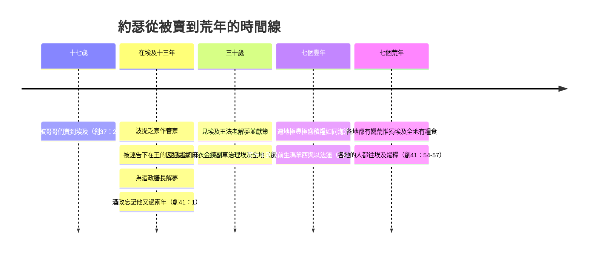

# 創世記 第41章

<!-- chapter-navigation:start -->
| [前一章](../01%20創世記/第40章.md) | [回目錄](../01%20創世記/全書目錄及綱要.md) | [下一章](../01%20創世記/第42章.md) |
| :--- | :---: | ---: |
<!-- chapter-navigation:end -->

1. 過了[[試煉後的榮耀|兩年]]，[[法老]]做夢，夢見自己站在[[尼羅河|河]]邊，
2. 有七隻母牛從[[尼羅河|河]]裡上來，又美好又肥壯，在[[尼羅河與埃及農業|蘆荻]]中吃草。
3. 隨後又有七隻母牛從[[尼羅河|河]]裡上來，又醜陋又乾瘦，與那七隻母牛一同站在河邊。
4. 這又醜陋又乾瘦的七隻母牛吃盡了那又美好又肥壯的七隻母牛。[[法老]]就醒了。
5. 他又睡著，第二回做夢，夢見一棵[[豐年與荒年的神聖節奏|麥子]]長了七個[[豐年與荒年的神聖節奏|穗子]]，又肥大又佳美，
6. 隨後又長了七個[[豐年與荒年的神聖節奏|穗子]]，又細弱又被[[東風（西洛可、卡姆辛）|東風]]吹焦了。
7. 這細弱的[[豐年與荒年的神聖節奏|穗子]]吞了那七個又肥大又飽滿的穗子。[[法老]]醒了，不料是個夢。
8. 到了早晨，[[法老]]心裡不安，就差人召了[[埃及]]所有的[[古埃及術士與博士|術士和博士]]來；法老就把所做的夢告訴他們，卻沒有人能給法老圓解。
9. 那時[[酒政]]對[[法老]]說：我今日想起我的罪來。
10. 從前[[法老]]惱怒臣僕，把我和[[膳長]]下在[[護衛長波提乏|護衛長]]府內的[[監獄（王的囚犯被囚之處）|監]]裡。
11. 我們二人同夜各做一夢，各夢都有講解。
12. 在那裡同著我們有一個希伯來的少年人，是[[護衛長波提乏|護衛長]]的僕人，我們告訴他，他就把我們的夢圓解，是按著各人的夢圓解的。
13. 後來正如他給我們圓解的成就了；我官復原職，[[膳長]]被掛起來了。
14. [[法老]]遂即差人去召[[約瑟]]，他們便急忙帶他出監，他就[[埃及人剃頭刮臉習俗|剃頭]]，[[埃及人剃頭刮臉習俗|刮臉]]，換衣裳，進到法老面前。
15. [[法老]]對[[約瑟]]說：我做了一夢，沒有人能解；我聽見人說，你聽了夢就能解。
16. [[約瑟]]回答[[法老]]說：[[解夢出於神|這不在乎我]]，神必將平安的話回答法老。
17. [[法老]]對[[約瑟]]說：我夢見我站在[[尼羅河|河]]邊，
18. 有七隻母牛從[[尼羅河|河]]裡上來，又肥壯又美好，在[[尼羅河與埃及農業|蘆荻]]中吃草。
19. 隨後又有七隻母牛上來，又軟弱又醜陋又乾瘦，在[[埃及]]遍地，我沒有見過這樣不好的。
20. 這又乾瘦又醜陋的母牛吃盡了那以先的七隻肥母牛，
21. 吃了以後卻看不出是吃了，那醜陋的樣子仍舊和先前一樣。我就醒了。
22. 我又夢見一棵[[豐年與荒年的神聖節奏|麥子]]，長了七個[[豐年與荒年的神聖節奏|穗子]]，又飽滿又佳美，
23. 隨後又長了七個[[豐年與荒年的神聖節奏|穗子]]，枯槁細弱，被[[東風（西洛可、卡姆辛）|東風]]吹焦了。
24. 這些細弱的[[豐年與荒年的神聖節奏|穗子]]吞了那七個佳美的穗子。我將這夢告訴了[[古埃及術士與博士|術士]]，卻沒有人能給我解說。
25. [[約瑟]]對[[法老]]說：法老的夢乃是一個。神已將所要做的事指示法老了。
26. 七隻好母牛是七年，七個好[[豐年與荒年的神聖節奏|穗子]]也是七年；這夢乃是一個。
27. 那隨後上來的七隻又乾瘦又醜陋的母牛是七年，那七個虛空、被[[東風（西洛可、卡姆辛）|東風]]吹焦的[[豐年與荒年的神聖節奏|穗子]]也是七年，都是七個荒年。
28. 這就是我對[[法老]]所說，神已將所要做的事顯明給法老了。
29. [[埃及]]遍地必來七個大豐年，
30. 隨後又要來七個荒年，甚至在[[埃及]]地都忘了先前的豐收，全地必被饑荒所滅。
31. 因那以後的饑荒甚大，便不覺得先前的豐收了。
32. 至於[[法老]]兩回做夢，是因神命定這事，而且必速速成就。
33. 所以，[[法老]]當揀選一個[[智慧與治理|有聰明有智慧]]的人，派他治理[[埃及]]地。
34. [[法老]]當這樣行，又派[[智慧與治理|官員]]管理這地。當七個豐年的時候，征收[[埃及]]地的五分之一，
35. 叫他們把將來豐年一切的糧食聚斂起來，積蓄[[積貨城制度|五穀]]，收存在[[各城（積貨城）|各城]]裡做食物，歸於[[法老]]的手下。
36. 所積蓄的糧食可以防備[[埃及]]地將來的七個荒年，免得這地被饑荒所滅。
37. [[法老]]和他一切臣僕都以這事為妙。
38. [[法老]]對臣僕說：像這樣的人，有[[神的靈在人身上|神的靈]]在他裡頭，我們豈能找得著呢？
39. [[法老]]對[[約瑟]]說：神既將這事都指示你，可見沒有人像你這樣有聰明有智慧。
40. 你可以掌管我的[[埃及宰相職位（維齊爾）|家]]；我的民都必聽從你的話。惟獨在[[埃及宰相職位（維齊爾）|寶座]]上我比你大。
41. [[法老]]又對[[約瑟]]說：我派你治理[[埃及]]全地。
42. [[法老]]就摘下手上[[埃及印璽戒指代表權柄|打印的戒指]]，戴在[[約瑟]]的手上，給他穿上[[埃及宮廷禮儀（剃頭、刮臉、賜名、賜戒指、細麻衣、金鍊、副車）|細麻衣]]，把[[埃及宮廷禮儀（剃頭、刮臉、賜名、賜戒指、細麻衣、金鍊、副車）|金鍊]]戴在他的頸項上，
43. 又叫[[約瑟]]坐他的[[埃及宮廷禮儀（剃頭、刮臉、賜名、賜戒指、細麻衣、金鍊、副車）|副車]]，[[喝道「跪下」的禮儀|喝道的]]在前呼叫說：[[喝道「跪下」的禮儀|跪下]]。這樣、[[法老]]派他治理[[埃及]]全地。
44. [[法老]]對[[約瑟]]說：我是法老，在[[埃及]]全地，若沒有你的命令，不許人擅自辦事【原文作動手動腳】。
45. [[法老]]賜名給[[約瑟]]，叫[[撒發那忒巴內亞]]，又將[[安城]]的祭司[[波提非拉]]的女兒[[亞西納]]給他為妻。約瑟就出去巡行[[埃及]]地。
46. [[約瑟]]見[[埃及]]王[[法老]]的時候年[[試煉後的榮耀|三十歲]]。他從法老面前出去，遍行埃及全地。
47. 七個豐年之內，地的出產極豐極盛【原文作一把一把的】，
48. [[約瑟]]聚歛[[埃及]]地七個豐年一切的糧食，把糧食積存在[[各城（積貨城）|各城]]裡；各城周圍田地的糧食都積存在本城裡。
49. [[約瑟]]積蓄[[積貨城制度|五穀]]甚多，如同海邊的沙，無法計算，因為穀不可勝數。
50. 荒年未到以前，[[安城]]的祭司[[波提非拉]]的女兒[[亞西納]]給[[約瑟]]生了兩個兒子。
51. [[約瑟]]給長子起名叫[[瑪拿西]]【就是[[瑪拿西（使之忘了）|使之忘了]]的意思】，因為他說：神使我忘了一切的困苦和我父的全家。
52. 他給次子起名叫[[以法蓮]]【就是[[以法蓮（使之昌盛）|使之昌盛]]的意思】，因為他說：神使我在受苦的地方昌盛。
53. [[埃及]]地的七個豐年一完，
54. 七個荒年就來了。正如[[約瑟]]所說的，各地都有饑荒；惟獨[[埃及]]全地有糧食。
55. 及至[[埃及]]全地有了饑荒，眾民向[[法老]]哀求糧食，法老對他們說：你們往[[約瑟]]那裡去，凡他所說的，你們都要做。
56. 當時饑荒遍滿天下，[[約瑟]]開了各處的倉，[[積貨城制度|糶糧]]給[[埃及]]人；在埃及地饑荒甚大。
57. 各地的人都往[[埃及]]去，到[[約瑟]]那裡[[積貨城制度|糴糧]]，因為天下的饑荒甚大。

---

## 本章知識節點

### 人物
- [[約瑟]]
- [[法老]]
- [[酒政]]
- [[膳長]]
- [[司獄]]
- [[波提非拉]]
- [[亞西納]]
- [[瑪拿西]]
- [[以法蓮]]
- [[王的囚犯]]
- [[約瑟在埃及]]

### 地點
- [[埃及]]
- [[尼羅河]]
- [[安城]]
- [[各城（積貨城）]]

### 原文
- [[撒發那忒巴內亞]]
- [[瑪拿西（使之忘了）]]
- [[以法蓮（使之昌盛）]]
- [[波提非拉（太陽神所賜）]]
- [[亞西納（屬內特女神）]]
- [[衣裳（外袍）]]

### 神學
- [[神的主權與預定]]
- [[解夢出於神]]
- [[豐年與荒年的神聖節奏]]
- [[約瑟預表基督]]
- [[神的靈在人身上]]
- [[智慧與治理]]
- [[試煉後的榮耀]]

### 歷史
- [[埃及宰相職位（維齊爾）]]
- [[埃及宮廷禮儀（剃頭、刮臉、賜名、賜戒指、細麻衣、金鍊、副車）]]
- [[尼羅河與埃及農業]]
- [[東風（西洛可、卡姆辛）]]
- [[古埃及術士與博士]]
- [[積貨城制度]]
- [[安城（赫利阿坡利斯）太陽神崇拜]]

### 文化
- [[埃及人剃頭刮臉習俗]]
- [[法老賜埃及名與妻]]
- [[埃及印璽戒指代表權柄]]
- [[喝道「跪下」的禮儀]]

### 互文
- [[約瑟與但以理（解夢、異邦宮廷）]]
- [[膳長被掛木架預表基督受咒詛]]
- [[「神使我忘記」與「神使我昌盛」的屬靈經歷]]
- [[約瑟失衣袍（三次）]]

### 解經爭議
- [[法老身份（許克所斯時期 vs 第十二王朝）]]
- [[撒發那忒巴內亞名字含義]]
- [[酒政「想起罪」是指忘記約瑟還是得罪法老]]
- [[「河」是否專指尼羅河]]

---

## 本章整理

約瑟因自己的夢被賣（創37章），又因別人的夢走出監牢。這一章從法老作夢開始，到天下人都往約瑟那裡糴糧為止：被酒政忘了兩年的約瑟（創40:23；41:1），被急忙帶出監牢，進到王宮，成為埃及的宰相。可以帶著兩個問題讀：這兩年等的是什麼？站在法老面前，約瑟的第一句話說了什麼？

### 經文大綱

1. 法老同夜作兩夢，無人能解（1-8節）
2. 酒政舉薦約瑟（9-13節）
3. 法老召見約瑟並重述兩夢（14-24節）
4. 約瑟解夢並建議因應之道（25-36節）
5. 法老任命約瑟治理埃及，賜名賜妻（37-45節）
6. 七個豐年：積糧如海沙，並生二子（46-52節）
7. 七個荒年來到，天下都來糴糧（53-57節）

### 一、「過了兩年」——法老的兩個夢（1-8節）

過了兩年，法老作夢，夢見自己站在[[尼羅河|河]]邊。CT 說這兩年對約瑟十分重要：他學習單單依靠神、不再求人（參40:14），從監中的達官多學了治國之道（參39:20），也到了[[試煉後的榮耀|三十歲能被神所用]]的年紀（46節；路3:23）。KC 說，神量定萬事的日期，也量定我們受苦的日期（林前10:13；雅1:3-4）；時候一到，祂就動工，使祂的僕人從卑微進入榮耀（詩105:19-21）。

第一個夢裡，有七隻又美好又肥壯的母牛從河裡上來，在[[尼羅河與埃及農業|蘆荻]]中吃草，隨後又有七隻又醜陋又乾瘦的母牛上來，把肥牛吃盡（2-4節）。「河」在原文是尼羅河的專用字（CT）；STEP 顯示原文 יְאֹר（H2975）源自古埃及語，專指尼羅河或其水系渠道。[[尼羅河與埃及農業|尼羅河是埃及的命脈]]，一年一次氾濫，帶來肥沃的泥土和充裕的水源（CT）；這條河的水情決定埃及農業是否豐收（《聖經精讀本》）。丁良才記下一則把水位與收成掛鉤的傳說：「尼羅河若只漲溢十二肘，就成了荒年；十三肘，眾人要受饑餓；十四肘眾人就歡喜；十五肘，莊稼就可收；十六肘，就是豐年；若漲得更高，就成了水災。」

牛喜歡浸在水中、只將頭頸露在水面上，以躲避烈日和蒼蠅（CT）；母牛半身浸在尼羅河裡，也是為了躲避太陽和蒼蠅（《雷氏研讀本》）。

蘆荻在 STEP 的原文是 אָחוּ（H260），是埃及借詞，指沼澤水草。埃及人以牛為上等的牲畜（丁良才）；母牛在埃及是月神伊希斯的象徵，與土地產量有關（《聖經精讀本》）。CT 說牛代表葷食，麥穗代表素食；丁良才說母牛是一切動物的標幟，穗子是一切植物的標幟。

第二個夢是[[豐年與荒年的神聖節奏|一棵麥子長七個穗子]]，隨後七個穗子又細弱又被[[東風（西洛可、卡姆辛）|東風吹焦]]，吞了那七個肥大的穗子（5-7節）。埃及的麥子多是一棵分數穗（CT、丁良才）。東風是春末夏初從沙漠吹來的熱風，會毀壞農作物、令百草枯萎（何13:15；賽40:7）（CT、《啟導本》）。CT 稱它為 sirocco，BH 說它也叫 khamsin，是從沙漠吹來的乾熱風，在聖經裡常和審判或艱難連在一起（出10:13）。短時間內重複的夢，按古埃及人的解夢法表示有意向或確實性（《聖經精讀本》）。

到了早晨，法老心裡不安，差人召了[[古埃及術士與博士|埃及所有的術士和博士]]，卻沒有人能圓解（8節）。術士專研祕術、巫術禮儀典籍，博士即星象學家，兩者被埃及人視為解夢專家（CT）。《聖經精讀本》說，術士意為「解釋所隱藏神奇之事的人」，掌握神秘的宗教知識，屬於祭司長職務，通常掌管占星學、解夢、看手相、占卜、變戲法等事；摩西時代的法老宮中（出7:11；8:18）和尼布甲尼撒的宮中（但1:20）都有這類人。

第8節法老所作的「夢」在原文是單數 חֲלוֹם（H2472）。CT 看出這暗示兩夢實為一個（25節），術士卻分開來解，這或許正是他們解夢失敗的原因。

KC 說，只有當埃及全部的智慧、世界全部的智慧都對法老的問題無言以對，人才想起約瑟；先要毀掉智慧人的智慧，神在基督裡的智慧才被人接受（林前1:19-20,30）。CT 說，人天然的頭腦、屬世的智慧，不能領會神深奧的事（林前2:11,14）。

### 二、酒政想起了他的罪（9-13節）

酒政對法老說：「我今日想起我的罪來。」（9節）這個罪指的是他從前得罪法老的事（40:1-2），不是忘記約瑟的託付（丁良才、CT）；BH 則說，他承認的是自己先前沒有向法老提起約瑟的疏失。

KC 說，酒政一想起約瑟，就不能不想起自己的過去：在哪裡遇見約瑟、約瑟為他做了什麼；我們想起主耶穌，也是如此。《聖經精讀本》說，這一切來自神，祂在適當的時機和環境中帶領義人（詩121:3-8；賽49:15-16）。

酒政稱約瑟為「一個希伯來的少年人」（12節）。「少年人」原文與37:2的「童子」同字，指未成年的男子；CT 認為這個稱呼可能是有意或無意地貶低約瑟。

### 三、「這不在乎我」——約瑟見法老（14-24節）

法老「遂即」差人去召約瑟，他們「急忙」帶他出監（14節）。約瑟[[埃及人剃頭刮臉習俗|剃頭、刮臉、換衣裳]]，是因為朝見法老必須遵守宮廷禮節：埃及男人通常不留鬚，猶太男人則多留鬚（CT）。這並不表示他在獄中蓬頭垢面（CT、《啟導本》）；他關在「王的囚犯被囚的地方」，待遇比普通監獄好（《啟導本》）。《舊約背景註釋》說，所剃的可能包括頭髮（民6:9）和鬍鬚（耶41:5），這樣他的外貌就與埃及人相似，埃及的壁畫也證明埃及人通常剃淨毛髮。

KC 數過約瑟的衣裳：第一件是彩衣，被哥哥們剝去、蘸了血（37:31-33）；第二件是奴僕的衣裳，留在波提乏妻子手中（39:10-18），也可能就是他的囚衣，這兩件都說到他的卑微；第三件是在這裡換上、可以進到法老面前的衣服，是他被法老高舉的衣服；第四件是稍後的細麻衣（42節），連著他公開的榮耀。KC 說，第14節是腓立比書2章的簡短圖畫：先有基督的卑微（腓2:5-8），後有升高（腓2:9）。

面對法老，約瑟的第一句話是：「[[解夢出於神|這不在乎我]]，神必將平安的話回答法老。」（16節）STEP 顯示開頭的 בִּלְעָדָי（H1107），字面是不在於我；「回答」是 עָנָה（H6030），「平安」是 שָׁלוֹם（H7965）。CT 說，「這不在乎我」表示解夢的能力出於神；「神必將平安的話回答法老」原文另譯「神必向法老宣示平安」，可見約瑟雖然還不知道夢境，卻已得了神的啟示，胸有成竹。

《聖經精讀本》說，法老認為約瑟有解夢的神奇能力，約瑟卻坦白指出秘訣唯獨在於神（40:8）；他作為一個僕人，大膽向大國之君證明自己的神，似乎在聽到夢的內容之前，就憑屬靈洞察力感受到神將藉法老的夢成就善工。KC 也說，法老期待約瑟解夢，約瑟推開這份期待，把榮耀歸給神，並且在聽夢之前，就說了神藉這夢讓法老知道對他有利的事。丁良才的評語是：「約瑟不怕在王的面前為主作見證。」

CT 的話中之光說，神真正的僕人都必須承認自己一無所有，而將榮耀歸於神；神才是惟一的啟示者、賜予者和賜福者。那些從神得著大恩賜的人，若以謙卑為懷、不肯篡奪神該得的讚美，神必給予更大的恩賜。

法老重述兩個夢（17-24節），用詞稍有出入：19節多出「又軟弱」，「又醜陋」按原文多出『非常』，還加上法老的評論——「在埃及遍地，我沒有見過這樣不好的」；21節的「喫了以後，卻看不出是喫了」是前文沒有的，強調這現象不同尋常的怪異；23節的「枯槁」一詞在全部舊約中僅此一次出現（CT）。法老特別強調母牛醜陋的樣子，可能預感事態不妙（《聖經精讀本》）；他大概是想過之後，才察覺瘦牛吃了肥牛並沒有變胖，也查證了自己國內是否見過這樣醜陋乾瘦的牛（KC）。

### 四、兩個夢，一個意思（25-36節）

|  | 第一夢 | 第二夢 |
|---|---|---|
| 好的 | 七隻母牛，又美好又肥壯 | 一棵麥子上七個穗子，又肥大又佳美 |
| 壞的 | 七隻母牛，又醜陋又乾瘦 | 七個穗子，細弱、被東風吹焦 |
| 結局 | 瘦牛吃盡肥牛，吃了卻看不出是吃了 | 細穗吞了飽穗 |
| 解 | 七個大豐年，隨後七個荒年 | 同一個解——「這夢乃是一個」 |

約瑟說「法老的夢乃是一個」（25節），這是解此夢的關鍵（CT）。「這夢乃是一個」的意思是兩個夢的解釋只有一個，或兩個夢都指同一件事（CT）；《雷氏研讀本》也說兩個夢的意思是相同的。至於為何兩回作夢，經文說「是因神命定這事，而且必速速成就」（32節）。STEP 的形態分析顯示，「命定」是 נָכוֹן（字根 כּוּן，H3559，Niphal 分詞，確立、定準），「速速成就」是 מְמַהֵר（字根 מָהַר，H4116，Piel 分詞，快快地、迅速催行），兩個分詞連用，強調神旨意的確定與急迫。

兩回作夢是在強調事情的確定性和急迫性（CT、《聖經精讀本》）；《雷氏研讀本》說，那些事件是肯定的，而且不久就要發生。CT 另說，神重複的啟示，目的是要喚起人的行動，不是要人頹廢（參來6:17-18）。

「神已將所要做的事指示法老」含有三層意思：要使法老知道神管理萬有；要拯救多人脫離饑荒的苦；要應驗神向亞伯拉罕所應許的話（創15:13）（CT、丁良才）。這些事顯明給法老，是為了使他救神的百姓（丁良才）；CT 說是要法老準備好，承擔拯救神選民的任務。《聖經精讀本》說，神要藉著災難把雅各家族帶到埃及。

約瑟不只解夢，更獻上具體對策（CT 數為五個建議）：

1. 揀選一個有聰明有智慧的人[[智慧與治理|總其成]]（33節）。STEP 顯示第33節與第39節重複使用一組詞：נָבוֹן（H995，聰明、通達）和 חָכָם（H2450，智慧）。CT 區分兩者：智慧是識透事實真相的能力，偏重原則；聰明是把智慧所得付諸執行的能力，偏重細則。
2. 在總管之下分層派[[智慧與治理|官員]]管理各地（34節上）。
3. 豐年征收五分之一（34節下）。
4. 聚斂豐年一切的糧食，也就是五分之一以外還要收購餘糧（35節上）。
5. [[各城（積貨城）|收存在各城裡]]，[[積貨城制度|歸法老手下看守]]，免得被人偷盜（35節下）。

約瑟絲毫沒有毛遂自薦的意思（CT）。他是奴僕，沒有被問，卻有尊嚴地向大能的法老獻策，其中沒有一絲對所受不公的報復（KC）。他根本沒想到自己會被選：他是希伯來人，身為奴僕又是囚犯，沒有學問和治國的閱歷（可與哈曼比較，斯6:6）（丁良才）。

### 五、「有神的靈在他裡頭」——約瑟被立為宰相（37-45節）

法老和他一切臣僕都以這事為妙（37節），可見他們沒有懷疑夢是神給的警告，也贊同約瑟的建議（CT）。法老說：「像這樣的人，[[神的靈在人身上|有神的靈在他裡頭]]，我們豈能找得著呢？」（38節）意思是，若非受神靈的感動，沒有人能作出這樣的解夢和建議（CT）。STEP 顯示原文是 רוּחַ אֱלֹהִים（H7307 搭配 H430，「神的靈」）；BH 說，這是聖經中最早提到神的靈在某人身上的地方之一，一位異教君王在約瑟身上認出了神的同在。丁良才的註解提到但5:14、出31:3。

CT 說，37至40節是法老徵詢臣僕之後當場頒佈授職令；41至45節上半，則是正式授職典禮中的諭令和行動，包括43節的分乘車輛、接受眾臣僕歡呼，和45節的賜名。典禮上的每一件事都有意義：

| 賜下 | 意義 |
|---|---|
| 打印的戒指 | 認證文件的印璽（CT）；掌權的標誌（斯3:10；8:2）（CT、丁良才） |
| 細麻衣 | 埃及貴族的朝服（CT）；也是埃及祭司所穿的衣服（丁良才） |
| 金鍊 | 表明對他榮寵有加（CT）；代表國王的獎掖，通常頒給有功勳的大臣（《啟導本》） |
| 副車 | 緊隨法老車後的座駕，表明地位僅次於法老（CT、《啟導本》） |
| 喝道「跪下」 | 由埃及文轉來的詞，含有讓開、迴避、屈膝、歡呼等意思（CT） |

這些都是[[埃及宮廷禮儀（剃頭、刮臉、賜名、賜戒指、細麻衣、金鍊、副車）|埃及宮廷的授職禮儀]]。[[埃及印璽戒指代表權柄|法老摘下自己手上的戒指戴在約瑟手上]]，就是把治國的權柄交託給他（丁良才）；有了戒指，就擁有受委託權（《串珠聖經註釋》）。

法老說「你可以掌管我的家」，[[埃及宰相職位（維齊爾）|『家』]]原意是房子，指皇宮，也就是執政的中樞，本句可延伸指掌管全埃及國；「我的民都必聽從你的話」，按原文直譯是「按照你的命令我的民要吻（你）」，吻手或腳表示尊敬或臣服（CT）。《舊約背景註釋》說，約瑟的職任相等於埃及的「大維齊爾」（首相）和「王室物業總監」，職務大致與「上下埃及糧倉總監」相同。「惟獨在寶座上我比你大」（40節）是說，約瑟在埃及成為一人之下、萬人之上的宰相（《聖經精讀本》）。

[[喝道「跪下」的禮儀|喝道的在前呼叫「跪下」]]（43節），STEP 顯示原文是 אַבְרֵךְ（H86，字典的意思是屈膝，通常理解為埃及語借詞，或屈膝歡呼之聲）。BH 說，這預示萬膝終必向基督跪拜（腓2:10-11）。

法老又說「我是法老」，意思是『我以法老這頭銜所擁有的權力，在此對你頒佈諭令』；「不許人擅自辦事」，原文是「舉起他的手或他的腳」，也就是做任何事的意思，法老表明他已賜給約瑟絕對的權力（CT）。

法老又行了兩件「埃及化」的事：賜名[[撒發那忒巴內亞]]，賜妻[[亞西納]]（45節）。古埃及法老任命宮廷高官，正式就職禮儀之一就是賜名（CT）。STEP 的希伯來音譯分別是 צָפְנַת פַּעְנֵחַ（H6847）與 אָסְנַת（H621），波提非拉是 פּוֹטִי פֶרַע（H6319）。

撒發那忒巴內亞的意思，各家說法不同：

| 來源 | 說法 |
|---|---|
| CT | 奧秘的啟示者，世界的救主，世界的救恩，維持生命的，生命的糧，因神的話而活著 |
| KC | 奧秘的啟示者，或世界的救主 |
| 《聖經精讀本》 | 世界的拯救者，或奧秘的啟示者 |
| 丁良才 | 有人以為是救世者或啟示奧秘者的意思 |
| BH | 神說話、他就活著，或奧祕的啟示者 |
| 《串珠聖經註釋》 | 意思不詳，可能有豐富生命的意思 |
| 《雷氏研讀本》 | 意思不能肯定 |
| 《舊約背景註釋》 | 含義不能確定，可能是「神已說話而他會存活」，也可能是「曉得之人」 |

CT 的靈意註解由此看基督：祂是奧秘的啟示者（約1:18）、世界的救主（約1:29）、生命的糧（約6:51）。

亞西納是安城祭司波提非拉的女兒。安城因敬拜太陽神而出名，祭司是埃及尊貴而有權勢的人物（CT、丁良才、《串珠聖經註釋》）；這城又叫赫利阿坡利斯，居民拜太陽神銳（《啟導本》、《雷氏研讀本》）。亞西納的意思是她屬於內特，內特是埃及女神（CT）；《啟導本》作「屬納特的女子」（納特為埃及女神）。《舊約背景註釋》說，這樁婚姻使約瑟與埃及最舉足輕重的祭司家族之一結盟。CT 把亞西納讀作外邦教會的預表，教會是基督的妻（參弗5:25、32）；KC 也說她是主耶穌升高之後所得的新婦，也就是從列國而來的教會的圖畫。

《聖經精讀本》說明法老的動機：賜名、賜妻一方面是為了鞏固約瑟在埃及社會的身份地位，「以防有人對他持有偏見或藐視」，另一方面「明顯出於私心，試圖把約瑟這難得的人才完全變為埃及人」。丁良才也說，約瑟成了埃及人，有了埃及國的名字和爵位；他的先祖亞伯拉罕也娶過埃及人夏甲為妻（創16:1）。

> [!note] 法老身份與年代
> 這位法老是誰，《舊約背景註釋》說已經無從稽考：部分學者認為情節所反映的背景是許克所斯時期（主前1750-1550年），因為當時有很多閃族人在埃及定居，埃及史料也提到有些是政府官員；按聖經年代資料，則指向更早的中王國第十二王朝（主前1963-1786年）。創世記的作者照例不提法老的名字，這作法可能是故意的：埃及人視法老為神，以色列人當然絕口不提他的名號。

### 六、瑪拿西與以法蓮（46-52節）

「約瑟見埃及王法老的時候年[[試煉後的榮耀|三十歲]]」（46節）。約瑟三十歲，已經在埃及十三年了（丁良才）；《雷氏研讀本》說，他十七歲來到埃及（參37:2），為奴的時間已有十三年。他出去遍行埃及全地，到各地視察實際業務的執行，確保計劃完成（CT）。利未人從三十歲開始在會幕任職（民4:3），主耶穌三十歲開頭傳道（路3:23）（CT）；《聖經精讀本》說，希伯來民族認為男人在這個年齡可以開始擔負責任。CT 的話中之光說，約瑟出監見法老時的年歲，再一次證明酒政把他忘了兩年是出於神的安排；神作事有祂自己的時間表。

七個豐年之內，地的出產極豐極盛，約瑟把糧食積存在各城裡，各城周圍田地的糧食都積存在本城裡（47-48節）。「一切」指各種糧食的五分之一（丁良才），CT 說還包括所收購的餘糧。糧食積蓄得如同海邊的沙，無法計算；「如同海邊的沙」是俗語，就是不可勝數的意思（CT、丁良才）。《聖經精讀本》說，約瑟積糧的背後，神要把選民引到埃及，直到迦南地的罪惡滿盈（創15:16）。

荒年未到以前，亞西納給約瑟生了兩個兒子（50節），都是在頭七年內出生的（CT）。兩個兒子的名字，是約瑟的信仰告白（《聖經精讀本》）：

- [[瑪拿西（使之忘了）|瑪拿西]]：STEP 的希伯來名是 מְנַשֶּׁה（H4519），源自約瑟說神使我忘記（נַשַּׁנִי，字根 נָשָׁה H5382，Piel 完成式）一切的困苦和我父的全家。後來的事實證明，約瑟並沒有忘記父家的人（42:7；43:27、30），所以 CT 認為這句話較合理的解釋，是忘記了他對父親家人的懷怨。丁良才的解釋是：「約瑟忘了他的苦難，卻沒有忘了他的神。」
- [[以法蓮（使之昌盛）|以法蓮]]：STEP 的希伯來名是 אֶפְרַיִם（H669），源自約瑟說神使我在受苦的地方昌盛（הִפְרַנִי，字根 פָּרָה H6509，Hiphil 完成式，字面義是使之繁衍、多結果子）。丁良才說：「我們為主忍受苦難的地方，大概也就是得昌盛的地方。」

CT 說，瑪拿西表明約瑟顛沛際遇的結束，以法蓮表明新生活豐盛的開展，須先有瑪拿西的經歷，後才有以法蓮的經歷；誰苦受得越多，誰的靈命就越豐盛。KC 讀出同一幅圖畫：被弟兄棄絕的主耶穌如今在榮耀裡，得著教會作新婦，可以忘記所受的凌辱，並且從榮耀裡使一切與祂聯合的人多結果子。

### 七、「你們往約瑟那裡去」——荒年開始（53-57節）

七個豐年一完，七個荒年就來了，「正如約瑟所說的」（54節）。各地都有饑荒，惟獨埃及全地有糧食；那是因為七個豐年留下的餘糧，使埃及人不致捱餓（CT）。CT 引書21:45、賽55:11 說，神的話從不落空。

等到埃及全地的餘糧用盡，眾民向法老哀求糧食，法老說：「你們往約瑟那裡去，凡他所說的，你們都要做。」（55節）KC 說，這是福音的美麗圖畫：神對那些因罪困苦、向祂呼求的人說，去見耶穌，祂告訴你們什麼，你們就做什麼（參約2:5）。CT 說，信徒如有需要，不要向人哀求，而要往主那裡去，對祂的話信而順服，就必得著滿足（約15:7）。

於是[[積貨城制度|約瑟開了各處的倉]]，[[積貨城制度|糶糧]]給埃及人；各地的人都往埃及去[[積貨城制度|糴糧]]（56-57節）。CT 為兩個難字注音：「糶」音「跳」，指出售糧食；「糴」音「笛」，指購買糧食。這一句也是下一章的伏筆：約瑟的哥哥們也要來了。

「饑荒遍滿天下」的「天下」，指當時所知道的世界，也就是中東埃及和鄰近一帶地方（CT）。饑荒發生在中東一帶（《啟導本》）；不是全世界，只包括埃及和它的鄰國（《串珠聖經註釋》）。丁良才推測，前來糴糧的各地的人大概是埃提阿伯、亞拉伯、迦南和亞蘭等國的人。KC 讀出另一層：豐年結束、荒年開始的這段日子，正是約瑟要與埃及人、也要與他哥哥們打交道的時候；KC 把它比作那將要臨到普天下的試煉的時候（啟3:10），和雅各遭難的日子（耶30:7）。《聖經精讀本》說，連續七年史無前例的災害，表明神把天地萬物當作工具，造成約瑟和他兄弟相遇的契機。

### 十三年與十四年：本章的兩條時間線

本章有兩條時間線交疊：一條是約瑟個人的十三年，一條是埃及的十四年（七個豐年加七個荒年，《聖經精讀本》）。丁良才算得很清楚：「三十歲」意味著約瑟已經在埃及十三年了（創37:2）；《雷氏研讀本》同說他十七歲來到埃及，為奴的時間已有十三年。《聖經精讀本》把約瑟的一生補完：此後他又活了八十年，一百一十歲歸到他列祖那裡（創50:26）。

兩條線在第46節交會：約瑟站在法老面前的那一天，既是他十三年受苦的終點，也是埃及十四年豐荒的起點。

### 背景補充：法老的夢、術士行會與約瑟的擢升

《舊約背景註釋》為本章的埃及場景提供了許多對照。

為何是兩個夢：古代近東的人一般假定夢是神明與人溝通的方法，有些夢很簡單直接（如雅各在伯特利所作的夢，創28:10-22）；夢若牽涉到君王或法老，其重要性有時會透過雙夢表達。蘇美王古德據說也曾作過兩個夢，指示他興建廟宇，兩位王的夢都是由術士或神明的代表圓解的。按照馬里文獻，連續兩晚作相同的夢，會加強夢中信息的重要性；《吉加墨斯史詩》和一首關於受苦義人的詩，都描述以三次重複來證實可靠性的夢。

術士行會：埃及、美索不達米亞和赫人王國的術士都組成同業行會，負責詮釋兆頭和異夢，以及煉製藥物。美索不達米亞的法術有黑白之分，奉行者分巫師術士與博士兩類，「埃及的術士行會卻沒有這個分別」；埃及術士的職責雖主要在醫療方面，對神明的態度卻似乎沒有那麼尊重。「埃及法老竟然要人為他解夢，此事十分反常。因為法老被奉為神祇，神明藉夢與他溝通時，其意義對他來說應該是顯而易見的。」形容法老所召專家的希伯來語字眼原是埃及文的專用名詞，有時被學者認為專指解夢者。

埃及也會鬧饑荒：埃及雖因尼羅河定期氾濫而成為古代近東最穩定的穀物出產地之一，「但它偶爾也會發生饑荒」。亞曼念紇一世在位時（主前1991-1962年）的《奈費爾蒂的異象》就提到過這樣一場災禍，「這典籍也是描述異象得到圓解，災難得以預知，與約瑟的敘述相仿」。CT 從另一頭說同一件事：正因為尼羅河每年定期氾濫，埃及很少有長期的饑荒。

配給制與積貨城：約瑟的計策是豐年每年儲藏五分之一的收成，有需要時分配給百姓，建築倉庫也是這妙計的一部分（出1:11；王上9:19）。埃及對尼羅河的經營與這河的恆常性，令埃及成為全古代近東的大糧倉，「積貨城是有長遠眼光，了解饑荒的必然性而謀求對策之富強國家的特徵」，每個區域通常都會在位置適中的地點設有積貨城。

擢升的規格：把官位授與非埃及人，在許克所斯時代以前十分罕見，但仍有先例——亞馬拿執政時期，一位閃族官員圖圖（Tutu）被任命為「全國最高之口」，地位權力相當於約瑟。不少埃及貴胄都可以說自己僅次於法老，好幾個職銜都表示有此地位，碑文中曾提及的兩個是「兩地之主最寵愛者」與「他的侍官之首」。至於打印的戒指，君王和王室執政官員都用印章戒指處理公務文件，這種戒指十分獨特並刻有王的名號，因此「使用者就是以王的名義行事」；細麻衣和金鍊是授職典禮中賜下的裝飾，用以表明他的地位、階級、職權。乘坐馬車、有衛兵在前頭開路，證明約瑟的身分地位極高；除王以外，所有人都得向他下跪，任何人都不許「舉手或舉足」反對他（參較：拉7:21-26）。

埃及語名字與安城祭司：給約瑟另起埃及語名字，是為了完成授職典禮的轉變過程，約瑟埃及化之後，更能在朝廷和埃及全地為人所接受；法老梅雷他（主前1224-1208年）在位時，也有更改閃族官員名字的慣例。安排這樁婚姻，使約瑟得與埃及最舉足輕重的祭司家族之一聯盟；所有主要節期都由安城的祭司主持，他們還負責監督在廟城希流坡利斯事奉太陽神銳的祭司。

埃及的傳記文學：埃及古墓中的傳記，和《辛奴亥的故事》等文學，為法老臣屬的生涯提供了充分資料，其中從低微地位被擢升到掌握大權的人為數不少。因此，約瑟高升得榮的描寫，從埃及當代的背景來看，可說是典型的例證。

### 從監牢到宰相（全章）

這一章從法老的兩個夢開始，到各地的人都往約瑟那裡糴糧為止。約瑟三十歲站在法老面前，第一句話是「這不在乎我」；之後他被立為宰相，生了瑪拿西和以法蓮，荒年來到時開倉糶糧，各地的人都到他那裡去。酒政把約瑟忘了兩年，是出於神的安排（CT）；法老派他治理埃及全地，是出乎約瑟的意外（參40:14；弗3:20）（丁良才）。通往榮耀的路總是經過苦難：約瑟十七歲那年下坡開始，三十歲被立為宰相（KC）。這一章的末了，饑荒遍滿天下，下一章就是約瑟的哥哥們到埃及糴糧。

### 豫表與互文

- 約瑟預表基督（CT 靈訓要義）：約瑟從監裡出來（14節），主耶穌從死裡復活；約瑟受外邦人尊敬（38-39節），主耶穌受外邦人歡迎；約瑟作埃及宰相（43-44節），主耶穌是萬王之王；約瑟娶外邦女子為妻（45節），主耶穌拯救外邦人作祂的新婦；約瑟三十歲遍行埃及全地（46節），主耶穌三十歲出去傳講天國；約瑟有豐富的糧食（48-49節），主耶穌是生命的糧。
- 《聖經精讀本》說，約瑟的一生體現「先苦難後得榮耀」，預表在十字架上受苦、復活升天、最終擁有天地所有權柄的耶穌基督（腓2:5-11）。
- 法老和臣僕深信約瑟有超乎常人的洞見，《雷氏研讀本》要人比較但5:11；丁良才就「有神的靈在他裡頭」參看但5:14、出31:3。

**參考資料**
代號：CT＝ccbiblestudy《逐節註解》；GT＝ccbiblestudy《拾穗》，彙集多本中文註釋；正文直接寫書名或作者的（如《丁道爾》、丁良才），都出自這裡；KC＝KingComments；BH＝BibleHub Study；STEP＝STEP Bible 原文資料（CC BY 4.0）
https://www.ccbiblestudy.org/Old%20Testament/01Gen/01CT41.htm
https://www.ccbiblestudy.org/Old%20Testament/01Gen/01GT41.htm
https://www.kingcomments.com/en/bible-studies/Gen/41
https://biblehub.com/study/genesis/41.htm
https://github.com/STEPBible/STEPBible-Data

<!-- appendix-links:start -->
## 附錄

### 相關地圖
- [[appendix/fhl_maps/maps/008|〈創圖三〉族長們於迦南地以外的活動]]
- [[appendix/fhl_maps/maps/015|〈創圖十〉雅各的生平]]
- [[appendix/fhl_maps/maps/016|〈創圖十一〉猶大和約瑟的生平]]
- [[appendix/fhl_maps/maps/017|〈創圖十二〉古埃及全圖]]
<!-- appendix-links:end -->

<!-- chapter-navigation:start -->
| [前一章](../01%20創世記/第40章.md) | [回目錄](../01%20創世記/全書目錄及綱要.md) | [下一章](../01%20創世記/第42章.md) |
| :--- | :---: | ---: |
<!-- chapter-navigation:end -->
