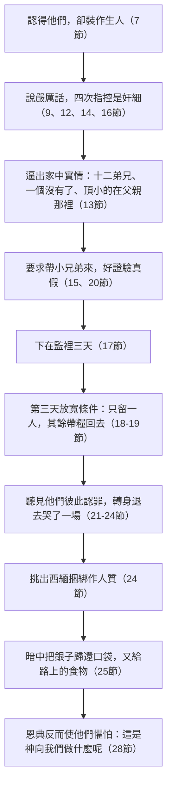

# 創世記 第42章

<!-- chapter-navigation:start -->
| [前一章](../01%20創世記/第41章.md) | [回目錄](../01%20創世記/全書目錄及綱要.md) | [下一章](../01%20創世記/第43章.md) |
| :--- | :---: | ---: |
<!-- chapter-navigation:end -->

1. [[雅各]]見[[埃及]]有糧，就對兒子們說：你們為什麼彼此觀望呢？
2. 我聽見[[埃及]]有糧，你們可以下去，從那裡為我們糴些來，使我們可以存活，不至於死。
3. 於是，[[約瑟]]的十個哥哥都下[[埃及]]糴糧去了。
4. 但[[約瑟]]的兄弟[[便雅憫]]，[[雅各]]沒有打發他和哥哥們同去，因為雅各說：恐怕他遭害。
5. 來糴糧的人中有以色列的兒子們，因為[[迦南地]]也有饑荒。
6. 當時治理[[埃及]]地的是[[約瑟]]；糶糧給那地眾民的就是他。約瑟的哥哥們來了，臉伏於地，[[約瑟的夢（應驗）|向他下拜]]。
7. [[約瑟]]看見他哥哥們，就認得他們，卻裝作生人，向他們說些[[對兄弟的試驗|嚴厲話]]，問他們說：你們從哪裡來？他們說：我們從[[迦南地]]來糴糧。
8. [[約瑟]]認得他哥哥們，他們卻不認得他。
9. [[約瑟]]想起從前所做的[[約瑟的夢（應驗）|那兩個夢]]，就對他們說：你們是奸細，來窺探這地的虛實。
10. 他們對他說：我主啊，不是的。僕人們是糴糧來的。
11. 我們都是一個人的兒子，是誠實人；僕人們並不是奸細。
12. [[約瑟]]說：不然，你們必是窺探這地的虛實來的。
13. 他們說：僕人們本是弟兄十二人，是[[迦南地]]一個人的兒子，頂小的現今在我們的父親那裡，有一個沒有了。
14. [[約瑟]]說：我才說你們是奸細，這話實在不錯。
15. 我[[古埃及的起誓方式|指著法老的性命起誓]]，若是你們的小兄弟不到這裡來，你們就不得出這地方，從此就可以把你們證驗出來了。
16. 須要打發你們中間一個人去，把你們的兄弟帶來。至於你們，都要囚在這裡，好證驗你們的話真不真，若不真，我[[古埃及的起誓方式|指著法老的性命起誓]]，你們一定是奸細。
17. 於是[[約瑟]]把他們都下在監裡三天。
18. 到了第三天，[[約瑟]]對他們說：我是敬畏[[神的護理|神]]的；你們照我的話行就可以存活。
19. 你們如果是誠實人，可以留你們中間的一個人囚在監裡，但你們可以帶著糧食回去，救你們家裡的饑荒。
20. 把你們的小兄弟帶到我這裡來，如此，你們的話便有證據，你們也不至於死。他們就照樣而行。
21. 他們彼此說：[[悔改與良心的覺醒|我們在兄弟身上實在有罪]]。他哀求我們的時候，我們見他心裡的愁苦，卻不肯聽，所以這場苦難臨到我們身上。
22. [[流便]]說：我豈不是對你們說過，不可傷害那孩子嗎？只是你們不肯聽，所以流他血的罪向我們追討。
23. 他們不知道[[約瑟]]聽得出來，因為在他們中間用[[通事（傳譯員）|通事]]傳話。
24. [[約瑟]]轉身退去，哭了一場，又回來對他們說話，就從他們中間挑出[[西緬]]來，在他們眼前把他捆綁。
25. [[約瑟]]吩咐人把糧食裝滿他們的器具，把各人的銀子歸還在各人的口袋裡，又給他們路上用的食物，人就照他的話辦了。
26. 他們就把糧食馱在驢上，離開那裡去了。
27. 到了住宿的地方，他們中間有一個人打開口袋，要拿料餵驢，才看見自己的[[古埃及銀子交易|銀子]]仍在口袋裡，
28. 就對弟兄們說：我的銀子歸還了，看哪，仍在我口袋裡！他們就提心吊膽，戰戰兢兢地彼此說：[[神的護理|這是神向我們做什麼呢]]？
29. 他們來到[[迦南地]]、他們的父親[[雅各]]那裡，將所遭遇的事都告訴他，說：
30. 那地的主對我們說嚴厲的話，把我們當作窺探那地的奸細。
31. 我們對他說：我們是誠實人，並不是奸細。
32. 我們本是弟兄十二人，都是一個父親的兒子，有一個沒有了，頂小的如今同我們的父親在[[迦南地]]。
33. 那地的主對我們說：若要我知道你們是誠實人，可以留下你們中間的一個人在我這裡，你們可以帶著糧食回去，救你們家裡的饑荒。
34. 把你們的小兄弟帶到我這裡來，我便知道你們不是奸細，乃是誠實人。這樣，我就把你們的弟兄交給你們，你們也可以在這地做買賣。
35. 後來他們倒口袋，不料，各人的銀包都在口袋裡；他們和父親看見銀包就都害怕。
36. 他們的父親[[雅各]]對他們說：你們使我喪失我的兒子：[[約瑟]]沒有了，[[西緬]]也沒有了，你們又要將[[便雅憫]]帶去；這些事都歸到我身上了。
37. [[流便]]對他父親說：我若不帶他回來交給你，你可以殺我的兩個兒子。只管把他交在我手裡，我必帶他回來交給你。
38. [[雅各]]說：我的兒子不可與你們一同下去；他哥哥死了，只剩下他，他若在你們所行的路上遭害，那便是你們使我白髮蒼蒼、悲悲慘慘地下[[陰間（Sheol）|陰間]]去了。

---

## 本章知識節點

### 神學
- [[約瑟的夢（應驗）]]
- [[神的護理]]
- [[悔改與良心的覺醒]]
- [[種與收的法則]]
- [[約瑟預表基督]]
- [[對兄弟的試驗]]
- [[苦難與管教]]
- [[亞伯拉罕之約]]

### 文化
- [[古埃及的起誓方式]]
- [[古埃及銀子交易]]

### 原文
- [[通事（傳譯員）]]
- [[陰間（Sheol）]]

### 互文
- [[約瑟的夢]]

### 人物
- [[雅各]]
- [[約瑟]]
- [[便雅憫]]
- [[流便]]
- [[西緬]]

### 地點
- [[埃及]]
- [[迦南地]]

---

## 本章整理

多坍事件（創37:17-28）之後，過了二十年，故事又回到雅各一家（《聖經精讀本》）。這一章的起因是饑荒：十個哥哥下埃及糴糧，站在已經是宰相的約瑟面前，卻沒有人認出他。可以帶著兩個問題讀：約瑟為什麼不立刻相認，反而一再試驗哥哥們？哥哥們從三天的囚禁，到口袋裡的銀子，一步步發現了什麼？

KC 說，整個約瑟的故事裡，經文沒有再談雅各和他的兒子們，彷彿聖靈在說：他們犯罪之後，約瑟又不在他們中間，我對他們就無話可說了。這是以色列棄絕主耶穌之後的歷史，他們暫時成了羅‧阿米，就是「非我民」（何1:9），但神並沒有忘記他們，祂在等候合宜的時機，而這時機必與那位真約瑟相連（KC）。如今饑荒把他們趕到約瑟腳前，如同浪子被饑餓趕回家（路15:17-18）（KC）。

《聖經精讀本》為這一幕標出時間：這是約瑟擔任宰相的第八年，七年大豐收剛結束（創41:53），前所未有的饑荒降臨，雅各當時約一百二十九歲。三代族長在有生之年都因饑荒受過苦（創12:10；26:1），說明地上的迦南是不完全的，是經受考驗和試煉的地方；雅各一家面臨的饑荒，是神把他們領進埃及的邀請函，[[亞伯拉罕之約|創15:13 所說立約百姓要在外邦地受四百年苦難的預言，現在開始漸漸成就]]（《聖經精讀本》）。

### 經文大綱

1. 雅各差遣十子下埃及糴糧（1-5節）
2. 十個哥哥向約瑟下拜，卻不認得他（6-8節）
3. 約瑟指控他們是奸細，下在監裡三天（9-17節）
4. 留西緬作人質，釋放其餘九人（18-25節）
5. 回迦南向雅各報告（26-34節）
6. 雅各不容便雅憫下去（35-38節）

### 一、「你們為什麼彼此觀望呢？」（1-5節）

雅各的兒子們坐在那裡，只是無助地彼此觀望，卻不去尋找糧食（《雷氏研讀本》）。丁良才推想，他們不願意下埃及，或許是因為良心有虧（創37:25-28）。CT 的話中之光由此說了三點：亞伯拉罕、以撒、雅各三位信心的祖宗，在迦南地都遭遇過饑荒，可見信心的道路並非一帆風順；迦南地沒有糧，埃及地反而有糧，許多時候信徒忠心站住地位，反而缺乏屬世的祝福，這正是考驗信心的時候；信徒明知可以從神的話中得著生命的供應，卻很少人愛讀聖經，而喜歡彼此觀望，當作新聞說說聽聽（徒17:21）。

為什麼十個哥哥全都下去？《聖經精讀本》給了兩個實際的理由：一是考慮曠野路途的危險，二是埃及的糧食可能按人頭定量出售，想一次能多買些糧食。《靈修版聖經註釋》說明穀物為何如此要緊：各地皆以穀物作糧食，幾乎人人靠它維生，它可以曬乾收藏，「比蔬菜、乳酪製品、肉類等更能長久保存」，所以穀類極其重要，人有時甚至把它當作錢幣來使用。

雅各不打發[[便雅憫]]同去，「恐怕他遭害」。雅各失去約瑟以後，對拉結餘下的一子便雅憫特別寵愛（《啟導本》、《靈修版聖經註釋》）；便雅憫取代了約瑟受父親寵愛的位置（《雷氏研讀本》）。

大概雅各懷疑約瑟先前是被眾子害了，恐怕他們還要害便雅憫（丁良才）。雅各了解他的兒子們，他對他們關於約瑟的說法，恐怕心裡一直存疑，也許他們為了保全自己，連便雅憫也會犧牲（KC）。約瑟遇害已二十年，雅各仍無法忘記那段傷心事（37:33-34）（《聖經精讀本》）。

第1節說是「雅各」打發兒子們，第5節卻說「以色列」的兒子們來糴糧（CT）。「以色列」是雅各在雅博渡口之後的新名字（32:28），雅各死後，它成了雅各後裔的名稱（《聖經精讀本》）。KC 說，他們雖然混在來糴糧的人中間，不再有列國中特殊的地位，聖靈仍用「以色列的兒子們」保留他們因信而有的分別。

### 二、夢應驗了（6-8節）

「約瑟的哥哥們來了，臉伏於地，向他下拜」（6節）。這正[[約瑟的夢（應驗）|應驗了約瑟從前所作的夢]]（創37:7、10）（CT）；哥哥們不知不覺就成就了約瑟在夢中所見的（丁良才），事隔二十年，向他下拜，應驗了當日的夢（《啟導本》）。

《聖經精讀本》說，「下拜」一詞在37:7之後再一次出現，那個夢在字面意義上已經成就；哥哥們為了求購糧食向約瑟下拜，在意義上也完全與夢中禾稼下拜一致，可見神的話語一點一劃都不能廢去（太5:18）。哥哥們以為賣掉約瑟就能破碎他的夢（37:19-20），神卻偏偏用這件事成就那夢，日後約瑟明白這一點，謙卑地告白這一切全是出於神（45:5-8）（《聖經精讀本》）。

CT 說，「糶糧給那地眾民的就是他」，指他是糶糧事務的總負責人，很可能外國人買主和特殊案件，都要呈報給他核准；丁良才說，糴糧及定價都是由約瑟管理，若有別國的人來買糧食，約瑟或者先要親自與他們相見。

STEP 的原文有十分生動的詞彙對照：第7節約瑟「認得」（וַיַּכִּרֵם）哥哥們，卻向他們「裝作生人」（וַיִּתְנַכֵּר）；第8節再次強調約瑟認得（וַיַּכֵּר）他哥哥們，他們卻不認得（לֹא הִכִּרֻהוּ）他。兩個詞都源自字根 נָכַר（H5234），用 Hiphil（認得）與 Hithpael（偽裝、裝作生人）形成對比。

哥哥們認不出約瑟，來源列了幾個理由。

約瑟被賣時還是十七歲的少年人，此時已步入中年（CT）；事隔二十年（CT、《啟導本》、《串珠聖經註釋》、《聖經精讀本》），他被賣時年紀很輕，如今已經長大成人（《串珠》、《雷氏研讀本》）。

他作埃及人的打扮（CT、丁良才、《啟導本》、《串珠》、《雷氏研讀本》），《雷氏研讀本》並說他把鬍子剃乾淨；問答都經[[通事（傳譯員）|通事]]傳話（CT、《雷氏研讀本》）。

他們曾把約瑟賣為奴僕，絕想不到他能做宰相（丁良才），做夢也沒有想到他會在埃及做起大官來（《串珠》）。《聖經精讀本》另加一項：他們不能正眼看他。BH 也說，約瑟的外貌隨歲月改變，穿的是埃及服飾，說話經過翻譯。

約瑟已作宰相七年，為什麼始終沒有與迦南的家人聯絡？《聖經精讀本》提出兩個可能：一是他確信到了時候，自己的夢必然照神美善的旨意成就，因此在耐心等候；二是他怕以這樣高的職位與他們相會，恐怕嚇壞眾兄長，反而給雙方的和好帶來諸多不便。

便雅憫此時幾歲，來源給了不同的數字：大概22歲（《聖經精讀本》），有二十多歲、已經娶妻生子（丁良才），已經成年、且已生了許多個兒子（CT，參創46:21）。

> [!note] 他認得我們，我們卻不認得祂
> CT 的話中之光說，許多基督徒是人云亦云、人拜亦拜，並不真正認得所拜的是誰，只是想從所拜的主得到些好處；真實的敬拜必須出於對主有真實的認識，這樣的人也才能以靈和真拜祂（約4:24）。

### 三、嚴厲與智慧：約瑟的試驗（9-20節）

第9節說約瑟想起從前所作的那兩個夢。STEP 顯示「想起」是 וַיִּזְכֹּר（字根 זָכַר H2142），夢是 הַחֲלֹמוֹת，經文把創37章的夢與此刻兄長下拜直接相連。《聖經精讀本》說，這一瞬間約瑟一定認識到神奇妙的安排：因著夢，他被賣、見到法老、成為宰相，神始終與他同在。

約瑟四次指控他們是「奸細」（9、12、14、16節）。STEP 顯示「奸細」原文是 מְרַגְּלִים（字根 רָגַל H7270，Piel 分詞，探子、窺探者），他們被指控來窺探這地的「虛實」，原文用 עֶרְוָה（H6172，字面是赤露之處）。這個控告大概是為了引發他們的據實辯解，以便從他們口中得知家人的一切情況（CT）。約瑟其實知道實情，埃及是古代的糧庫，常有被侵略的危險，他利用這些情況逼問兄長（《聖經精讀本》）。以色列後來也打發探子窺探迦南地，約瑟眾兄長被指控同樣為外國服務；行商做這種事應該十分普遍，因為他們能在不受人注意的情況下周遊國內。有些政府自然而然地對外人心存疑忌，「並且間諜罪名本身亦極難洗雪」（《舊約背景註釋》）。

KC 承認，這個指控並不真實，他們不是奸細；約瑟在意的是他們對這指控的反應，而他們的反應顯示，他們不再自我辯護了，他們察覺神正在對付他們。

> [!note] 約瑟的嚴厲與恩慈
> KC 說，約瑟沒有把腳踏在跪伏於他面前的哥哥們身上，他們當年就是這樣待他的；他也沒有走向另一極端，大方地把一切一筆勾銷，因為那樣對他們並無真正的益處。他時而嚴厲、時而恩慈，時而威嚇、時而鼓勵，時而控告、時而設筵，這是極大的智慧，不是喜怒無常。主要得著我們的心和良心時，也是這樣作工的。CT 的話中之光說，向那跌倒的人，主是「嚴厲」的，所以我們應當長久在祂的恩慈裡（羅11:22）。

丁良才說，約瑟向他們說些嚴厲的話，有兩種意思：要使哥哥們不認識他，也要看他們改變了性情沒有。

約瑟兩次[[古埃及的起誓方式|「指著法老的性命起誓」]]（15、16節），這是古埃及人鄭重發誓時慣常使用的方式，意思是「就如法老活著那樣實在」，或「如違誓言，必遭法老懲罰」（CT）；起誓者若不實踐誓言，法老必會加以刑罰（《串珠聖經註釋》）。

他堅持要見小兄弟便雅憫，是想確知哥哥們有沒有像害他一樣也害了便雅憫（CT）。要查清楚哥哥們有沒有加害便雅憫（《啟導本》、《串珠聖經註釋》、《雷氏研讀本》），看他們對待便雅憫是否跟對待他一樣的殘忍（《靈修版聖經註釋》）。CT 另說，他或許也盼望老父隨來；丁良才列了三點：要使哥哥們生出認真悔改的心，若便雅憫先來老父就更容易下來，他無非是隨神的引導叫同族的人都下埃及而成全他的夢；《聖經精讀本》則說，約瑟對唯一的同母兄弟便雅憫懷有特別的愛，所以再三強調一定要把他帶來。

KC 說，只有把便雅憫帶到約瑟面前，他們才能證明自己是誠實人；約瑟與便雅憫屬於一起，預表以色列將來接受主耶穌，約瑟是祂被棄絕的圖畫，便雅憫是祂掌權作王的圖畫。

「於是約瑟把他們都下在監裡三天」（17節）。KC 說，約瑟讓他們稍微嚐一嚐他所經歷的：他在那裡是冤枉的，他們在那裡卻是該當的，而且他們所嚐的只是他所受的一小部分。《串珠聖經註釋》與 CT 都說，這是把他們拘禁起來，使他們知道事情的嚴重；《聖經精讀本》說，這對哥哥們可能是反省的好機會，應該能夠回想起曾被他們無辜扔進坑裡的約瑟（37:24）。

「到了第三天」按現在的說法應該是第四天，因為猶太人計算天數，第一天和最後一天只要有部分時間包括在內，便各視為一整天（CT、丁良才），所以前面的「三天」實際可能不到四十八個小時（CT）。

約瑟在第18節說：「我是敬畏神的」。《聖經精讀本》說，約瑟用這種方式表明自己有信仰、有良心，好讓兄弟們放心；但他沒有提到與族長立約、關係密切的「耶和華」之名，那樣會馬上暴露自己是希伯來人。

### 四、良心的甦醒（21-24節）

| | 當年（創37） | 如今（創42） |
|---|---|---|
| 誰有權柄 | 哥哥們掌握約瑟的性命 | 性命反倒交在約瑟手中 |
| 誰在哀求 | 約瑟「哀求我們」，他們不肯聽 | 他們哀求：「我主啊，不是的」 |
| 誰在坑／監裡 | 約瑟被丟在坑裡 | 他們被下在監裡三天 |

這群人曾掌握愛作夢之人的性命，如今自己的性命反而交在對方手中；他們曾把約瑟扔進坑裡，如今自己被囚禁（《聖經精讀本》）。

監獄作成了工（KC）。他們彼此說：「我們在兄弟身上實在有罪」（21節）。STEP 顯示「實在有罪」是 אֲשֵׁמִים（H818，字根 אָשַׁם，負罪、有過犯）。《聖經精讀本》說，這是聖經中第一次認罪的句子；希伯來人認為所有的不幸是罪的代價，他們把今天的苦難看作當年多坍事件帶來的報應。

CT 說，哥哥們開始瞭解到，他們正在收割當日所種的惡果（加6:7）；苦難常幫助我們認識自己的罪，人在犯罪之後可以遮蓋罪行，卻永遠無法除去內心的愧疚。BH 注意到這一節裡有一個創37章沒有記載的細節：他們說「他哀求我們的時候，我們見他心裡的愁苦，卻不肯聽」，原來當年約瑟曾苦苦哀求，而他們聽見了，卻不肯聽。

流便說：「所以流他血的罪向我們追討。」（22節）《聖經精讀本》說，這種思想出自挪亞時代神說過的話（創9:5-6），日後在摩西的律法中成為贖回產業者的規矩（民35:19；申19:12）。

約瑟聽見他們這樣說，轉身退去，哭了一場（24節）。這表明他外表嚴厲，內心卻滿了手足之愛（CT），也顯明主耶穌何等被人向祂回轉的每一步所感動（KC）。後面的幾章，約瑟還要哭好幾次（43:30；45:2、14；46:29；50:1、17）（KC）。

為什麼挑出西緬，而不是長子流便？西緬生性殘忍（創34:25；49:5），很可能是當年謀害約瑟的主要人物；約瑟沒有挑出長兄流便，或許是因流便曾主張不可下手害他（創37:21-22；本章22節）（CT）。

西緬可能是該計畫的主持人，甚至曾粗暴對付過約瑟（《串珠聖經註釋》）；他是殺害示劍人的主謀，在謀害約瑟時可能也最積極，除了流便，西緬就是最大的（《聖經精讀本》）；他在創34章也有暴力的名聲（BH）。丁良才另補一層理由：流便雖是長子而應當被留，「但他本有救約瑟的心（三十七22），就沒有被留」。

第19節的條件比三天前放寬了：原先是打發一個人去、其餘全數囚禁（16節），現在改成只留一人、其餘九人可以帶糧食回去。《聖經精讀本》推想理由有二：父家需要很多糧食，也怕年老的雅各擔心。

### 五、口袋裡的銀子（25-38節）

約瑟吩咐把[[古埃及銀子交易|各人的銀子]]歸還在各人的口袋裡，又給他們路上用的食物（25節）。《聖經精讀本》說明這樣做的兩個理由：賣糧給父母、弟兄不能收錢，也要使他們在半路上看不到口袋裡有購糧的錢。

KC 說，這銀子本是約瑟恩典的憑據，他們卻沒有當作恩典來經歷；約瑟的良善本是要叫他們喜樂，但有虧的良心沒有喜樂，恩典嚇著了他們。這證明他們還不夠認識神，然而神一路與他們同行，為要叫他們認識祂是賜與者。CT 的靈意註解說，從我們這一面看，生命的糧食須要花銀子去買（2節；啟3:18）；從主那一面看，生命的糧食是「賜給」的，不需用銀錢買（約6:31-33；賽55:1-2）。

STEP 顯示第28節字面是他們的心出去了（וַיֵּצֵא לִבָּם），形容極度驚恐、心失所依，中文可以說成心幾乎跳了出來；他們也彼此戰兢發顫（וַיֶּחֶרְדוּ，字根 חָרַד H2729，Qal 未完成式）。他們戰兢地說：「[[神的護理|這是神向我們作甚麼呢]]？」這表明他們承認神掌管一切（CT、《串珠聖經註釋》）。

遇到不好的事必是出於神的管教（CT），是由於神不喜悅他們，叫他們受苦（《串珠》）。「提心吊膽」，可見良心有虧的人容易懼怕（丁良才）。

回到迦南之後，兄弟們的報告有兩處空白：《聖經精讀本》注意到他們沒有提被關三天（17節），也沒有提西緬被扣的經過（24節），「或許他們想減輕對年邁父親的打擊」。《串珠聖經註釋》說，雅各看見這些錢包，自然會懷疑兒子是在埃及把糧食偷回來的；他失去了約瑟，已經感到極其痛苦，再不能承受任何其他的傷痛。

雅各哀嘆：「約瑟沒有了，西緬也沒有了，你們又要將便雅憫帶去；這些事都歸到我身上了。」（36節）CT 說，「你們使我喪失我的兒子」可能是說約瑟因你們的緣故而死，也可能是他懷疑是他們害死了約瑟（KC 同說，這話裡聽得出雅各懷疑兄長們與約瑟的失蹤有關）；CT 又說，從雅各的話可以看出，他已失去從前的天然性格，變成一個溫柔、有愛心的人。

> [!note] 雅各還不會說信心的話
> KC 說，雅各還不能說出信心的語言：「我們曉得萬事都互相效力，叫愛神的人得益處」（羅8:28）。他只看見自己已經失去的（約瑟、西緬）和即將失去的（便雅憫），把一切都當作與他作對。丁良才說，雅各卻不知道，這些事將來都要使他得大喜樂；神出名的僕人有時也缺少信心，摩西曾說「你為何苦待僕人」（民11:10），大衛曾說「必有一日我死在掃羅手裡」（撒上27:1），以利亞求死（王上19:4），耶利米歎息（耶20:7）。KC 最後說：只要雅各還不肯交出便雅憫，約瑟就不能向他們顯明自己；我們若不肯把一切交出來，神也無法向我們顯明祂自己。

流便說：「我若不帶他回來交給你，你可以殺我的兩個兒子。」（37節）這是以自己兩個兒子的性命，來擔保父親一個兒子的安危（CT）；流便其實有四個兒子（創46:9）（丁良才）。族長時代父親掌握子女的生死權，流便這樣把兩個兒子的性命交在雅各手裡，是悲壯的誓言（《聖經精讀本》）。

雅各仍說：「他若在你們所行的路上遭害，那便是你們使我白髮蒼蒼、悲悲慘慘地下[[陰間（Sheol）|陰間]]去了。」（38節）《聖經精讀本》說，這是文學手法，指老人悲痛的死亡，表達如果便雅憫受害，自己如死一般，痛苦悲傷。

### 約瑟這場試驗的結構

約瑟每一步的動作，可以排開來看：

《靈修版聖經註釋》說明約瑟為何不乾脆相認：他對哥哥們最後的印象，就是他們把他賣為奴隸，所以他決定先試驗他們，好知道他們現在是仍奸詐邪惡如故，還是已經改變了。

### 背景補充：間諜罪與以物易物的銀子

《舊約背景註釋》為本章兩處細節作了說明。

間諜罪名：以色列後來也打發探子窺探迦南地，約瑟眾兄長被指控同樣為外國服務；從事貿易的行商做這種事「應該十分普遍，因為他們能夠在不受人注意或不被懷疑的情況下周遊國內」。有些政府自然而然地對外人心存疑忌，「並且間諜罪名本身亦極難洗雪」。

交易銀子：錢幣要到主前六世紀才發明並普遍應用，因此貴金屬、寶石、香料、香及其他奢侈品，都是按重量以貨易貨的，貨物的相對價值視乎其罕有性。銀子在古代世界每個地方都是很普遍的貿易品，「埃及沒有天然銀礦，所以銀子是很受歡迎的通商貿易標準」。

### 從下拜到銀子（全章）

這一章從雅各看見埃及有糧開始，到雅各不容便雅憫下去為止。哥哥們為了糧食下埃及，在約瑟面前下拜，夢應驗了，他們卻不知道；三天的囚禁之後，他們第一次說出「我們在兄弟身上實在有罪」，口袋裡退回的銀子又使他們害怕，說這是神向他們作什麼。約瑟的嚴厲不是為了報復（KC）；《靈修版聖經註釋》說，他是要看哥哥們是否已經改變。這一章結束時，西緬還留在埃及，雅各不肯讓便雅憫下去，故事要在下一章繼續。

### 豫表與其他線索

- 約瑟預表基督，是生命的糧；人必須到主這裡來，才能不餓、不渴（CT；約6:35、51）。
- 約瑟的夢：哥哥們以為賣掉約瑟就可以破碎他的夢，神卻偏偏利用這件事成就了那夢（《聖經精讀本》）。
- 種與收的法則：哥哥們正在收割當日所種的惡果（加6:7）（CT）；《雷氏研讀本》說，約瑟誘導他們認罪，是加6:7的一個例證。
- 《聖經精讀本》說，雅各又一次受到自己孩子的傷害，是五十年前欺騙父親和哥哥（創27:19-20）的報應，更是神為了使雅各成聖而實施的愛的鞭打（來12:6）。
- [[神的護理]]：《聖經精讀本》說，本章以埃及和迦南為背景，描寫約瑟一方面極度克制自己的感情，一方面考驗兄弟們的行為和對過去罪行的懊悔；選民的歷史徹底在神的主權護理之下。

**參考資料**
代號：CT＝ccbiblestudy《逐節註解》；GT＝ccbiblestudy《拾穗》，彙集多本中文註釋；正文直接寫書名或作者的（如《丁道爾》、丁良才），都出自這裡；KC＝KingComments；BH＝BibleHub Study；STEP＝STEP Bible 原文資料（CC BY 4.0）
https://www.ccbiblestudy.org/Old%20Testament/01Gen/01CT42.htm
https://www.ccbiblestudy.org/Old%20Testament/01Gen/01GT42.htm
https://www.kingcomments.com/en/bible-studies/Gen/42
https://biblehub.com/study/genesis/42.htm
https://github.com/STEPBible/STEPBible-Data

<!-- appendix-links:start -->
## 附錄

### 相關地圖
- [[appendix/fhl_maps/maps/008|〈創圖三〉族長們於迦南地以外的活動]]
- [[appendix/fhl_maps/maps/015|〈創圖十〉雅各的生平]]
- [[appendix/fhl_maps/maps/016|〈創圖十一〉猶大和約瑟的生平]]
- [[appendix/fhl_maps/maps/017|〈創圖十二〉古埃及全圖]]
<!-- appendix-links:end -->

<!-- chapter-navigation:start -->
| [前一章](../01%20創世記/第41章.md) | [回目錄](../01%20創世記/全書目錄及綱要.md) | [下一章](../01%20創世記/第43章.md) |
| :--- | :---: | ---: |
<!-- chapter-navigation:end -->
