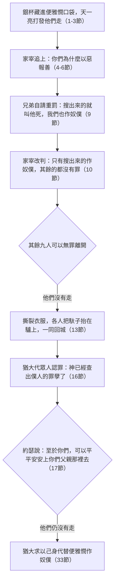

# 創世記 第44章

<!-- chapter-navigation:start -->
| [前一章](../01%20創世記/第43章.md) | [回目錄](../01%20創世記/全書目錄及綱要.md) | [下一章](../01%20創世記/第45章.md) |
| :--- | :---: | ---: |
<!-- chapter-navigation:end -->

1. [[約瑟]]吩咐[[家宰（約瑟的管家）|家宰]]說：把糧食裝滿這些人的口袋，儘著他們的驢所能馱的，又把各人的銀子放在各人的口袋裡，
2. 並將我的銀杯和那少年人糴糧的銀子一同裝在他的口袋裡。家宰就照[[約瑟]]所說的話行了；
3. 天一亮就打發那些人帶著驢走了。
4. 他們出城走了不遠，[[約瑟]]對[[家宰（約瑟的管家）|家宰]]說：起來，追那些人去，追上了就對他們說：你們為什麼以惡報善呢？
5. 這不是我主人飲酒的杯嗎？豈不是他[[銀杯與杯占術|占卜用的]]嗎？你們這樣行是作惡了。
6. [[家宰（約瑟的管家）|家宰]]追上他們，將這些話對他們說了。
7. 他們回答說：我主為什麼說這樣的話呢？你僕人斷不能做這樣的事。
8. 你看，我們從前在口袋裡所見的銀子，尚且從[[迦南地]]帶來還你，我們怎能從你主人家裡偷竊金銀呢？
9. 你僕人中無論在誰那裡搜出來，就叫他死，我們也作我主的奴僕。
10. 家宰說：現在就照你們的話行吧！在誰那裡搜出來，誰就作我的奴僕；其餘的都沒有罪。
11. 於是他們各人急忙把口袋卸在地下，各人打開口袋。
12. [[家宰（約瑟的管家）|家宰]]就搜查，從年長的起到年幼的為止，那杯竟在[[便雅憫]]的口袋裡搜出來。
13. 他們就撕裂衣服，各人把馱子抬在驢上，回城去了。
14. [[猶大（雅各之子）|猶大]]和他弟兄們來到[[約瑟]]的屋中，約瑟還在那裡，他們就在他面前[[約瑟的夢（應驗）|俯伏於地]]。
15. [[約瑟]]對他們說：你們做的是什麼事呢？你們豈不知像我這樣的人必能[[銀杯與杯占術|占卜]]嗎？
16. [[猶大（雅各之子）|猶大]]說：我們對我主說什麼呢？還有什麼話可說呢？我們怎能自己表白出來呢？[[悔改與良心的覺醒|神已經查出僕人的罪孽了]]。我們與那在他手中搜出杯來的都是我主的奴僕。
17. [[約瑟]]說：我斷不能這樣行！在誰的手中搜出杯來，誰就作我的奴僕；至於你們，可以平平安安地上你們父親那裡去。
18. [[猶大（雅各之子）|猶大]]挨近他，說：我主啊，求你容僕人說一句話給我主聽，不要向僕人發烈怒，因為你如同法老一樣。
19. 我主曾問僕人們說：你們有父親有兄弟沒有？
20. 我們對我主說：我們有父親，已經年老，還有他老年所生的一個小孩子。他哥哥死了，他母親只撇下他一人，他父親疼愛他。
21. 你對僕人說：把他帶到我這裡來，叫我親眼看看他。
22. 我們對我主說：童子不能離開他父親，若是離開，他父親必死。
23. 你對僕人說：你們的小兄弟若不與你們一同下來，你們就不得再見我的面。
24. 我們上到你僕人─我們父親那裡，就把我主的話告訴了他。
25. 我們的父親說：你們再去給我糴些糧來。
26. 我們就說：我們不能下去。我們的小兄弟若和我們同往，我們就可以下去。因為，小兄弟若不與我們同往，我們必不得見那人的面。
27. 你僕人─我父親對我們說：你們知道我的妻子給我生了兩個兒子。
28. 一個離開我出去了；我說他必是被撕碎了，直到如今我也沒有見他。
29. 現在你們又要把這個帶去離開我，倘若他遭害，那便是你們使我白髮蒼蒼、悲悲慘慘地下[[陰間（Sheol）|陰間]]去了。
30. 我父親的命與這童子的命相連。如今我回到你僕人─我父親那裡，若沒有童子與我們同在，
31. 我們的父親見沒有童子，他就必死。這便是我們使你僕人─我們的父親白髮蒼蒼、悲悲慘慘地下[[陰間（Sheol）|陰間]]去了。
32. 因為僕人曾向我父親為這童子[[古代近東的作保制度|作保]]，說：我若不帶他回來交給父親，我便在父親面前永遠擔罪。
33. 現在求你容僕人住下，[[猶大的認罪與悔改|替這童子作我主的奴僕]]，叫童子和他哥哥們一同上去。
34. 若童子不和我同去，我怎能上去見我父親呢？恐怕我看見災禍臨到我父親身上。

---

## 本章知識節點

### 人物
- [[約瑟]]
- [[猶大（雅各之子）]]
- [[便雅憫]]
- [[雅各]]
- [[家宰（約瑟的管家）]]

### 地點
- [[埃及]]
- [[迦南地]]

### 神學
- [[對兄弟的試驗]]
- [[猶大的認罪與悔改]]
- [[悔改與良心的覺醒]]
- [[約瑟的夢（應驗）]]

### 原文
- [[古代近東的作保制度]]
- [[陰間（Sheol）]]
- [[銀杯與杯占術]]

---

## 本章整理

這一章接在宴樂之後：第二次歸鄉前，兄弟們受到宰相的款待、西緬被釋放、便雅憫也可以安全回家，心情非常暢快（《聖經精讀本》）；約瑟卻又安排了一個局，把銀杯藏進便雅憫的口袋。KC 說，神藉著賜給約瑟的智慧，把弟兄們帶回多坍的那塊田，回到他們把約瑟丟在坑裡、把他賣掉的那一刻（創37:17-24）；當年約瑟的哀求，他們不肯聽（參42:21）。如今父親所疼愛的那一個又落在他們手裡（20節），他們會不會再一次犧牲他？可以帶著這個問題讀：他們會怎麼做？猶大又說了什麼？

### 經文大綱

1. 銀杯藏在便雅憫的口袋裡（1-13節）
2. 猶大在約瑟面前認罪（14-17節）
3. 猶大代求，願代弟為奴（18-34節）

### 一、銀杯的局（1-13節）

約瑟又一次吩咐[[家宰（約瑟的管家）|家宰]]把糧食裝滿他們的口袋，把各人的銀子放回口袋，又把他的銀杯和那少年人糴糧的銀子一同裝在便雅憫的口袋裡（1-2節）。KC 說，在整個試煉的過程中，耶和華顯出恩典的作為始終如一。約瑟藉藏銀杯的事，試驗哥哥們是否關心幼弟便雅憫的安危（CT）；他聯想到二十二年前的多坍事件，想通過這件事考驗兄弟們對便雅憫的態度（《聖經精讀本》）。

KC 說，在賣約瑟這件事上，弟兄中惟有便雅憫是無辜的，然而全部的罪責卻都歸在他身上，這也是主耶穌所遭遇的：義的代替不義的（彼前3:18）。KC 又把家宰讀作聖靈的圖畫：他照約瑟所說的一切去行，追上弟兄們，「查出」便雅憫口袋裡的杯，使他們陷入極大的驚惶，再也無可推諉，這正是聖靈一直要把人帶到的地步：一個沒有藉口的認罪。

CT 從第3節推出，家宰是在晚間趁他們睡夢中把銀子和銀杯放進口袋，一大早就叫他們走，使他們沒有機會查看自己的口袋。第12節「從年長的起，到年幼的為止」，是為了消除他們可能認為家宰栽贓的疑慮（CT）；家宰明知杯子在便雅憫口袋中，為了不使計畫被對方看穿，故意從老大開始搜查（《聖經精讀本》）。

兄弟們自請的是「就叫他死，我們也作我主的奴僕」（9節），家宰卻改成「在誰那裡搜出來，誰就作我的奴僕；其餘的都沒有罪」（10節）。受罰的程度減輕許多，因為搜查銀杯的目的不在於懲罰他們，而在於試驗他們的存心（CT）；《聖經精讀本》說，這是約瑟事先設計的，想看看當便雅憫被當作偷竊者、將被留在埃及作奴隸時，其他兄弟們反應如何。

[[銀杯與杯占術|「豈不是他占卜用的嗎？」]]（5節）STEP 顯示第2、5節的「銀杯」原文是 גָּבִיעַ（H1375，高腳杯、碗），第5節「占卜」原文以 Piel 不定詞與未完成式疊用（נַחֵשׁ יְנַחֵשׁ，字根 נָחַשׁ H5172），表強調，是必用來占卜的意思。

> [!note] 約瑟真的占卜嗎？
> 《舊約背景註釋》說明古代確有盤占術（lecanomancy，把油倒在水中觀察圖形）與水占術（hydromancy），有舊巴比倫的觀兆文獻可證。
>
> 約瑟是敬畏神的人（41:16），必不行占卜（丁良才、CT、《聖經精讀本》）；占卜為摩西律法所禁（利19:26；申18:9-14，《聖經精讀本》）。
>
> 《雷氏研讀本》與《靈修版聖經註釋》也說他未必真的占卜。
>
> 這句話，可能是藉此凸顯那杯的貴重（CT、《雷氏研讀本》、《靈修版聖經註釋》），因為偷竊宗教儀式所使用的物件，乃是極嚴重的罪（CT）。
>
> 也可能是為了偽裝自己是埃及人（《聖經精讀本》），或只是要大大地恐嚇他們（丁良才）。
>
> 《串珠聖經註釋》則說，約瑟可能受了埃及人影響，認為神會透過酒杯表明心意，並提醒我們既有了聖經，不該再倚靠這種方法。
>
> CT 另提一個譯法：此句可作「他已經將它占卜出來了」，意即他已經查出它的藏處了。第15節「你們豈不知像我這樣的人必能占卜嗎」，說的是「我必能占卜」，沒有說「我已經占卜」（CT）。CT 並在問題改正裡說，約瑟僅只在一些關鍵性的品格、言語和行為上豫表基督，並不是他所說的每一句話、所作的每一件細節都豫表基督；諸如本節的占卜和虛偽指控等，不能作為信徒認可或效法的聖經根據。

兄弟們的反應，正是這個試驗要量的東西：

| | 多坍（創37） | 埃及（創44） |
|---|---|---|
| 父親所愛的兒子 | 約瑟——他們剝衣、丟坑、賣了他 | 便雅憫——罪名落在他身上 |
| 有無機會脫身 | 有：騙父親說被野獸撕碎了 | 有：家宰說「其餘的都沒有罪」 |
| 他們怎麼做 | 撇下他，回去欺哄父親 | 撕裂衣服，一同回城 |

「他們就撕裂衣服，各人把馱子抬在驢上，回城去了」（13節）。撕裂衣服是古時中東人表達悲傷、哀痛的方式（CT），是當時表示極度憂傷的習俗（《靈修版聖經註釋》），也是懊惱、悲憤的表示（《啟導本》）。

他們並沒有質問、埋怨、責備便雅憫，回城表明他們並沒有丟下便雅憫不管（CT）；《聖經精讀本》說，大家甘心放棄自己的自由，要與便雅憫同在，這種行為是出於對父親的孝心和兄弟的友愛。丁良才說，由此約瑟可以看得出，他們和從前不同了。KC 留意到一個呼應：他們撕裂衣服，正如當年雅各因他們假造的約瑟死訊而撕裂衣服一樣（創37:32-34）。

約瑟給了兄弟們兩次可以脫身的機會：家宰說其餘的都沒有罪（10節），約瑟說至於你們可以平平安安地上你們父親那裡去（17節）。KC 說，約瑟把他們放在一個與過去非常相似的處境裡。他們都沒有走：

### 二、「神已經查出僕人的罪孽了」（14-17節）

他們在約瑟面前「[[約瑟的夢（應驗）|俯伏於地]]」（14節），這是約瑟的夢第三次應驗（37:5-10；42:6；43:26）（CT）。KC 說，他們這一次不只下拜，而是俯伏在地，承認神的公義，說神已將他們的罪孽查出，這或許指的是他們對約瑟所行的惡；他們把眼前的遭遇看作神公義的清算，口中再沒有一句反駁，所能做的只是把自己連同便雅憫獻上作奴僕。

猶大說：「我們對我主說什麼呢？還有什麼話可說呢？我們怎能自己表白出來呢？[[悔改與良心的覺醒|神已經查出僕人的罪孽了]]。」STEP 顯示第16節「查出」使用動詞字根 מָצָא（H4672，查出、找著），「罪孽」是 עָוֺן（H5771）。猶大在此並沒有試圖為自己辨白，而是謙卑地伏在神的光中（CT）。原文「僕人」（עֲבָדֶיךָ）是複數詞，表示他代表眾弟兄認罪，包括承認先前出賣約瑟的罪（37:18-28）（CT）。《聖經精讀本》說，這表明約瑟的兄弟們承認當年在多坍賣掉約瑟的罪行，認為現在所受的就是那件事的報應，這證明他們痛恨自己的過犯（42:21-22）。

> [!note] 他根本不提那個杯
> KC 的觀察是：論到那個杯，他們的確是無辜的，但這對他們的良心已經毫無意義，猶大甚至提都不提它。一旦良心被喚醒、被責備，它就只處理那個真正的罪責問題。
>
> 「都是我主的奴僕」這句話，完全應驗了當年被兄長們取笑過的夢：「難道你真要作我們的王嗎？難道你真要管轄我們嗎？」（37:8）（《聖經精讀本》）。

約瑟卻不放過他們：「我斷不能這樣行！在誰的手中搜出杯來，誰就作我的奴僕；至於你們，可以平平安安地上你們父親那裡去。」約瑟的目的是要查看兄長們是否拋下小兄弟不顧而去，並不是真的要留下便雅憫（CT）；這是最後一次試驗（《雷氏研讀本》），他們很有可能要與妻子、兒女永遠分開，在異國他鄉作奴隸（《聖經精讀本》）。

KC 說，約瑟知道他們在杯的事上是無辜的，但他們認了過去的罪嗎？所以他把他們放在一個與過去非常相似的處境裡：他們現在會怎麼做？明知便雅憫無辜，他們會撇下他去作奴僕嗎？他們會再一次用編造的故事去欺哄父親雅各嗎？結果顯出，恩典已在他們心裡作了工。

### 三、猶大的代求（18-34節）

猶大開口第一句就把姿態放到最低：「我主啊，求你容僕人說一句話給我主聽，不要向僕人發烈怒，因為你如同法老一樣。」（18節）在古代近東，根據身份區分上下級，稱對方為主而自稱僕人，是特別敬重對方、極力謙卑自己的慣用禮儀（創18:2；出21:5）（《聖經精讀本》）。「你如同法老一樣」，是因為古時專橫的君王往往憑一時喜怒定案，不容臣僕分訴（CT）。

猶大在求情詞裡一共七次稱約瑟為「我主」（CT）。他所陳述的家世，《聖經精讀本》有年歲可查：雅各九十一歲時在巴旦亞蘭生了約瑟，十六年後、一百零七歲時在迦南地以法他得了便雅憫，拉結因這一胎難產而死，所以猶大說他母親只撇下他一人（20節）。

KC 稱這是一篇令人心動的陳情：猶大在這段話裡十四次提到「父親」，十二次提到「兄弟」。他一句也沒有為便雅憫的清白辯護；猶大求的是憐憫（伯9:15），他的請求是讓便雅憫回到父親那裡，自己並不求釋放。《聖經精讀本》另數出，猶大在祈求中二十二次親密稱呼便雅憫為「小孩子」「小兄弟」。

猶大最後說出口的是這一句：「我父親的命與這童子的命相連」（30節）。STEP 顯示原文是 וְנַפְשׁוֹ קְשׁוּרָה בְנַפְשׁוֹ（字根 קָשַׁר H7194，Qal 被動分詞，捆綁、牽繫），字面直譯是他的魂牽繫在他的魂裡（《聖經精讀本》），使人想起「約拿單的心與大衛的心相連」（撒上18:1）（《串珠聖經註釋》）；丁良才也為這句話參看撒上18:1。

「他必是被撕碎了」（28節），約瑟就是在這一刻，才知道哥哥們當年是怎樣哄瞞父親的（丁良才）。《聖經精讀本》說，約瑟二十二年沒能聽到故鄉的消息，猶大的每一句話都喚起他深情的回憶傷感，發自內心的真誠話語必然感人心弦，其威力遠超於爭辯或狡辯。

> [!note] 求你容僕人住下，替這童子作我主的奴僕
> 當年提議把約瑟賣為奴的，正是猶大（創37:26-27）；如今他自願代替弟弟作奴僕（33節）。CT 列出這轉變的三重意義：他信守對父親所作的[[古代近東的作保制度|保]]（43:9）；他十分體恤老父親的心境；他不再手足相殘，而有弟兄相愛的情懷。
>
> KC 說，在猶大向父親的心思裡，再也找不到一絲從前那種欺哄父親的冷酷；他學會了體會父親和幼弟的感受，這種心的改變，惟有神能作成。
>
> 《雷氏研讀本》說：「猶大情詞懇切之請求的高潮，就是自己願意代替便雅憫受罰——一個美妙的事例，說明猶大偉大的後人耶穌在各各他山上所成就的事。」CT 的話中之光也說，猶大為小弟兄在父親面前作保，而我們的主是從猶大出來的，祂為我們作了更美之約的中保（來7:14、22）。CT 並補一個後話：日後以色列眾支派與猶大支派對抗時，惟有便雅憫支派站在猶大這一邊（王上12:20-24）。

末了一句「若童子不和我同去，我怎能上去見我父親呢？恐怕我看見災禍臨到我父親身上」（34節）。從18至34節，猶大的話確已表現出和從前判若兩人，且其愛父護弟之情溢於言表，難怪令約瑟隱忍不住，與眾兄弟泣擁相認（45:1-15）（CT）。[[猶大的認罪與悔改|這個可驗證的轉變，完成了約瑟對兄弟的試驗]]。

### 背景補充：占卜的杯

《舊約背景註釋》為第5、15節約瑟所說的「占卜」提供了具體的技術背景：好幾個舊巴比倫的觀兆文獻都在討論油所構成的各種形狀及其詮釋，「證明在約瑟的時代，盤占術確然存在」；而觀察水本身之反映的水占術是另一種占卜法。它同時坦承資料的限制——「現代學者對埃及占卜術的知識有限，因此不能提供更具體的資料」，但指出在這個較早期的時代，通常惟有具相當地位的人，才對占卜術有所認識。

《聖經精讀本》則說，在埃及，將酒杯倒滿水，先向邪靈禱告，然後觀察水的狀況進行占卜；當時的人都知道埃及占卜時特別重視這個杯子。《串珠聖經註釋》說，當時的人先把水倒入杯裡，然後在水中丟下一塊小石或一片金屬，憑著水波動的形狀來臆測將來或隱蔽的事。

### 從銀杯到代求（全章）

這一章從銀杯藏進便雅憫的口袋開始，到猶大願代替便雅憫作奴僕為止。約瑟把兄弟們放回多坍那個抉擇之前：杯在便雅憫那裡搜出來，家宰說其餘的都沒有罪，他們卻撕裂衣服，一同回城。猶大代眾人認罪，說神已經查出僕人的罪孽，又用自己的一生代替便雅憫作奴僕（33節）。KC 說，約瑟已達到目的，他注意到猶大已經改變了。這是大團圓（45:1-15）的前奏曲，雅各家族的團圓是通過家族每個成員的努力完成的（《聖經精讀本》）。

### 豫表與其他線索

- 唯一無辜的便雅憫擔了眾人的罪，KC 讀作主耶穌「義的代替不義的」（彼前3:18）。
- 銀杯：CT 的靈意註解說，銀杯象徵主所喝的杯，也就是十字架的苦難（太20:22；26:39）；我們各人的十字架是主量給的。
- 猶大：當日提議賣約瑟，現在自願代替便雅憫作奴僕（丁良才、《啟導本》、《串珠聖經註釋》、BH）；KC 說他是棄絕約瑟背後的推動力量，最後獻上自己代替便雅憫作奴僕，CT 說他不再手足相殘（37:26-27），而有弟兄相愛的情懷；[[猶大的認罪與悔改]]；[[悔改與良心的覺醒]]。
- 第三次俯伏於地：[[約瑟的夢（應驗）]]。
- [[銀杯與杯占術]]：CT 提醒，不能把約瑟所說的每一句話、所作的每一件細節都當作豫表或榜樣。

**參考資料**
代號：CT＝ccbiblestudy《逐節註解》；GT＝ccbiblestudy《拾穗》，彙集多本中文註釋；正文直接寫書名或作者的（如《丁道爾》、丁良才），都出自這裡；KC＝KingComments；BH＝BibleHub Study；STEP＝STEP Bible 原文資料（CC BY 4.0）
https://www.ccbiblestudy.org/Old%20Testament/01Gen/01CT44.htm
https://www.ccbiblestudy.org/Old%20Testament/01Gen/01GT44.htm
https://www.kingcomments.com/en/bible-studies/Gen/44
https://biblehub.com/study/genesis/44.htm
https://github.com/STEPBible/STEPBible-Data

<!-- appendix-links:start -->
## 附錄

### 相關地圖
- [[appendix/fhl_maps/maps/008|〈創圖三〉族長們於迦南地以外的活動]]
- [[appendix/fhl_maps/maps/015|〈創圖十〉雅各的生平]]
- [[appendix/fhl_maps/maps/016|〈創圖十一〉猶大和約瑟的生平]]
- [[appendix/fhl_maps/maps/017|〈創圖十二〉古埃及全圖]]
<!-- appendix-links:end -->

<!-- chapter-navigation:start -->
| [前一章](../01%20創世記/第43章.md) | [回目錄](../01%20創世記/全書目錄及綱要.md) | [下一章](../01%20創世記/第45章.md) |
| :--- | :---: | ---: |
<!-- chapter-navigation:end -->
