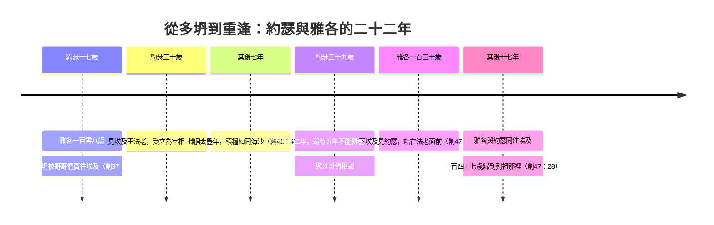

# 創世記 第45章

<!-- chapter-navigation:start -->
| [前一章](../01%20創世記/第44章.md) | [回目錄](../01%20創世記/全書目錄及綱要.md) | [下一章](../01%20創世記/第46章.md) |
| :--- | :---: | ---: |
<!-- chapter-navigation:end -->

1. [[約瑟]]在左右站著的人面前情不自禁，吩咐一聲說：人都要離開我出去！約瑟和弟兄們相認的時候並沒有一人站在他面前。
2. 他就放聲大哭，[[埃及]]人和[[法老]]家中的人都聽見了。
3. [[約瑟]]對他弟兄們說：我是約瑟。我的父親還在嗎？他弟兄不能回答，因為在他面前都驚惶。
4. [[約瑟]]又對他弟兄們說：請你們近前來。他們就近前來。他說：我是你們的兄弟約瑟，就是你們所賣到[[埃及]]的。
5. 現在，不要因為把我賣到這裡[[悔改與良心的覺醒|自憂自恨]]。這是[[神的主權與人的責任|神差我在你們以先來]]，為要保全生命。
6. 現在這地的饑荒已經二年了，還有五年不能耕種，不能收成。
7. 神差我在你們以先來，為要給你們[[餘民與大施拯救|存留餘種在世上，又要大施拯救]]，保全你們的生命。
8. 這樣看來，差我到這裡來的不是你們，乃是[[神的護理|神]]。他又使我如[[法老]]的父，作他全家的主，並[[埃及宰相職位（維齊爾）|埃及全地的宰相]]。
9. 你們要趕緊上到我父親那裡。對他說：你兒子[[約瑟]]這樣說：神使我作全[[埃及]]的主，請你下到我這裡來，不要耽延。
10. 你和你的兒子孫子，連牛群羊群，並一切所有的，都可以住在[[歌珊地]]，與我相近。
11. 我要在那裡奉養你；因為還有五年的饑荒，免得你和你的眷屬，並一切所有的，都敗落了。
12. 況且你們的眼和我兄弟[[便雅憫]]的眼都看見是我親口對你們說話。
13. 你們也要將我在[[埃及]]一切的榮耀和你們所看見的事都告訴我父親，又要趕緊地將我父親搬到我這裡來。
14. 於是[[約瑟]]伏在他兄弟[[便雅憫]]的頸項上哭，便雅憫也在他的頸項上哭。
15. 他又與眾弟兄親嘴，抱著他們哭，隨後他弟兄們就和他說話。
16. 這風聲傳到[[法老]]的宮裡，說：[[約瑟]]的弟兄們來了。法老和他的臣僕都很喜歡。
17. [[法老]]對[[約瑟]]說：你吩咐你的弟兄們說：你們要這樣行：把馱子抬在牲口上，起身往[[迦南地]]去。
18. 將你們的父親和你們的眷屬都搬到我這裡來，我要把[[埃及]]地的美物賜給你們，你們也要吃這地肥美的出產。
19. 現在我吩咐你們要這樣行：從[[埃及車輛與遷徙|埃及地帶著車輛]]去，把你們的孩子和妻子，並你們的父親都搬來。
20. 你們眼中不要愛惜你們的家具，因為[[埃及]]全地的美物都是你們的。
21. [[雅各|以色列]]的兒子們就如此行。[[約瑟]]照著[[法老]]的吩咐給他們[[埃及車輛與遷徙|車輛]]和路上用的食物，
22. 又給他們各人一套衣服，惟獨給[[便雅憫]]三百銀子，五套衣服；
23. 送給他父親公驢十匹，馱著[[埃及]]的美物，母驢十匹，馱著糧食與餅和菜，為他父親路上用。
24. 於是[[約瑟]]打發他弟兄們回去，又對他們說：你們[[饒恕與和好|不要在路上相爭]]。
25. 他們從[[埃及]]上去，來到[[迦南地]]、他們的父親[[雅各]]那裡，
26. 告訴他說：[[約瑟]]還在，並且作[[埃及]]全地的宰相。[[雅各]]心裡冰涼，因為不信他們。
27. 他們便將[[約瑟]]對他們說的一切話都告訴了他。他們父親[[雅各]]又看見約瑟打發來接他的[[埃及車輛與遷徙|車輛]]，心就甦醒了。
28. [[雅各|以色列]]說：罷了！罷了！我的兒子[[約瑟]]還在，趁我未死以先，我要去見他一面。

---

## 本章知識節點

### 人物
- [[約瑟]]
- [[雅各]]
- [[便雅憫]]
- [[法老]]
- [[約瑟在埃及]]

### 地點
- [[埃及]]
- [[迦南地]]
- [[歌珊地]]

### 神學
- [[神的護理]]
- [[神的主權與人的責任]]
- [[饒恕與和好]]
- [[餘民與大施拯救]]
- [[約瑟預表基督]]
- [[悔改與良心的覺醒]]

### 歷史
- [[埃及宰相職位（維齊爾）]]
- [[埃及車輛與遷徙]]

---

## 本章整理

猶大說完那段代求，約瑟沒有打斷他。KC 說，弟兄們心裡恩典的工作，藉猶大的口顯出了確據；到這一刻，約瑟再也控制不住自己，除了向他們表明自己，沒有別的能滿足他的心。這一章是流淚和解的場面，也是約瑟與弟兄相認、關係開始恢復的高潮（《聖經精讀本》）。可以帶著兩個問題讀：約瑟怎麼解釋自己被賣到埃及這件事？雅各聽到「約瑟還在」，為什麼先心裡冰涼？

### 經文大綱

1. 「我是約瑟」——遣開左右，放聲大哭（1-3節）
2. 「差我到這裡來的不是你們，乃是神」（4-8節）
3. 接父親下埃及，住在歌珊地（9-15節）
4. 法老下令迎接全家，賜下車輛與美物（16-20節）
5. 打發弟兄回迦南：「不要在路上相爭」（21-24節）
6. 雅各心裡冰涼，看見車輛心就甦醒（25-28節）

### 一、「我是約瑟」（1-3節）

約瑟在左右站著的人面前情不自禁，吩咐一聲：「人都要離開我出去！」（1節）STEP 顯示「情不自禁」原文使用動詞字根 אָפַק（H662，Hithpael 不定詞 לְהִתְאַפֵּק，意為克制、忍住）；「相認」使用動詞字根 יָדַע（H3045，Hithpael 不定詞 בְּהִתְוַדַּע，意為使自己被知道），按原文直譯是「約瑟使他自己被弟兄認出來的時候」。CT 說，這時並沒有一人站在他面前，包括他的家宰和傳譯的通事。

《聖經精讀本》說，約瑟之前一直努力掩飾自己的身份（42:24；43:30），現在不再有這個必要：哥哥們已真正悔改（42:21；44:16），他們對年邁父親的孝心（44:19-32）也得到證實，對弟弟便雅憫也懷著純潔的愛（44:33-34）。KC 說，神對待罪人的方式正是如此，祂要主耶穌能向他表明自己；祂對待屬祂的人也是如此，祂要他們「不見一人，只見耶穌」（太17:6-8）。這樣的顯明是向每一個靈魂單獨進行的，那一刻沒有別人能在場（KC）。

「他就放聲大哭」（2節），這是約瑟與兄弟重逢後第三次哭（42:24；43:30）（CT）。CT 說，埃及人和法老家中的人都聽見了，是指那些在約瑟家中侍候的埃及人聽見了哭聲，法老家中的人也聽見了約瑟和兄弟們相認的消息（參16節）。

「我是約瑟。我的父親還在嗎？」（3節）他早已知道父親還在（43:27-28），這是再確認式的詢問，顯明他愛父之深（CT）；丁良才也說，這一句話顯明約瑟愛父親的心。

「他弟兄不能回答，因為在他面前都驚惶。」STEP 顯示「驚惶」是 נִבְהֲלוּ（字根 בָּהַל H926，Niphal 完成式，指極度驚惶、恐懼失措）。CT 說，這是形容嚇得魂不附體，他們不知約瑟的心意，恐懼大禍即將臨頭；《雷氏研讀本》說，兄弟們多年以來一直都心裡不安（比較50:15）。

> [!note] 「我是約瑟」與主耶穌的顯現
> 將來主耶穌也要這樣親自顯現與以色列人（亞12:10；啟1:7；太24:30）（CT、丁良才）。KC 把它連到大馬色路上：主向掃羅顯現時說「我就是……耶穌」，掃羅也是驚倒在地，因為他所宣告為死了的那一位，竟然活著（徒9:4-5）。《聖經精讀本》說，那位被釘十字架的耶穌（徒2:36），總有一天手握天上的權柄出現在我們面前（太24:30；路21:27）；對悔改的人，祂是救贖主，對沒有悔改的人，祂是審判的主（太25:31-46）。

### 二、「不是你們，乃是神」（4-8節）

約瑟說：「請你們近前來。」他們就近前來。他說：「我是你們的兄弟約瑟，就是你們所賣到埃及的。」（4節）「請你們近前來」表示此刻他並不是以埃及宰相的身分與他們說話；「就是你們所賣到埃及的」的目的並不在責備他們，乃在證明他的身分真切（CT）。《聖經精讀本》說，這顯出約瑟謙卑的品性，作為堂堂的埃及宰相，他毫不猶豫地承認自己的真實身份，是迦南族長雅各的第十一個兒子。

他先解除他們的恐懼：現在不要因為把我賣到這裡，[[悔改與良心的覺醒|自憂自恨]]（5節）。STEP 顯示「自憂自恨」在原文由兩組平行表達構成：אַל־תֵּעָצְבוּ（字根 עָצַב H6087，Niphal 未完成式，在 אַל 後形成勸阻語氣，不要憂傷、愁苦），以及 וְאַל־יִחַר בְּעֵינֵיכֶם（字根 חָרָה H2734，Qal 未完成式，字面近似不要讓怒氣、懊惱在你們眼中燒起來）。CT 說，「憂」是愁煩，「恨」是責怪，這種心情是當知道了自己作錯事後該有的反應，而約瑟到此已經兩次聽見他們說這樣的話（42:21-22；44:16）。

《聖經精讀本》數過：為了安慰眾兄弟，約瑟在5至9節之間六次見證發生在自己身上的一切是神主權的護理安排，可以看出約瑟對兄弟的愛。STEP 顯示5、7、8節反覆使用動詞字根 שָׁלַח（H7971，差遣）：5節是神差我（שְׁלָחַנִי），7節是神差我（וַיִּשְׁלָחֵנִי），8節則形成不是你們差我、乃是神（לֹא אַתֶּם שְׁלַחְתֶּם ... כִּי הָאֱלֹהִים）的對照。

約瑟三次說「[[神的主權與人的責任|神差我]]」（5、7、8節）：

| 節 | 約瑟怎麼說 | 要點 |
|---|---|---|
| 4 | 「就是你們所賣到埃及的」 | 人的惡行，據實承認 |
| 5 | 「這是神差我在你們以先來，為要保全生命」 | 神的差遣，在人的惡行之上 |
| 7 | 「為要給你們存留餘種在世上，又要大施拯救」 | 救贖的目的 |
| 8 | 「差我到這裡來的不是你們，乃是神」 | 終極的歸因 |

> [!note] 不減輕人的責任，也高過人的惡意
> KC 說，這絲毫沒有減輕他們所行的惡；神使用了人所存的惡意來成就善。主耶穌也是這樣：一面是「按著神的定旨先見被交與人」，一面被無法之人的手釘在十字架上（徒2:23）。這裡有人永遠測不透的奧祕：一面是人的責任，是要完全歸到他身上的；一面是神的計畫，祂在其中給人所行的惡留了地位，卻絲毫不減人的可責性。
>
> 《聖經精讀本》說，若錯誤地解釋「差我到這裡來的……乃是神」，多坍事件的主謀就會變成神；這句話真正的意思，是強調即使兄弟們由於嫉妒犯罪，神依然能完成自己善意的目的。CT 的話中之光說：「我們所作的事，雖然都在神掌管的手中，但我們不可認為作惡也可以成善，而故意去作惡事」（參羅3:8）。
>
> KC 又說，確知一切由神的旨意、而非人的意志所掌管，就使我們免於報復和苦毒，反倒預備好去和好；屬靈的人能在萬事中認出神的手，因此能饒恕那虧負他的人。約瑟的態度正是如此，他那裡沒有一點報復的心（KC）；丁良才也說，他不但沒有報仇的心，反倒愛他們。

神藉著約瑟不但救了雅各一家的人，也救了埃及全國及鄰國的人（41:56-57），所以「眾兄所最不喜歡的夢還是指著救他們的大恩」（丁良才）。

[[餘民與大施拯救|存留餘種]]：STEP 顯示第5節「保全生命」使用 מִחְיָה（H4241，保全生命），第7節「存留餘種」使用 שְׁאֵרִית（H7611，餘種），「大施拯救」使用 פְּלֵיטָה（H6413，拯救）。CT 說，雖然他們並沒有失去任何家人，但全家已度過一個極大的難關，所以約瑟稱他們為「餘種」，深信他們的後代會繼續存留，成為一班神的選民。CT 的靈意註解說，這兩個詞顯露了救贖的主題（參羅9:27）；《聖經精讀本》說，「大施拯救」不單指在大饑荒中拯救雅各一家的性命，也包含屬靈的拯救，是藉著將要來的基督實現的，「餘種」指存留者，無論在什麼苦難中也不至滅亡（賽1:9；6:13；耶23:3）。

「[[埃及宰相職位（維齊爾）|如法老的父]]」（8節）。《舊約背景註釋》說，最可能與此對應的，是用來描述法老朝廷好幾類官員和祭司的埃及職銜 it-ntr，「神的父」，「父」字表達的是諮詢的關係；所扮演的角色大概與士17:10 米迦所聘請的祭司，或王下6:21 作以色列王顧問的以利沙相同。CT 說「法老的父」有三層意思：表明約瑟如同父親對待子女，費心照料法老的一切事務；表明法老對他的信賴，有如兒子信賴父親；表明約瑟有如法老的師父，相當於現代的「國王資政」或「國策顧問」。又說，「法老的父」是對法老個人，「他全家的主」是對法老的宮廷，「埃及全地的宰相」是對埃及全國。

### 三、歌珊地：與我相近（9-15節）

約瑟吩咐兄弟們趕緊上去對父親說：「神使我作全埃及的主，請你下到我這裡來，不要耽延。」（9節）CT 說，這顯明約瑟孺慕之情。《聖經精讀本》說他急於把父親的家從故鄉遷來，是出於孝心，不想讓老父親和兄弟們受苦，也是堅信移居埃及是神的旨意（15:13-16）。

約瑟要父親住在[[歌珊地]]，與我相近（10節）。歌珊是埃及尼羅河三角洲東邊一塊肥沃富庶的土地，屬蘭塞境內（參47:11），與書珥毗連，距離紅海不遠（CT）；這個閃族語系的地名，最可能是指下埃及三角洲圖米拉特乾河一帶，這個地區更能為羊群提供上等的牧草（《舊約背景註釋》）。

約瑟特意選擇歌珊地，是因為與自己的住處相近，有適合牧民放牧的大草場，土地又肥沃易於農耕；他不必先與法老商議，就能決定給家人如此肥沃之地，表明約瑟在埃及的穩固地位（《聖經精讀本》）。「與我相近」，主耶穌也照樣願意祂所愛的人與自己相近（約14:3；17:24）（丁良才）。

「我要在那裡奉養你」（11節）。子女應當盡力奉養父母；特別是基督徒子女，不可藉口奉獻給神（各耳板），而忽略自己對肉身父母的責任（可7:11-13）（CT）。《聖經精讀本》也說，約瑟不僅在神面前誠實，對父母也盡子女的孝道。

「是我親口對你們說話」（12節）。從前他是通過別人傳譯（42:23），現在是他親口說希伯來話；特別提及便雅憫的眼看見他說話，是使雅各相信這些話的有力證據（CT）。「你們也要將我在埃及一切的榮耀，和你們所看見的事，都告訴我父親」（13節），我們也要將所聽見主的話，和所看見主一切的榮耀，向人見證出來（CT）；KC 說，這也是我們的任務，要把我們在主耶穌的榮耀裡所看見的，都告訴父神。

於是「約瑟伏在他兄弟便雅憫的頸項上哭……他又與眾弟兄親嘴，抱著他們哭，隨後他弟兄就和他說話」（14-15節）。弟兄們不再存著忌恨（37:8）和畏懼（44:18）的心說話，而是說和睦的話（37:4）（CT）。丁良才說，約瑟切實地愛他的哥哥們，絲毫沒有報仇的心。

> [!note] 愛既完全，就把懼怕除去
> KC 說，約瑟的弟兄們的眼看見他的榮耀，耳聽見他的應許，心感受到他溫暖的愛，當他伏在他們頸項上親嘴的時候。「愛裡沒有懼怕；愛既完全，就把懼怕除去。」（約壹4:18）從前的嚴厲，如今一點也看不見了。當他們被這一切的愛與良善所勝，他們就開口說話了；被主的愛所勝的心，不能不說話。

### 四、法老的邀請（16-20節）

「這風聲傳到法老的宮裡……法老和他的臣僕都很喜歡」（16節）。《聖經精讀本》說，這可以看出約瑟平時得到法老絕對的信任和愛戴，也受屬下的尊重和敬佩；法老完全接受平時被他們視為賤民的希伯來家族，是因為約瑟對埃及作出的功績，法老深深被他的人格感化。

丁良才列出法老喜歡雅各全家下到埃及的三個緣故：他喜愛約瑟；雅各全家人多，於埃及有益處（出1:10）；在朝的王是外國人，埃及人不喜歡他，所以法老沒有排外的心，倒歡迎善良的人進入他的國度，能幫助堅固他的王位。CT 的背景註解說，此法老應屬喜克索（Hyksos）王朝，並非埃及人，乃外來民族，故歡迎希伯來人遷徙此地，或可幫助他鞏固王位。

KC 說，與約瑟在一起，一切都必須放下，他們不必為此後悔（20節）。法老在這裡是神的圖畫，他說要把埃及地最好的賜給他們；他們從前帶著迦南土產中最好的一點點來見約瑟（43:11），如今藉著約瑟，他們得的是埃及全地的美物；主耶穌也用這樣的應許鼓勵祂的門徒（可10:29-30）。

「你們眼中不要愛惜你們的家具，因為埃及全地的美物都是你們的。」信徒的眼中也不要重視世事世物，因為我們顧念的是所不見的（林後4:18）；若真的看見屬天的榮美，就能歡然丟棄屬地的事物（參腓3:7-8）（CT）。丁良才也說，我們不當讓世上的好處阻攔我們得天上的福氣。《串珠聖經註釋》說，「家具」就是一切行李，他們將會在埃及得到一切需用的東西。

「把你們的孩子、和妻子，並你們的父親都搬來」，要「從埃及地帶著車輛去」（19節）。「車輛」指牛馬拉動的雙輪或四輪運輸車，當時似乎是一般人所未擁有的（CT）；《聖經精讀本》說，約瑟家族可以使用王室馬車，證明他們為貴賓。KC 說，這些車輛可以看作聖靈的圖畫，聖靈賜給信徒力量和引導；食物是神的話，衣服是基督，信徒披戴基督，祂就藉著他們在世上顯出來（加3:27）。

### 五、「不要在路上相爭」（21-24節）

約瑟給各人一套衣服，惟獨給[[便雅憫]]三百銀子、五套衣服（22節）。約瑟愛弟弟之情表現在衣服上，他曾給他五倍的食物（43:34），現在給他五套衣服（《啟導本》）。《舊約背景註釋》說，約瑟作為埃及行政官的責任，是為百姓分配糧食和衣物，他亦同樣照顧自己的親人；故事開始時約瑟得到彩衣（37:3），雅各怎樣獨加寵愛約瑟，約瑟亦同樣對胞弟便雅憫獨加寵愛。《聖經精讀本》說，儘管曾被兄弟們賣到埃及，約瑟卻送給他們珍貴的出產表示愛意，這是愛仇敵誡命的典範（太5:44）。

末了一句叮嚀是：「你們不要在路上相爭。」（24節）STEP 顯示本節使用動詞字根 רָגַז（H7264，Qal 未完成式，在 אַל 後表達勸阻，אַל־תִּרְגְּזוּ בַּדָּרֶךְ），字典的意思是顫抖、激動；依本節語境，各譯本分別處理為不要相爭、不要動怒、不要激動。

約瑟是怕他們為從前出賣他的事，彼此推諉、怨懟（CT）；怕他們在路上彼此埋怨（丁良才）；擔心他們在回程路上就賣約瑟事件相互追究責任、爭執，因為自覺罪輕的人往往會埋怨其他人（《聖經精讀本》）。KC 說，一個可以說他早就說過了（42:22），另一個可以說丟他下坑的不是他，但約瑟已經全都饒恕了他們，所以他們不該再彼此指責。《串珠聖經註釋》另提一種可能：或是為著五套衣服和三百銀子的分配不均而起爭端。《啟導本》說，約瑟囑咐哥哥們不要為過去賣掉他的事爭論，要緊的是快把父親迎接來埃及。

KC 轉向我們：我們也十分需要這個勸勉。主耶穌把一切都賜給我們了，我們卻仍時常忘記它，門徒甚至在主論到自己的受苦時，還爭論誰為大（路22:24）。CT 的話中之光也說，信徒現在是在往天家的路上，千萬不要彼此惹氣、互相嫉妒（加5:25），若相咬相吞，只怕要彼此消滅了（加5:15）。

### 六、心裡冰涼，心就甦醒（25-28節）

兒子們告訴雅各：「約瑟還在，並且作埃及全地的宰相。」（26節）「[[神的護理|雅各心裡冰涼，因為不信他們]]」。STEP 顯示第26節「心裡冰涼」原文使用動詞字根 פּוּג（H6313，Qal 連續未完成式 וַיָּפָג לִבּוֹ，意為麻木、冷淡、停滯）。CT 說，這是對此大好消息心裡沒有反應；《串珠聖經註釋》說，這形容雅各好像被這太意外的消息嚇破了膽，不敢相信。

《聖經精讀本》列出雅各不信的三個實際理由：他一直堅信約瑟已經死了（37:33；42:38；44:28）；他對那位埃及宰相的印象並不好（43:6、14）；而自示劍事件之後，他已經不再相信兒子們（34:30；42:36）。它並說明，「心裡冰涼」是希伯來人常用的表現手法，期望和喜樂喻為心裡火熱，不信則喻為心裡冰涼。

KC 說，雅各看見那件血染的彩衣時，心裡毫不懷疑，他的兒子被野獸撕碎了（37:33）；如今聽見約瑟還活著，他反倒不信。我們寧可相信壞消息而不信好消息，寧可相信謊言而不信真理，惟有藉著恩典的工作，我們才相信真理。

使他甦醒的是兩樣東西：「他們便將約瑟對他們說的一切話都告訴了他」，「又看見約瑟打發來接他的車輛，心就甦醒了」（27節）。STEP 顯示第27節「心就甦醒」原文使用動詞字根 חָיָה（H2421，Qal 連續未完成式），搭配 רוּחַ（H7307）作 וַתְּחִי רוּחַ יַעֲקֹב，字面直譯是雅各的靈活過來、甦醒；這裡的 רוּחַ 指雅各的心神。丁良才說，眾子拿出憑據來，雅各才信；CT 的話中之光說，我們傳福音常遇見的難處，便是福音朋友心裡冰涼、毫無反應，所以最要緊的，乃是將主所說的話，並主所給我們的屬靈經歷（車輛），見證出來，因為它們能甦醒人心。

KC 把它讀作圖畫：約瑟的話是神的話，約瑟差來的車輛是聖靈；惟有神的話藉著聖靈的工作，才能造出新生命，若我們的心麻木了，惟有重新開始讀神的話，新生命才會回來。

「以色列說：罷了！罷了！我的兒子約瑟還在，趁我未死以先，我要去見他一面。」（28節）「罷了」即「夠了」，意思是證據充分顯示約瑟還活著，約瑟竟仍活著，夫復何求（CT）。KC 說，雅各說的是「他還活著」，不是約瑟的榮耀，這就夠了；他惟一想要的就是見他一面，此後他可以安然死去。這裡經文從「雅各」轉回「以色列」，KC 說是因為他的心神恢復了；CT 的靈意註解說，「以色列」顯明一個成熟、經過火煉的性格。

### 二十二年，一條時間線

《聖經精讀本》說，雅各108歲的時候與約瑟（17歲）分手，過了22年，130歲才又見到兒子（47:9），之後共同生活了17年，147歲歸到列祖那裡（47:28）。CT 由第6節推算：約瑟三十歲作宰相，至今經過七個豐年和兩個荒年，所以現年三十九歲，距他被賣已有二十二個年頭；《啟導本》也說，約瑟現在才39歲。

### 背景補充：職銜、歌珊、車輛與五倍的份

《舊約背景註釋》為本章幾個細節各補一條。

「法老的父」：最可能與此對應的，是用來描述法老朝廷好幾類官員和祭司的埃及職銜 it-ntr，「神的父」；「父」字表達的是諮詢的關係。

歌珊：這個閃族語系的地名，最可能是指下埃及三角洲圖米拉特乾河（Wadi Tumilat，從尼羅河東支延伸至大苦湖）一帶；許克所斯時代的埃及文獻曾論及這個地區的閃族人，這個地區「更能為羊群提供上等的牧草」。創47:11 用「蘭塞境內的地」形容歌珊，進一步證實此地位於埃及本土。

車輛：供應車輛並不表示埃及車輛和迦南車輛不同，而是他細心顧慮到婦孺的需要，不用他們走路前來；半遊牧民族通常不會設置車輛。

便雅憫的五倍：約瑟作為埃及行政官的責任，是為百姓分配糧食和衣物（在古代近東來自巴比倫和馬里的文獻中，這是常見的一點），他亦同樣照顧自己的親人。

### 從「我是約瑟」到「罷了」（全章）

這一章從約瑟遣開左右、說出「我是約瑟」開始，到雅各說「罷了，罷了」為止。約瑟承認「你們所賣到埃及的」，卻說「差我到這裡來的不是你們，乃是神」；他沒有否認弟兄們的罪，也沒有報復，而是用歌珊的地、法老的車輛、衣服和銀子，邀請全家下埃及。KC 說，被弟兄棄絕的約瑟，向弟兄顯明自己，除去他們的懼怕，供養他們；雅各最後也說，趁我未死以先，我要去見他一面。《聖經精讀本》說，這是雅各的兒子們經過二十二年的離別，真正成為以色列共同體的場面，是神所賜愛與淚水的鞭打（來12:6），目的是使雅各成為以色列。

### 豫表與其他線索

- 約瑟預表基督：約瑟向弟兄顯明自己（KC、CT）；他為他們哭，以恩慈除去他們的懼怕，供養他們，並要他們趕緊上到他父親那裡去傳報他的榮耀（KC）。CT 的靈訓要義列出「如何認識並經歷基督」，說這是出於主的啟示、藉著信徒的傳揚、憑著信心來接受。
- [[神的主權與人的責任]]：「不是你們，乃是神」這句話，KC 說絲毫沒有減輕他們所行的惡；《聖經精讀本》說，若錯誤地解釋，多坍事件的主謀就會變成神。
- [[餘民與大施拯救]]：雅各家在饑荒中存活，也連到救贖的主題（CT、《聖經精讀本》）。
- [[神的護理]]：話語與車輛使冰涼的心甦醒（KC、CT）；眾子拿出憑據來，雅各才信（丁良才）。

**參考資料**
代號：CT＝ccbiblestudy《逐節註解》；GT＝ccbiblestudy《拾穗》，彙集多本中文註釋；正文直接寫書名或作者的（如《丁道爾》、丁良才），都出自這裡；KC＝KingComments；BH＝BibleHub Study；STEP＝STEP Bible 原文資料（CC BY 4.0）
https://www.ccbiblestudy.org/Old%20Testament/01Gen/01CT45.htm
https://www.ccbiblestudy.org/Old%20Testament/01Gen/01GT45.htm
https://www.kingcomments.com/en/bible-studies/Gen/45
https://biblehub.com/study/genesis/45.htm
https://github.com/STEPBible/STEPBible-Data

<!-- appendix-links:start -->
## 附錄

### 相關地圖
- [[appendix/fhl_maps/maps/008|〈創圖三〉族長們於迦南地以外的活動]]
- [[appendix/fhl_maps/maps/015|〈創圖十〉雅各的生平]]
- [[appendix/fhl_maps/maps/016|〈創圖十一〉猶大和約瑟的生平]]
- [[appendix/fhl_maps/maps/017|〈創圖十二〉古埃及全圖]]
<!-- appendix-links:end -->

<!-- chapter-navigation:start -->
| [前一章](../01%20創世記/第44章.md) | [回目錄](../01%20創世記/全書目錄及綱要.md) | [下一章](../01%20創世記/第46章.md) |
| :--- | :---: | ---: |
<!-- chapter-navigation:end -->
