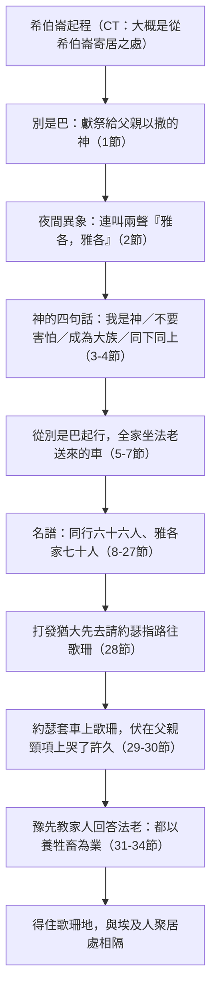

# 創世記 第46章

<!-- chapter-navigation:start -->
| [前一章](../01%20創世記/第45章.md) | [回目錄](../01%20創世記/全書目錄及綱要.md) | [下一章](../01%20創世記/第47章.md) |
| :--- | :---: | ---: |
<!-- chapter-navigation:end -->

1. [[雅各|以色列]]帶著一切所有的，起身來到[[別是巴]]，就獻祭給[[亞伯拉罕之約|他父親以撒的神]]。
2. 夜間，神在異象中對[[雅各|以色列]]說：[[雅各]]！雅各！他說：我在這裡。
3. 神說：我是神，就是你父親的神。你下[[埃及]]去不要害怕，因為我必使你在那裡[[亞伯拉罕之約|成為大族]]。
4. [[神的護理|我要和你同下埃及去，也必定帶你上來]]；[[約瑟]]必給你送終【原文作將手按在你的眼睛上】。
5. [[雅各]]就從[[別是巴]]起行。[[雅各|以色列]]的兒子們使他們的父親雅各和他們的妻子、兒女都坐在[[埃及車輛與遷徙|法老為雅各送來的車上]]。
6. 他們又帶著[[迦南地]]所得的牲畜、貨財來到[[埃及]]。[[雅各]]和他的一切子孫都一同來了，
7. [[雅各]]把他的兒子、孫子、女兒、孫女，並他的子子孫孫，一同帶到[[埃及]]。
8. [[十二支派起源|來到埃及的以色列人]]名字記在下面。[[雅各]]和他的兒孫：雅各的長子是流便。
9. 流便的兒子是哈諾、法路、希斯倫、迦米。
10. 西緬的兒子是耶母利、雅憫、阿轄、雅斤、瑣轄，還有迦南女子所生的掃羅。
11. 利未的兒子是革順、哥轄、米拉利。
12. 猶大的兒子是珥，俄南、示拉、法勒斯、謝拉；惟有珥與俄南死在[[迦南地]]。法勒斯的兒子是希斯倫、哈母勒。
13. 以薩迦的兒子是陀拉、普瓦、約伯、伸崙。
14. 西布倫的兒子是西烈、以倫、雅利。
15. 這是利亞在巴旦亞蘭給[[雅各]]所生的兒子，還有女兒底拿。兒孫共三十三人。
16. 迦得的兒子是洗非芸、哈基、書尼、以斯本、以利、亞羅底、亞列利。
17. 亞設的兒子是音拿、亦施瓦、亦施韋、比利亞，還有他們的妹子西拉。比利亞的兒子是希別、瑪結。
18. 這是拉班給他女兒利亞的婢女悉帕從[[雅各]]所生的兒孫，共有十六人。
19. [[雅各]]之妻拉結的兒子是[[約瑟]]和便雅憫。
20. [[約瑟]]在[[埃及]]地生了瑪拿西和以法蓮，就是安城的祭司波提非拉的女兒亞西納給約瑟生的。
21. 便雅憫的兒子是比拉、比結、亞實別、基拉、乃幔、以希、羅實、母平、戶平、亞勒。
22. 這是拉結給[[雅各]]所生的兒孫，共有十四人。
23. 但的兒子是戶伸。
24. 拿弗他利的兒子是雅薛、沽尼、耶色、示冷。
25. 這是拉班給他女兒拉結的婢女辟拉從[[雅各]]所生的兒孫，共有七人。
26. 那與[[雅各]]同到[[埃及]]的，除了他兒婦之外，凡從他所生的，共有[[雅各家七十人與七十五人|六十六人]]。
27. 還有[[約瑟]]在[[埃及]]所生的兩個兒子。[[雅各]]家來到埃及的共有[[雅各家七十人與七十五人|七十人]]。
28. [[雅各]]打發[[猶大（雅各之子）|猶大]]先去見[[約瑟]]，請派人引路往[[歌珊地|歌珊]]去；於是他們來到[[歌珊地]]。
29. [[約瑟]]套車往[[歌珊地|歌珊]]去，迎接他父親[[雅各|以色列]]，及至見了面，就伏在父親的頸項，哭了許久。
30. [[雅各|以色列]]對[[約瑟]]說：我既得見你的面，知道你還在，就是死我也甘心。
31. [[約瑟]]對他的弟兄和他父的全家說：我要上去告訴[[法老]]，對他說：我的弟兄和我父的全家從前在[[迦南地]]，現今都到我這裡來了。
32. 他們本是[[埃及人厭惡牧羊人|牧羊的人]]，以養牲畜為業；他們把羊群牛群和一切所有的都帶來了。
33. 等[[法老]]召你們的時候，問你們說：你們以何事為業？
34. 你們要說：你的僕人，從幼年直到如今，都以養牲畜為業，連我們的祖宗也都以此為業。這樣，你們可以住在[[歌珊地]]，因為[[埃及人厭惡牧羊人|凡牧羊的都被埃及人所厭惡]]。

---

## 本章知識節點

### 人物
- [[雅各]]
- [[約瑟]]
- [[猶大（雅各之子）]]
- [[法老]]

### 地點
- [[別是巴]]
- [[埃及]]
- [[迦南地]]
- [[歌珊地]]

### 神學
- [[神的護理]]
- [[亞伯拉罕之約]]
- [[十二支派起源]]

### 歷史
- [[埃及車輛與遷徙]]
- [[雅各家七十人與七十五人]]
- [[埃及人厭惡牧羊人]]
- [[埃及人視希伯來人為不潔淨]]
- [[喜克索王朝（Hyksos）背景]]

---

## 本章整理

雅各從希伯崙起程（《啟導本》），走到迦南南界的[[別是巴]]就停下來獻祭，神在夜間的異象裡准他下埃及，並應許與他同去。接著是一份隨他下埃及的名譜，最後父子在歌珊重逢，約瑟教家人怎麼回答法老，好讓全家住在歌珊。上一章法老送來了車輛，雅各說：「趁我未死以先，我要去見他一面。」（45:28）；這一章寫他出發的那一步，以及到了埃及之後怎麼安頓。可以帶著三個問題讀：雅各為什麼先停下來獻祭？名單裡的六十六、七十、七十五三個數字怎麼對得上？為什麼約瑟要家人強調自己是牧羊人？

### 經文大綱

1. **別是巴獻祭，神在夜間異象中應許**（1-4節）
2. **全家帶著牲畜貨財下埃及**（5-7節）
3. **隨雅各下埃及的名譜**（8-27節）
4. **父子在歌珊重逢**（28-30節）
5. **約瑟豫先策劃，使家人得住歌珊**（31-34節）

### 一、他為什麼要在別是巴獻祭？（1-4節）

雅各離開迦南以前，先在別是巴停下來獻祭給他父親以撒的神（1節）。「別是巴」的意思是『盟誓之井』，這名字本身就叫人想起神的應許（KC）。亞伯拉罕曾在這裡求告耶和華永生神的名（21:33），以撒也在這裡築壇（26:25）。眾族長雖然多次築壇，聖經卻很少有他們獻祭的記錄，雅各在此以前唯一被提過的一次，是和拉班立約的時候（31:54）；以撒在別是巴築過壇，卻沒有獻祭的記錄。雅各乘這次南行到此朝聖，因為這是他長大之處，也是他父親崇拜之聖所的所在地（《舊約背景註釋》）。

雅各的猶疑有幾個緣由。丁良才列了五項：

- 亞伯拉罕下埃及曾冒大險（12:10）；
- 神曾阻止以撒下埃及（26:2）；
- 神應許把迦南地賜給亞伯拉罕、以撒、雅各和他們的後裔；
- 埃及是一個熱心拜偶像的國度；
- 或許他也想起創15:13 的預言。

《串珠》另指出，他也可能擔心前往埃及不合神的心意，或是害怕自己不能適應在埃及的新生活。

獻祭是他的回應。原文第1節在「獻祭」（וַיִּזְבַּח，H2076）後面接的是複數名詞「祭物」（זְבָחִים，H2077）。CT 據此認為這個獻祭並不簡單，是持續獻上祭物，直到使神滿足為止；或許雅各怕自己下埃及會錯，所以藉此向神求問。KC 說他在離開這地以前要先尊榮神，彷彿沒有神與他同去的確據，就不肯再往前一步。《聖經精讀本》也讀成再次確認移居埃及是否真是神的旨意；它還說明雅各在這裡稱「以色列」，是立約的新名，表示這次移居是雅各作為代表人物，照神的應許行動，將在他的後裔中形成以色列民族。

神在夜間的異象中回答他，連叫兩聲「雅各！雅各！」。這樣的重複也出現在「亞伯拉罕！亞伯拉罕！」（22:11）和「摩西！摩西！」（出3:4），常在重大啟示或命令之前（BH）；《聖經精讀本》認為神特意重複這名字，是要雅各回憶過去的歲月，確信別是巴之約必然成就，正如伯特利之約（28:13-15）。CT 注意到「異象」在原文是複數詞，表示神曾向雅各多次多方顯現並說話。

神宣告「我是神，就是你父親的神」（אָנֹכִי הָאֵל אֱלֹהֵי אָבִיךָ；H595、H410、H430）。CT 說「我是神」表明祂負一切的責任，「你父親的神」表明祂必成就向以撒所作的應許。「你下埃及去不要害怕」這句話，證明雅各那時心中躕躇、畏懼，擔心因約瑟的緣故而下埃及不合神的心意（CT）。神說了四件事：

| 神的話 | 各家的說明 |
|---|---|
| 「我是神，就是你父親的神」 | 神負一切的責任，必成就向以撒所作的應許（CT）；神在這裡重申向亞伯拉罕和以撒立約的應許（《啟導本》） |
| 「你下埃及去不要害怕」 | 雅各那時心中躕躇、畏懼（CT）；神曾在伯特利應許與他同行（28:15），這新的應許必定帶給他安慰與希望（《聖經精讀本》） |
| 「我必使你在那裡成為大族」 | 耶和華要在埃及使他們從一個支派氏族擴展至一個大國，比較出1:7（《雷氏》） |
| 「我要和你同下埃及去，也必定帶你上來」 | 見下 |

第4節「我要和你同下埃及去，也必定帶你上來」，原文連用兩次「我」（אָנֹכִי），且「必定帶你上來」重複「上去」的字根（וְאָנֹכִי אַעַלְךָ גַם־עָלֹה，H5927），強烈宣告神引領同在的確定性。

> [!note] 「也必定帶你上來」——這個「你」指誰？
> 雅各最後在埃及去世（49:33），這句應許要怎麼理解？CT 說這個「你」是集合代名詞，並非指雅各個人，乃指他的全體後裔；《串珠》同樣說「你」指雅各的後代，雅各乃是他們的代表。《聖經精讀本》把兩面都算進去：神從兩個方面成就了這約，雅各的骨灰將送回迦南地埋葬（50:13），雅各的後裔也要出埃及、征服迦南地。
>
> 賈斯樂郝威在《聖經難解經文詮釋手冊》把『雅各終究死在埃及』列為一道難題（命題57），給了三種解答：這個應許是針對雅各的後裔說的；雅各可能經由約瑟而被帶出埃及，雖然他那時不是活著的（50:25；出13:19）；雅各復活後將會回到應許之地（太8:11）。

「約瑟必給你送終」，原文直譯是約瑟必把手放在你的眼睛上（וְיוֹסֵף יָשִׁית יָדוֹ עַל־עֵינֶיךָ；H7896、H3027、H5869），也就是親手為父親闔上雙眼。CT 說這裡的「你」是個人代名詞，暗示雅各將至死和約瑟相離不遠（50:1），丁良才同樣這麼讀。《聖經精讀本》把它連到神對亞伯拉罕的應許（15:15）：神保證雅各平安入睡，日後也如實成就（49:33）。KC 另注意到神在這裡自稱你父親以撒的神，這叫我們想起祂是復活的神；雅各是站在復活的根基、新生命的地位上往前走的。

這段話不是一次孤立的顯現。移居埃及成就了火把之約（15:13-17）「要成了外邦人」的預言，也是出埃及事件的前奏。《聖經精讀本》列出雅各家族移居埃及的四重意義：在迦南各族中保持純潔性；從雅各家族轉變成以色列『國家』；選民經歷許多的苦難和試煉；通過將來的出埃及事件，體現救贖的意義。它並把時間標了出來：這是亞伯拉罕蒙召215年之後，雅各130歲，大概在 B.C.1876年左右。

丁良才從地理與目的兩面解釋神為何要他們下去：埃及是最合式以色列人居住的國度，因為那裡有許多草地足供他們作牧場。神的用意有四：

- 要使雅各的後裔聯合為一；
- 要使以色列人和拜偶像的人少有來往；
- 要使他們多吸收埃及的文化；
- 要使他們因受磨煉而越發親近神。

### 二、全家上路（5-7節）

雅各從別是巴起行，他的兒子們使父親和自己的妻子、兒女都坐在法老送來的車上（5節）。他們也帶著在迦南地所得的牲畜、貨財，雅各和他的一切子孫都一同來了（6-7節）。CT 說，「一切子孫都一同來了」表示沒有一個人留下不來；兒子們讓老父親、妻子和兒女坐車，也表示堅固的人應該擔代不堅固人的軟弱（羅15:1）。

[[埃及車輛與遷徙|這批車輛]]在當時是一種奢侈品，法老送車既反映約瑟在埃及的地位，也是給雅各的尊榮（BH）。同時代的埃及馬車是輕型的，材料是木和皮革，車輪只有兩輻；法老所乘坐的華麗馬車要到稍後的新王國時代才一再在藝術中出現，所以第29節約瑟套的車，用的是當時實際存在的輕便車制（《舊約背景註釋》）。

### 三、名譜與那些數目（8-27節）

名單以十二個兒子為中心，按母親的順序分四組（《聖經精讀本》、《串珠》）：

| 母親 | 節 | 人數 |
|---|---|---|
| 利亞（並女兒底拿） | 8-15 | 三十三人 |
| 悉帕（利亞的婢女） | 16-18 | 十六人 |
| 拉結 | 19-22 | 十四人 |
| 辟拉（拉結的婢女） | 23-25 | 七人 |
| 合計 | | 七十人 |

名單上的人並不都是在迦南出生、一起走下來的。凡在雅各未死之前，誕生在他家中的兒孫，無論是生在迦南或是生在埃及，都算作「來到埃及的以色列人」，包括約瑟在埃及所生的兩個兒子（CT）。丁良才也說，名單未必只記下到埃及的人，或者也記雅各未死以先在埃及所生而立家成族的孫子和曾孫。《聖經精讀本》說，作者的目的不是記錄『出生地』，而是把焦點放在『以色列國家的形成』；從摩西時代回頭看，這些兒孫或是各支派的創立者，或是獨立部落的族長（民26章）。這份名單也是[[十二支派起源|十二支派名單]]的起點。

第26節說「那與雅各同到埃及的，除了他兒婦之外，凡從他所生的，共有[[雅各家七十人與七十五人|六十六人]]」；第27節說「雅各家來到埃及的共有七十人」。兩個數字的算法如下：

- 四組合計七十人（丁良才、《啟導本》、CT）；
- 同行的六十六人，是七十人減去已經在埃及的約瑟、瑪拿西、以法蓮，以及雅各本人（丁良才、李道生《舊約聖經問題總解》）；
- 《啟導本》換一種算法：七十人減去已死在迦南的珥與俄南，和在埃及出生的瑪拿西、以法蓮，剛好六十六人；CT 認為15節的「三十三人」沒有把女兒底拿算在內，所以要先加上她，再減去珥、俄南與約瑟、瑪拿西、以法蓮，同樣是六十六人；
- 六十六人再加上雅各、約瑟、瑪拿西、以法蓮，就是「雅各家」的七十人（丁良才、CT、《串珠》、《雷氏》）。

這份名單不包括雅各的妻子、兒婦，以及底拿與西拉以外的女兒和孫女；若把這些人都算進去，人數便不止七十人（《串珠》、《啟導本》、《雷氏》）。

> [!note] 那麼徒7:14 的「七十五人」呢？
> 兩個數字都對（KC）。司提反（或路加）根據的是七十士譯本（LXX），它在第20節末了增列五個名字（KC、CT、丁良才）：瑪拿西的一子一孫、以法蓮的二子一孫。
>
> 李道生在《舊約聖經問題總解》裡數的方式略有出入：他記為瑪拿西的一個兒子瑪姬和一個孫子基列，並以法蓮的三個兒子書提拉、比結、他罕（民26:28、29、35）。
>
> 《聖經精讀本》不從名單增列著眼，說七十五人是『七十人加上日後形成獨立家業的約瑟五個後代』（50:23）。倪柝聲另提一解：徒7:14 的「全家」原文是「親族」，範圍較廣；七十人是「雅各家」，七十五人是並雅各的親族都在內。丁良才補了一點：徒7:14-15 所論的是雅各全家的數目，和本處不同。

同一個「七十」，各家讀出不同的意思。CT 說「七十」在聖經裡是『今世完全』的數目（但9:24；太18:22），這個數字裡包括雅各的女兒和孫女各一人作代表，表明所有以色列人（不分男女）都下到埃及，日後所有以色列人也同樣蒙神從奴役中拯救出來。《聖經精讀本》拆成兩個因數：『7』有關神的救贖，『10』有關人類完全發展；根據神與族長之間的誓約，七十表明神的百姓是神聖子民，也預表繁榮昌盛和完全拯救。

KC 則從六十六那一頭看：六是人的數字，人總是不及格，永遠達不到七所說的完全；當約瑟（主耶穌的圖畫）與他的兒子被加進來，六十六的不完全就變成了七十的完全。

名單裡有兩個女性（女兒底拿、孫女西拉），不太尋常。猶太人一般都只計算男丁人數（太14:21；15:38），但遇有特殊含意的事例時也往往提到女性（太1:3、5-6；徒1:13-14）（CT）。第7節的「女兒」「孫女」原文是複數詞，可見雅各不只底拿一個女兒（CT、丁良才）。

CT 坦承這個算法有矛盾：15節不算底拿，18節卻算西拉；而雅各有那麼多男孫，不可能只有一個女孫。聖經本身未作解釋，只能猜測是為27節的「七十人」豫作安排。丁良才的推測不同：底拿和西拉被提名，或者是因為她們沒有出嫁而且出名，雅各其餘的女兒和孫女大概都出了嫁。

賈斯樂郝威在命題58 把本章、民數記26章與啟示錄7章三份名單並排，處理以色列到底是十二支族還是十四支族：雅各只有十二個兒子，但約瑟得了雙分（48:22），民26 以瑪拿西和以法蓮取代約瑟支派。利未因職事是祭司、不得分地，散住在各支派的四十八座利未城裡。啟7 的名單則除去但支派、列入利未，每一份名單的作者都設法保住『十二』這個數目。

### 四、二十二年後的重逢（28-30節）

雅各打發[[猶大（雅各之子）|猶大]]先去見約瑟，請派人引路往歌珊去（28節）。原文動詞「引導／指教」（לְהוֹרֹת，字根 יָרָה H3384）說明雅各派他去打前站、領路往歌珊。由此可見猶大在雅各和約瑟心目中的地位（CT）。《聖經精讀本》把原因說得更具體：猶大借著第二次埃及之行的言行（44:18-34），得到雅各的信任；猶大作為家族的全權代表，日後猶大家族成為以色列支派中繼承王權的家族（49:10）。BH 讀到更遠：這一幕預告了猶大支派的地位，大衛與「猶大支派中的獅子」（啟5:5）都由他而出。

約瑟套車往歌珊去，迎接他父親以色列；及至見了面，就伏在父親的頸項上，哭了許久（29節）。「套車」原文（אָסַר מֶרְכַּבְתּוֹ；H631、H4818）指的是備妥座車。這是約瑟第四次哭，而且一次比一次久（42:24；43:30；45:2、14-15）（CT）。這是父子在希伯崙分手後，過了二十二年又相逢的場面，不需更多的言語，只有深沉長久的哭聲才能傳達相逢的喜樂（《聖經精讀本》）。KC 說，雅各渴望再見約瑟，約瑟也渴望再見父親，他上去迎接他；我們往主那裡去的時候，會發現祂也正在路上迎向我們。

雅各說：「我既得見你的面，知道你還在，就是死我也甘心。」（30節）KC 說，這叫我們想起西面抱著嬰孩耶穌時所說的話（路2:25-30）。CT 說，世人是『朝聞道，夕死可也』，信徒是『若得親眼看見救恩，也可安然去世』；約瑟豫表基督，雅各得見約瑟的面，死也甘心。《聖經精讀本》讀出這句話的背面：看來在見到約瑟之前，雅各內心肯定深藏約瑟之死留下的遺恨。

KC 也提醒我們看約瑟的舉止：他作為兒子，如何尊榮他的父親。兒女孝敬父母是本分（弗6:1-3），即使兒女的社會地位遠高於父母，這本分也不改變；約瑟對父親的愛，這些年來沒有減少。雅各得見約瑟，是他最大願望的實現，他滿足了，可以去世了，不過他實際上還要在埃及活十七年（47:28）。

### 五、為什麼是歌珊？（31-34節）

約瑟對弟兄和父的全家說，他要上去告訴法老（31節）；這是他為父家的將來，豫先策劃應對之道（CT）。法老會問：「你們以何事為業？」（33節）KC 注意到，這似乎是法老對來見他的人慣常會問的問題，所以約瑟先教家人怎麼回答：你的僕人，從幼年直到如今，都以養牲畜為業，連祖宗也是（34節）。KC 另有一層靈意的讀法：『職業』一字與詩45:1 譯成『詩』的是同一個字，約瑟放在弟兄們口中的答案，於是成了他們的職業是頌讚王的榮耀的詩句；這也是主耶穌要在我們生命中成就的，要我們的生命成為歌頌神榮耀的詩句。

歌珊地的好處，丁良才數了五樣：地土肥美；草地很多（他們多牧羊）；離迦南地近（後來出埃及的時候就便當）；離埃及人略遠（不惹埃及人的怒）；離約瑟的住處近。他又說，以色列人明明地承認自己是牧羊人，有兩個好處：可以佔領埃及人所不用的歌珊地；雖住在埃及，卻與拜偶像的埃及人少有來往，也不至於隨從他們的惡俗。

《聖經精讀本》從兩方面說明約瑟為什麼強調埃及人討厭牧民：歌珊地適於放牧，又遠離埃及人居住地，既有利於維持本行，還能防止被埃及人同化，最適合保持固有的民族性和純潔的宗教性；它又位於邊境地帶，有利於後裔移居迦南地，體現約瑟和雅各堅信後裔將回歸迦南地的應許（46:4；15:14）。CT 的背景註解則說明它的位置：歌珊「位於尼羅河出海的三角洲地帶，土地肥沃，是全埃及最好的畜牧用地」，且「該地自處一隅，易於和埃及人隔離；且距迦南地不遠，可謂是由埃及進入迦南地的大門口」。

第34節那句「[[埃及人厭惡牧羊人|因為凡牧羊的都被埃及人所厭惡]]」，原文使用『埃及人的可憎之物』（תוֹעֲבַת מִצְרַיִם，H8441）來形容牧羊人（רֹעֵה צֹאן；H7462、H6629）。各家提出的原因不一：

| 提出者 | 原因 |
|---|---|
| 《聖經精讀本》 | 傳統上以農業為主，對其他行業有排斥心理；認為牧人沒有教養、非常野蠻；曾被遊牧民攻擊過的被害意識；對牧人殺害他們認為神聖的動物產生輕蔑感 |
| 《啟導本》 | 埃及以農立國，法老時代已有高度文明，看不起粗陋的遊牧生活 |
| BH | 埃及主要是農耕社會，其宗教實踐又常涉及對動物的崇拜，這可能助長了對飼養牲畜者的反感 |
| 《舊約背景註釋》 | 提出限定：埃及本地的牧羊人大概不會被其他埃及人恨惡；約瑟的忠告另有外交作用 |

《聖經精讀本》並記下一個具體的線索：從埃及發掘的石碑上，牧羊人又瘦又高、飽經風霜，像病人一樣憔悴，甚至有的像幽靈，可能因這些緣故，埃及人厭惡牧羊人。經文本身只陳述「厭惡」這個事實，沒有指定單一原因。

約瑟的叮嚀還有外交上的考量：一方面警告父親埃及人有排外態度，另一方面表示自己一家能夠獨立自足（羊群足以供應他們所需），並且顯出他們沒有野心要擺脫放牧生涯以從事其他行業（《舊約背景註釋》）。他要家人避免提到牧羊（那是埃及人所藐視的職業），卻要強調他們的畜牧業（《雷氏》）；歌珊地不是埃及人常到的地方，而該區的草原很適合牧養牲畜（《串珠》）。

> [!note] 為什麼這個策略行得通
> 當時治理埃及的[[喜克索王朝（Hyksos）背景|喜克索王朝]]，乃外來的牧羊民族，人稱其王為『牧羊王』（CT）。《靈修版聖經註釋》據此把約瑟的算計說明白：「因為法老的祖先很可能是許克所斯人的遊牧民族，所以他或許會同情牧人，而埃及人絕不歡迎牧人住在他們中間。約瑟的策略奏效，雅各一家從法老的慷慨乃至埃及人所抱的成見中受益。」

> [!note] 被世界厭惡，反而成了保護
> 約瑟如此安排父家的住處，除了為日後全族人出埃及豫作打算，用意更在使他們避免和埃及人混雜來往，不至於隨從埃及人的惡俗（CT）。《聖經精讀本》說，神甚至可以利用埃及人的這種風俗，提供環境，使自己的百姓活出分別為聖的生活。
>
> KC 說得更透：因著埃及人的厭惡，雅各家被分派到埃及地的一隅，這就攔阻了他們與埃及人混合；若與埃及人相混，他們就會失去自己的身分，如今他們仍分別出來，保住了民族與信仰的獨立。KC 再往應用走一步：埃及人是世界的圖畫，對世界上的人來說，一個為神的榮耀而活的基督徒，正是『可厭惡的』。

### 從別是巴到歌珊（全章）

這一章從雅各在別是巴的祭壇開始，到他在歌珊與約瑟重逢、全家得到安置結束。離開應許之地前，雅各先獻祭求問，神在異象中回答他：不要害怕，我與你同去，也必定帶你上來（1-4節）。名單上的數目（六十六、七十、七十五）計算範圍各不相同，卻都指向同一件事：神應許的那一家人，正一個不缺地下到埃及（8-27節）。約瑟與父親在歌珊重逢，又豫先教家人怎麼回答法老，使他們得住在與埃及人聚居處相隔的歌珊地（28-34節）。這一章把雅各家送進埃及，下一章是他們在法老面前的對話與安頓。

**參考資料**
代號：CT＝ccbiblestudy《逐節註解》；GT＝ccbiblestudy《拾穗》，彙集多本中文註釋；正文直接寫書名或作者的（如《丁道爾》、丁良才），都出自這裡；KC＝KingComments；BH＝BibleHub Study；STEP＝STEP Bible 原文資料（CC BY 4.0）
https://www.ccbiblestudy.org/Old%20Testament/01Gen/01CT46.htm
https://www.ccbiblestudy.org/Old%20Testament/01Gen/01GT46.htm
https://www.kingcomments.com/en/bible-studies/Gen/46
https://biblehub.com/study/genesis/46.htm
https://github.com/STEPBible/STEPBible-Data

<!-- appendix-links:start -->
## 附錄

### 相關地圖
- [[appendix/fhl_maps/maps/008|〈創圖三〉族長們於迦南地以外的活動]]
- [[appendix/fhl_maps/maps/015|〈創圖十〉雅各的生平]]
- [[appendix/fhl_maps/maps/016|〈創圖十一〉猶大和約瑟的生平]]
- [[appendix/fhl_maps/maps/017|〈創圖十二〉古埃及全圖]]
<!-- appendix-links:end -->

<!-- chapter-navigation:start -->
| [前一章](../01%20創世記/第45章.md) | [回目錄](../01%20創世記/全書目錄及綱要.md) | [下一章](../01%20創世記/第47章.md) |
| :--- | :---: | ---: |
<!-- chapter-navigation:end -->
