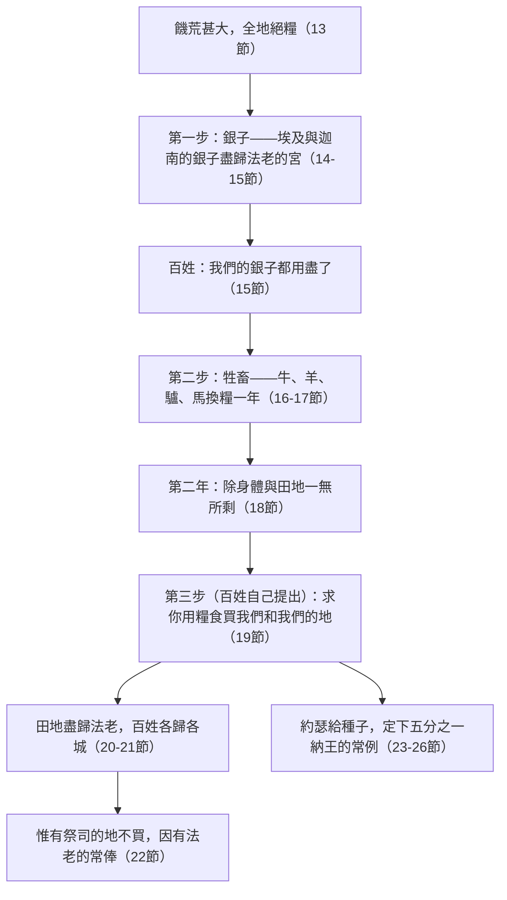

# 創世記 第47章

<!-- chapter-navigation:start -->
| [前一章](../01%20創世記/第46章.md) | [回目錄](../01%20創世記/全書目錄及綱要.md) | [下一章](../01%20創世記/第48章.md) |
| :--- | :---: | ---: |
<!-- chapter-navigation:end -->

1. [[約瑟]]進去告訴[[法老]]說：我的父親和我的弟兄帶著羊群牛群，並一切所有的，從[[迦南地]]來了，如今在[[歌珊地]]。
2. [[約瑟]]從他弟兄中挑出五個人來，引他們去見[[法老]]。
3. [[法老]]問[[約瑟]]的弟兄說：你們以何事為業？他們對法老說：你僕人是牧羊的，連我們的祖宗也是牧羊的。
4. 他們又對[[法老]]說：[[迦南地]]的饑荒甚大，僕人的羊群沒有草吃，所以我們來到這地[[寄居身分|寄居]]。現在求你容僕人住在[[歌珊地]]。
5. [[法老]]對[[約瑟]]說：你父親和你弟兄到你這裡來了，
6. [[埃及]]地都在你面前，只管叫你父親和你弟兄住在國中最好的地；他們可以住在[[歌珊地]]。你若知道他們中間有什麼能人，就派他們看管我的牲畜。
7. [[約瑟]]領他父親[[雅各]]進到[[法老]]面前，雅各就給法老祝福。
8. [[法老]]問[[雅各]]說：你平生的年日是多少呢？
9. [[雅各]]對[[法老]]說：我[[寄居身分|寄居在世]]的年日是一百三十歲，我平生的年日又少又苦，不及我列祖在世寄居的年日。
10. [[雅各]]又給[[法老]]祝福，就從法老面前出去了。
11. [[約瑟]]遵著[[法老]]的命，把[[埃及]]國最好的地，就是[[蘭塞|蘭塞境內的地]]，給他父親和弟兄居住，作為產業。
12. [[約瑟]]用糧食奉養他父親和他弟兄，並他父親全家的眷屬，都是照各家的人口奉養他們。
13. 饑荒甚大，全地都絕了糧，甚至[[埃及]]地和[[迦南地]]的人因那饑荒的緣故都餓昏了。
14. [[約瑟]]收聚了[[埃及]]地和[[迦南地]]所有的銀子，就是眾人糴糧的銀子，約瑟就把那銀子帶到[[法老]]的宮裡。
15. [[埃及]]地和[[迦南地]]的銀子都花盡了，埃及眾人都來見[[約瑟]]，說：我們的銀子都用盡了，求你給我們糧食，我們為什麼死在你面前呢？
16. [[約瑟]]說：若是銀子用盡了，可以把你們的牲畜給我，我就為你們的牲畜給你們糧食。
17. 於是他們把牲畜趕到[[約瑟]]那裡，約瑟就拿糧食換了他們的牛、羊、驢、馬；那一年因換他們一切的牲畜，就用糧食養活他們。
18. 那一年過去，第二年他們又來見[[約瑟]]，說：我們不瞞我主，我們的銀子都花盡了，牲畜也都歸了我主。我們在我主眼前，除了我們的身體和田地之外，一無所剩。
19. 你何忍見我們人死地荒呢？求你用糧食買我們和我們的地，我們和我們的地就要給[[法老]]效力。又求你給我們種子，使我們得以存活，不致死亡，地土也不致荒涼。
20. 於是，[[約瑟的饑荒土地政策|約瑟為法老買了埃及所有的地]]，埃及人因被饑荒所迫，各都賣了自己的田地；那地就都歸了法老。
21. 至於百姓，[[約瑟]]叫他們，從[[埃及]]這邊直到埃及那邊，[[各歸各城或使民為奴|都各歸各城]]。
22. 惟有祭司的地，[[約瑟]]沒有買，因為祭司有從[[法老]]所得的常俸。他們吃法老所給的常俸，所以他們不賣自己的地。
23. [[約瑟]]對百姓說：我今日為[[法老]]買了你們和你們的地，看哪，這裡有種子給你們，你們可以種地。
24. 後來打糧食的時候，你們要把[[約瑟的饑荒土地政策|五分之一納給法老]]，四分可以歸你們做地裡的種子，也做你們和你們家口孩童的食物。
25. 他們說：你救了我們的性命。但願我們在我主眼前蒙恩，我們就作[[法老]]的僕人。
26. 於是[[約瑟]]為[[埃及]]地定下常例，直到今日：[[法老]]必得五分之一，惟獨祭司的地不歸法老。
27. 以色列人住在[[埃及]]的[[歌珊地]]。他們在那裡置了產業，並且[[亞伯拉罕之約|生育甚多]]。
28. [[雅各]]住在[[埃及]]地十七年，雅各平生的年日是一百四十七歲。
29. [[雅各|以色列]]的死期臨近了，他就叫了他兒子[[約瑟]]來，說：我若在你眼前蒙恩，請你[[大腿底下起誓|把手放在我大腿底下]]，用慈愛和誠實待我，請你不要將我葬在[[埃及]]。
30. 我與我祖我父同睡的時候，你要將我帶出[[埃及]]，葬在他們所葬的地方。[[約瑟]]說：我必遵著你的命而行。
31. [[雅各]]說：你要向我起誓。[[約瑟]]就向他起了誓，於是[[雅各|以色列]]在[[床頭或杖頭|床頭上【或作扶著杖頭】]]敬拜神。

---

## 本章知識節點

### 人物
- [[雅各]]
- [[約瑟]]
- [[法老]]

### 地點
- [[埃及]]
- [[迦南地]]
- [[歌珊地]]
- [[蘭塞]]
- [[麥比拉洞]]

### 神學
- [[神的護理]]
- [[寄居身分]]
- [[亞伯拉罕之約]]

### 歷史
- [[約瑟的饑荒土地政策]]

### 主題
- [[大腿底下起誓]]

### 解經爭議
- [[床頭或杖頭]]
- [[各歸各城或使民為奴]]

---

## 本章整理

這一章有兩條線交織：一邊是雅各一家在歌珊安頓下來、生養眾多；一邊是埃及全國在饑荒裡一步一步把銀子、牲畜、田地和自己交在法老手裡。全章收在一個年老的雅各敬拜神的畫面上。上一章約瑟教家人怎麼回答法老，這一章他們照著說了，法老也照著准了。可以帶著三個問題讀：「寄居」兩個字為什麼被雅各一家反覆強調？約瑟的土地政策算善政還是暴政？雅各最後是在床頭還是扶著杖頭敬拜？

### 經文大綱

1. 五個弟兄見法老，得住歌珊（1-6節）
2. 雅各見法老，兩次為他祝福（7-10節）
3. 約瑟按人口奉養父家（11-12節）
4. 饑荒政策：銀子、牲畜、田地（13-26節）
5. 雅各的十七年與臨終的囑咐（27-31節）

### 一、「你們以何事為業？」（1-6節）

約瑟進去告訴法老，他的父親和弟兄從迦南地來了，如今在歌珊地（1節）。法老曾主動吩咐約瑟接他全家遷來（45:19-20），他們既然來了，理當向法老報告（CT）。

約瑟從弟兄中挑出五個人，引他們去見法老（2節）。經文沒有說這五個人是誰，各家從不同角度讀這個數字。一種讀法著眼於責任：約瑟挑的是外表體面且具有口才的人，『五』這數字在聖經裏象徵『負責』（參太25:2）（CT）；五是責任的數字，是人所當作的（KC）。另一種從埃及那一頭看：埃及人認為『五』在數字中最有意義，所以最喜歡這個數字（43:34；45:22），可見約瑟引見弟兄時，一切都精心而機智地作了準備（《聖經精讀本》）。BH 則認為五可能表示恩典或恩寵，並認為這個選擇反映約瑟的智慧與眼光，他很可能挑的是能給法老留下好印象的人。

法老問：「你們以何事為業？」他們照約瑟先前所教導的（46:31-34）回答：「你僕人是牧羊的，連我們的祖宗也是牧羊的。」（3節）接著說明來意：迦南地饑荒甚大，羊群沒有草吃，「所以我們來到這地[[寄居身分|寄居]]」，求容他們住在歌珊地（4節）。

「[[寄居身分|寄居]]」原文動詞（לָגוּר，字根 גּוּר H1481）的意思是作客旅、暫時居留。

> [!note] 「寄居」這兩個字，是他們的居留申請，也是他們的身分
> 「寄居」表明他們只是暫住，無意在埃及久住（丁良才、CT、KC、《雷氏》）；他們遲早要回到迦南（丁良才、CT）；KC 說，他們真正的居所在迦南。丁良才並說這與信從在世上相似（來11:13；彼前2:11）。
>
> 《聖經精讀本》指出希伯來語『寄居』一詞就是『暫時居住』的意思（12:10；20:1；35:27），這表示他們也隨先祖的信仰，堅信回歸迦南地的應許，這種意識成了日後出埃及事件的背景。BH 把它連到來11:13 與詩39:12 的客旅主題。
>
> 精讀本另記下這段「暫住」實際上有多長：儘管約瑟的兄弟們希望只住到饑荒結束（4節），神卻按照創15:13-16 的預言，把居住期限（B.C.1876-1446）延長到四百三十年（出12:40；加3:17），直到迦南地罪惡滿盈為止。

法老對約瑟說：「埃及地都在你面前，只管叫你父親和你弟兄住在國中最好的地；他們可以住在歌珊地。你若知道他們中間有什麼能人，就派他們看管我的牲畜。」（5-6節）「能人」是善於牧養牲畜的人（CT、《串珠》），法老願意委派這些人出任官職，負責照顧他的牲畜（《串珠》）。

弟兄們所求的住歌珊，正是法老已經應許給約瑟的；神也是這樣，藉著我們的禱告，把祂在旨意中早已定意要給我們的賜給我們（KC）。《聖經精讀本》從政治面讀：歌珊地土地肥沃，又是埃及的邊境和戰略要塞（46:31-34），法老爽快地把這樣重要的地方讓給異國人，可以看出他對約瑟的絕對信任，以及約瑟不可忽略的影響力。

### 二、逃荒的老人，為天下最有權勢的人祝福（7-10節）

約瑟領他父親雅各進到法老面前，雅各就給法老祝福（7節）。原文兩次都用祝福動詞（וַיְבָרֶךְ，H1288）：他一見面就祝福，離開前再祝福（7、10節），而且沒有向法老求什麼（CT）。

雅各憑什麼能祝福？舊約時期，族長的祝福權是根據神和亞伯拉罕之間的生死之約（12:3）；族長也肩負家庭的祭司，能以神的祭司身分為他人祝福。他對法老的善意充滿感恩，祝福的是法老個人的平安與繁榮（《聖經精讀本》）。丁良才說得樸素：雅各年紀老邁，又是神的僕人，所以為法老禱告。

> [!note] 從來位分大的給位分小的祝福
> 『從來位分大的給位分小的祝福』（來7:7），CT 與 KC 都用這句話解釋這一幕：雅各是逃荒的人，還得靠法老得糧食，卻能祝福當時地上最有權勢的人，因為他靠神的應許，在屬靈上比法老大。CT 說：「雅各雖然是宰相的父親，但是無論如何總比法老小一點。並且雅各又是一個逃荒的人，他到法老的地方來，還得靠法老得糧食，今後他需要仰仗法老的不知道有多少。但是在這裏我們看見，雅各在法老面前並不失去他的地位；他知道在屬世方面雖然法老的位分是大的，但是在屬靈方面法老的位分卻是小的，所以他能替法老祝福。這是他站住屬靈的地位。」
>
> KC 說，約瑟並不以他年老、跛腳的父親為恥，這是給所有社會地位高過父母的年輕人的功課：雅各也許是個貧窮的白髮老人，但他在神裡面是富足的。KC 又補一個新約的對照：保羅這個囚犯站在非斯都面前，向亞基帕王說話時，也是這樣（徒26:29）。
>
> CT 還看出雅各一生的翻轉：他從前想盡辦法求取別人的祝福（27:19），如今卻是為別人祝福。靈命幼稚的人，只想從別人有所得；靈命成熟的人，卻想讓別人有所得。

法老問雅各：「你平生的年日是多少呢？」雅各回答：「我[[寄居身分|寄居在世]]的年日是一百三十歲，我平生的年日又少又苦，不及我列祖在世寄居的年日。」（8-9節）原文以「寄居」（מְגוּרַי，H4033）形容人生像借住客旅，「又少又苦」（מְעַט וְרָעִים；H4592、H7451）直譯為年日又短又多艱難。

| | 年歲 |
|---|---|
| 亞伯拉罕 | 175 歲 |
| 以撒 | 180 歲 |
| 雅各 | 147 歲（見法老時 130 歲） |

「又苦」指什麼？丁良才數了九樣：

- 以掃的怨恨
- 拉班的欺哄
- 底拿被辱
- 拉結去世
- 流便不孝
- 約瑟被害
- 猶大行淫
- 西緬被囚
- 幼子（便雅憫）離家

《啟導本》另列：被兄逐殺（27:41-28:5）、被舅欺負（29-30章）、不能專一所愛（29:13-30）、家庭不和（30:1-24）、子女異地肇事（34章）、長子與妾亂倫（35:22）、愛侶早喪（35:16-20）、晚年失子（37:24-36）、兒輩相妒（37章）、終身寄居。CT 的背景註解也從逃避以掃、受拉班剝削，一直數到險失西緬和便雅憫，說這是滿了辛酸苦痛的生涯。

KC 指出另一面：他的年日之所以又少又苦，是因為他沒有接受耶和華的引導，總是走自己的路；他不信靠神，以為必須自己想辦法去得著神所應許的。《聖經精讀本》的讀法不同：正如日後雅各自己的告白（48:15-16），這些歲月在神的護理下，成為養育子女、試煉、成聖的過程，為使他單單信靠神；他終於活出得勝的生命，平安歸到列祖那裡（49:33）。

### 三、蘭塞的地與按人口奉養（11-12節）

約瑟遵著法老的命，把埃及國最好的地，就是[[蘭塞]]境內的地，給他父親和弟兄居住，作為產業（11節）。「蘭塞」是後起的地名，就是歌珊地（CT、《串珠》、《雷氏》、《聖經精讀本》、《啟導本》；丁良才也認為或許是歌珊後來所稱的名字）。各家補充的細節如下：

- 摩西時代的歌珊地名，因數百年後統治埃及的法老蘭塞二世（主前1290-1224）而得名（CT）；
- 名字出現在這裏，是要讓讀者知道所談及的是那個地區（《雷氏》）；
- 狹義指歌珊地國庫的名稱（《聖經精讀本》）；
- 又叫「瑣安田」（詩78:12），出1:11 與民33:3 則稱為蘭塞城（《啟導本》）。

《舊約背景註釋》補上地理與族群背景：這個位於尼羅河三角洲東北部的地區，據悉其居民是閃族人，在主前十八至十六世紀是許克所斯活動的中心；此地又稱泰尼斯地區，希伯來奴隸日後在此建築積貨城比東和蘭塞（出1:11）。蘭塞二世的名字出現在這裡，可能是今名古用的案例。

約瑟用糧食奉養他父親、弟兄和他父親全家的眷屬，都是照各家的人口奉養他們（12節）。這表示糧食的供需受到嚴格管制，按實際人數多少分配，使他們既無匱乏之虞，又不至於浪費珍貴有限的資源（CT）。KC 說，約瑟的照顧臨到老的少的、大的小的，每個人都得到個別的關注，沒有一個人被忘記，這對教會中的照顧是重要的功課。當全地都絕了糧，雅各全家卻得約瑟的供養（CT）。

### 四、銀子、牲畜、田地（13-26節）

饑荒甚大，全地都絕了糧，埃及地和迦南地的人都餓昏了（13節）。長時間的殘酷饑荒，出現牲畜瘦弱、稻穀乾枯的慘景，法老的夢準確無誤地實現在眼前（41:1-6）（《聖經精讀本》）。

約瑟的救荒計畫分三步：先用糧食換得人民的銀子，再換得牲畜，最後為法老換取土地（《串珠》）。《聖經精讀本》先澄清第18節的「第二年」是哪一年：它不是饑荒的第二年，而是用牲畜交換糧食的第二年，即饑荒的最後一年（第七年）；丁良才、CT 也推算這是荒年的末期。連種子都找不到，可見當時饑荒的嚴重性（《聖經精讀本》）。

| 階段 | 百姓交出 | 經文 |
|---|---|---|
| 一 | 銀子（糴糧的銀子盡歸法老的宮） | 14-15節 |
| 二 | 牲畜（牛、羊、驢、馬） | 16-17節 |
| 三 | 身體與田地（並求種子） | 18-20節 |

約瑟不是無償救濟糧食，而是讓百姓用錢、牲畜、土地和身體來交換，目的是培養他們的自立能力、維持社會秩序；結果帶來王權鞏固、土地國有化、合理的納稅制度（《聖經精讀本》）。《舊約背景註釋》說，貨物貿易遠古之時已經存在，互惠地交換財產、貨物、製品，是古代非貨幣經濟的基礎，第16-17節所述的是饑荒時以牲口換取穀糧。

第三步是百姓自己提出來的。CT 說：「注意這種出賣土地和勞力的辦法，並非出於約瑟的要求，而是出於埃及百姓自動的提議。」《聖經精讀本》補上動機：歷盡饑荒苦難的百姓，除了維持生命，根本顧不得考慮身體和田地，他們自願成為法老的僕人——佃農。《舊約背景註釋》說明這在當時並不陌生：政府可以因為欠債不還、未能繳稅，或家庭沒有後嗣，將土地充公；饑荒時埃及人無力購買糧食，只得將土地售與政府，成為法老的佃農。

債奴在古代近東到處都很常見：失去土地的農人賣身為短期奴隸，來供養自己一家，為奴的期限可以是一日（出22:26-27），也可以是幾年；在以色列，債奴最多只能為奴六年（出21:2）。然而本章的埃及例證顯示他們是終身作為法老佃農，以收成的五分之一作為田賦（《舊約背景註釋》）。

約瑟於是[[約瑟的饑荒土地政策|為法老買了埃及所有的地]]，叫百姓[[各歸各城或使民為奴|都各歸各城]]，給他們種子，並定下[[約瑟的饑荒土地政策|五分之一納給法老、四分歸自己]]的常例（20-26節）。「歸了法老」並不是所有的土地都歸了法老個人，而是經過一定程式成為國家的財產（《聖經精讀本》）。

> [!note] 第21節到底說了什麼
> 「都各歸各城」另有一種讀法。馬所拉文本（MT）作 וְאֶת־הָעָם הֶעֱבִיר אֹתוֹ לֶעָרִים（字根 עָבַר H5674，他將百姓遷移到各城）。CT 記下：「根據《七十士譯本》，『都各歸各城』這句話另譯成『使各人都成為奴隸』」（LXX 作 κατεδουλώσατο αὐτῷ εἰς παῖδας）；《串珠》則說呂振中把這句話翻譯為「叫他們做奴隸」。
>
> 讀成遷徙的一方講行政效率。CT 說這是把人民從鄉下乾旱的田園遷徙到鄰近囤糧的城市，候命分配田地為法老耕種，「不失為明智的辦法」；丁良才說大概是預備領糧（41:35、45）。《聖經精讀本》指「各城」就是當年大豐收時儲存糧食的地方（41:48），約瑟施行全埃及範圍的大搬遷，是為了能迅速有效地供應糧食，並直接判定七十士譯本與武加大譯本的理解是不正確的。
>
> 讀成為奴的一方從上下文推。《啟導本》說：「也有人考證『各歸各城』應譯為『成為農奴』，因為田地與牲畜都賣給了法老，後來連身體也賣了（23節），百姓都成為奴隸，故25節法老的『僕人』應作『奴僕』。」《串珠》兩讀並列。BH 所據的英文譯本正文採後者，但限定程度：這是契約性的僕役而非奴隸制，百姓仍保有若干權利，並且能夠耕種土地。

> [!note] 這是善政還是暴政？
> 經文自己給的評價，是從百姓口中說出來的：「你救了我們的性命」（הֶחֱיִתָנוּ，字根 חָיָה H2421，意為使我們存活）。經文同時記載了另一面：土地與勞役由此集中在王權之下（20-21、23、25節）。BH 就第14節指出，這種財富與權力向法老集中的趨勢，日後將成為以色列人受奴役的背景。
>
> 來源對這套制度多半給正面評價。《聖經精讀本》說：「應該說約瑟施行的制度是善政、決不是暴政」，理由是與各國稅制相比，交納五分之一決非殘酷條件；古時經濟上無自立能力的人往往自願為僕，這種主僕關係「不是剝削者和被剝削者的關係，而是以順從為條件的保護者和被保護者的關係」。《串珠》對「五分之一」的註解是：「是極低的稅收；上古中東的人借錢時通常要付出百分之五十的利息。」CT 的背景註解說，古代許多國家的常規抽稅約在十分之一左右，若遇非常時期和暴政，則遠在五分之一以上。
>
> 《舊約背景註釋》的口氣比較保留：「百分之二十的稅額在古代世界並不反常。然而現時有關埃及稅收的資料，並不足以為約瑟所提出的賦稅，作出更具體的描繪。」
>
> KC 從中讀出一個豫表：約瑟用他為主的地位，把一切完全歸服法老，先是銀子，再是牲畜，最後是人和地；主耶穌也要照樣使萬有服在神以下（林前15:24-28），而祂是為神買了這一切（啟5:9）。

《聖經精讀本》另記下這套制度在後世的痕跡：約瑟制定的埃及土地法，後被兩位歷史學家希羅多德（B.C.484-425）和提歐多路斯（B.C.1世紀末）證明，其架構是除祭司擁有的土地外全歸國家管理，佃農身分的百姓在耕種國家土地時須交納所產的五分之一作為稅金；雖然後代有許多補充，主體未變。它並說，在救贖史的開展過程中，埃及作為逃城，為選民提供了休養生息之地（太2:13-15）。

惟有祭司的地，約瑟沒有買，因為祭司有從法老所得的常俸（22節）。這反映祭司所享的特權：他們從法老領受生活津貼，不必出賣土地（《串珠》）。「常俸」是從國庫中支付的一定數量的物品，在古埃及祭政一致的社會中，這是給予以法老為首的統治階層祭司的特權；在嚴酷的饑荒中，負責供奉太陽神「銳」（Ra）和其他神的祭司們是唯一能安逸生活的階層（《聖經精讀本》）。

《舊約背景註釋》並提出一個對照：埃及祭司「往往集中了頗大的政治勢力……不少法老都覺得有逢迎他們的必要」，「反觀以色列的制度，則不容許利未支派擁有地業。」KC 也在這裡看見一幅圖畫：有一班人不受約瑟的轄制，就是祭司；這叫人想起今日教會中的信徒，他們是祭司（彼前2:5）。不久萬有要服在主耶穌之下，教會卻不在其中，教會是要與祂一同作王的（弗1:22-23）。

KC 又說，約瑟在救恩之後，還給百姓種子，使他們得以存活（23-26節）；這也像主耶穌，祂不只拯救，還給一切需要，使人能為祂而活。種子好比神的話，我們可以撒種，也成為我們的養料；而法老的那一份必須先分別出來，就像神對一切有首先的權利（箴3:9）。

### 五、十七年（27-31節）

以色列人住在埃及的歌珊地，他們在那裡置了產業，並且[[亞伯拉罕之約|生育甚多]]（27節）。原文連用兩個『生養、增多』的動詞（וַיִּפְרוּ וַיִּרְבּוּ מְאֹד；פָּרָה H6509，רָבָה H7235A），強調以色列人在埃及迅速繁衍。這應驗了46:3 神對雅各的話（出1:7；12:37）（丁良才）；《聖經精讀本》把兩個應許一起算進來，這既成就了十七年前雅各移居埃及時的應許（46:3），也成就了二百五十多年前亞伯拉罕移居迦南時的應許（12:2）。CT 也留下一句警語：以色列人樂不思蜀，在埃及置產落戶，以致後來被埃及人忌恨（出1:8-10）。

雅各住在埃及地十七年，平生的年日是一百四十七歲（28節）。『十七年』正是約瑟被賣時的歲數（37:2）（CT）：約瑟十七歲離開父親，雅各最後的十七年，又在約瑟身邊度過。與苦難的前半生相比，雅各在平安中安享晚年，但他仍然思念故鄉迦南地（《聖經精讀本》）。

> [!note] 他的結局比他的祖宗更美
> KC 的觀察是：在信心的道路上，雅各不及亞伯拉罕和以撒；但他的結局卻更美。我們沒有亞伯拉罕或以撒臨終的記載，卻讀到雅各臨終十分詳盡的記載，這正是要顯明神的恩典最終如何在這個人身上得勝，是神那忍耐的管教工作的高峰。

臨終時，他叫約瑟「[[大腿底下起誓|把手放在我大腿底下]]」，並要求「用慈愛和誠實待我」（29節）。原文是 שִׂים־נָא יָדְךָ תַּחַת יְרֵכִי（H7760、H3027、H3409），又把 חֶסֶד（慈愛／恩惠，H2617）和 אֱמֶת（信實／真誠，H571）放在一起，帶有忠誠、守信的意味。這是亞伯拉罕當年叫老僕人起誓的方式（24:2），古時表示鄭重其事、信守承諾；手所接觸的部位靠近生殖器官，意味著若違背誓言，就會遭受絕後的報應（CT），『大腿』是生殖器官的委婉說法（《雷氏》），這樣起誓象徵誓約的嚴肅和神聖（《聖經精讀本》）。

> [!note] 他不在乎吃什麼穿什麼，卻極在乎葬在哪裡
> CT：「雅各在埃及地沒有注意吃甚麼、穿甚麼，他對於這些都沒有問題；兒子給他甚麼，他就接受甚麼。但是，他對於自己死後該葬在甚麼地方這一個問題並沒有放鬆，因為這一個問題與神應許的地和國發生關係。」
>
> 丁良才數出兩個理由：他相信他的後裔必得迦南地為業；他要使他的子孫知道，埃及不是他們常住的地方。《串珠》與《聖經精讀本》都說，雅各確信神必實現應許，把迦南地賜給他子孫為業；精讀本又加上兩層：對列祖表示自己的情意，並期望他的後裔不要留戀埃及地的安逸，要仰望立約之地。
>
> KC 更把它連到復活：他要葬在那地，是著眼於復活，以及神就那應許之地所起的一切誓（參太22:31-32：「神不是死人的神，乃是活人的神」）。

「[[麥比拉洞|葬在他們所葬的地方]]」指的是迦南地希伯崙的麥比拉洞，亞伯拉罕和以撒也埋在那裡（23:19；25:8-9；35:27-29）。《舊約背景註釋》說明這種安排的社會意義：家塚一旦設立，就有了每個人都要與全體家人同葬的傳統；這樣做不但構成代與代之間的聯繫，更進一步加強家族對墳墓所在地所有權的證據。

末了一句：「於是以色列在[[床頭或杖頭|床頭上【或作扶著杖頭】]]敬拜神」（31節）。馬所拉文本（MT）讀作「床頭」（עַל־רֹאשׁ הַמִּטָּה，H4296）；在未加母音標點的古代希伯來文子音串 המטה 中，亦可讀作「杖」（מַטֶּה，H4294），七十士譯本（LXX）與希伯來書 11:21 即採後者讀法。

> [!note] 床頭，還是杖頭？
> 李道生在《舊約聖經問題總解》把來由說得最細：古代的希伯來文還沒有今日作母音的標點，「床」字音是 Mittah，「杖」字音是 Matteh，都是同一個字根，因此七十士譯本就譯為「杖」字；馬所拉文本讀作「床」，希伯來書11:21 引用的正是七十士譯本的「杖」。丁良才說希伯來文的「杖」字和「床」字僅略有差別；CT 說兩字發音相近，並指出七十士譯本在別處（48:2）同一個字又翻作「床」。無論是「在床頭上」或是「扶著杖頭」，均表示他氣衰力竭，十分軟弱（CT）。
>
> 《串珠》說「在床頭」描寫這個體弱的老人家，不能從床上起來跪在地上向神敬拜，只有伏在床頭禱告神。《聖經精讀本》認為兩者意義相同，並引王上1:47-48，雅各已經壽高體弱，只好在床頭上敬拜神，他寄居的生涯在禱告和感恩中結尾。
>
> KC 從「杖」讀出雅各一生的縮影：在毘努伊勒，神摸了他的大腿窩，從此他瘸腿而行（32:25、31）；那根杖，是他起初不肯接受、後來卻不可或缺的扶持。如今他承認神一直是他的扶持，於是他敬拜。CT 給「杖」的含意相近：一生在地上奔波，乃是作客旅；一生受神的帶領，是蒙神憐憫的記號（32:10）。所以這句話的意思是對神說：你在我身上和我一生的路上所作的，沒有一件不是最好的，所以我要敬拜你。

KC 的結語是：他的死，以敬拜神、並把祝福分給後裔為標記，還能想像比這更好的結局嗎？

### 寄居與生養（全章）

這一章從一個寄居者的申請開始：約瑟的弟兄對法老說「我們來到這地寄居」，法老把埃及最好的地給了他們（1-12節）。中段是埃及全國在饑荒裡交出銀子、牲畜、田地和自己，成為法老的佃農，惟有祭司不在其內（13-26節）。雅各一家在歌珊置了產業，生育甚多（27節）；這位自稱「寄居」、年日又少又苦的老人，臨終要約瑟起誓把他葬回列祖所葬的地方，然後敬拜（28-31節）。埃及人把地賣給了法老，雅各卻吩咐把他帶回列祖所葬的地方。下一章，雅各要為約瑟的兩個兒子祝福。

**參考資料**
代號：CT＝ccbiblestudy《逐節註解》；GT＝ccbiblestudy《拾穗》，彙集多本中文註釋；正文直接寫書名或作者的（如《丁道爾》、丁良才），都出自這裡；KC＝KingComments；BH＝BibleHub Study；STEP＝STEP Bible 原文資料（CC BY 4.0）
https://www.ccbiblestudy.org/Old%20Testament/01Gen/01CT47.htm
https://www.ccbiblestudy.org/Old%20Testament/01Gen/01GT47.htm
https://www.kingcomments.com/en/bible-studies/Gen/47
https://biblehub.com/study/genesis/47.htm
https://github.com/STEPBible/STEPBible-Data

<!-- appendix-links:start -->
## 附錄

### 相關地圖
- [[appendix/fhl_maps/maps/008|〈創圖三〉族長們於迦南地以外的活動]]
- [[appendix/fhl_maps/maps/015|〈創圖十〉雅各的生平]]
- [[appendix/fhl_maps/maps/016|〈創圖十一〉猶大和約瑟的生平]]
- [[appendix/fhl_maps/maps/017|〈創圖十二〉古埃及全圖]]
<!-- appendix-links:end -->

<!-- chapter-navigation:start -->
| [前一章](../01%20創世記/第46章.md) | [回目錄](../01%20創世記/全書目錄及綱要.md) | [下一章](../01%20創世記/第48章.md) |
| :--- | :---: | ---: |
<!-- chapter-navigation:end -->
