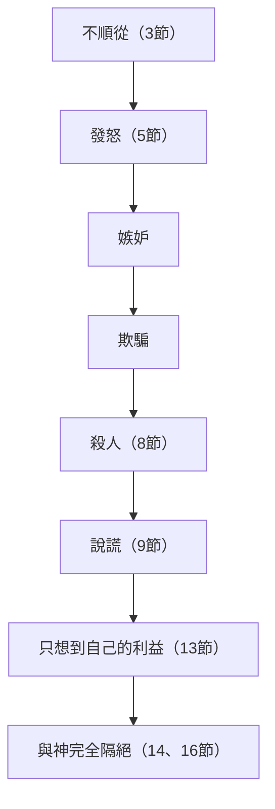

# 創世記 第4章

<!-- chapter-navigation:start -->
| [前一章](../01%20創世記/第3章.md) | [回目錄](../01%20創世記/全書目錄及綱要.md) | [下一章](../01%20創世記/第5章.md) |
| :--- | :---: | ---: |
<!-- chapter-navigation:end -->

1. 有一日，那人和他妻子[[夏娃]]同房，夏娃就懷孕，生了[[該隱]]【就是得的意思】，便說：耶和華使我得了一個男子。
2. 又生了[[該隱]]的兄弟[[亞伯]]。亞伯是牧羊的；該隱是種地的。
3. 有一日，[[該隱]]拿地裡的出產為[[血祭與素祭|供物]]獻給耶和華；
4. [[亞伯]]也將他羊群中頭生的和羊的脂油獻上。耶和華[[希伯來書11章亞伯因信獻祭|看中了亞伯和他的供物]]，
5. 只是看不中[[該隱]]和他的供物。該隱就大大的發怒，變了臉色。
6. 耶和華對[[該隱]]說：你為什麼發怒呢？你為什麼變了臉色呢？
7. 你若行得好，豈不蒙悅納？你若行得不好，[[罪伏在門前|罪就伏在門前]]。他必戀慕你，你卻要制伏他。
8. [[該隱]]與他兄弟[[亞伯]]說話；二人正在田間。該隱起來打他兄弟亞伯，[[該隱殺亞伯|把他殺了]]。
9. 耶和華對[[該隱]]說：你兄弟[[亞伯]]在哪裡？他說：我不知道！[[我豈是看守我兄弟的麼|我豈是看守我兄弟的嗎]]？
10. 耶和華說：你做了什麼事呢？[[亞伯的血哀告|你兄弟的血]]有聲音從地裡向我哀告。
11. 地開了口，從你手裡接受你兄弟的血。現在你必從這地受咒詛。
12. 你種地，地不再給你效力；你必流離飄蕩在地上。
13. [[該隱]]對耶和華說：我的刑罰太重，過於我所能當的。
14. 你如今趕逐我離開這地，以致不見你面；我必流離飄蕩在地上，凡遇見我的必殺我。
15. 耶和華對他說：凡殺[[該隱]]的，必遭報七倍。耶和華就給[[該隱的記號|該隱立一個記號]]，免得人遇見他就殺他。
16. 於是[[該隱]]離開耶和華的面，去住在[[伊甸]]東邊[[挪得]]之地。
17. [[該隱]]與[[該隱妻子的來源|妻子]]同房，他妻子就懷孕，生了[[以諾（該隱之子）|以諾]]。該隱建造了一座城，就按著他兒子的名將那城叫做以諾。
18. [[以諾（該隱之子）|以諾]]生[[以拿]]；以拿生[[米戶雅利]]；米戶雅利生[[瑪土撒利]]；瑪土撒利生[[拉麥]]。
19. [[拉麥]][[拉麥的一夫多妻|娶了兩個妻]]：一個名叫[[亞大（拉麥之妻）|亞大]]，一個名叫[[洗拉（拉麥之妻）|洗拉]]。
20. [[亞大（拉麥之妻）|亞大]]生[[雅八]]；雅八就是住帳棚、牧養牲畜之人的祖師。
21. [[雅八]]的兄弟名叫[[猶八]]；他是一切彈琴吹簫之人的祖師。
22. [[洗拉（拉麥之妻）|洗拉]]又生了[[土八該隱]]；他是打造各樣銅鐵利器的【或作：是銅匠鐵匠的祖師】。土八該隱的妹子是[[拿瑪]]。
23. [[拉麥]]對他兩個妻子說：[[拉麥之歌|亞大、洗拉，聽我的聲音]]；拉麥的妻子，細聽我的話語：壯年人傷我，我把他殺了；少年人損我，我把他害了【或作我殺壯士卻傷自己，我害幼童卻損本身。】
24. 若殺[[該隱]]，遭報七倍，殺[[拉麥]]，必遭報七十七倍。
25. [[亞當]]又與妻子同房，他就生了一個兒子，起名叫[[塞特]]，意思說：神另給我立了一個兒子代替[[亞伯]]，因為[[該隱]]殺了他。
26. [[塞特]]也生了一個兒子，起名叫[[以挪士]]。那時候，人才[[求告耶和華的名]]。

---

## 本章知識節點

### 人物
- [[該隱]]
- [[亞伯]]
- [[塞特]]
- [[以挪士]]
- [[以諾（該隱之子）]]
- [[以拿]]
- [[米戶雅利]]
- [[瑪土撒利]]
- [[拉麥]]
- [[亞大（拉麥之妻）]]
- [[洗拉（拉麥之妻）]]
- [[雅八]]
- [[猶八]]
- [[土八該隱]]
- [[拿瑪]]

### 神學／罪
- [[罪伏在門前]]
- [[亞伯的血哀告]]
- [[該隱的道路]]
- [[該隱的後代與無神文化]]

### 神學／救贖
- [[該隱的記號]]
- [[希伯來書11章亞伯因信獻祭]]
- [[希伯來書12章亞伯的血與基督的血]]

### 地點
- [[伊甸]]
- [[挪得]]

### 主題
- [[我豈是看守我兄弟的麼]]
- [[求告耶和華的名]]
- [[血祭與素祭]]
- [[拉麥之歌]]
- [[拉麥的一夫多妻]]
- [[該隱妻子的來源]]
- [[該隱殺亞伯]]
- [[猶大書該隱的道路]]

### 解經爭議
- [[神不偏待人與看不中該隱]]

### 背景
- [[古代近東血仇制度]]

---

## 本章整理

上一章寫人犯罪，被逐出伊甸園（創3:23-24）；丁良才說，前一章談人類罪惡的起源，這一章談罪惡的蔓延。本章從夏娃生下該隱和亞伯開始（第1-2節），兩兄弟各自獻上供物，神看中亞伯的，沒有看中該隱的（第3-5節）。該隱在田間殺了亞伯（第8節），神判他流離飄蕩（第12節），他離開耶和華的面，住在伊甸東邊的挪得（第16節）。經文接著列出該隱的後代（第17-24節），最後回到亞當家，塞特和以挪士出生，那時候人才求告耶和華的名（第25-26節）。

### 兩個兒子與兩種職業（1-2節）

夏娃生下[[該隱]]（קַיִן，H7014B），便說：「耶和華使我得了一個男子」（第1節；『得』：קָנִיתִי，字根 קָנָה H7069）。CT 說『該隱』的原文字義是『得著』，夏娃以為她得著了神所應許的『女人的後裔』（創3:15）；丁良才與 KC 也這樣讀，KC 並說她很快就會發現他不是。BH 則留意到「一個男子」這個說法可能帶著對創3:15 後裔的期待，該隱最後並沒有成就這個角色。

夏娃的話本身，《聖經精讀本──創世記註解》讀成信仰的告白：她承認孩子是神所賜的禮物，是充滿喜悅的告白（詩127:3）。

名字與這句話的關係，各家說法略有不同。《創世記雷氏研讀本》說，『該隱』（qayin）和『我得了』（qaniti）是兩個相關語，該隱的意思大概是『矛』。《丁道爾聖經註釋》說，該隱與『獲得』一字發音相近；這種對名字的講解通常是文字遊戲，不一定是同源字，卻替一個常用的名字冠上某種特殊含意。

第1節夫妻「同房」，原文用的是『知道』（יָדַע，H3045）。《雷氏研讀本》說這是表達性關係的委婉語；《丁道爾》說，這個字在此特別的含意中，極美地表達出兩性真正的結合是在全然相知相交之中，不過這個字也可能完全失去這個高尚的內涵（參創19:5）。

第2節生了弟弟[[亞伯]]（הֶבֶל，H1893）。CT 說原文字義是『氣息，虛幻，虛空』，夏娃生該隱之後並未得著所應許的後裔，顯然為此失望，才以『虛空』為次子命名；丁良才也說這名字顯明夏娃失了盼望。這名字也許反映夏娃明白到咒詛的含義（羅8:20；《雷氏研讀本》）；BH 的解讀則是，這個意思可能指生命短暫（傳1:2）。

《丁道爾》保留得多一些：亞伯之名與希伯來字『虛空』或『一個呼吸』外型完全相同（傳1:2），但經上並未由此提及什麼，兩者的關係恐怕出於偶然；這名字在字根上或許與蘇美文的 ibil(a)、亞喀得的 ab／plu 同源，意為「兒子」。

亞伯是牧羊的，該隱是種地的（第2節）。KC 說，兩個孩子往不同方向發展本身沒有問題，只是從活動的差異可以看出各人心的方向：牧羊看來輕鬆，該隱則像是勤奮工作的人。

這兩種職業在當時的背景，註釋有幾種講法。丁良才說，世上無教化的人多靠打獵為生，略有教化的人多靠畜牧維生，文明人多靠務農維生；亞當的兒子既然是種地牧羊，就足以證明他們不是野蠻人。《聖經精讀本》說，這是人類最悠久的職業，與神對男人的咒詛（創3:17-19）有著密切的關係。

亞伯為什麼養羊，KC 與 CT 各有說法。KC 說，那時養羊還不是為了吃肉，因為人類要到創世記9章3節才被神允許吃肉，所以亞伯養羊是為了獻祭給神，他深深明白，人只能靠著祭物才能來到神面前。CT 說，當時人類還是素食（創3:18），牧羊的目的大概是為著製衣遮羞（創3:21）和獻祭贖罪，並說從這節可以看出，亞伯是為神而活，該隱是為自己的肚腹而活。

### 兩份供物與不蒙悅納的原因（3-5節）

有一日，該隱拿地裡的出產獻給耶和華；亞伯也將羊群中頭生的和羊的脂油獻上（第3-4節）。這是聖經第一次記載獻祭的事（《啟導本聖經創世記註釋》）。[[血祭與素祭|該隱與亞伯獻上供物]]，兩節都用 מִנְחָה（H4503G，供物／禮物）稱呼。

經文說神「看中了亞伯和他的供物」，卻「看不中該隱和他的供物」（第4-5節），並沒有直接交代原因。丁良才與《精讀本》說，神表示悅納的形式，古人認為可能是降火燒掉亞伯的供物（利9:24；士6:21）。

各家對原因的說法，大致有三個方向。

第一個方向是供物沒有血。亞伯獻的是被殺流血的犧牲，該隱獻的卻沒有血，和聖書上流血贖罪的道理正是相反，這是亞伯的祭被看中的原因之一（CT、丁良才、艾基斯）。KC 把該隱沒有血的供物比作無花果葉（創3:7）：人自己的努力，不能使罪人與神和好。

第二個方向是供物本身不夠好。丁良才說，該隱的祭物有兩樣不及格：不是初熟的（利2:12；1:16），而且出自受咒詛的土地（創3:17）。李道生說，該隱的祭物或許是因為非地裡初熟的出產，又是被咒詛的，不是上好的。

第三個方向是問題出在獻祭的人，不在供物的種類。《丁道爾》說，若聲稱該隱的祭物不蒙悅納是因為未曾帶血，這是很危險的說法（參申26:1-11）；此處最明顯的是亞伯獻上羊的精華，而該隱卻存著高傲的態度獻祭。《雷氏研讀本》說，不流血的供物不一定是不恰當的（比較利2:1、4、14、15），叫神不悅的是該隱不信的態度。

《舊約背景註釋》說，聖經只用籠統的『禮物』稱呼這兩份供物，這字與利未記2章的素祭關係最為密切，意思似乎是向神所賜的豐足表示謝意，因此該隱獻上所種的收成是合宜的，這類祭本來不必帶血。祭若是勉強獻上，就不能表達謝意，該隱可能正有這個問題。《啟導本》說，兩人供物的不同不在一個用動物、一個用植物，而在對祭物的態度：一個隨便獻，一個把最好的獻上。亞伯獻頭生的羊和羊的脂油，見證他對神的信心，他明白贖罪要犧牲，須用血來代贖（來9:22）。

雖然說法不同，好幾家都留意到神看的是獻祭的人。不但該隱的祭物不對，連他自己這個人也不對；他和他的祭物是不能分開的，神不悅納他的祭物，因他本身不被悅納（CT、《串珠聖經註釋》）。《串珠》並說，他若行得好，祭物必蒙悅納。KC 也說，供物與獻祭的人是不能分開的，神在供物裡接納獻祭的人。

經文的寫法本身就透露這一點：『亞伯和他的供物，該隱和他的供物』，表明神看重的是兩兄弟內心的動機和態度（撒上16:7；《精讀本》），也就是供物背後的態度和信心（來11:4；BH）。

[[希伯來書11章亞伯因信獻祭|希伯來書11章4節]]說，亞伯是憑信心獻祭，成了討論這段經文最常用的參考經文。CT 把亞伯的祭物被看中的原因歸納為三點：他照著從父母聽來的神的旨意，沒有憑自己的意思；他是因信獻祭；他獻上的是被殺流血的犧牲。KC 說，兩人同是罪人，所以被接納或被拒絕的原因要在供物上找；亞伯真正把父母的教導放在心上，明白無辜者的血是必要的。

這又帶出一個常被問到的難題：聖經說神不偏待人，為什麼看不中該隱？賈斯樂郝威說，神不偏待人，是祂公平對待人、不袒護誰；但這不表示神對所有的行為都一視同仁，神看不中該隱，是因為他沒有憑信心獻祭，就像聖經也說神憎惡以掃（瑪1:3）和尼哥拉一黨人的行為（啟2:6），憎惡的是他們的所行，不是他們本人（參[[神不偏待人與看不中該隱]]）。

### 罪伏在門前：殺人以前的最後呼召（6-7節）

神先問該隱：「你為什麼發怒呢？你為什麼變了臉色呢？」（第6節）CT 說，發怒和變臉色是外面的表現，神的問話是要使該隱注意背後的原因和他內心真實的光景。《丁道爾》說，這兩個重複的問句刻劃出神喜愛訴諸理性，並且對罪人仍然關心。

《精讀本》說，神用重複的形式，表明他期盼該隱承認錯誤的迫切之心；該隱被咒詛的原因，在於他不理會神的督促、始終沒有悔改，與供物是否被悅納無關。

第7節是聖經第一次出現「罪」（חַטָּאת，H2403B）這個字（《精讀本》）。經文說「罪就伏在門前」，『伏』（רֹבֵץ，字根 רָבַץ H7257）描寫野獸蹲伏埋伏的樣子。

CT 把罪描寫成人格化的活物，蹲伏在門前，準備隨時撲過來。《精讀本》說這是試圖撲向人類的貪婪猛獸，就像守在門口、向屋內的人吼叫的野獸；BH 把這個意象與彼前5:8 吼叫的獅子對照。

經文接著說「他必戀慕你，你卻要制伏他」（第7節；『戀慕』：תְּשׁוּקָה，H8669，BH 說與創3:16 同字；『制伏』：תִּמְשָׁל，字根 מָשַׁל H4910）。這個『他』指誰，丁良才列出兩種說法。

有些註釋家認為『他』是指『罪惡』：罪惡如兇猛的野獸要害該隱，他若行得好就可以得勝。也有人認為『他』是指亞伯：該隱若行得好，仍有長子的名分，兄弟也會戀慕他（參創3:16）。KC 也說，該隱若肯聽神的話，仍能居長子的位子，享受與長子身分相連的祝福。

神在這裡給了該隱機會。KC 說，神向他提起發怒的事，給他機會回頭、「行得好」，並警告若不這樣，罪就會完全佔有他。《啟導本》說，他這時可能已暗藏殺機，神仍盼他回轉，並叮囑應制伏罪。

### 第一宗謀殺與神的追問（8-16節）

該隱與他兄弟亞伯說話，二人正在田間；該隱起來打他兄弟亞伯，把他殺了（第8節；[[該隱殺亞伯|該隱殺亞伯]]）。《啟導本》說，這是人類歷史上第一宗謀殺案，動機是妒恨（約壹3:12、15）；KC 說，亞伯並沒有得罪該隱，該隱是妒恨亞伯從神得的恩典。

第8節「說話」之後，原文怎麼接，《丁道爾》談到兩種可能。他說 RV 將希伯來文譯得很正確：『該隱告訴亞伯他的兄弟』（參出19:25）；若是這樣，就顯出該隱曾在接受或拒絕神的責備之間，大大搖擺不定。七十士譯本卻在後面加上『我們到田間去罷』，若這些話真是原來經文所有，這樁謀殺案便顯然出於預謀。

《啟導本》採用後面這種讀法：該隱蓄意騙弟弟到外邊，親手把他殺了。BH 也說，這句邀請可能暗示預謀。

丁良才從犯罪的嚴重性列出五個讓該隱罪加一等的理由：

- 他殺的是自己的親兄弟。
- 是一個好兄弟。
- 兄弟並沒有得罪他。
- 他事先已經受到神的警告。
- 他還假裝跟兄弟和好。

神問：「你兄弟亞伯在哪裡？」（第9節）丁良才說，這是神第二次問人的話（參創3:9）。KC 說，神藉著發問，叫人思考自己的行為，給出深思熟慮的回答；該隱不像亞當夏娃那樣閃躲，而是直接撒謊。

該隱回答：「我不知道！我豈是看守我兄弟的嗎？」（第9節；[[我豈是看守我兄弟的麼|我豈是看守我兄弟的麼]]）丁良才指出這句話有三個過錯：存心殘忍、藐視神、不愛胞弟，並說『我不知道』是謊言，罪上加罪。CT 也說，「我不知道」是說謊，「我豈是看守我兄弟的嗎」是頂撞神。KC 從這件事看出罪的兩大特徵：暴力與謊言（也就是敗壞），人所有的罪都可以回到這兩件事上。

神接著說：「你兄弟的血有聲音從地裡向我哀告。」（第10節；[[亞伯的血哀告]]）STEP 把『血』標為複數形，『哀告』標為複數分詞（דָּם，H1818；צָעַק，H6817）。

丁良才說，亞伯的血呼籲神為他自己伸冤；唯獨耶穌的血呼籲神為世人赦罪，這與[[希伯來書12章亞伯的血與基督的血|希伯來書12章24節]]相呼應。《精讀本》補充了古代人的觀念：無辜流的血會一直控訴直到伸冤；所有的血和生命都單單屬於神，因此殺人是侵犯和挑戰神權威的行為。

神的處罰與憐憫在這一段同時出現。《精讀本》說，有罪的地方就有神的憐憫（羅5:20）：神為犯罪的人穿上皮衣，對人類的第一個殺人犯也同樣給予保護的記號。

該隱受的處罰是：地不再給他效力，他必流離飄蕩在地上（第11-12節）。《精讀本》說，這使人類和土地的紐帶被完全破壞，比創3:17 以下對亞當的刑罰還要嚴重。《串珠聖經註釋》把這兩方面歸納為：即使努力耕種，土地也不生產；他被趕逐離開伊甸園一帶，在世界各處流蕩。

該隱的回應是：「我的刑罰太重，過於我所能當的。」（第13節）在丁良才看來，他雖說這話，卻沒有悔改的心；CT 說這話可譯作『我的罪孽太大，過於所能赦免的』，並非認罪，而是出於自憐的怨歎。KC 說，該隱先是否認自己的罪，現在又說自己的罪不能赦免，兩種閃躲都顯出他不願在神面前低頭。

《啟導本》把該隱一步一步墮落的過程整理成一個流程：

CT 的〈該隱墮落的過程〉也是走同一條路線，分成六個階段：不順從神的啟示、因為祭物不被接受而發脾氣、因為嫉妒而殺害別人、對神說謊、只想到自己的利益、最後與神完全隔絕。

該隱怕「凡遇見我的必殺我」（第14節），神回答：「凡殺該隱的，必遭報七倍」，並給該隱立一個「記號」（אוֹת，H226H），免得人遇見他就殺他（第15節）。《啟導本》說，「凡遇見我的」指的是將來人口增多以後的情形，第一個家庭之外當時並沒有許多人；丁良才說，這是亞當夏娃所生的別的兒女。

那個記號是什麼樣子，經文沒有交代，各家說法如下。

記號的樣子經文沒有說明，歷來有多種解釋；它是神保護該隱的記號，也是對別人的警告（BH）。《啟導本》說那「不是在身上作什麼記號，而是一個警告的訊號」，《雷氏研讀本》說這是「神保證用恩慈對待他，是保護他性命的一個象徵」。《丁道爾》說得更進一步：它不是一個烙印，乃是一種安全通行證，幾乎像是立約，使神實際上成了該隱的保護者，這是憐憫對不悔改的人所能作到的極限。

《舊約背景註釋》指出，本節的希伯來字眼與犯人或奴隸所受的刺青、傷殘無關（埃施嫩納和漢摩拉比法典都有提及）；與它最相近的，是以西結書9:4-6中耶路撒冷無罪之人額上受神保護的記號。它或許是個能令人尊重或提防的外在記號，也可能是神向該隱顯示的神蹟，讓他知道自己不會受害，也不會受人攻擊。

KC 說，神在祂的美善中，仍然顧念該隱在地上的生命；神設立記號，是讓別人看見，只有神保留向罪人該隱行動的權利。

《舊約背景註釋》另外介紹了[[古代近東血仇制度|古代近東的血仇背景]]：在中央政府不能全面控制的地區，家族間的宿怨導致流血是很常見的事，兇手或其家人必須有一人償命。該隱的話顯示當時已有較大規模的家族，亞伯一系可能有人意圖復仇。

到了第16節，該隱離開耶和華的面，去住在伊甸東邊挪得之地。《丁道爾》說，該隱的離開，既是他的審判，也是他的選擇；以下的記載讓人初嘗自滿自足之社會的滋味，這正是新約所謂『世界』的本質。

『挪得』（נוֹד，H5113）的意思，CT、《雷氏研讀本》、《啟導本》與《串珠》都說是流浪、遊蕩一類的意思，與該隱被判的「流離飄蕩」相應（第12節）。丁良才說，我們現在不知道這地在何處，只知道在伊甸園東邊。KC 說，東邊正是神驅逐亞當夏娃的方向（創3:24）。

### 該隱的後代與沒有神的文化（17-24節）

[[該隱的後代與無神文化|該隱的家譜]]是聖經裡第一份家譜。KC 說，這是不信的、屬肉體的一系的家譜，到創世記5章才輪到有信心的家譜，這符合哥林多前書15:46所說的：屬靈的在後，屬血氣的在先；該隱建城，並按兒子的名字給城命名，KC 說這證明這份家譜記的是活在不信裡的人，他在自己建造的城上寫下自己的榮耀。

經文用八節，從[[以諾（該隱之子）|建城]]一路寫到打造銅鐵利器，最後是一首拉麥的歌（第17-24節）。許多人疑惑的[[該隱妻子的來源]]也在第17節浮現。

丁良才反問：亞當若沒有生了別的兒女，怎能有該隱的妻子呢？《雷氏研讀本》說，那顯然是亞當的一個女兒（比較創5:4），可能是該隱的姐妹、侄女或侄孫女；由於亞當和夏娃的遺傳系統裡沒有突變的基因，這樣的婚姻不會像今天那樣危險。CT 說，大多數解經家認為她是亞當和夏娃所生的女兒，兄妹結婚是在摩西律法之後才禁止的。

賈斯樂郝威說，禁令是幾千年後在摩西的時代頒佈的（約主前1500年；利18:6）。李道生說，亞伯拉罕的妻子撒萊原是他同父異母的妹妹（創20:12），可見兄妹結婚在上古是神未曾禁止的。

聖經裡的「城」，CT 與《啟導本》都說是人可以安居的社會單位，可大可小，不過《啟導本》提醒，它不能與後世高度發展的城市相比。該隱建城，代表他受咒詛後（第12節）為自己建立一種新的生活，以減低咒詛之苦（《啟導本》）；《雷氏研讀本》說，他也許欲借此抵銷神對他的咒詛。

第17-22節記錄了該隱後代的名字與事蹟：以諾建城，雅八是住帳棚、牧養牲畜之人的祖師，猶八是一切彈琴吹簫之人的祖師，土八該隱打造各樣銅鐵利器。CT 與 KC 從名字的意思和這些事蹟，讀出沒有神的文化有怎樣的特色：

| 人名 | 名字在原文的意思（CT） | 經文交代的身分或事蹟 | 註釋的解讀 |
|---|---|---|---|
| 以諾 | 開始，學習，教師，供獻 | 該隱用他的名字建了一座城 | 《丁道爾》：或許是想藉長子和第一座城市的名字，表明『重新開始』的念頭 |
| 以拿 | 見證的城 | 以諾的兒子 | CT：把沒有神的文化當作一種『見證』和誇耀 |
| 米戶雅利 | 神要抹除，擊打的 | 以拿的兒子 | CT：明知道神反對，卻還是一意孤行 |
| 瑪土撒利 | 屬神的人 | 米戶雅利的兒子 | CT：知道人是屬於神的，卻仍一意孤行 |
| 拉麥 | 健壯的，有能力 | 娶了兩個妻子、作了一首歌 | CT：『強而有力』地推展文化建設 |
| 亞大 | 裝飾，娛樂 | 雅八和猶八的母親 | CT：注重裝飾和娛樂 |
| 洗拉 | 保護，屏幃，遮藏 | 土八該隱和拿瑪的母親 | CT：美其名為『保護』身心的健康，實際上卻是在放縱肉體的情慾 |
| 雅八 | 流動，領導 | 住帳棚牧養牲畜之人的祖師 | CT：發明遊牧生活來維持生存；KC：可以用來說明經濟繁榮、財產和便利 |
| 猶八 | 音樂，快樂聲音 | 彈琴吹簫之人的祖師 | CT：發明音樂來消愁解悶；KC：可以用來說明藉藝術和文化帶來娛樂 |
| 土八該隱 | 該隱的擴展，該隱的流出 | 打造各樣銅鐵利器 | CT：製造利器來自衛，是人類戰爭文化的開端；KC：代表科學與技術 |
| 拿瑪 | 悅心的 | 土八該隱的妹妹 | CT 的靈意註解：最後竟至殺人『取樂』，強橫兇暴 |

這些技術本身，註釋也給了肯定的評價。《丁道爾》說，若存偏見記載，對該隱就不會有任何美言可說，但實際情形卻複雜得多：神要多多利用該隱宗族的技術，以造福祂的子民；「他是一切……的祖師」這句話承認其功績，並預備我們的心，同樣接受世俗事業的成就，予以讚賞，因為聖經沒有一處教導說，惟獨敬虔的人能獲得所有恩賜。

同一段註釋接著說，拉麥的家可以處理外在的環境，卻不能自理；該隱的家族無疑是一個小宇宙，其技術精良、道德敗壞的模式，正是人類的寫照。

《啟導本》的判斷與此一致：神不以人物質的成就來定善惡，所看重的是道德的景況（創6:5-7）。

《舊約背景註釋》介紹了這些技術在古代的歷史座標：綿羊和山羊的馴養，考古證據可追溯到主前第九千年紀；樂器是初期人類最先的發明之一，埃及最早期的簫可以考證到主前第四千年紀；人類在主前第四千年紀已經開始熔煉鍛造銅製的工具，鐵器要到主前第二千年紀末葉最後出現。

拉麥有兩件事特別被註釋提起。第一件是[[拉麥的一夫多妻]]：STEP 把第19節標為拉麥『為自己』娶了兩個妻子。這是多妻的起頭，也是歷史記錄上首次違反神所定的一夫一妻制（丁良才、《雷氏研讀本》）；《丁道爾》說，企圖改善神所設婚姻模式的努力，立下大具破壞力的先例，創世記其餘部分正足以為詮釋。

第二件是[[拉麥之歌]]（第23-24節）。STEP 把第23節的 יֶלֶד（H3206）標為『年輕人』，句子大意是『我殺了一個人，為我的傷；殺了一個年輕人，為我的傷痕』；第24節則說「殺拉麥，必遭報七十七倍」。

丁良才說，這兩節是存留世界最古的詩歌，拉麥作它是要安慰兩個妻子：有人要傷他，他就先殺了；殺該隱的人要遭報，殺他的人必加倍遭報，因為該隱殺亞伯是無故的，他殺人卻有緣故。《雷氏研讀本》說，拉麥誇口，若有人要為他殺人報復，他會以七十七倍的力量保護自己，不需要神的幫助，像該隱所接受的那樣。

CT 說，這是比神允許該隱的報應更多十倍；拉麥驕傲狂妄，自以為足夠有能力照顧自己，比神照顧該隱還要好上十倍。《聖經精讀本》說，拉麥拿著土八該隱製造的利器，抱著猶八製作的樂器，傲慢地唱出憎惡和復仇之歌。

《啟導本》拿這首歌對比耶穌的教導：仇恨的報復豈有窮盡！主耶穌解決人類問題的方法是寬恕，祂要求我們寬恕七十個七次（太18:21-22），即無數次。《串珠》也把拉麥的七十七倍與耶穌教導門徒饒恕人七十個七次作對比，並說人類文化的進步，並不能保證道德同樣進步。

### 塞特與求告耶和華的名（25-26節）

第25-26節回到亞當家。夏娃生了兒子，起名叫「塞特」（שֵׁת，H8352），並說：「神另給我立了一個兒子代替亞伯，因為該隱殺了他」；『塞特』與動詞『立／指定』（שָׁת，字根 שִׁית H7896）同源。

各家對『塞特』這個名字的解釋如下：

- CT：新苗、茁芽、設立、代替、償還。
- 《雷氏研讀本》：『那指定的一個』，也就是被殺之亞伯的代替者。
- 《啟導本》：『替代』或『賜』。
- KC：『補償』或『替代』。

KC 並從中得出一個原則：凡是獻給神，或是被神收回去的，神一定會給予補償或代替。CT 的〈話中之光〉說：「神的見證人是不會斷絕的；這一個被殺了，神還會興起另一個來代替。」

塞特也生了一個兒子，起名叫「[[以挪士]]」（אֱנוֹשׁ，H583）。CT 說原文字義是『脆弱必要死的人』；人唯有認識自己的『軟弱無能』，對這個必死的自己無所指望，才會轉而呼求神。《啟導本》與《串珠》都說這名字的意思是『人』，《啟導本》並說與『亞當』相似。

KC 從以挪士這個名字看出塞特的信心：塞特與該隱和他的後代相反，不指望人，而是把一切指望都放在神身上。KC 說，一邊有人在地上為自己立名（第17節），另一邊有人在意識到自己軟弱時，求告耶和華的名。

「那時候，人才[[求告耶和華的名]]」（第26節；קָרָא בְּשֵׁם יְהוָה，H7121 搭配 H8034 與 H3068）。《串珠》說，這句話在舊約多指公開敬拜神；從以挪士起，人類便開始有集體的敬拜。《精讀本》說，從塞特時代開始，人們才謙卑地承認自己的軟弱和無力，向與人立約、並負責成就的神禱告和敬拜，以感恩之心公開進行崇拜活動。

這裡有一個常被問到的難題：亞伯在第3-4節就已經向神獻祭，為什麼說到以挪士才求告耶和華的名？賈斯樂郝威說，『求告耶和華的名』真正的意義不是很明確，不能拿來和亞伯獻祭這個明確的事實相比而認為有衝突；它有可能表示一個定期、莊嚴、公開式的崇拜禱告儀式（參羅10:13），是在以挪士以前沒有的；在亞伯的時代，也沒有提到求告耶和華的名。

### 兩條路線：兩份名單的對照

CT 在〈從創四章裏的人名意義學取教訓〉這段註釋中，把整章看作是兩份名單的對比。

| | 不要神的人（該隱這條線） | 要神的人（塞特這條線） |
|---|---|---|
| 起點 | 離開了神的面之後，『開始學習』過沒有神的生活（以諾） | 認識人生的『虛空』（亞伯） |
| 自我認識 | 明知道神要『消除』、也知道人是『屬於神』的，卻還是一意孤行（米戶雅利、瑪土撒利） | 也認識自己是『軟弱必死的』（以挪士） |
| 出路 | 『強有力』地推展文化建設，自養、自娛、自衛（拉麥、雅八、猶八、土八該隱） | 轉而求告那位『我是的』——耶和華 |
| 結局 | 竟至殺人『取樂』，強橫兇暴（拿瑪） | 以神的生命來『代替』舊人（塞特） |

猶大書11節提到「該隱的道路」。CT 說，凡不照神的旨意而行的，就是走該隱的道路（猶11）；KC 說，這是人憑己意親近神的路，走這條路的人最後背向神，過自己的日子，如本章16-22節所見（參[[猶大書該隱的道路]]）。

丁良才把這條道路落實到今天：該隱只憑自己的意思獻祭給神，他不承認自己是罪人；直到如今，還有這樣不肯悔改、不依靠十字架的人，只把耶穌當作善人、世人的好榜樣，卻不承認祂是神的兒子、是為人贖罪的。

KC 則把這裡看作一條貫穿整本聖經的界線的起點：神的家和魔鬼的家從此分開（約壹3:10-12）；自以為靠自己的義事奉神的人，自古以來就逼迫那些靠恩典活著的人（加4:29）。

### 從兄弟失和到兩條路線（全章）

本章從夏娃生下該隱和亞伯開始（第1-2節），兩人的供物一個被看中、一個沒有被看中，該隱發怒，神問他，並告訴他罪伏在門前（第3-7節）。該隱殺了亞伯，神追問他，判他流離飄蕩，又給他立記號免得人殺他，他離開耶和華的面，住在挪得（第8-16節）。

該隱的後代建城、發展技術，拉麥有兩個妻子，也作了報復七十七倍的歌（第17-24節）。亞當家又生了塞特，塞特生以挪士，那時候人才求告耶和華的名（第25-26節）。KC 說，該隱的家譜與創世記5章的有信心的家譜，是兩條不同的線；CT 則用兩份名單把這兩條線並排對照，一邊是不要神的人，一邊是要神的人。

**參考資料**
代號：CT＝ccbiblestudy《逐節註解》；GT＝ccbiblestudy《拾穗》，彙集多本中文註釋；正文直接寫書名或作者的（如《丁道爾》、丁良才），都出自這裡；KC＝KingComments；BH＝BibleHub Study；STEP＝STEP Bible 原文資料（CC BY 4.0）
https://www.ccbiblestudy.org/Old%20Testament/01Gen/01CT04.htm
https://www.ccbiblestudy.org/Old%20Testament/01Gen/01GT04.htm
https://www.kingcomments.com/en/bible-studies/Gen/4
https://biblehub.com/study/genesis/4.htm
https://github.com/STEPBible/STEPBible-Data

<!-- appendix-links:start -->
## 附錄

### 相關地圖
- [[appendix/fhl_maps/maps/006|〈創圖一〉洪水前的各地示意圖]]
<!-- appendix-links:end -->

<!-- chapter-navigation:start -->
| [前一章](../01%20創世記/第3章.md) | [回目錄](../01%20創世記/全書目錄及綱要.md) | [下一章](../01%20創世記/第5章.md) |
| :--- | :---: | ---: |
<!-- chapter-navigation:end -->
