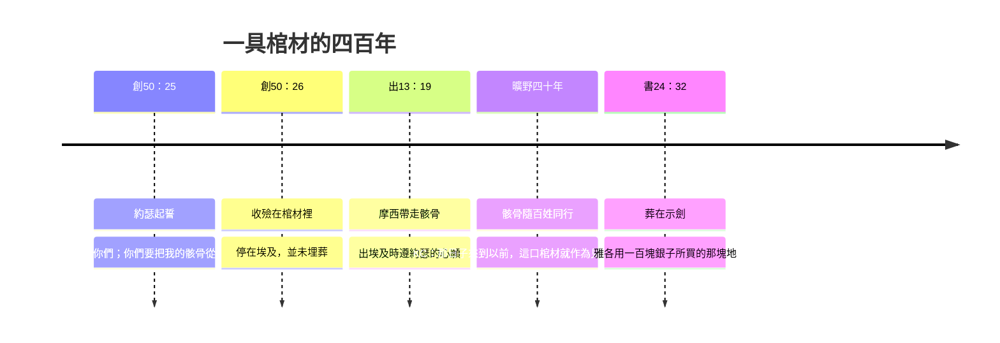

# 創世記 第50章

<!-- chapter-navigation:start -->
| [前一章](../01%20創世記/第49章.md) | [回目錄](../01%20創世記/全書目錄及綱要.md) |  |
| :--- | :---: | ---: |
<!-- chapter-navigation:end -->

1. [[約瑟]]伏在他父親的面上哀哭，與他親嘴。
2. [[約瑟]]吩咐伺候他的醫生用[[古埃及薰屍與哀悼|香料薰他父親]]，醫生就用香料薰了[[雅各|以色列]]。
3. [[古埃及薰屍與哀悼|薰屍的常例是四十天]]；那四十天滿了，[[古埃及薰屍與哀悼|埃及人為他哀哭了七十天]]。
4. 為他哀哭的日子過了，[[約瑟]]對[[法老]]家中的人說：我若在你們眼前蒙恩，請你們報告法老說：
5. 我父親要死的時候叫我起誓說：你要將我葬在[[迦南地]]，在我為自己所掘的墳墓裡。現在求你讓我上去葬我父親，以後我必回來。
6. [[法老]]說：你可以上去，照著你父親叫你起的誓，將他葬埋。
7. 於是[[約瑟]]上去葬他父親。與他一同上去的，有[[法老]]的臣僕和法老家中的長老，並[[埃及]]國的長老，
8. 還有[[約瑟]]的全家和他的弟兄們，並他父親的眷屬；只有他們的婦人孩子，和羊群牛群，都留在[[歌珊地]]。
9. 又有車輛馬兵，和他一同上去；那一幫人甚多。
10. 他們到了約但河外、[[亞達禾場與亞伯麥西|亞達的禾場]]，就在那裡大大地號咷痛哭。[[約瑟]]為他父親哀哭了七天。
11. [[迦南地|迦南]]的居民見[[亞達禾場與亞伯麥西|亞達禾場上的哀哭]]，就說：這是[[埃及]]人一場極大的哀哭。因此那地方名叫[[亞達禾場與亞伯麥西|亞伯麥西]]，是在約但河東。
12. [[雅各]]的兒子們就遵著他父親所吩咐的辦了，
13. 把他搬到[[迦南地]]，葬在幔利前、[[麥比拉洞|麥比拉田間的洞]]裡；那洞和田是亞伯拉罕向赫人以弗崙買來為業，作墳地的。
14. [[約瑟]]葬了他父親以後，就和眾弟兄，並一切同他上去葬他父親的人，都回[[埃及]]去了。
15. [[約瑟]]的哥哥們見父親死了，就說：[[悔改與良心的覺醒|或者約瑟懷恨我們]]，照著我們從前待他一切的惡足足地報復我們。
16. 他們就打發人去見[[約瑟]]，說：你父親未死以先吩咐說：
17. 你們要對[[約瑟]]這樣說：從前你哥哥們惡待你，求你饒恕他們的過犯和罪惡。如今求你饒恕你父親神之僕人的過犯。他們對約瑟說這話，約瑟就哭了。
18. 他的哥哥們又來俯伏在他面前，說：我們是你的僕人。
19. [[約瑟]]對他們說：不要害怕，我豈能代替神呢？
20. 從前[[神的主權與人的責任|你們的意思是要害我，但神的意思原是好的]]，要[[神的護理|保全許多人的性命]]，成就今日的光景。
21. 現在你們不要害怕，[[饒恕與和好|我必養活你們和你們的婦人孩子]]。於是[[約瑟]]用親愛的話安慰他們。
22. [[約瑟]]和他父親的眷屬都住在[[埃及]]。約瑟活了一百一十歲。
23. [[約瑟]]得見[[以法蓮]]第三代的子孫。[[瑪拿西]]的孫子、瑪吉的兒子也養在約瑟的膝上。
24. [[約瑟]]對他弟兄們說：我要死了，但[[神的護理|神必定看顧你們]]，領你們從這地上去，到[[亞伯拉罕之約|他起誓所應許給亞伯拉罕、以撒、雅各之地]]。
25. [[約瑟]]叫以色列的子孫起誓說：神必定看顧你們；你們要把我的[[約瑟骸骨葬於示劍|骸骨從這裡搬上去]]。
26. [[約瑟]]死了，正一百一十歲。人用[[古埃及薰屍與哀悼|香料將他薰了]]，把他收殮在棺材裡，停在[[埃及]]。

---

## 本章知識節點

### 人物
- [[約瑟]]
- [[雅各]]
- [[法老]]
- [[以法蓮]]
- [[瑪拿西]]

### 地點
- [[埃及]]
- [[迦南地]]
- [[歌珊地]]
- [[麥比拉洞]]
- [[亞達禾場與亞伯麥西]]

### 神學
- [[神的護理]]
- [[神的主權與人的責任]]
- [[饒恕與和好]]
- [[亞伯拉罕之約]]
- [[悔改與良心的覺醒]]

### 歷史
- [[約瑟骸骨葬於示劍]]

### 文化
- [[古埃及薰屍與哀悼]]

---

## 本章整理

這是創世記的最後一章，從雅各的葬禮寫到約瑟的死。前半寫約瑟怎樣為父親哀哭、薰屍、率領浩大的行列把他葬回迦南；後半寫雅各一死，哥哥們又怕約瑟報復，約瑟說出整卷創世記最重要的一句話：「你們的意思是要害我，但神的意思原是好的」，最後自己也留下骸骨的遺命。上一章雅各囑咐葬在麥比拉洞，氣絕而死，這一章寫那囑咐怎麼辦成。可以帶著三個問題讀：約瑟為什麼要用埃及人的方法薰屍？哥哥們轉述的『父親的吩咐』是真的嗎？一具停在埃及的棺材，為什麼是創世記的結尾？

KC 為這最後一章下的引言：這一章多顯出約瑟的品格和美德，多過他的地位和尊榮；約瑟在這裡也奇妙地指向主耶穌。

### 經文大綱

1. 約瑟哀哭、薰屍、埃及舉國哀悼（1-3節）
2. 求法老准他歸葬迦南（4-6節）
3. 浩大的送葬行列；亞達禾場哀哭七日（7-11節）
4. 葬於麥比拉洞，眾人回埃及（12-14節）
5. 哥哥們懼怕，約瑟饒恕（15-21節）
6. 約瑟之死與骸骨的遺命（22-26節）

### 一、薰屍：一個實際的用途（1-3節）

約瑟伏在他父親的面上哀哭，與他親嘴（1節）。KC 數算，這是約瑟第六次哭；他親吻已死的雅各，表達對父親的深情：死亡割斷了父子的連結，約瑟對父親的愛卻沒有改變，在復活裡這個連結將要恢復。這也應驗了神在別是巴對雅各的應許「約瑟必給你送終」（46:4，原文「將手按在你的眼睛上」）（CT）。

約瑟吩咐伺候他的醫生用香料薰他父親（2節）。『薰屍／防腐』的原文動詞（לַחֲנֹט / וַיַּחַנְטוּ，字根 חָנַט H2590）指古埃及保存遺體的特殊工藝。

> [!note] 約瑟為什麼用埃及人的方法薰屍？
> 各家的說明從不同角度回到遺體的保存。從埃及運屍到迦南需要相當時日，若不防腐，就無法履行約瑟向父親所起的誓（47:29-31）；CT 特別澄清，約瑟的用意不是學埃及人的迷信，認為人的肉身若未腐爛，靈魂就仍停留在肉身內。李道生在《舊約聖經問題總解》也說，希伯來人死後本來不用薰屍，約瑟是為了保存老父的屍體不致腐爛、可以完整地運回迦南安葬。
>
> 《舊約背景註釋》指出，薰屍是埃及人的常例，負擔得起的人都不會不做；雅各和約瑟的屍骸都受過防腐處理，他們這樣做雖然可能是為了避免得罪埃及人，但同時亦有保存屍體，以便日後在迦南安葬的作用。《靈修版聖經註釋》則說，用香料薰屍體是埃及人的習慣，對於遊牧民族並不常見，約瑟吩咐醫生薰雅各，在禮貌上表示對埃及人的尊重。
>
> 《啟導本》另注意一個細節：約瑟殮葬父親沒有用專業薰屍的人，他用的是伺候雅各的醫生；可能由醫生做不但更在行，也可以避免薰屍人採用異教的禮儀。
>
> 《舊約背景註釋》指出這件事在聖經裡的位置：本段是以色列人薰屍惟一的例子。手續由一組受過特別訓練的殯喪祭司執行，內臟全部取出，屍體浸在特別的防腐藥水中四十天。
>
> 李道生把最上等的一種薰屍法描述得最細：先從鼻孔鉤出腦髓、剖腹取出五臟，用藥水洗淨後以玉桂、沉香、藥物、香料填滿縫好，浸於炭酸蘇打內，取出後用浸透亞拉伯樹膠的細麻布纏裹全身，裝殮在如人形的無花果木棺材內，「須費三千銀元纔能完成，而屍體可以存留三四千年而不朽」。

[[古埃及薰屍與哀悼|薰屍四十天、哀哭七十天]]：埃及定例，為法老舉哀才七十二天，雅各竟得七十天，可見其備極哀榮（《啟導本》）。「七十天」是否包含薰屍的「四十天」？CT 與《啟導本》都認為七十天包括薰屍的四十天在內，CT 並說也有解經家認為，按古埃及的風俗，薰屍期間是不舉哀的。《舊約背景註釋》的拆法又不同：日數可能包括了薰屍所需的四十日，再加上傳統的三十日哀悼期（申34:8）。至於這個數字有多長，丁良才與《串珠》給了同一個對照：以色列人為亞倫和摩西哀哭，也只有三十天（民20:29；申34:8）。

### 二、送葬（4-14節）

為他哀哭的日子過了，約瑟不直接見法老，而託[[法老]]家中的人轉稟，因他正在守喪（4節）（CT、丁良才、《串珠》、《聖經精讀本》），不剃頭刮臉，不能親自面見法老（CT；丁良才說不剃鬚髮，《聖經精讀本》說沒有刮臉）。從埃及到墓地的距離約500公里，需要越過國境，約瑟還要暫時離職，所以需要王的特許（《聖經精讀本》）。約瑟說的是父親叫他起誓，要葬在迦南地「我為自己所掘的墳墓裡」，求法老讓他上去葬父親，以後必回來（5節）。

法老說：你可以上去，照著你父親叫你起的誓，將他葬埋（6節）。這表明法老信任約瑟的話，是約瑟多年來言行合一所得來的信用（CT）。

於是有了古代近東罕見的一幕：法老的臣僕、法老家中的長老、埃及國的長老，還有車輛馬兵，浩浩蕩蕩護送一個希伯來老人的靈柩回迦南（7-9節）。「法老的臣僕」是總體稱呼，包括法老家中的長老（宮廷貴戚）與埃及國的長老（國家的達官宿老）；有車輛馬兵，是因為國葬場合需要護送的軍隊（CT）。送葬的人眾多且尊貴（丁良才）。

> [!note] 這場葬禮的規格，與雅各自己的取捨
> KC 從薰屍的隆重讀出他的地位：雅各被視為埃及的顯貴之一；照他名字的意思，他是以神的王子的身分死去，得的是王室的葬禮。若他或約瑟開口，必定會為他造一座金字塔，但雅各不求任何為自己立名的地方。
>
> BH 另指出第10節那個地點的性質：禾場通常設在高處以借風力揚穀，在那裡舉哀，可能象徵『分別、潔淨』；而第10節的七日之哀，正是猶太人後來守喪的傳統天數（shiva），至今仍然遵行。

他們到了約但河外，亞達的禾場，就在那裡大大地號咷痛哭，約瑟為他父親哀哭了七天（10節）。

> [!note] 亞達的禾場——荊棘與打穀場
> 「[[亞達禾場與亞伯麥西|亞達的禾場]]」的確切位置未能確定。經文說在「約但河外」，原文可指河東或河西；CT 甚至提出「約但」可能是一個古城名（約瑟夫曾提及），位於迦南南地。《舊約背景註釋》坦言至今未能確定，《串珠》也說地點不詳；《啟導本》則說它在約但河東、死海的北面，從此推斷運雅各遺體返迦南之路是繞過死海從東北進入希伯崙，沒有取道西南較近的路，或因途中不靖。
>
> CT 的原文字義給「亞達」兩個意思：平原、荊棘叢。《聖經精讀本》另提一種可能：原名「亞達」可能取自禾場主人的名字。《啟導本》說明「禾場」是什麼：與中國的打穀場類似，多在城郊當風處，為用泥或石築成的圓形或方形平地。《舊約背景註釋》則說，在禾場上哀哭七天沒有不合理之處，禾場與商業、法律、生命有關，用來紀念部族的首領很是合適（民15:20；得3；撒下24:16-24）。
>
> KC 從這名字讀出深意：「亞達」意為「荊棘叢」，荊棘是墮落之後地所長出來的（創3:18），說到罪的後果；雅各一生確實嘗夠了自己所種的（加6:7-8）。然而荊棘旁邊連著的是「禾場」，在禾場上，麥子與糠秕分開，說到神在雅各生命中的管教：祂把糠秕除去了，剩下的是給神的麥子，而這果子正在雅各的死上顯明出來。

迦南的居民見亞達禾場上的哀哭，就說：「這是埃及人一場極大的哀哭。」因此那地方名叫[[亞達禾場與亞伯麥西|亞伯麥西]]（11節）。「亞伯麥西」就是『埃及人的哀哭』的意思（《啟導本》、《串珠》）；原文作 אָבֵל מִצְרַיִם（H67），《舊約背景註釋》指出這有諧音的特點：希伯來語的「哀哭」是埃伯（'ebel），與「亞伯」（'abel）音近，「亞伯」又是『溪』的意思，好幾處的地名都含有這個字。當地居民眼中，雅各的葬禮實在盛大，以致從此連地名都更改了（《聖經精讀本》）。

雅各的兒子們就遵著他父親所吩咐的辦了，把他葬在[[麥比拉洞|麥比拉田間的洞]]裡（12-13節）。KC 說，雅各拒絕了埋葬在埃及所帶來的尊榮，選擇了迦南的一個洞穴；他的兒子們把這敬畏神的父親隆重地安葬（參徒8:2），埃及和迦南的居民都不明白這是為什麼。這個選擇顯示他們對神的應許充滿信心，相信祂必把迦南地賜給他們的後代為業（《靈修版聖經註釋》）；《聖經精讀本》說，雅各的出殯行列走向祖父亞伯拉罕和父親以撒所葬之地，預示四百年後的出埃及事件，也是確信神對迦南地的應許的信仰告白。

約瑟葬了他父親以後，就和眾弟兄，並一切同他上去葬他父親的人，都回埃及去了（14節）。歸葬尚不是整個家族的出埃及。

### 三、「我豈能代替神呢？」（15-21節）

約瑟的哥哥們見父親死了，就說：「或者約瑟懷恨我們，照著我們從前待他一切的惡足足地報復我們。」（15節）他們按著自己的心議論約瑟，以為約瑟和他們的性情一樣（丁良才）。KC 說，他們以為約瑟這十七年待他們好，只是為了父親的緣故，何等不認識約瑟；彷彿在說：我們知道他為我們作了什麼，卻不知道他對我們是什麼感覺。《聖經精讀本》說，哥哥們始終沒有忘記約瑟淒涼的哀求聲（42:21）。

《聖經精讀本》把這一幕讀成收尾：雅各死後，兄弟們對多坍事件（37:18-28）有了真實的悔改，而約瑟給了安慰和寬恕，這是對和解（45:15）的重新確認，也是以色列共同凝聚力的體現。

他們轉述『父親未死以先吩咐說……求你饒恕』（16-17節；原文以『擔當／赦免』שָׂא，字根 נָשָׂא H5375，搭配「過犯」פֶּשַׁע 與「罪惡」חַטָּאת）。

> [!note] 這句『父親的吩咐』是真的嗎？
> 經文沒有記載雅各先前說過這話。《啟導本》從動機判斷：從約瑟的哥哥們說話的動機看，所謂『你父親未死以先的吩咐』很可能是捏造的。丁良才則不談真偽，只指出時間差：早十七年，約瑟已經饒恕了哥哥們的錯（45:1-15）。
>
> 可以確定的是：約瑟哭了。約瑟心中憂傷，因為他們還疑惑他（丁良才）。KC 數算，這是約瑟第七次哭：約瑟的愛竟得到哥哥們這樣的回應，對他是極大的悲傷；他用眼淚表明這種態度傷了他的心。
>
> KC 並把它轉向讀者：我們有時也像約瑟的哥哥們。我們知道主耶穌在十字架上為我們擔當了神的審判，也經歷過祂的看顧；然而一遇難處，就忽然顯出我們何等不真信靠祂。

約瑟的回答，是全卷創世記的神學高峰（18-21節）：

| 約瑟說的 | 意思 |
|---|---|
| 「不要害怕，我豈能代替神呢？」 | 原文直譯為難道我在神的位置上嗎？（הֲתַחַת אֱלֹהִים אָנִי；תַּחַת H8478）；不能代替神去審判和刑罰人，只有神知道人的心思（《串珠》）；伸冤在神，不在我（羅12:19）（丁良才、《啟導本》）；他完全服在神的旨意之下（KC） |
| 「從前你們的意思是要害我」 | 人的惡意仍被稱為惡，責任沒有取消 |
| 「但神的意思原是好的，要保全許多人的性命」 | 神把同一件事導向行惡者未曾打算的結果；從人的惡念可以看出神的美意（20節；參45:5）（《啟導本》） |
| 「我必養活你們和你們的婦人孩子」 | 不但饒恕，還以善報惡（路6:27）（《啟導本》） |

> [!note] 『你們的意思……神的意思』
> 第20節原文形成鮮明的動詞對比：你們打算（חֲשַׁבְתֶּם，字根 חָשַׁב H2803I）害我，神卻打算（חֲשָׁבָהּ）使之成為美善，為要成就「保全許多人的性命」（לְהַחֲיֹת עַם־רָב，字根 חָיָה H2421，意為使人存活）。第21節約瑟應許「我必養活你們」（אֲכַלְכֵּל，字根 כּוּל H3557），並「用親愛的話安慰他們」（原文直譯為『對他們的心說話』וַיְדַבֵּר עַל־לִבָּם；H1696、H3820）。「養活」的原意是使他們得著照料和供應（《串珠》）。
>
> 這句話延續了45:5「神差我在你們以先來」的解釋，又一次清楚地陳明神奇妙的保守（《雷氏》），成為創世記中神護理主題的高潮（[[神的主權與人的責任]]）。兩面必須並存：人的惡意是真的惡，人要負責；神的護理卻真能使用人的惡行，成就行惡者原未打算的善（參徒2:23：主耶穌一面「按著神的定旨先見被交與人」，一面被無法之人的手釘在十字架上）。
>
> CT：人的意思無論是怎樣的壞，我們若能從神的角度來看整個事物，就會因著神的美意而得享安息。

### 四、一具棺材，一個盼望（22-26節）

約瑟活了一百一十歲（22節）。對埃及人來說，一百一十歲正是理想的年齡；對木乃伊所作的檢驗，證明埃及人的平均壽命是四十至五十歲（《舊約背景註釋》）。BH 也說在古代近東的脈絡裡，一百一十歲被視為理想的年歲，象徵完滿而蒙福的一生；這樣長的壽數，讓約瑟看見神對他家的應許得著成就，也讓聖約能藉著他的後代延續下去。約瑟死時正是雅各下埃及以後第七十年，即雅各去世以後第五十四年（丁良才）。

他得見[[以法蓮]]第三代的子孫，[[瑪拿西]]的孫子瑪吉的兒子，也養在約瑟的膝上（23節）。「養在約瑟的膝上」似指約瑟視孫子如同兒子（丁良才、《啟導本》、《雷氏》）；《啟導本》並說中國人也用『膝』來比喻父母子女的關係，例如『承歡膝下』；《串珠》說這表明約瑟以一家之主的身分，承認瑪吉的兒子是他的子孫。

然而他臨終所說的，一句也不關乎埃及的地位。約瑟有四種榮耀：成為埃及人、做了宰相、娶埃及尊貴女子為妻、得著尊榮富貴，然而他沒有失了信心（來11:22）（丁良才）。

> [!note] 「神必定看顧你們」
> 「我要死了，但[[神的護理|神必定看顧你們]]，領你們從這地上去，到他起誓所應許給亞伯拉罕、以撒、雅各之地。」（24節）「看顧」，意思是為了你們而插手幹預（《雷氏》）；約瑟相信他的子孫最終會遷回迦南地，因此希望他們把他的骸骨帶回去。原文重複使用「看顧」字根（פָּקֹד יִפְקֹד，H6485）加強語氣，表達神眷顧的必然性。約瑟說了兩次（24、25節）。
>
> KC：約瑟死了，神卻長存。他把弟兄們交託給祂。他死的時候，埃及一切的榮耀彷彿都與他一同放進了棺材裡。約瑟的信心，是望著那應許之地的。來11:22：約瑟因著信，臨終的時候提到以色列族將來要出埃及，並為自己的骸骨留下遺命。
>
> KC 說，約瑟沒有要求把骸骨立刻運回迦南，是要強調他的骸骨將在百姓中間。他知道百姓有一天必上去；在那日子來到以前，這口棺材就作為一個見證與百姓同在，當他們受欺壓的日子來到，這位死了的約瑟，仍要提醒他們他所說的話：神必定看顧你們。這誓言後來由摩西成全（出13:19）；KC 說百姓在曠野把約瑟的身體抬了四十年，最後葬在示劍（[[約瑟骸骨葬於示劍|書24:32]]），在那裡他仍然等候著神成就祂應許的那一刻。
>
> 約瑟所指的那地，正是[[亞伯拉罕之約|神向亞伯拉罕、以撒、雅各起誓所應許之地]]（24節）。以色列三大族長在此代表選民與神立約，日後百姓正是根據這份應許祈求神的憐憫（出32:13；申9:27），神也因著這份應許保守他們（利26:42）（《聖經精讀本》）。

KC 注意到約瑟說這話時的處境：他的弟兄住在全地最好的地方，蒙王完全的恩寵，而他們的兄弟約瑟是全國第二號的統治者，沒有任何跡象顯示這個十分優越的地位會改變。約瑟自己也是喜樂的，他看見自己的子孫到第三代；然而他說的卻是「神必定看顧你們」，他預見了以色列受患難的日子，也預見神必拯救他們、領他們進入應許之地。

約瑟死了，正一百一十歲；人用香料將他薰了，把他收殮在棺材裡，停在埃及（26節）。原文作『把他安放在棺木裡』（וַיִּישֶׂם בָּאָרוֹן；動詞 יָשַׂם H3455，名詞 אָרוֹן H727）。經文用『停』字，表示人們把約瑟的屍體暫時擱置，並未埋葬，與他要弟兄日後把骸骨搬上去的遺命相呼應（CT）。

那「棺材」是一個盛載木乃伊的箱子（《雷氏》）；製作木乃伊時使用棺材或石棺，是埃及人而非以色列人的慣例（《舊約背景註釋》）。過了四百年，照他的遺願葬在迦南的示劍地（書24:32）；這些族長絲毫沒有留戀埃及的榮耀，一心指望得著預表永恆天上的迦南的應許之地（來11:16、25）（《聖經精讀本》）。KC 連到林後4:10：約瑟死後不下葬，留在百姓中間，像「身上常帶著耶穌的死，使耶穌的生也顯明在我們身上」。

> [!example]- 丁良才：約瑟與主耶穌的對照表（節選）
> 丁良才在本章末尾按創世記的次序，列出約瑟與耶穌相似之處近五十項，分「卑微之時」與「高舉之時」兩段。節選如下：
>
> | | 約瑟 | 主耶穌 |
> |---|---|---|
> | 卑微 | 父之愛子（37:3） | 太3:17 |
> | 卑微 | 弟兄恨惡（37:4） | 路4:28-29 |
> | 卑微 | 弟兄不信（37:5） | 約7:5 |
> | 卑微 | 被父差遣（37:13） | 路20:13 |
> | 卑微 | 剝脫衣服（37:23） | 太27:28 |
> | 卑微 | 猶大設計（37:26-27） | 太26:14-15 |
> | 卑微 | 帶往埃及（37:36） | 太2:14-15 |
> | 卑微 | 成為奴僕（39:1） | 腓2:7 |
> | 卑微 | 被人誣告（39:17） | 路23:1-15 |
> | 卑微 | 犯人同處（40:23） | 路23:32 |
> | 高舉 | 得以釋放（41:14） | 徒2:24 |
> | 高舉 | 升為至高（41:40） | 腓2:9 |
> | 高舉 | 萬人跪拜（41:43） | 腓2:10 |
> | 高舉 | 開倉糶糧（41:56） | 約6:51 |
> | 高舉 | 兄長不認（42:8） | 約1:10-11 |
> | 高舉 | 哭了一場（42:24） | 路19:41 |
> | 高舉 | 弟兄相認（45:1-4） | 路24:31；啟1:7 |
> | 高舉 | 天父差我（45:5-8） | 約3:16-17；徒2:23 |
> | 高舉 | 約瑟還在（45:26-28） | 來7:25；啟1:18 |
>
> 丁良才自己先聲明了分寸：「聖書沒有明記約瑟為耶穌的預表；但細察創世記，就可知道他有許多與耶穌相似的地方」。

> [!note] 創世記的最後一個字
> 全卷始於『起初神創造天地』，終於一具停在埃及的棺材。CT 說，創世記開始於生命和光，結束於死亡和黑暗，表明人因著墮落犯罪，結局乃是死亡和黑暗，因此人需要神的救贖；沒有救贖的人生，就是「收殮在棺材裏，停在埃及」的人生。
>
> 《啟導本》從約瑟的遺命讀出另一層：神所揀選的亞伯拉罕一族，始於迦南而終於埃及；但約瑟像他的列祖一樣，囑咐把骸骨運回去，信他的民族必有一天能回到神所應許的迦南。他的信心的旅程不過剛剛開始，《希伯來書》把這當作信心的好榜樣（來11:22），他的盼望沒有落空（出13:19）。
>
> 《聖經精讀本》說，創世記的歷史從光和生命開始，在淒涼的喪鐘聲中、以族長雅各的葬禮和約瑟的死結束；神卻藉著雅各的死，使一個民族以色列得以誕生，又將約瑟的死當作出埃及事件的預備。本章是死亡之章，也是熱切渴望新生活、新生命的一章。

### 從哀哭到棺材（全章）

這一章從約瑟伏在父親面上哀哭開始（1節），經過薰屍、七十天的哀悼、浩大的送葬行列和麥比拉洞的安葬（2-14節），來到哥哥們的懼怕與約瑟的回答：他不能代替神，神的意思原是好的，他必養活他們（15-21節）。最後約瑟活到一百一十歲，叮囑弟兄們起誓：神必定看顧你們，要把我的骸骨從這裡搬上去（22-25節）；他死了，被薰了，停在埃及的一具棺材裡（26節）。創世記到此結束，約瑟的遺命等到出埃及記才應驗（出13:19）。

**參考資料**
代號：CT＝ccbiblestudy《逐節註解》；GT＝ccbiblestudy《拾穗》，彙集多本中文註釋；正文直接寫書名或作者的（如《丁道爾》、丁良才），都出自這裡；KC＝KingComments；BH＝BibleHub Study；STEP＝STEP Bible 原文資料（CC BY 4.0）
https://www.ccbiblestudy.org/Old%20Testament/01Gen/01CT50.htm
https://www.ccbiblestudy.org/Old%20Testament/01Gen/01GT50.htm
https://www.kingcomments.com/en/bible-studies/Gen/50
https://biblehub.com/study/genesis/50.htm
https://github.com/STEPBible/STEPBible-Data

<!-- appendix-links:start -->
## 附錄

### 相關地圖
- [[appendix/fhl_maps/maps/008|〈創圖三〉族長們於迦南地以外的活動]]
- [[appendix/fhl_maps/maps/015|〈創圖十〉雅各的生平]]
- [[appendix/fhl_maps/maps/016|〈創圖十一〉猶大和約瑟的生平]]
<!-- appendix-links:end -->

<!-- chapter-navigation:start -->
| [前一章](../01%20創世記/第49章.md) | [回目錄](../01%20創世記/全書目錄及綱要.md) |  |
| :--- | :---: | ---: |
<!-- chapter-navigation:end -->
