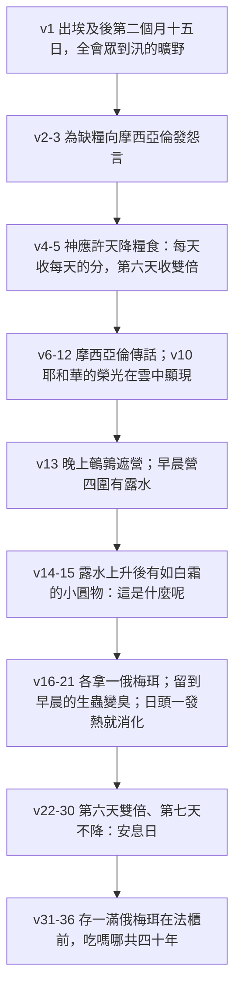

# 出埃及記 第16章

<!-- chapter-navigation:start -->
| [前一章](../02%20出埃及記/第15章.md) | [回目錄](../02%20出埃及記/全書目錄及綱要.md) | [下一章](../02%20出埃及記/第17章.md) |
| :--- | :---: | ---: |
<!-- chapter-navigation:end -->

1. [[以色列]]全會眾從[[以琳]]起行，在出[[埃及]]後第二個月十五日到了以琳和[[西乃]]中間、[[汛的曠野]]。
2. [[以色列]]全會眾在曠野向[[摩西]]、[[亞倫]][[以色列人的怨言|發怨言]]，
3. 說：巴不得我們早死在[[埃及]]地、[[耶和華]]的手下；那時我們坐在肉鍋旁邊，吃得飽足。你們將我們領出來，到這曠野，是要叫這全會眾都餓死啊！
4. [[耶和華]]對[[摩西]]說：我要將[[嗎哪|糧食從天降給你們]]。百姓可以出去，每天收每天的分，我[[神的試驗|好試驗他們遵不遵我的法度]]。
5. 到第六天，他們要把所收進來的預備好了，比每天所收的多一倍。
6. [[摩西]]、[[亞倫]]對[[以色列]]眾人說：到了晚上，你們要知道是[[耶和華]]將你們從[[埃及]]地領出來的。
7. 早晨，你們要看見[[耶和華的榮光|耶和華的榮耀]]，因為耶和華聽見你們向他所發的怨言了。我們算什麼，你們竟向我們發怨言呢？
8. [[摩西]]又說：[[耶和華]]晚上必給你們肉吃，早晨必給你們食物得飽；因為你們向耶和華發的怨言，他都聽見了。我們算什麼，[[以色列人的怨言|你們的怨言不是向我們發的，乃是向耶和華發的]]。
9. [[摩西]]對[[亞倫]]說：你告訴[[以色列]]全會眾說：你們就近[[耶和華]]面前，因為他已經聽見你們的怨言了。
10. [[亞倫]]正對[[以色列]]全會眾說話的時候，他們向曠野觀看，不料，[[耶和華的榮光|耶和華的榮光在雲中顯現]]。
11. [[耶和華]]曉諭[[摩西]]說：
12. 我已經聽見[[以色列人的怨言]]。你告訴他們說：到黃昏的時候，你們要吃肉，早晨必有食物得飽，你們就知道我是[[耶和華]]─你們的神。
13. 到了晚上，有[[鵪鶉遮營|鵪鶉飛來，遮滿了營]]；[[鵪鶉遷徙|早晨在營四圍的地上有露水]]。
14. 露水上升之後，不料，野地面上有如白霜的[[嗎哪的物理特性|小圓物]]。
15. [[以色列|以色列人]]看見，不知道是什麼，就彼此對問說：這是什麼呢？[[摩西]]對他們說：[[天降嗎哪|這就是耶和華給你們吃的食物]]。
16. [[耶和華]]所吩咐的是這樣：你們要按著各人的飯量，為帳棚裡的人，按著人數收起來，各拿一[[俄梅珥]]。
17. [[以色列|以色列人]]就這樣行；有多收的，有少收的。
18. 及至用[[俄梅珥]]量一量，[[林後8：13-15 多收的沒有餘少收的沒有缺|多收的也沒有餘，少收的也沒有缺]]；各人按著自己的飯量收取。
19. [[摩西]]對他們說：[[神的供應|所收的，不許什麼人留到早晨]]。
20. 然而他們不聽[[摩西]]的話，內中有留到早晨的，就生蟲變臭了；摩西便向他們發怒。
21. 他們每日早晨，按著各人的飯量收取，[[神的供應|日頭一發熱，就消化了]]。
22. 到第六天，[[安息日收取規定|他們收了雙倍的食物]]，每人兩[[俄梅珥]]。會眾的官長來告訴[[摩西]]；
23. [[摩西]]對他們說：[[耶和華]]這樣說：[[安息日的設立|明天是聖安息日]]，是向耶和華守的聖安息日。你們要烤的就烤了，要煮的就煮了，所剩下的都留到早晨。
24. 他們就照[[摩西]]的吩咐留到早晨，[[安息日收取規定|也不臭，裡頭也沒有蟲子]]。
25. [[摩西]]說：你們今天吃這個吧！因為今天是向[[耶和華]]守的[[安息日]]；你們在田野必找不著了。
26. 六天可以收取，第七天乃是[[安息日]]，那一天必沒有了。
27. 第七天，百姓中有人出去收，什麼也找不著。
28. [[耶和華]]對[[摩西]]說：你們不肯守我的誡命和律法，要到幾時呢？
29. 你們看！[[耶和華]]既將[[安息日]]賜給你們，所以第六天他賜給你們兩天的食物，第七天各人要住在自己的地方，不許什麼人出去。
30. 於是百姓第七天[[安息日收取規定|安息]]了。
31. 這食物，[[以色列]]家叫[[嗎哪]]；[[嗎哪的物理特性|樣子像芫荽子，顏色是白的，滋味如同攙蜜的薄餅]]。
32. [[摩西]]說：[[耶和華]]所吩咐的是這樣：要將一滿[[俄梅珥]]（俄梅珥就是伊法十分之一）[[嗎哪]]留到世世代代，使後人可以看見我當日將你們領出[[埃及]]地，在曠野所給你們吃的食物。
33. [[摩西]]對[[亞倫]]說：[[保存一俄梅珥嗎哪|你拿一個罐子，盛一滿俄梅珥嗎哪]]，存在[[耶和華]]面前，要留到世世代代。
34. [[耶和華]]怎麼吩咐[[摩西]]，[[亞倫]]就怎麼行，把[[嗎哪]][[保存一俄梅珥嗎哪|放在法櫃前存留]]。
35. [[以色列|以色列人]]吃[[嗎哪]]共四十年，直到進了有人居住之地，就是[[迦南]]的境界。
36. （[[俄梅珥]]就是伊法十分之一。）

---

## 本章知識節點

### 主題
- [[嗎哪]]
- [[神的供應]]
- [[聽命順從蒙醫治]]

### 神學
- [[嗎哪預表基督]]
- [[安息日的設立]]
- [[安息日]]
- [[耶和華的榮光]]
- [[神的試驗]]

### 原文
- [[俄梅珥]]

### 地點
- [[汛的曠野]]
- [[西乃]]
- [[以琳]]
- [[迦南]]
- [[埃及]]

### 人物
- [[摩西]]
- [[亞倫]]
- [[耶和華]]
- [[以色列]]

### 事件
- [[天降嗎哪]]
- [[鵪鶉遮營]]
- [[安息日收取規定]]
- [[保存一俄梅珥嗎哪]]

### 歷史
- [[以色列人的怨言]]

### 背景
- [[鵪鶉遷徙]]
- [[嗎哪的物理特性]]

### 解經爭議
- [[嗎哪是不是自然產物]]

### 互文
- [[約6：31-35 耶穌是生命的糧]]
- [[約6：51 我是從天上降下來的活糧]]
- [[林後8：13-15 多收的沒有餘少收的沒有缺]]
- [[啟2：17 隱藏的嗎哪]]
- [[來9：4 盛嗎哪的金罐]]
- [[詩78：24-25 天上的糧食]]
- [[申8：3 人活著不是單靠食物]]
- [[腓2：14 不發怨言]]

---

## 本章整理

上一章停在有十二股水泉的以琳。這一章以色列人從以琳起行，到了汛的曠野，缺了糧食就向摩西、亞倫發怨言。耶和華應許從天降糧食：晚上有鵪鶉，早晨有嗎哪，每天收當天的分，第六天收雙倍，好守安息日。

### 一、離開以琳，走進真正的曠野（v1）

以色列全會眾從以琳起行，在出埃及後第二個月十五日，到了以琳和西乃中間的汛的曠野（1節）。以琳有水有綠蔭，仍不能久留，必須往前行（CT、KC）。KC 把它放在整段旅程裡看：經過救贖、詩歌、瑪拉的試煉和以琳的安歇之後，真正的曠野生活從這裡才開始。

「[[以色列|以色列全會眾]]」這個詞在這裡第一次出現，是五經中首次使用（《中文聖經註釋》、CT）。CT 還讀出它的用意：出埃及最主要的目的是事奉神，因此他們必須聚集在一起，「『全會眾』同工配搭，才能達成這個目的，而這個『全會眾』也就成了新約時代『教會』的模型」。

BH 說，「會眾」在原文帶有「a gathered assembly」（聚集的會眾）之意，強調他們是神所揀選之民的群體身分。

日子算得很清楚：出埃及後第二個月十五日，正好離開埃及一個月（CT、《丁道爾聖經註釋》、《串珠聖經註釋》）。

《中文聖經註釋》指出，這個日期不單在記年月日，也在表明從正月十四日吃逾越節羊羔、翌日離開埃及算起，「至今已有一個月了。他們所帶的食物早就用光了」；KC 算成一個半月，推測從埃及帶出來的存糧有可能已經吃盡。

[[汛的曠野]]在哪裡，來源並不一致：《啟導本聖經腳註》說在西奈半島西南、今德伯特蘭勒（Debbeter-Ramleh）區，《串珠》卻說在西乃半島東北部。

「汛」的原文字義是「刺，黏土」，這是「一片長滿荊棘的曠野，難於找到食物」（CT）。

這個名字容易和別的名字混淆：汛和[[西乃]]兩個名字「在語言學上可能有關係，但本段清楚顯示並非同一處地方」（《丁道爾》）；它也不是尋的曠野，《中文聖經註釋》提醒：「汛的曠野（Wilderness of Sin）和尋的曠野（Wilderness of Zin），並不是同一個地區」。BH 另註明 Sin 與英文表示過犯的那個字無關，很可能出自一個閃族語字根。

### 二、第二次[[以色列人的怨言|怨言]]（v2-3）

以色列全會眾在曠野向摩西、亞倫發怨言，說：巴不得我們早死在埃及地、耶和華的手下；那時我們坐在肉鍋旁邊，吃得飽足（2-3節）。這是第二次怨言：第一次（14:11-12）是因敵人臨近、面對死亡的威脅，而且「僅可能是百姓中的一些原為埃及人做工，作以色列人之領班的」；這一次卻是為肚腹，是以色列的全會眾，「埋怨到神了」（《中文聖經註釋》）。

「巴不得我們早死在埃及地」並不表示說話的人真想死，是在埋怨現在活著似乎比死了還不如（《中文聖經註釋》）。

他們把在埃及的日子美化了（《丁道爾》、《舊約聖經背景註釋》）。《中文聖經註釋》稱「坐在肉鍋旁邊，吃得飽足」是「在忍饑捱餓中的人，幻想過往生活的誇大話」；《丁道爾》也說這是人性，他們「忘了在埃及是奴隸，反將其優點理想化」，而「奴隸沒有多少肉吃，印象中的卻是巨形的肉鍋」。

KC 說，神的百姓這樣愚昧，作者自己也一樣愚昧：一遇逆境就忘了救恩，忘了在瑪拉與以琳的經歷，反倒眷戀世界過去的享樂。

他們其實並未到餓死的地步（《串珠》、丁良才）。丁良才《出埃及記註釋》指出，原因是「他們還有許多的牲畜」（17:3），甚至過了幾個月，在西奈山，全百姓沒有一家不能吃逾越節的羊羔（民9:1-5）。

最後那句「是要叫這全會眾都餓死啊」，已經把埋怨變成指控。《中文聖經註釋》說這「不單是埋怨，而是指責了」，而且是「指責他們有預謀陷害的嫌疑」；KC、CT、《丁道爾》也都讀成百姓指控摩西、亞倫故意把他們帶來餓死。

摩西的回答把責任歸屬講清楚：「[[耶和華|你們的怨言不是向我們發的，乃是向耶和華發的]]」（8節）。「帶領以色列人出埃及的不是他們……以色列人找錯對象了」（CT）；摩西亞倫也把焦點從自己移開，承認他們只是神的僕人（BH）。

### 三、[[天降嗎哪|從天降下的糧食]]與[[神的試驗|試驗]]（v4-12）

耶和華的回應是供應：我要將糧食從天降給你們；百姓可以出去，每天收每天的分，我好試驗他們遵不遵我的法度（4節）。祂沒有因為怨言刑罰百姓，與在瑪拉一樣，在恩典裡迎向他們（KC）。

這裡的「試驗」，STEP 標示原文是 אֲנַסֶּנּוּ，來自動詞 נָסָה（H5254），字典的意思是「to test」（試驗）。下一章摩西責問百姓「為什麼試探耶和華呢」（17:2），用的是同一個動詞：這一章是神試驗百姓，到下一章卻成了百姓試探神。

這個試驗要看百姓肯不肯天天倚靠神的供應（《串珠》、《丁道爾》）。丁良才把試驗拆成兩層：看他們肯不肯靠神（因為神一天只給他們夠一天所用的），也看他們肯不肯遵神的法度。CT 說，『每天收每天的分』的意思是「信靠神並不是一勞永逸的事，乃是一天過一天的信靠」，而順服神的誡命也要一次過一次，條條都要遵行。

《丁道爾》另提一個接續：神每日供應以色列的需要，可能是主禱文中『日用的飲食』之懇求的出處（太6:11）。

「糧食」一詞的範圍有分歧。《串珠》說原文廣義可指任何食物（包括肉），狹義則單指麵包，「從下文來看，這狹義的解釋較為適合」；《中文聖經註釋》同讀，並說這神蹟「不單不指普通的糧食，連鵪鶉也不包括在內，乃獨指嗎哪」。《丁道爾》卻主張若照古義譯作「糧食」，「鵪鶉和嗎哪便都可以包括在這應許之內」。

摩西、亞倫對百姓說：到了晚上，你們要知道是耶和華將你們從埃及地領出來的；早晨，你們要看見耶和華的榮耀（6-7節）。耶和華的作為是要提醒百姓，領他們出埃及的是祂，這是他們已經忘記的（KC）。

亞倫正對全會眾說話的時候，他們向曠野觀看，不料，[[耶和華的榮光]]在雲中顯現（10節）。這是祂第一次向全會眾顯現，目的是讓他們因祂是誰而心生敬畏，沒有要滅絕他們（KC）。

那榮光是什麼樣子？CT 描述為「雲中出現神榮耀的光輝，耀眼刺目」；《丁道爾》認為這裡「可能不過是指雲柱」。《舊約聖經背景註釋》給了一條文化平行：「不是只有以色列的神學，才有神明以這種方式顯現的概念，美索不達米亞的神祇也是用其神性光輝梅嵐穆，來彰顯他們的能力。」

### 四、[[鵪鶉遮營|鵪鶉]]與[[嗎哪]]（v13-15）

到了晚上，有鵪鶉飛來，遮滿了營；早晨在營四圍的地上有露水（13節）。[[鵪鶉遷徙|鵪鶉]]為什麼會來，各家給的是同一套自然史：鵪鶉是候鳥，遷徙時途經西乃半島，長途飛行後疲累低飛，極易捕捉（《中文聖經註釋》、《丁道爾》、《舊約背景註釋》、《啟導本》）。

《中文聖經註釋》說，秋季鵪鶉由歐洲飛越地中海到西乃半島短停，春天再北飛，長飛之後十分疲累，「只離地面約三尺的大批集中飛行，極易為人捕捉」。牠們疲倦時「連遊牧民族的黑色矮帳都不能越過，落地之後亦無法再度起飛」（《丁道爾》）；落地時密到得降在其他鵪鶉身上，覓地棲息的鵪鶉曾有壓沉小舟的記錄（《舊約背景註釋》）。

按詩篇78:27-28 的誦述，鵪鶉也像嗎哪一樣從天而降；鵪鶉只出現在這一晚，本章接下去到結尾都只有嗎哪，「這是顯明嗎哪為每天都有，鵪鶉卻不是」（《中文聖經註釋》）。

露水上升之後，野地面上有如白霜的小圓物；以色列人看見，不知道是什麼，就彼此對問：這是什麼呢？摩西對他們說：這就是耶和華給你們吃的食物（14-15節）。「這是什麼呢」成了這食物的名字（CT、《中文聖經註釋》、《丁道爾》、《聖經精讀本──出埃及記註解》）。

第15節百姓問「這是什麼呢」，STEP 把原文 מָן（H4478）在這裡標為疑問詞「what?」（什麼）；到了第31節，同一個字標成食物的名稱「manna」（嗎哪）。

至於名字的語源，《中文聖經註釋》說，「嗎哪」的音譯來自七十士譯本，背後根據的是譯者時代亞蘭文的『這是甚麼』；《丁道爾》把它歸為通俗語源的解法，並拿『摩西』一名的諧音解釋相比。

[[嗎哪的物理特性|嗎哪長什麼樣]]，經文說是「有如白霜的小圓物」。原文 דַּק מְחֻסְפָּס（H1851、H2636），STEP 這一節分別譯作「thin [stuff]」（細薄的東西）和「flake-like」（鱗片狀的）。CT 的原文字義作「白霜」是白色的霜，「小圓物」是鱗狀的東西。

《丁道爾》指出後一個字有兩種解法：早期猶太解經家作「小丸」，早期譯本及《盎克羅之他爾根》作「鱗片」，「由於這個希伯來字沒有再出現於他處，要確定其意義是不可能的」。

「芫荽子」這個對譯也有疑問：「芫荽在沙漠極少出現，這字較有可能是泛指有白色種籽的沙漠植物」（《舊約背景註釋》）。

[[嗎哪是不是自然產物|它是不是當地的天然產物]]，是本章最大的爭論：

| 立場 | 代表 | 要點 |
| --- | --- | --- |
| 反對自然解釋 | CT〔問題改正〕、丁良才、《啟導本》、李道生 | 丁良才列六點差異（產地、產量、安息日照產、藥料非糧食、季節、進迦南即止）；《啟導本》另列四點（久儲與產量、名稱「這是甚麼」、不受地區限制、存放法櫃前） |
| 主張自然解釋 | 《丁道爾》 | 「幾乎可以確證嗎哪就是阿拉伯人稱為『曼』（man）的物質」——兩種介殼蟲在檉柳樹枝間的分泌，出產最多的是六月 |
| 自然解釋但自陳難處 | 《舊約背景註釋》 | 蚜蟲說；但「全季節的產量也不過是五百磅左右，相對而言，聖經記載每人每日的收集量是半磅」，結論是「基於自然現象的解釋似乎全都遠不及聖經的描寫」 |
| 兩說並存、歸於神能 | 《中文聖經註釋》 | 縱令這嗎哪是當地的正常產物，要一時產量如此之大，能供飽如許多人，並如許長的時間，亦非有神的大能作為是不可能成就的 |

### 五、[[俄梅珥]]與收取的規矩（v16-21）

耶和華吩咐的是這樣：按著各人的飯量，為帳棚裡的人，按著人數收起來，各拿一俄梅珥（16節）。以色列人就這樣行，有多收的，有少收的；用俄梅珥量一量，「多收的也沒有餘，少收的也沒有缺」（17-18節）。

這是不是神蹟，有兩種讀法。《丁道爾》給了一個不同的解釋：「本節描述的可能不是神蹟，他們不過是一致同意每人一俄梅珥，將收集起來的嗎哪集中分配而已。保羅在哥林多後書八章14、15節顯然是這樣解釋。」丁良才、《中文聖經註釋》、CT 則都稱這是神蹟。

保羅正是引這一句勸信徒[[林後8：13-15 多收的沒有餘少收的沒有缺|彼此均平]]（KC、《啟導本》、《精讀本》）。

摩西說，所收的不許什麼人留到早晨（19節）。《中文聖經註釋》給了一個生活層面的理由：「在曠野酷熱的天氣之下，食物留到第二天的，多數會變味腐壞，以致使食用的人產生疾病。」更根本的目的是教百姓完全依靠神，不要為明天憂慮（丁良才、CT、《精讀本》）。

沒有一份能留到明天，所以要信靠耶和華明天仍會供應：==放在神的食櫃裡，比放在以色列人的帳棚裡更安全==。這也是讀經的功課：不能靠昨天所讀的活著，否則吃的是舊糧，那只會餵養驕傲，而驕傲是發臭的（KC）。

然而有人不聽摩西的話，留到早晨的就生蟲變臭了，摩西便向他們發怒（20節）。食物在第二天變臭是較常有的，「忽然在第二天生蟲了，卻是罕見的」，所以這被看作警戒不信或故意不聽的人的神蹟（《中文聖經註釋》）。

### 六、[[安息日的設立|安息日]]第一次出現（v22-30）

到第六天，他們收了雙倍的食物，每人兩俄梅珥；會眾的官長來告訴摩西（22節）。摩西說：明天是聖安息日，要烤的就烤了，要煮的就煮了，所剩下的都留到早晨（23節）。

「這是聖經中第一次正式提到安息日，也是以色列人最早守安息日的記載。」（《啟導本》）《丁道爾》也說，雖然創2:2-3 已有設立的觀念，「安息日一詞在聖經中出現，這卻是第一次」。

第23節除了 שַׁבָּת「安息日」之外，還用了 שַׁבָּתוֹן（H7677），STEP 這一節譯作「a sabbath observance」（安息日的遵守）。《丁道爾》說，本節在常用的『安息日』一詞以外，又加了一個更有力的字眼；和合本把『聖安息日』一句話重複作為強調，利25:4、5 等經文把這字譯作『聖安息』。

這時還沒有傳律法。丁良才從5節推論，這顯明在傳律法以先，以色列人已經知道安息日的理；KC 補上一個時序上的分別：在律法頒布之前，安息是特權而不是義務，只有到了西乃，律法賜下的時候，它才成為義務。

第六天的雙倍食物，CT 讀成神的體貼：「安息日是為人設立的（可二27），神既願意讓人身心休息，就多方體貼、憐憫人，于前一日為人預備好糧食，既可休息又不必挨餓。」

留到安息日早晨的嗎哪不臭，裡頭也沒有蟲子（24節）；第七天出去收的人，什麼也找不著（27節）。這兩件事都被看作神蹟（CT、《中文聖經註釋》）。CT 點出一個對稱：降嗎哪是神蹟，「唯獨在安息日，偏偏不降嗎哪也是神蹟」。

耶和華對摩西說：你們不肯守我的誡命和律法，要到幾時呢？（28節）少數人的悖逆，竟連累整個民族被神責備（CT）。CT 並說「只在一條誡命上沒有遵守，就被視為不遵守全部的律法」。《中文聖經註釋》則讀出這句話把守安息日的律例「提前到在西乃山頒布律法以前就必須遵守，且不單指安息日，甚至包含了其他的誡命和律法了」。

### 七、[[保存一俄梅珥嗎哪|存在法櫃前的那一罐]]（v31-36）

這食物，以色列家叫嗎哪；樣子像芫荽子，顏色是白的，滋味如同攙蜜的薄餅（31節）。

[[嗎哪預表基督|它預表什麼]]？白色預表聖潔，圓形預表無始無終，微小預表謙卑（丁良才、KC）。丁良才在這裡列了十一條——真神所賜、自天降下、十分奧妙、微小之物、圓如芫荽、白如珍珠、甘甜可口、每日早取、各人宜食、直到迦南、有人藐視——每一條都附上新約的對應經文。

KC 另分來源、賜予者、外形、用途四組來列：來自天上，是神所賜；外形白、小、圓；用途上味道甘甜、是白白的恩賜、人人都能取得，因為它就在地上。

百姓是先在晚上得鵪鶉、次日早晨才得嗎哪。KC 補了一層次序：鵪鶉是我們以另一位的死來餵養自己的圖畫，[[約6：51 我是從天上降下來的活糧|而嗎哪代表基督在地上降卑的一生]]。

摩西對亞倫說：你拿一個罐子，盛一滿俄梅珥嗎哪，存在耶和華面前，要留到世世代代；亞倫就把嗎哪放在法櫃前存留（33-34節）。那一罐放在哪裡，CT 給了一個很小心的說明：「最初是放在約櫃的前面……何時改放在約櫃的裡面，聖經並無明文記載」。

有解經家認為，原文並無『櫃』字，只有『法』字，這個字常指法版，因此推論嗎哪是放在櫃裡的法版前（CT、丁良才）。《舊約背景註釋》則說，第34節的「見證」只可能是指當時仍未製造的約櫃，「可見嗎哪的樣本是在曠野歷程較後的時期，才放到約櫃之中的」。

這罐後來失傳，推測是在士師時代約櫃被非利士人擄去時（CT、《中文聖經註釋》、丁良才；參[[來9：4 盛嗎哪的金罐|來9:4]]；王上8:9 記所羅門時代櫃內只剩兩塊石版）。在曠野連一天都留不住的嗎哪，卻被存留到永遠（KC）。

「共四十年」是概數，實際是三十九年零十一個月（丁良才、李道生）。《精讀本》算得更細：第一次吃嗎哪是出埃及第二個月十五日，停止是四十一年一月十六日。

吃嗎哪四十年，意思是嗎哪四十年沒有斷過，他們還有牛群羊群，有肉有奶（丁良才）；CT 說嗎哪是取代麵包的主食，副食仍有鵪鶉肉與牛羊肉。

四十是試驗的數字，在這整段試驗的年日裡，嗎哪是神看顧不間斷的憑據，問題只在我們每天還看不看得見（KC）。

### 從汛的曠野到法櫃前（全章）

本章從缺糧的怨言走到一罐存在法櫃前的嗎哪。出埃及後第二個月十五日，全會眾在汛的曠野向摩西、亞倫發怨言（1-3節）；耶和華應許從天降糧食，晚上有鵪鶉，早晨有嗎哪（4-15節）。

收取的規矩把供應和信靠連在一起：每人按飯量收一俄梅珥，不許留到早晨，第六天收雙倍，安息日在這裡第一次被正式提到（16-30節）。CT 為本章訂的標題是【天降嗎哪】。

章末，摩西吩咐亞倫把一滿俄梅珥嗎哪存在耶和華面前，留到世世代代；以色列人吃嗎哪共四十年，直到進了迦南的境界（31-36節）。下一章，百姓在利非訂因沒有水喝與摩西爭鬧，摩西責問他們為什麼試探耶和華（17:1-2）。

**參考資料**
代號：CT＝ccbiblestudy《逐節註解》；GT＝ccbiblestudy《拾穗》，彙集多本中文註釋；正文直接寫書名或作者的（如《丁道爾》、丁良才），都出自這裡；KC＝KingComments；BH＝BibleHub Study；STEP＝STEP Bible 原文資料（CC BY 4.0）
https://www.ccbiblestudy.org/Old%20Testament/02Exo/02CT16.htm
https://www.ccbiblestudy.org/Old%20Testament/02Exo/02GT16.htm
https://www.kingcomments.com/en/bible-studies/Exo/16
https://biblehub.com/study/exodus/16.htm
https://github.com/STEPBible/STEPBible-Data

<!-- appendix-links:start -->
## 附錄

### 相關地圖
- [[appendix/fhl_maps/maps/019|〈出圖二〉以色列人出埃及到西乃山]]
- [[appendix/fhl_maps/maps/024|〈民圖五〉出埃及和進迦南的旅程]]
<!-- appendix-links:end -->

<!-- chapter-navigation:start -->
| [前一章](../02%20出埃及記/第15章.md) | [回目錄](../02%20出埃及記/全書目錄及綱要.md) | [下一章](../02%20出埃及記/第17章.md) |
| :--- | :---: | ---: |
<!-- chapter-navigation:end -->
