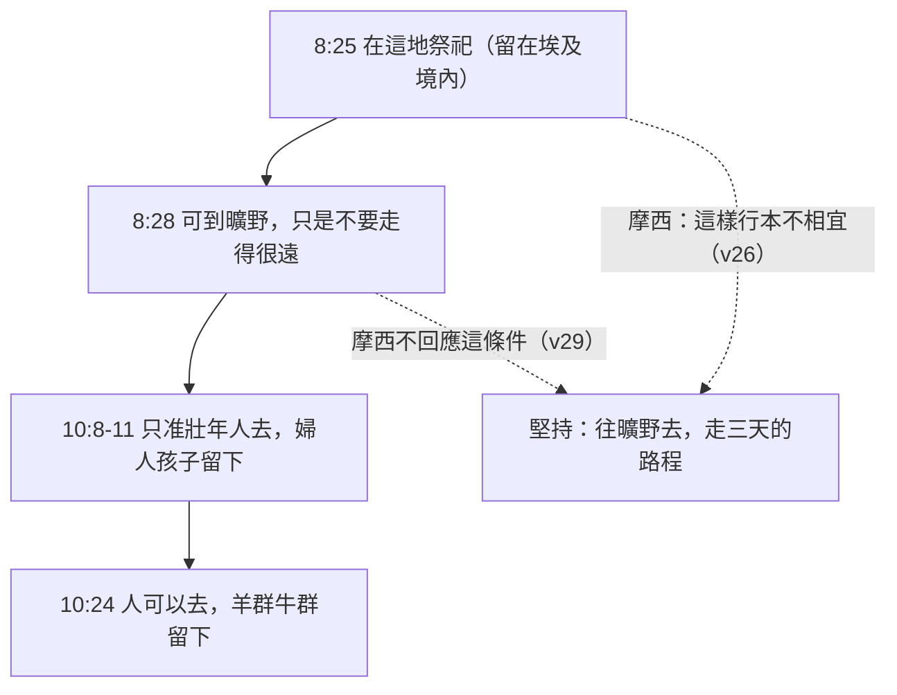

# 出埃及記 第8章

<!-- chapter-navigation:start -->
| [前一章](../02%20出埃及記/第7章.md) | [回目錄](../02%20出埃及記/全書目錄及綱要.md) | [下一章](../02%20出埃及記/第9章.md) |
| :--- | :---: | ---: |
<!-- chapter-navigation:end -->

1. [[耶和華的話臨到|耶和華]]吩咐[[摩西]]說：你進去見[[法老]]，對他說：耶和華這樣說：[[容我的百姓去]]，好[[在曠野事奉神|事奉我]]。
2. 你若不肯容他們去，我必使[[蛙災|青蛙蹧蹋你的四境]]。
3. [[尼羅河|河裡]]要滋生[[蛙災|青蛙]]；這青蛙要上來進你的宮殿和你的臥房，上你的床榻，進你臣僕的房屋，上你百姓的身上，進你的爐灶和你的[[爐灶和摶麵盆|摶麵盆]]，
4. 又要上你和你百姓並你眾臣僕的身上。
5. [[耶和華的話臨到|耶和華]]曉諭[[摩西]]說：你對[[亞倫]]說：把你的杖伸在江、[[尼羅河|河]]、池以上，使[[蛙災|青蛙到埃及地上來]]。
6. [[亞倫]]便伸杖在[[埃及]]的諸水以上，青蛙就上來，遮滿了埃及地。
7. [[埃及行法術的|行法術的]]也用他們的邪術照樣而行，叫青蛙上了[[埃及]]地。
8. [[法老]]召了[[摩西]]、[[亞倫]]來，說：請你們[[代求|求耶和華]]使這青蛙離開我和我的民，我就[[容我的百姓去|容百姓去祭祀耶和華]]。
9. [[摩西]]對[[法老]]說：[[任憑你吧]]，我要何時為你和你的臣僕並你的百姓[[代求|祈求]]，除滅青蛙離開你和你的宮殿只留在[[尼羅河|河裡]]呢？
10. 他說：明天。[[摩西]]說：可以照你的話吧，好叫你知道沒有像[[耶和華聖名的啟示|耶和華─我們神的]]。
11. [[蛙災|青蛙]]要離開你和你的宮殿，並你的臣僕與你的百姓，只留在[[尼羅河|河裡]]。
12. 於是[[摩西]]、[[亞倫]]離開[[法老]]出去。摩西為擾害法老的青蛙[[代求|呼求耶和華]]。
13. [[耶和華的話臨到|耶和華]]就照[[摩西]]的話行。凡在房裡、院中、田間的青蛙都死了。
14. 眾人把青蛙聚攏成堆，遍地就都腥臭。
15. 但[[法老]]見災禍鬆緩，就[[法老心剛硬|硬著心]]，不肯聽他們，正如[[耶和華的話臨到|耶和華]]所說的。
16. [[耶和華的話臨到|耶和華]]吩咐[[摩西]]說：你對[[亞倫]]說：伸出你的杖擊打地上的塵土，使塵土在[[埃及]]遍地變作[[蝨災|虱子]]（或譯：虼蚤；下同）。
17. 他們就這樣行。[[亞倫]]伸杖擊打地上的塵土，就在人身上和牲畜身上有了[[蝨災|虱子]]；[[埃及]]遍地的塵土都變成虱子了。
18. [[埃及行法術的|行法術的]]也用邪術要生出[[蝨災|虱子]]來，卻是不能。於是在人身上和牲畜身上都有了虱子。
19. [[埃及行法術的|行法術的]]就對[[法老]]說：這是[[神的手段]]。[[法老心剛硬|法老心裡剛硬]]，不肯聽[[摩西]]、[[亞倫]]，正如[[耶和華的話臨到|耶和華]]所說的。
20. [[耶和華的話臨到|耶和華]]對[[摩西]]說：你清早起來，[[法老]]來到[[尼羅河|水邊]]，你站在他面前，對他說：耶和華這樣說：[[容我的百姓去]]，好[[在曠野事奉神|事奉我]]。
21. 你若不容我的百姓去，我要叫[[蠅災|成群的蒼蠅]]到你和你臣僕並你百姓的身上，進你的房屋，並且[[埃及]]人的房屋和他們所住的地都要滿了成群的蒼蠅。
22. 當那日，我必[[分別百姓|分別]]我百姓所住的[[歌珊地]]，使那裡沒有[[蠅災|成群的蒼蠅]]，好叫你知道我是[[知道我是耶和華|天下的耶和華]]。
23. 我要將我的百姓和你的百姓[[分別百姓|分別出來]]。明天必有這神蹟。
24. [[耶和華的話臨到|耶和華]]就這樣行。蒼蠅成了[[蠅災|大群]]，進入[[法老]]的宮殿，和他臣僕的房屋；[[埃及]]遍地就因這[[蠅災|成群的蒼蠅]]敗壞了。
25. [[法老]]召了[[摩西]]、[[亞倫]]來，說：你們去，在[[法老四次妥協|這地祭祀你們的神]]吧！
26. [[摩西]]說：這樣行本不相宜，因為我們要把[[埃及人所厭惡的]]祭祀[[耶和華的話臨到|耶和華]]─我們的神；若把埃及人所厭惡的在他們眼前獻為祭，他們豈不拿石頭打死我們嗎？
27. 我們要往[[曠野]]去，走[[三天的路程]]，照著[[耶和華的話臨到|耶和華]]─我們神所要吩咐我們的祭祀他。
28. [[法老]]說：我容你們去，在[[法老四次妥協|曠野祭祀耶和華─你們的神；只是不要走得很遠]]。求你們為我[[代求|祈禱]]。
29. [[摩西]]說：我要出去[[代求|求耶和華]]，使[[蠅災|成群的蒼蠅]]明天離開[[法老]]和法老的臣僕並法老的百姓；法老卻不可再行[[詭詐]]，不容百姓去[[耶和華的話臨到|祭祀耶和華]]。
30. 於是[[摩西]]離開[[法老]]去[[代求|求耶和華]]。
31. [[耶和華的話臨到|耶和華]]就照[[摩西]]的話行，叫[[蠅災|成群的蒼蠅]]離開[[法老]]和他的臣僕並他的百姓，一個也沒有留下。
32. 這一次[[法老]]又[[法老心剛硬|硬著心]]，不容百姓去。

---

## 本章知識節點

### 神學
- [[容我的百姓去]]
- [[在曠野事奉神]]
- [[知道我是耶和華]]
- [[法老心剛硬]]
- [[分別百姓]]
- [[神的手段]]
- [[埃及人所厭惡的]]
- [[任憑你吧]]
- [[代求]]
- [[三天的路程]]

### 歷史
- [[蛙災]]
- [[蝨災]]
- [[蠅災]]
- [[法老四次妥協]]

### 原文
- [[成群]]

### 文化
- [[青蛙為埃及聖物]]
- [[埃及人厭惡的祭牲]]
- [[埃及行法術的]]

---

## 本章整理

本章一口氣記了三災：蛙災、蝨災、蠅災（第1-32節）。行法術的在第二災還能照樣而行，到第三災就做不到了，只能對法老說「這是神的手段」（19節）；從第四災起，神把以色列人所住的歌珊地分別出來（第22-23節）；法老則從求摩西代求、災禍一鬆緩就反悔，走到開條件和摩西討價還價（第8、15、25-28節）。第9章接著是畜疫、瘡災與雹災。

### 經文大綱

1. **第二災：蛙災**（1-15節）
2. **第三災：蝨災**（16-19節）
3. **第四災：蠅災**（20-32節）

### 一、蛙災（1-15節）

耶和華差摩西去見法老：「[[容我的百姓去]]，好[[在曠野事奉神|事奉我]]」（1節）。法老若不肯，「我必使青蛙蹧蹋你的四境」（2節）：青蛙要從河裡上來，進宮殿、臥房、床榻，連「你的[[爐灶和摶麵盆|爐灶和你的摶麵盆]]」（3節）也不放過。亞倫伸杖，「青蛙就上來，遮滿了埃及地」（6節）。

#### 青蛙不咬人，為什麼算是災？

在全部十災中，蛙災可能是最不恐怖的：青蛙不會咬人，也不使人懼怕，但是蛙災卻是使人最討厭的——滿目所見的都是跳來跳去的青蛙，滿耳所聽的盡是咯咯的蛙叫，滿鼻所聞的又是噁心的青蛙腥臭；加上青蛙也需要飲食、也會排泄，所以青蛙的確會糟蹋四境（《中文聖經註釋》）。

《中文聖經註釋》也指出，『蹧蹋』這個字在舊約聖經中，施行動作的惟獨是神，絕未用於他神的行動；可見這災的嚴重性。

> [!original]- 「蹧蹋」與第1-2節的原文
> 『蹧蹋』的原文是 נָגַף（*na.gaph*，H5062），可繙成「擊打」（賽19:22）或「擊殺」（出12:13,23）（《中文聖經註釋》）。
>
> 第1節「容我的百姓去，好事奉我」原文是 שַׁלַּח אֶת־עַמִּי וְיַעַבְדֻנִי（H7971 搭配 H5647）；第2節「我必使青蛙蹧蹋你的四境」（2節）原文是 נֹגֵף אֶת־כָּל־גְּבוּלְךָ בַּצְפַרְדְּעִים（H5062 搭配 H6854）。
>
> 「蛙」可能是個擬聲詞，即「哇哇叫的動物」；舊約提及青蛙的，只有本段和兩首敘述這事的詩篇（《丁道爾》；詩78:45；105:30）。

#### 為什麼偏偏是青蛙？

黃迦勒說：「古代埃及人視青蛙為神聖動物，認為牠標誌那掌管生育的女神，她具有創造生命的能力。」

《啟導本》說：「埃及人奉青蛙為神，賜子女神赫克蒂便是蛙的化身。」

丁良才說青蛙是掌管生育女神的標號：「因此埃及人不敢殺害青蛙。」KingComments 也說，青蛙被埃及人視為聖物、受尊敬，因此不可被殺；如今這些偶像，在神審判的手下成了一場災。

宮殿、臥房、摶麵盆，這些是埃及人看作最清潔的地方，如今被他們自己視為聖物的青蛙弄髒了（《精讀本》）。古時候好潔淨的人中當推埃及人為首，所以這災叫他們十分厭惡（丁良才）。

《舊約背景註釋》說：「水中和河邊填滿腐魚，很自然就把青蛙趕到岸上。」（承接第一災）又說：「但卻難以想像這災怎能夠說成是她被擊敗。」

> [!background]- 埃及的蛙神與埃及人的潔淨
> 《舊約背景註釋》說，女神赫克特（Heqet）是青蛙的形狀，並司助產；《啟導本》稱賜子女神赫克蒂是青蛙的化身，《精讀本》提到蛙頭女神。
>
> 埃及的祭司穿細麻布衣服；按古時的史家所記，他們白日兩次、黑夜兩次，用涼水沐浴全身。百姓也好洗澡，祭司又常謹防各樣污穢（丁良才）。

> [!application]- 摶麵盆裡的青蛙
> KingComments 說：「The frogs come into the kneading bowls, indicating that it is mixed with the food.」（青蛙進到摶麵盆裡，表示牠們已經混進了食物。）

#### 行法術的為什麼也叫青蛙上來？

經文說「[[埃及行法術的|行法術的]]也用他們的邪術照樣而行，叫青蛙上了埃及地」（7節）。這句帶有諷刺：「他們不但沒有除滅災禍，反而使境況更惡化。」（《串珠》）在到處都是青蛙的時候，獨裁者應當要他那行法術的將青蛙消滅或驅除才對；他沒有這樣做，卻叫他們也用邪術照樣而行，使災害更為嚴重了（《中文聖經註釋》）。

這不是說行法術的也能生出青蛙。艾基斯說：「術士引出的青蛙，在數量上遠比摩西的手杖所造成聚攏遍地的青蛙少得多；這些青蛙可能是術士預先預備的，就像魔術師帽子內的青蛙一樣。」

#### 法老第一次求代禱（8-14節）

法老召了摩西、亞倫來：「請你們求耶和華使這青蛙離開我和我的民，我就容百姓去祭祀耶和華」（8節）。丁良才說，法老在這事上顯出三種謙卑的心意：①承認耶和華有權柄，能驅逐青蛙離開他；②承認摩西、亞倫的禱告有能力；③應許讓百姓去。雖是這樣，法老見災鬆了，就又不肯容百姓去（15節）。丁良才說：「人拉弓，弓隨手彎，手松，弓仍復原。」

法老是一個狡猾的談判者：他雖然說『我就容百姓去祭祀耶和華』，但究竟哪些人可以參與祭祀、在哪一處祭祀，他早已保留餘地，不加以說明（《串珠》）。他也沒有說明百姓可以到哪裡去祭祀神，要到兩災後的25節，才將他的真意顯明（《中文聖經註釋》）。

#### 「任憑你吧」是什麼意思？

摩西對法老說「[[任憑你吧]]」（9節），請法老自己定除滅青蛙的時間。《丁道爾》說，這句直譯是「榮耀你自己吧」，可能是對君主的敬稱；《中文聖經註釋》也說，中文的翻譯似乎不甚客氣，原文卻是對王恭謹的說法，直譯應是：『請給我光彩吧！』意即由你指定時間。

這話又清楚顯示災難是神所引來、神所帶走的。『神的時候』的概念再次得以強調——祂要災禍何時離開，災禍就何時離開（《丁道爾》）。

> [!original]- 「任憑你吧」
> 「任憑你吧」原文是 הִתְפָּאֵר עָלַי（H6286）。

法老說「明天」（10節）。拾穗推測，他大概盼望到了次日災難或能自己消去；黃迦勒則說，除去蛙災固然愈快愈好，但法老可能考慮到他所作的承諾（釋放以色列人），所以給出一天的緩衝時間。

摩西應承下來：「可以照你的話吧，好叫你知道沒有像耶和華─我們神的」（10節）。黃迦勒說：「摩西對神的話相當有把握，所以他對法老的回應也相當有自信。」

#### 死青蛙的腥臭

「眾人把青蛙聚攏成堆，遍地就都腥臭」（14節）。《串珠》說，狡猾的法老雖已討得一點便宜，「但他沒有預料到」遍地腥臭。《中文聖經註釋》說，這是素有行政經驗、善於講價的獨裁者所沒有預先想到的：「青蛙的死屍和遍地腥臭」，是他在『講價』時沒有向摩西提及的。

#### 「硬著心」在這裡是什麼意思？

「但法老見災禍鬆緩，就[[法老心剛硬|硬著心]]，不肯聽他們」（15節）。《舊約背景註釋》指出，本節的『硬著心』用的動詞與前面的不同，意思是『使之重』，連到埃及人所共知的一個意象：《亡經》裡稱量死者之心的審判；增加法老之心的重量，就是表示他來生要面臨厄運已是定數。

> [!background]- 《亡經》裡稱心的審判
> 《舊約背景註釋》提供了本章一條重要的背景：「本節所用的動詞與前面的不同（參四20～23，七13），意思是『使之重』，因此與埃及一個人所共知的意象有關。在《亡經》中審判的一幕裡面，死者的心放在天平之上，與一條羽毛（代表司真實和正義的女神瑪阿特〔Ma'at〕）互稱，來決定他要被帶進快樂的來生，還是遭受吞吃。」
>
> 它接著說：「增加法老之心的重量，就是表示他來生要面臨厄運已是定數。它和英語俗諺『在棺材上多加一根釘子』差不多，都有使無可避免的事加速發生的意思。」

> [!original]- 「鬆緩」與「硬著心」
> 「鬆緩」原文是 הָרְוָחָה（H7309）；「硬著心」原文是 וְהַכְבֵּד אֶת־לִבּוֹ，STEP Bible 列出的原文動詞是 כָּבֵד（H3513）。

> [!application]- 患難中許願，平安時忘了
> 黃迦勒的〔話中之光〕說：「正如法老的表現，人們在患難中許願，但得了平安時卻不還願。」
>
> KingComments 說，那些抗拒神清楚說話的人，等到神下一次說話時，就更難被說服了。

### 二、蝨災（16-19節）

這一災沒有預告：耶和華直接吩咐摩西，叫亞倫「伸出你的杖擊打地上的塵土，使塵土在埃及遍地變作虱子」（16節）。法老既是失了信用（15節），神這一次就沒有使摩西警誡他；因此術士也沒有預備的機會（丁良才）。

#### 「虱子」到底是什麼？

譯本與註釋對這是哪一種小蟲說法不一。《中文聖經註釋》說：「各譯本和各學者都頗有不同的意見。」又說：「至於這小昆蟲，我們既無法考證，便仍以蝨子稱之。」

《每日研經叢書》說：「似乎最可能是扁蝨」。

《舊約背景註釋》說：「大部分研究都認為最可能是蚊子和扁蝨。」

《串珠》說：「蚊蟲在埃及極普遍，所以將蝨子當作蚊蟲十分合理。」

> [!background]- 各家對「虱子」的看法
> - 和合本小字：或譯作虼蚤。
> - 七十士譯本、武加大譯本、《耶路撒冷聖經》和猶太哲學家菲羅都譯作蚊蚋；菲羅說：「這是一種細小而極使人厭煩的昆蟲，它不單咬人後使之癢得難受，也會進入人的鼻孔和耳朵，甚至傷害眼睛的瞳孔。」（《中文聖經註釋》）
> - 蚊子與扁蝨：「前者可以在氾濫後留下的大量死水潭中滋生。」（《舊約背景註釋》）
> - 蚊子：「埃及的蚊子特別的小,但是叮咬的程度非常厲害。這小東西追擊人無處躲藏,甚至鑽入人的眼睛或鼻子。」（《精讀本》）

> [!original]- 「塵土」與「虱子」
> 第16節「地上的塵土」原文是 עֲפַר הָאָרֶץ（H6083 搭配 H776）；「虱子」原文是 כִּנִּים（*kinnim*，H3654），STEP Bible 列為 כִנִּם（H3654／H3654B）。

#### 這一災為什麼特別難受？

埃及人好潔，為祭司的要常剃除頭髮和全身的汗毛，穿著細麻衣，因此這蝨子災就越發叫他們難忍（丁良才）。埃及的祭司按規矩每三天要剃頭、沐浴，之後用無瑕疵的動物獻祭；但由於這場災難，所有的動物都變得污穢、有了傷痕，根本不能獻祭，這些人也就無法否認，有一位正在消滅他們宗教的耶和華神（《精讀本》）。

經文說亞倫「擊打地上的塵土」（17節）。黃迦勒說：「注意，人和牲畜都是用地上的塵土造成的(參創二7，19)，一切的活物都是出自塵土。」

> [!application]- 神鬆一鬆托住萬有的手
> 黃迦勒的〔話中之光〕說：地受擊打生出蝨子，一面表明這是出於神的作為，另一面也說出神稍微放鬆一下祂『托住萬有』（來1:3）的權能手，就會產生自然界的變異而造成災害。

#### 術士為什麼做不到？

「行法術的也用邪術要生出虱子來，卻是不能」（18節）。邪術只能用障眼法騙人，卻不能使無生物變成生物，他們的能力僅能到此為止；活物只能『生出』，不能『造出』（黃迦勒）。當生命從死的塵土中被帶出來的時候，撒但的能力就到了盡頭（KingComments）。

於是在人身上和牲畜身上都有了蝨子，行法術的人也不能例外，他們也自身難保了（《中文聖經註釋》）。

#### 「這是神的手段」

行法術的就對法老說：「這是[[神的手段]]」（19節）。黃迦勒說：「『神的手段』原文是神的手指頭；本句意指行法術的承認這不是人手所能作的，唯有神才能作。」

《串珠》說，「神的手段」在原文可作「神的指頭」。《丁道爾》說，這個喻象「在三十一章18節再次出現」，形容神的作為。

丁良才把神權柄的三種標記排出來：

| 標記 | 程度 | 經文 |
|---|---|---|
| **神的指頭** | 微小的權柄 | 出8:19；路11:20 |
| **神的手** | 略大的權柄 | 出3:20 |
| **神的膀臂** | 更大的權柄 | 出15:16 |

KingComments 指出「神的指頭」在聖經裡還有兩處用法：兩塊法版是神用指頭寫的（出31:18；申9:10），顯明祂話語的權柄；「我觀看你指頭所造的天」（詩8:3），顯明祂創造的能力。

術士所指的神，並不是真神，乃是埃及人所信的眾神中的某一個神（《中文聖經註釋》）；這句話並不代表他們真的認識了唯一的神，只是承認有一種超自然的存在在幫助以色列（《精讀本》）。丁良才也說，反對神的人往往不由自主地就為真理作見證（比方：法利賽人，約11:47-48；官長，徒4:16；被巫鬼附的使女，徒16:17）。

> [!application]- 神的指頭與聖靈
> KingComments 把它連到新約：路11:20 我若靠著神的能力（原文：神的指頭）趕鬼，平行的經文作「我若靠著神的靈趕鬼」（太12:28），所以「神的指頭」就是聖靈。惟有神的聖靈，能在一個由塵土所造、死在罪中的人心裡，賜下新的生命（羅8:11）。

### 三、蠅災（20-32節）

耶和華對摩西說：「你清早起來，法老來到[[尼羅河|水邊]]，你站在他面前」（20節）。這意味著不只摩西起得早，法老也起得早——法老無疑是去尼羅河邊行他的偶像敬拜（KingComments）。

摩西與法老相見時的氣氛，大概和亞哈與以利亞相見時彼此所說的話相仿（丁良才；王上21:20）；亞哈和法老都忘了，是他們自己把所負責的百姓拖進了災禍（KingComments）。

> [!application]- 世人在儀式上的紀律
> KingComments 說，世人有時在他們所寄託幸福的各樣儀式上，是很有紀律的；信徒反倒可以從他們身上學一課。

#### 「成群的蒼蠅」是什麼蟲？

神警告要叫「成群的蒼蠅」（21節）進入埃及。這群飛蟲究竟是什麼，各家猜測不一；雖然繙為成群的蒼蠅，但從其他譯本和菲羅的解釋，已可體會到這些昆蟲的令人厭惡和可怕（《中文聖經註釋》）。

> [!original]- 「成群的蒼蠅」原文是「混雜群」
> 第21節的「成群的蒼蠅」，原文只有一個字 עָרֹב（*arob*，H6157），是集合名詞，指成群的飛蟲或混雜群體。
>
> 《丁道爾》說，直譯可作「混雜群」……經文可能指的是被腐蛙引來、各種成群的飛蟲，不是單一品種。《中文聖經註釋》說，12:38 的「閒雜人」就是從這字的同一字根而來的。

> [!background]- 譯本與學者的猜測
> - 《中文聖經註釋》列出：七十士譯本譯作『狗蠅』；武加大譯本作各類飛蟲；《耶路撒冷聖經》作牛虻。菲羅用傳奇筆法形容：正如大群雜亂的野獸——獅子、熊、豺狼、豹子……許多食人的鳥群。
> - 《舊約背景註釋》：最普遍的詮釋是學名 Stomoxys calcitrans 的品種，因為牠能夠傳播皮膚性炭疽（與後來的兩災有關）。「這些昆蟲既是害蟲，又傳播病菌，所以說遍地被牠們所敗壞。」

#### 神開始「分別」

神說：「當那日，我必[[分別百姓|分別]]我百姓所住的歌珊地，使那裡沒有成群的蒼蠅」（22節）。這是第一個沒有影響住在歌珊之以色列人的災難（《舊約背景註釋》）。

為什麼前三災不分？丁良才提到，有人以為以色列人和歌珊地在頭三災中受了些連累，他說這大概是因為神要藉這些災難懲罰熬煉祂的百姓；而法老或者因這些事起了三種感想，使自己越發固執：

1. 神的權柄有限，不能保護以色列人；
2. 神的愛心有限，不看顧以色列人；
3. 神不能降重災到極處，恐怕以色列人也被除滅。

所以神往後將歌珊地和埃及地分別出來：一面勉勵以色列人，一面使法老和他的臣僕知道，祂不但有愛心看顧祂的百姓，也有權柄能保護他們（9:4,26；10:23；11:7；12:13；丁良才）。

「我要將我的百姓和你的百姓分別出來」（23節）的『分別』，和第22節不是同一個字。《串珠》說：「這裡有分開或救贖之意，事實上將以色列人分開出來就是將他們救贖出來。」

《精讀本》說：「從災難中把以色列百姓分別出來,意味著神對自己百姓的救贖行為。」

《中文聖經註釋》說，這個字「是贖買或救贖的意思」，但「和前後文不能配稱」。

KingComments 說，這分別是一種拯救，神稱它為一個『記號』；撒但若恨惡什麼，就是恨惡神的百姓持守神為他們與世界所定下的分別。

> [!original]- 第22節與第23節的兩個「分別」
> 第22節「我必分別我百姓所住的歌珊地」（22節）原文是 וְהִפְלֵיתִי ... אֶרֶץ גֹּשֶׁן（H6395 搭配 H1657，『分別／顯出不同』）。
>
> 第23節「我要將我的百姓和你的百姓分別出來」（23節）原文是 וְשַׂמְתִּי פְדֻת，名詞 פְּדוּת（H6304），有『贖價／救贖』之意。

神這樣做，是「好叫你知道我是天下的耶和華」（22節）。法老原本說「我不認識耶和華」（出5:2）。《中文聖經註釋》說：「經過兩次的災禍後，他不得不召摩西來和他討價還價（八8）而承認了這使者的地位。到第三災時，行法術的也肯定了摩西亞倫能這樣行，是神的作為，不過他們只接受這神為眾神中之一。」又說，神的目的是「要叫法老知道神是天下的主，而不是眾神中的一神而已」。

#### 法老的第一、二次妥協（25-28節）

法老先說：「你們去，在這地祭祀你們的神吧！」（25節）後來又說：「我容你們去，在曠野祭祀耶和華─你們的神；只是不要走得很遠」（28節）。KingComments 說：「Four times he proposes a compromise (verses 25,28; Exo 10:7-9,24). He will dispute every centimeter of space.」（他四次提出[[法老四次妥協|妥協]]（出8:25、28；10:7-9、24），要為每一寸空間爭辯。）

| 次 | 法老的提議 | 實質 |
|---|---|---|
| 一（8:25） | 「在這地祭祀」 | 不准出境——你們可以事奉我，也事奉神 |
| 二（8:28） | 「只是不要走得很遠」 | 不准走遠——仍在他的勢力範圍內 |
| 三（10:8-11） | 只准壯年人去 | 留下家眷作人質 |
| 四（10:24） | 羊群牛群留下 | 留下產業 |

法老為什麼不讓他們走遠？他不放心這些慣於遊牧的人出到曠野去走得太遠：遊牧的人在沙漠走三天的路程以後，不慣沙漠生活的軍兵是難得把他們追回的（《中文聖經註釋》）。

> [!application]- 「不要走得很遠」
> KingComments 說，法老的提議就像撒但的妥協方案：他要為每一寸空間爭辯。但神和摩西——以及每一個因信主耶穌而屬神的人——除了與那釘死基督的世界清楚分別以外，什麼都不能滿足。
>
> 黃迦勒的〔話中之光〕說：「『不要走得很遠』，乃是魔鬼的策略：牠若不能阻止我們信主，牠就要叫我們不要信得太迷、愛主太過。」

#### 摩西為什麼不肯在埃及境內獻祭？

摩西說：「這樣行本不相宜，因為我們要把[[埃及人所厭惡的]]祭祀耶和華─我們的神；若把埃及人所厭惡的在他們眼前獻為祭，他們豈不拿石頭打死我們嗎？」（26節）所以他們要往曠野去，走[[三天的路程]]（27節）。摩西沒有從自己這方面的理由來和法老談判，他是從埃及人方面的理由來使法老無話可說（拾穗）。

問題出在祭牲：埃及人把許多牲畜當作神的聖物（《丁道爾》）。《精讀本》引希羅多德的記錄：在古埃及，如果有人殺害了他們視為神聖的動物，不論職位高低一律處以死刑。

> [!background]- 埃及人為什麼厭惡這些祭牲
> - 《丁道爾》：身上有某些標記的公牛，是亞皮斯（Apis）神的聖物；伊西斯（Isis）女神以母牛為聖；亞孟神（Amon）的聖物則是公羊——如此類推，幾乎每種祭牲都包括在內。它還記下一則歷史：波斯王剛比西斯（主前529-522年在位）曾用詐打了一場勝仗——他們驅趕聖物來開路，埃及的弓箭手不肯殺傷。
> - 李道生說，曾有一位羅馬欽差誤殺了一隻貓，就被埃及人毆打致死。
> - 《舊約背景註釋》：無數浮雕證明，屠殺牲畜給神祇作為食物，在埃及宗教中是十分普遍的作法。然而動物血祭在埃及宗教中最主要的太陽崇拜、君王崇拜和葬禮等儀式中，卻沒有什麼地位——被殺的往往是被視為神祇仇敵的動物。

> [!original]- 「埃及人所厭惡的」與「三天的路程」
> 第26節「埃及人所厭惡的」（26節）原文是 תוֹעֲבַת מִצְרַיִם（H8441 搭配 H4714G）；第27節「三天的路程」原文是 דֶּרֶךְ שְׁלֹשֶׁת יָמִים（H1870、H7969、H3117）。

#### 這一次法老又硬著心

摩西答應代求，但說「法老卻不可再行[[詭詐]]」（29節）。丁良才在此列了一長串先知諫責君王的先例：撒母耳諫掃羅、拿單諫大衛、以利亞諫亞哈、哈拿尼諫亞撒、耶戶諫約沙法、亞撒利雅諫烏西雅、施洗約翰諫希律，並說：「神的僕人往往諫責世上有威權的人。」

成群的蒼蠅離開法老和他的臣僕並他的百姓，「一個也沒有留下」（31節）。蒼蠅既是這樣忽然完全離開埃及，就顯明這災不是偶然的，乃是出於神（丁良才）。

「這一次法老又硬著心，不容百姓去」（32節）。《中文聖經註釋》說：「江山易改，本性難移！」法老不顧連續五次的神蹟，鐵了心向著死亡之路走去（《精讀本》；7:13,22；8:15,19）。

### 從蛙災到蠅災（全章）

三災一步步加重：青蛙還能被術士照樣叫上來，虱子他們就做不到，只能說「這是神的手段」（19節）；到了蠅災，神把歌珊地分別出來，好叫法老知道祂是天下的耶和華（第22節）。法老兩次請摩西代求（第8、28節），兩次在災禍鬆緩、蒼蠅離開後又硬著心（第15、32節），讓步時也開出條件（第25-28節）。

各家從本章讀出的重點，相關條目有完整說明：

- 青蛙本是埃及人不敢殺的聖物（丁良才；見[[青蛙為埃及聖物]]）。
- 「[[任憑你吧]]」顯示災難是神所引來、神所帶走的（《丁道爾》）。
- 「[[神的手段]]」原文是「神的指頭」，黃迦勒說，這是行法術的「承認這不是人手所能作的，唯有神才能作」。
- 第23節的[[分別百姓|分別]]帶有救贖的意思，《串珠》說：「事實上將以色列人分開出來就是將他們救贖出來」。
- [[法老心剛硬|硬著心]]用的是『使之重』，連到埃及稱心審判的意象（《舊約背景註釋》）。

> [!application]- 頭四災的屬靈對照（黃迦勒〔靈訓要義〕）
> | 災 | 對付的埃及神明 | 逆轉 |
> |---|---|---|
> | 一、水變血（7:14-25） | 河神 | 賴以生存的河水 → 死亡的威脅；享受變為厭惡 |
> | 二、蛙災（8:1-15） | 生產女神 | 所崇拜的聖物 → 骯髒不潔之物；安寧變為煩擾 |
> | 三、蝨災（8:16-19） | 大地之神 | 所依靠的土地（塵土） → 螫人吸血之物；穩固變為困擾 |
> | 四、蠅災（8:20-32） | 蠅神 | 自私 → 自己受害；並且只充滿埃及人所住之地 |

**參考資料**
資料來源：黃迦勒《基督徒文摘解經系列》逐節註解（ccbiblestudy）；ccbiblestudy《拾穗》，彙集多本中文註釋；正文寫『拾穗』或寫出書名、作者的（如《丁道爾》、丁良才），都摘自這裡；KingComments 研經註解（英文）；BibleHub 研讀註釋（英文）；STEP Bible 原文資料（CC BY 4.0）
https://www.ccbiblestudy.org/Old%20Testament/02Exo/02CT08.htm
https://www.ccbiblestudy.org/Old%20Testament/02Exo/02GT08.htm
https://www.kingcomments.com/en/bible-studies/Exo/8
https://biblehub.com/study/exodus/8.htm
https://github.com/STEPBible/STEPBible-Data

<!-- appendix-links:start -->
## 附錄

### 相關地圖
- [[appendix/fhl_maps/maps/018|〈出圖一〉摩西的早年]]
<!-- appendix-links:end -->

<!-- chapter-navigation:start -->
| [前一章](../02%20出埃及記/第7章.md) | [回目錄](../02%20出埃及記/全書目錄及綱要.md) | [下一章](../02%20出埃及記/第9章.md) |
| :--- | :---: | ---: |
<!-- chapter-navigation:end -->
