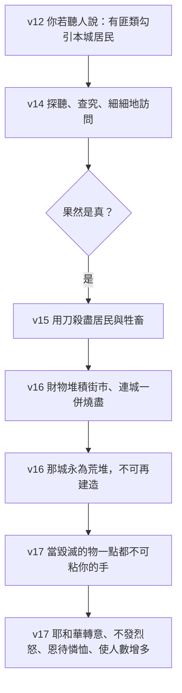

# 申命記 第13章

<!-- chapter-navigation:start -->
| [前一章](../05%20申命記/第12章.md) | [回目錄](../05%20申命記/全書目錄及綱要.md) | [下一章](../05%20申命記/第14章.md) |
| :--- | :---: | ---: |
<!-- chapter-navigation:end -->

1. 你們中間若有[[先知]]或是做夢的起來，向你顯個[[神蹟奇事不是真先知的憑證|神蹟奇事]]，
2. 對你說：我們去隨從你素來所不認識的別神，[[事奉與作奴僕同一字根（a.vad）|事奉他]]吧。他所顯的[[神蹟奇事不是真先知的憑證|神蹟奇事]]雖有應驗，
3. 你也不可聽那[[先知]]或是那做夢之人的話；因為這是耶和華─你們的神[[神的試驗|試驗你們]]，要知道你們是[[你要盡心盡性盡力愛耶和華（a.hav）|盡心盡性愛耶和華]]─你們的神不是。
4. 你們要順從耶和華─你們的神，[[敬畏神|敬畏他]]，謹守他的誡命，聽從他的話，[[事奉與作奴僕同一字根（a.vad）|事奉他]]，[[專靠（da.veq）|專靠]]他。
5. 那[[先知]]或是那做夢的既用言語叛逆那領你們[[出埃及|出埃及地]]、救贖你脫離[[為奴之家]]的耶和華─你們的神，要勾引你離開耶和華─你神所吩咐你行的道，你便要將他治死。這樣，就[[把那惡從你們中間除掉（ba.ar）|把那惡從你們中間除掉]]。
6. 你的同胞弟兄，或是你的兒女，或是你懷中的妻，或是如同你性命的朋友，若暗中引誘你，說：我們不如去事奉你和你列祖素來所不認識的別神─
7. 是你四圍列國的神。無論是離你近，離你遠，從地這邊到地那邊的神，
8. 你不可依從他，也不可聽從他，眼不可顧惜他。你不可憐恤他，也不可遮庇他，
9. 總要殺他；[[石刑|你先下手]]，然後眾民也下手，將他治死。
10. 要[[石刑|用石頭打死他]]，因為他想要勾引你離開那領你[[出埃及|出埃及地]][[為奴之家]]的耶和華─你的神。
11. 以色列眾人都要聽見害怕，就不敢在你們中間再行這樣的惡了。
12. 在耶和華─你神所賜你居住的各城中，你若聽人說，有些[[匪類（be.liy.ya.al）|匪類]]從你們中間的一座城出來勾引本城的居民，說：我們不如去事奉你們素來所不認識的別神；
13. 併於上節。
14. 你就要[[探聽查究細細地訪問（da.rash、cha.qar、sha.al）|探聽，查究，細細地訪問]]，果然是真，準有這可憎惡的事行在你們中間，
15. 你必要用刀殺那城裡的居民，把城裡所有的，連牲畜，都用刀[[滅絕（herem）|殺盡]]。
16. 你從那城裡所奪的財物都要堆積在街市上，用火將城和其內所奪的財物都在耶和華─你神面前燒盡；那城就永為[[荒堆（tel）|荒堆]]，不可再建造。
17. 那[[滅絕（herem）|當毀滅的物]]連一點都不可粘你的手。你要聽從耶和華─你神的話，遵守我今日所吩咐你的一切誡命，行耶和華─你神[[各人行自己眼中看為正的事|眼中看為正的事]]，耶和華就必轉意，不發烈怒，恩待你，憐恤你，照他向你列祖所起的誓使你人數增多。
18. 併於上節。

---

## 本章知識節點

### 主題
- [[神蹟奇事不是真先知的憑證]]
- [[先知]]
- [[為奴之家]]
- [[各人行自己眼中看為正的事]]

### 神學
- [[把那惡從你們中間除掉（ba.ar）]]
- [[滅絕（herem）]]
- [[神蹟（miraculous signs）]]
- [[神的試驗]]
- [[試探的本質]]
- [[敬畏神]]
- [[專一敬拜]]
- [[亞伯拉罕之約]]

### 原文
- [[匪類（be.liy.ya.al）]]
- [[探聽查究細細地訪問（da.rash、cha.qar、sha.al）]]
- [[荒堆（tel）]]
- [[專靠（da.veq）]]
- [[事奉與作奴僕同一字根（a.vad）]]
- [[你要盡心盡性盡力愛耶和華（a.hav）]]
- [[求問與訪問同一個字（da.rash）]]

### 歷史
- [[出埃及]]

### 背景
- [[石刑]]

### 解經爭議
- [[殺盡米甸人的道德難題]]

### 互文
- [[林前5：13|林前5：13 把那惡人從你們中間趕出去]]

---

## 本章整理

第12章說不可打聽迦南人怎樣事奉他們的神；這一章講以色列人中間若有人勸百姓去事奉別神，要怎麼辦。引誘的人有三種：行神蹟奇事的先知或做夢的（v1-5）、連同胞弟兄、兒女、懷中的妻也包括在內的最親的人（v6-11），以及使整座城背道的匪類（v12-18）。前兩種要治死，第三種要先查證，確實了才把全城殺盡燒盡。

### 三種來源，同一個問題（全章結構）

第十三章只處理一件事：有人要拉你去事奉別神，你該怎麼辦。經文把這件事拆成三種來源，各給一段。

摩西在本章分三個類型訓戒將要發生的虛假宗教之誘惑：來自假先知的誘惑（1-5節）、來自家人與親戚的誘惑（6-11節）、來自群眾的誘惑（12-18節）（《聖經精讀本──申命記註解》、CT、KC）。

這一章直接接著上一章最後幾節而來（KC）。前章教訓境內只能有一個中央聖所，是為了防止亂設敬拜場所；本章則轉向另一個方向，警戒來自內部各種勢力的拜偶像誘惑（《精讀本》）。

| 段落 | 引誘來自誰 | 手法 | 處置 |
|---|---|---|---|
| v1-5 | 先知或做夢的 | 公開行神蹟奇事，而且應驗 | 不可聽，將他治死 |
| v6-11 | 同胞弟兄、兒女、懷中的妻、如同性命的朋友 | 暗中引誘 | 不可顧惜，你先下手用石頭打死 |
| v12-18 | 匪類，影響到整座城 | 勾引本城居民 | 先查證，然後全城殺盡燒盡 |

三段有一個共用的動詞。第5節「勾引你離開」與第12節「勾引本城的居民」是同一個字根 na.dach（H5080，to banish），前者是使役語幹的不定詞加第二人稱字尾，後者是使役語幹的連續式（STEP）。

兩處的「勾引…離開」字義都是趕離，趕出，第10節的『勾引你離開』按原文意指「趕逐你離開」（CT 的原文字義）。引誘者的身分一路變，動作卻始終是同一個——把人從耶和華那裡趕開。

### 神蹟應驗了也不算（v1-5）

第一段設的情境最難：那人行了神蹟奇事，而且第2節說「他所顯的神蹟奇事雖有應驗」。經文的回答是第3節——你也不可聽。

第1節「神蹟」是 'ot（H226G，字典的意思是「sign: miraculous」（神蹟））、「奇事」是 mo.Fet（H4159，mo.phet，字典的意思是「wonder」（奇事））；「做夢的」在原文是兩個字，cho.Lem cha.Lom（H2492B ＋ H2472）（STEP）。CT 的原文字義也註「做夢的(原文雙字)」做夢(首字)；夢(次字)。

兩個詞各有分工：「神蹟」為指示將來的預兆，「奇事」是證明先知或作夢的確有能力的異事，不過二詞常用作同義詞（《啟導本聖經申命記註釋》；見 [[神蹟（miraculous signs）]]、[[先知]]）。

判準因此不在能力上。「真先知的憑證不是有無行神蹟的能力（十七1），而是他的信息和工作是否符合神所啟示的客觀標準，是否合乎基本信仰。」（《啟導本》）

還有一句更難接受的：「為了試驗神的子民，神也容許假先知的預言應驗」（《申命記雷氏研讀本》）。

KC 的結論相同：「It is not the sign or the wonder that is decisive, but the Word of God.」（起決定作用的是神的話，神蹟或奇事都不是關鍵。）（見 [[神蹟奇事不是真先知的憑證]]）

> [!note]
> 第3節的界線要劃得小心：這話並非告訴我們神主動利用假先知行神蹟奇事，因為邪靈也會行超自然的事；神乃是容許假先知行騙，以顯明人的存心（CT）。
>
> 神的試驗與撒但的試探不同，撒但的試探是在人心裡勾起犯罪的衝動，神的試驗則是熬煉百姓的教育過程（《精讀本》；見 [[神的試驗]]、[[試探的本質]]）。

第3節說這是要知道「你們是盡心盡性愛耶和華─你們的神不是」。

「愛」是 a.hav（H157G，to love）的複數分詞，後面接 le.vav（H3824 心）與 ne.phesh（H5315G 魂），兩個詞各帶第二人稱複數字尾（STEP）。

『盡心盡性』原文是「全心全魂」（CT）。這句話比申6:5 少了「盡力」一項，其餘完全相同（見 [[你要盡心盡性盡力愛耶和華（a.hav）]]）。

第4節接著給出正面的清單，共六件事（CT）。

六個動詞的前三個是 ha.lakh（H1980I，字典的意思是「to go: walk」（行走））順從、ya.re（H3372H，字典的意思是「to fear: revere」（敬畏））敬畏、sha.mar（H8104G，字典的意思是「to keep: obey」（遵守））謹守（STEP）。

後三個是 sha.ma（H8085H，字典的意思是「to hear: obey」（聽從））聽從、a.vad（H5647H，to serve）事奉、da.vaq（H1692，to cleave）專靠（STEP）。

最後一個的意思是牢牢地聯結、緊緊依附著祂（CT；見 [[敬畏神]]、[[事奉與作奴僕同一字根（a.vad）]]、[[專靠（da.veq）]]）。

### 最親的人也不例外（v6-11）

第二段換成暗中的引誘。

第6節列的四種人一個比一個近：同胞弟兄、兒女、懷中的妻、如同你性命的朋友。

第一個其實寫得更具體——ach（H251G，弟兄）加 ben（H1121A，兒子）加 em（H517，母親），直譯是你的弟兄、你母親的兒子；「暗中」是 se.ter（H5643A，secrecy，前面帶介系詞），「引誘」是 sut（H5496，to incite）（STEP）。

「暗中」的字義是遮蓋，秘密；「引誘」是煽動，唆使（CT 的原文字義）。「如同你性命的朋友」，是一種親近到彷彿一個靈魂用兩個身體說話的關係（KC）。

第8節一口氣下了五道禁令，各有對應的英文：『依從』指同意（consent）、『聽從』指聽信（hearken）、『顧惜』指看為可憐（pity）、『憐恤』指寬容（spare）、『遮庇』指掩蓋（conceal）（CT）。

原文的五個動詞也是分開的：to.Veh（H14）、tish.Ma'（H8085G）、ta.Chos（H2347，chus，字典的意思是「to pity」（憐惜））、tach.Mol（H2550，cha.mal，字典的意思是「to spare」（顧惜））、te.kha.Seh（H3680，ka.sah，字典的意思是「to cover」（遮蓋））（STEP）。

其中「也不可聽從他」這一項，也可能包含另一件事：引誘者會要求你即使不從也別聲張，這樣祕密就守住了，他可以繼續去害別人（KC）。

第9節的程序寫得很細：你先下手，然後眾民也下手。原文這裡用了兩個對稱的詞——你的手（yad，H3027H）配 ri.shon（H7223G，first），眾民的手（yad 與 am，H3027H、H5971A）配 a.cha.ron（H314，last）（STEP）。

以色列的審判制度至少要有兩個以上的證人才能判其有罪，判死刑時規定證人先舉石打罪人，之後周圍的眾人一起拿石頭打死他（《精讀本》）。

為什麼要這樣安排？第一個見證人必須第一個丟石頭，他不能控告了人卻把執行交給別人（KC）；這份牽連會讓人不敢輕率地指控別人，是防止誣告的保護機制（KC、BH；見 [[石刑]]）。

第11節說出這一切要達到的效果：以色列眾人都要聽見害怕，就不敢在你們中間再行這樣的惡了。這表示刑罰要公開執行，以警效尤（《申命記串珠聖經註釋》）。

### 一整座城背道時（v12-18）

第三段的規模最大。

第12節說有些匪類從你們中間的一座城出來勾引本城的居民。『匪類』原文是「比列的子孫」，意指魔鬼的兒女（CT、KC）。

這個字意指沒有價值、卑賤之子，希伯來文讀音是彼列，原意可能是吞吃，新約用它來形容撒但（《串珠》；見 [[匪類（be.liy.ya.al）]]）。

但經文沒有立刻動手。

第14節先插進三個動詞：探聽、查究、細細地訪問。它們是三個不同的字——da.rash（H1875，to seek）、cha.qar（H2713，to search）、sha.al（H7592，to ask），三個動詞前面都帶連接詞；後面再接一個作副詞用的 ya.tav（H3190，be good）的不定詞絕對式（STEP）。

「三次重複使用意義相近的動詞是為了強調,與偶像崇拜罪的嚴重性及其處罰的重要性,決不聽信風聞,必充分、慎重且公正,徹底地調查、處置。」（《精讀本》）

「神不接受傳聞，但人都不注意的常把傳聞當真實。」（CT 的話中之光）

神自己也是這樣做的，所多瑪與蛾摩拉那一次就是先例（KC，參創18:21；見 [[探聽查究細細地訪問（da.rash、cha.qar、sha.al）]]、[[求問與訪問同一個字（da.rash）]]）。

處置的用語是 herem。第15節「殺盡」是 cha.ram（H2763A，to devote/destroy，不定詞絕對式），第17節「當毀滅的物」是 che.rem（H2764A，devoted thing，帶定冠詞）——動詞與名詞正好一對（STEP）。

整座城都該被摧毀，如同迦南地的城邑一樣（《串珠》；見 [[滅絕（herem）]]、[[殺盡米甸人的道德難題]]）。

第16節的收尾是永久性的：那城就永為荒堆，不可再建造。「荒堆」原文是 tel（H8510），字典的意思是「mound」（土堆）（STEP）。

這個詞在考古上很有份量，許多被毀的古城後來成了土丘（BH；見 [[荒堆（tel）]]）。

> [!important]
> 第4節命令百姓「專靠他」，第17節命令當毀滅的物「連一點都不可粘你的手」。這兩個動詞是同一個字根：第4節與第17節都是 da.vaq（H1692，to cleave），前者是第二人稱複數、後者是第三人稱單數的未完成式（STEP）。
>
> 兩處的中文字義也完全相同——「專靠」附著，黏住，緊靠；「粘」附著，黏住，緊靠（CT 的原文字義）。全章因此有一個原文上的收束：該黏的黏住，不該黏的一點都不可沾。

### 除掉那惡，然後神轉意

貫穿全章的是一句公式。

第5節說「這樣，就把那惡從你們中間除掉」，「除掉」是 ba.ar（H1197I，字典的意思是「to burn: purge」（燒除），前面帶連接詞）（STEP）。

「除掉(原文雙同字)」的字義是消耗，燒盡；原文意指用火燒除，含有除惡務盡的意思（CT）。為的是消除作惡的和那罪惡本身（《啟導本》，參十七7；十九19；二十一21；二十四7及士二十13）。

這道命令在申命記共出現九次；新約的對應是給哥林多教會的「Remove the wicked man from among yourselves」（把那惡人從你們中間趕出去）（KC；見 [[把那惡從你們中間除掉（ba.ar）]]、[[林前5：13]]）。

恨惡罪惡與愛惜罪人是兩件事：不可與惡有交通，但對被過犯所勝的人仍要用溫柔的心把他挽回，並且自己也要小心免得被引誘（KC）。

最後一節的方向是反過來的。

第17節說當毀滅的物一點都不可粘手，接著是「耶和華就必轉意，不發烈怒，恩待你，憐恤你，照他向你列祖所起的誓使你人數增多」。

「恩待」是 na.tan（H5414G，給）加 ra.cha.mim（H7356B，compassion），「憐恤」是 ra.cham（H7355，to have compassion）（STEP）。

「使你人數增多」是 ra.vah（H7235A，to multiply）的使役語幹（STEP）。CT 的原文字義給的是「恩待(原文雙字)」憐憫，子宮(首字)；給，置，放(次字)，正好對得上 STEP 的兩個字（見 [[亞伯拉罕之約]]）。

> [!question]
> 全章從頭到尾在講除掉，最後一句卻在講增多。
>
> 滅一座城必然損失人口，而這個順服的舉動卻連著神必使他們再增多的應許（KC）。
>
> 這也接回神向亞伯拉罕起誓的後裔繁多（BH，參創12:2、15:5）。本章沒有解釋這兩件事怎麼並存，只是把它們寫在同一節裡。

這一章與上一章也有一條線。

申12:8 說「各人行自己眼中看為正的事」是不可以的，申12:25、28 兩次要人行「耶和華眼中看為正的事」；本章第17節的收尾用的正是同一句——行耶和華你神眼中看為正的事（見 [[各人行自己眼中看為正的事]]、[[專一敬拜]]、[[為奴之家]]、[[出埃及]]）。

兩章都以這個判準作結，只是申12 收的是敬拜的地點與飲食，申13 收的是面對引誘時的取捨。

**參考資料**
代號：CT＝ccbiblestudy《逐節註解》；GT＝ccbiblestudy《拾穗》，彙集多本中文註釋；正文直接寫書名或作者的（如《丁道爾》、丁良才），都出自這裡；KC＝KingComments；BH＝BibleHub Study；STEP＝STEP Bible 原文資料（CC BY 4.0）
https://www.ccbiblestudy.org/Old%20Testament/05Deut/05CT13.htm
https://www.ccbiblestudy.org/Old%20Testament/05Deut/05GT13.htm
https://www.kingcomments.com/en/bible-studies/Deu/13
https://biblehub.com/study/deuteronomy/13.htm
https://github.com/STEPBible/STEPBible-Data

<!-- appendix-links:start -->
## 附錄

### 相關地圖
- [[appendix/fhl_maps/maps/025|〈申圖一〉應許之地全圖]]
<!-- appendix-links:end -->

<!-- chapter-navigation:start -->
| [前一章](../05%20申命記/第12章.md) | [回目錄](../05%20申命記/全書目錄及綱要.md) | [下一章](../05%20申命記/第14章.md) |
| :--- | :---: | ---: |
<!-- chapter-navigation:end -->
